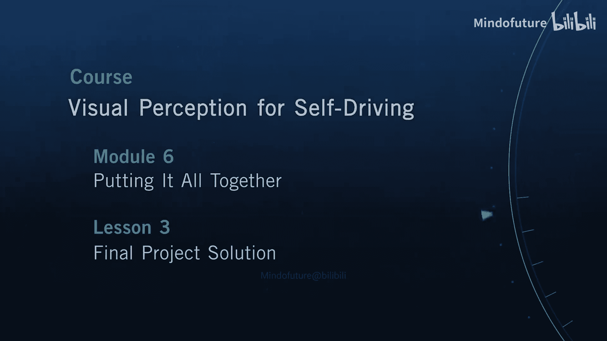
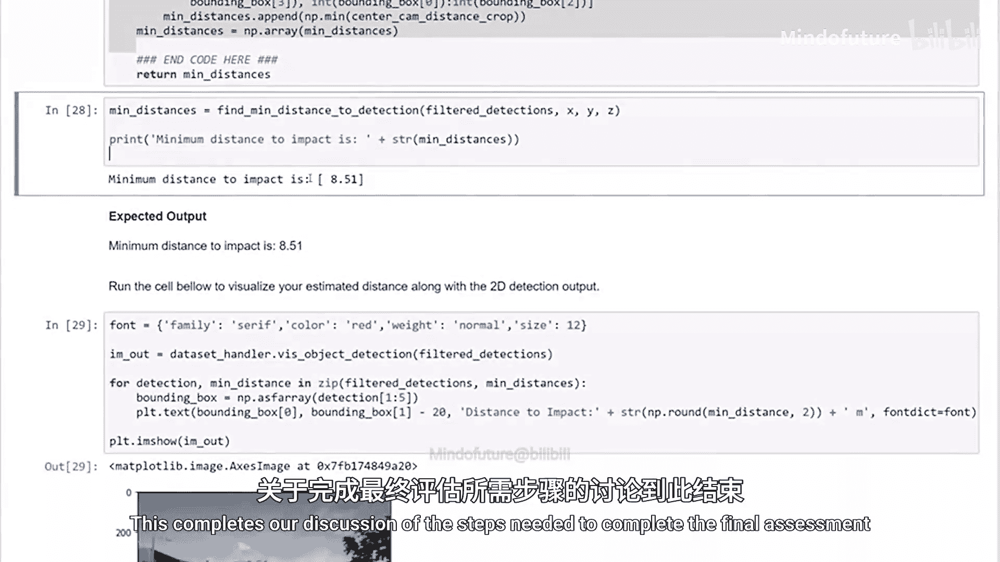
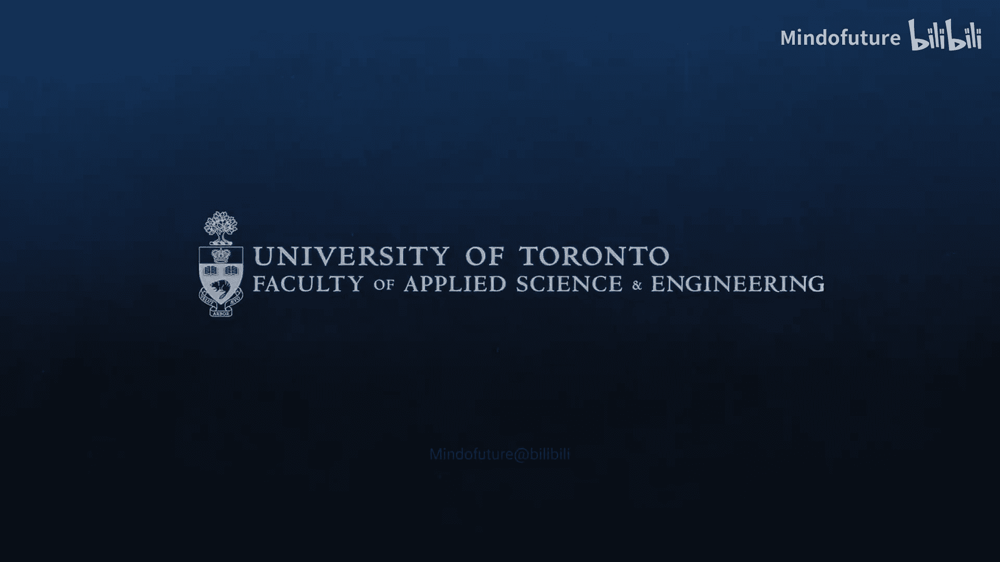

# 032：最终项目解决方案

在本节课中，我们将学习如何完成最终评估项目，实现一个基础的环境感知栈。我们将逐步讲解完成所有评分函数所需的解决方案。

## 概述

最终项目要求我们实现一个完整的环境感知栈，核心任务包括：地面平面估计、车道边界估计以及障碍物距离计算。我们将逐一解析每个任务的实现步骤。

---

## 地面平面估计 🛣️

上一节我们介绍了项目的整体目标，本节中我们来看看如何估计地面平面。要估计地面平面，首先需要计算场景中每个像素的X、Y和Z坐标。

### 从深度图计算XY坐标

我们首先实现 `XY_from_depth` 函数。该函数以深度图和数据集处理器提供的标定矩阵 **K** 作为输入，输出场景中每个像素的X、Y坐标。每个像素的Z坐标直接从深度图本身获取，因此函数无需计算此值。

以下是实现步骤：

1.  从标定矩阵 **K** 中提取焦距和相机中心参数。
2.  为图像中的每个像素创建一个U和V坐标网格。也可以直接遍历深度图中的每个像素，但使用数组结构可以简化存储和处理指令。
3.  利用NumPy的广播功能，根据Jupyter笔记本和视频中提供的公式，在UV网格上计算并返回场景中每个像素的X和Y坐标。

**核心公式**：
`X = (U - cx) * Z / fx`
`Y = (V - cy) * Z / fy`
其中，`(fx, fy)` 是焦距，`(cx, cy)` 是相机中心。

我们使用frame0中的几个测试点来验证函数，确认得到了每个点的正确结果。

### 使用RANSAC拟合平面

现在我们已经获得了场景中每个像素的XYZ坐标，接下来可以利用语义分割输出来获取属于道路的像素的XYZ坐标。这部分代码已提供。

之后，我们在评分函数 `ransac_plane_fit` 中实现RANSAC来估计平面参数。该函数以属于道路的像素的X、Y、Z点坐标作为输入。

以下是RANSAC算法的实现步骤：

1.  **设置终止条件**：我们将最大迭代次数设为100，最小内点数为45000，将一个点被视为内点的距离阈值设为0.1米。
2.  **开始主RANSAC循环**：
    *   首先，从输入的函数中随机选择15个点。
    *   使用提供的 `compute_plane` 函数，利用这15个点计算一个平面模型。
    *   然后，根据到平面的距离阈值获取内点数量，并检查该数量是否大于之前所有迭代中的内点数量，以更新最佳内点集。
    *   最后，检查最小内点数终止条件，如果内点数大于所需阈值，则终止循环。
3.  函数返回使用最佳内点集中所有点重新计算的平面模型。

测试我们的函数后，可以得出结论：我们得到的值非常接近预期结果。

---

## 车道边界估计 🚧

现在地面平面已经估计完成，我们继续使用语义分割输出来进行车道边界估计。

### 估计车道线提案

如Jupyter笔记本所述，第一步是通过检测属于疑似车道边界的所有线条来确定车道边界提案。我们在 `estimate_lane_lines` 函数中实现此功能。

该函数以数据处理器提供的语义分割输出作为输入，并创建一个新的分割图像，其中包含属于车道边界的类别输出，例如车道标记、路缘石和人行道。

为了估计车道线提案，我们可以应用Canny边缘检测，然后进行霍夫变换直线估计。输出被重塑以保证一个 `n x 4` 的输出张量维度。

可视化输出的车道提案，我们可以看到边界提案中包含水平线。此外，有16个输出线提案。然而，查看图像，我们只能看到8条。这意味着存在需要合并的冗余线条。

### 合并与过滤车道线

合并和过滤需要在 `merge_lane_lines` 函数中实现。该函数以上一个函数估计的车道提案作为输入，根据其斜率过滤掉水平线，然后根据斜率和截距合并剩余的线条。

我们为斜率和截距定义了相似性阈值，以决定哪些线应该合并。此外，图像空间中的水平线往往具有零斜率，因此我们确定一个最小斜率阈值，低于此阈值的线被认为过于倾斜，不属于我们的车道边界。

以下是实现此函数的步骤：

1.  计算输入中所有线条的斜率和截距。
2.  根据最小斜率阈值过滤线条，以消除水平线。
3.  使用斜率和截距阈值对线条进行聚类。执行此聚类有多种方法，都会得到相同的解决方案。
    *   对于线条集合中的每条线，我们识别集合中所有落在斜率阈值内的其他线，然后检查截距是否也落在截距阈值内。
    *   任何满足这两个条件的线条都会被聚类并从集合中移除。
4.  最后，通过计算聚类的平均斜率和截距，合并聚类后的提案，得到每个聚类的一条线。

可视化我们函数的输出，可以看到每个车道边界都有一条与之关联的线估计。

### 扩展车道边界

最后，通过实现提供的函数 `extrapolate_lines` 并找到当前车道中心最近的两条线，将车道边界扩展到可行驶空间的范围内。结果就是当前车道的左右车道边界。

---

## 障碍物距离计算 🚗

完成此评估所需的最后一个组件是，使用目标检测算法的输出，计算与场景中每个对象的碰撞距离。

### 通过分割过滤检测结果

然而，提供此输出的特定算法并不十分精确。因此，在估计场景中障碍物的深度之前，需要使用语义分割的输出对目标检测的输出进行过滤。这是通过 `filter_detections_by_segmentation` 函数执行的。

该函数以初始检测结果和语义分割输出作为输入。然后，它遍历每个检测，并将分割输出裁剪到检测边界框内的像素。计算与检测输出类别相同的像素数量，然后通过边界框面积进行归一化。如果计算出的归一化计数小于阈值0.3，则最终过滤掉边界框。这意味着，如果边界框面积中预测类别像素所占比例小于三分之一，我们就消除该边界框。

可视化剩余的边界框，我们可以看到，经过过滤过程后，只剩下一个完全包含汽车的边界框。

### 计算最小碰撞距离

最后，我们需要编写一个名为 `find_min_distance_to_detection` 的函数，以获取与场景中每个对象的最小碰撞距离。该函数以过滤后的检测结果以及图像中所有像素的X、Y和Z坐标作为输入。

在其第一步中，计算到过滤后检测中每个像素的距离。然后，计算每个检测中的最小距离，由函数返回。

测试我们的函数表明，我们得到了正确的最小碰撞距离。

---

## 总结

本节课中，我们一起学习了完成最终评估所需的完整步骤。我们实现了地面平面估计、车道边界估计以及障碍物距离计算，共同构建了一个能够引导自动驾驶汽车在其环境中安全行驶的基础感知栈。这是立志成为自动驾驶汽车工程师的关键技能。

在结束之前，建议你花时间比较我们提出的解决这些任务的方法与你自己的设计。请告诉我们你是如何完成的。恭喜你，现在已经完成了我们自动驾驶汽车专项课程第三门课的最终评估。

请记住，在这个不断变化的领域中，总有更多知识需要学习。继续努力吧！😊