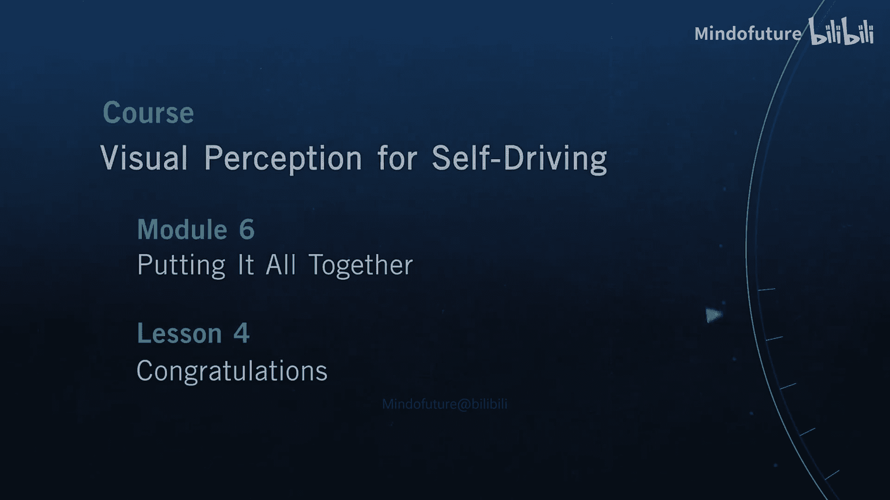
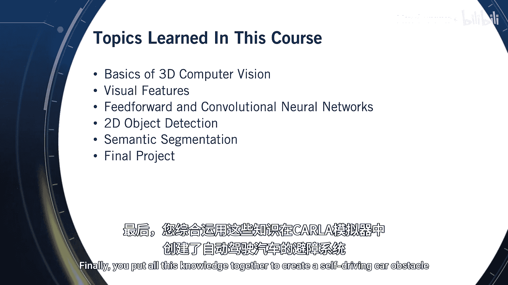

# 033：课程总结与展望

在本节课中，我们将回顾并总结整个《自动驾驶汽车的视觉感知》课程的核心内容，并对后续学习方向进行展望。

---

恭喜你完成了自动驾驶汽车视觉感知课程。你在本课程中学到的概念是任何自动驾驶汽车软件栈的基础部分。

让我们总结一下到目前为止所学的内容。

## 第一周：3D计算机视觉基础

在第一周，我们学习了3D计算机视觉的基础知识，以及如何使用**互相关**和**卷积**算子执行滤波操作。

*   **互相关/卷积操作**：这是图像处理的基础，公式可表示为 `(I * K)[x, y] = Σ_i Σ_j I[x+i, y+j] · K[i, j]`，其中 `I` 是输入图像，`K` 是卷积核。
*   **应用**：你运用这些基础操作创建了一个基础的障碍物避让软件。

## 第二周：特征检测与视觉里程计

在第二周，我们转向了如何从图像中提取有用信息。

上一节我们介绍了基础的图像处理，本节中我们来看看如何提取和利用图像特征。

你学习了如何通过特征检测与描述来提炼图像信息。随后，你学习了如何利用这些特征，通过视觉里程计来获取里程估计。

## 第三周：深度神经网络基础

由于经典视觉感知方法的局限性，我们在第三周重点学习了深度神经网络。

以下是深度神经网络的核心组成部分：
*   **基本构件**：你学习了深度神经网络的基本构建模块及其训练方法。
*   **卷积神经网络**：你了解了一种特殊类型的前馈神经网络——卷积神经网络。

## 第四周：基于CNN的2D目标检测

在课程的第四周，你探索了用于2D目标检测的卷积神经网络。

你学习了2D目标检测的问题定义、如何训练一个2D目标检测器，以及如何使用2D目标检测的输出结果来增强自动驾驶汽车的感知栈。

## 第五周：语义分割

你在本课程中学习的最后一个主题是语义分割。在第五周，你学习了如何定义语义分割问题。

以下是语义分割的关键内容：
*   **问题定义**：如何将图像中的每个像素分类到特定的语义类别。
*   **模型方法**：如何使用卷积神经网络，通过编码器-解码器模型来执行语义分割。
*   **实际应用**：如何使用语义分割的输出结果来执行可行驶区域估计和车道线分割。

最后，你将所有这些知识结合起来，在Carla模拟器中创建了一个自动驾驶汽车障碍物避让系统。

---

本课程介绍的概念是一个非常活跃的研究领域。我鼓励你通过阅读最新的论文和关注该领域的动态，更深入地探索这些引人入胜的主题。

为了帮助你开始，我提供了一份补充材料清单，这些材料将扩展你对自动驾驶汽车视觉感知这一丰富领域的理解。

在下一门课程中，我将介绍自动驾驶汽车软件栈的最后一组组件：运动规划。正如你将学到的，运动规划是一个复杂的、多尺度的问题，其中包含许多有趣的挑战等待你去探索。

所以，请加入我，继续你在掌握自动驾驶汽车技术道路上的下一段旅程。

---

本节课中我们一起学习了自动驾驶汽车视觉感知的完整知识体系，从基础的3D视觉和图像处理，到特征提取与里程计，再到深度神经网络、目标检测与语义分割，最终集成应用于模拟驾驶系统。这些内容是构建自动驾驶感知能力的核心。