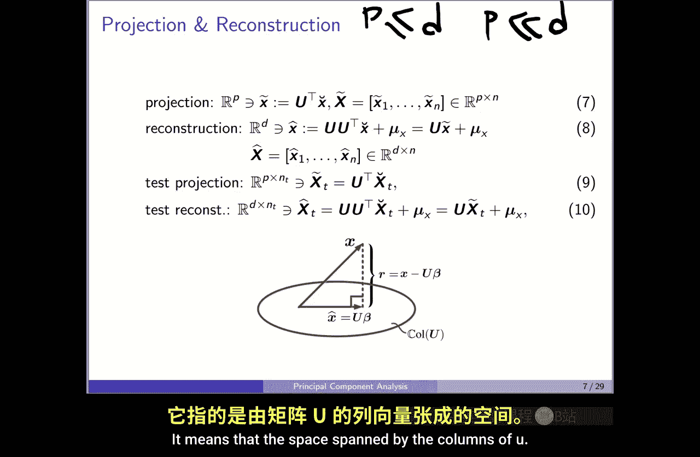

# 002：主成分分析 (PCA) 🧮

在本节课中，我们将要学习主成分分析。这是一种用于降维和特征提取的基础技术。我们将了解其目标、工作原理以及如何通过特征分解来实现它。

## 主成分分析的目标 🎯

主成分分析的目标是找到数据中方差最大的方向。数据点通常呈现为云状分布。

数据中存在多个方向，我们可以根据数据在这些方向上的方差大小进行排序。有些方向的方差比其他方向更大。

## PCA作为坐标旋转 🔄

如果使用所有主成分方向，例如在二维情况下使用P1和P2，那么PCA就相当于一个坐标旋转。换句话说，当使用所有能捕捉数据不同方差方向的主成分时，PCA仅仅是一种旋转。

## PCA用于降维 📉

然而，如果只使用几个最重要的主成分方向，例如仅使用P1，那么所有数据点都将被投影到P1上。这会产生一些重构误差。

因此，PCA可以用于降维或特征提取。

PCA最早于1901年被提出，并在后续的论文中得到改进。

## 从二维到三维的扩展 🔺

上一节我们介绍了二维数据的PCA。现在，我们来看一个三维数据的例子，例如具有三个坐标（基因1，基因2，基因3）的数据。我们应用PCA并只保留前两个最重要的方向，以达到降维或特征提取的目的。

PCA找到了数据分布所在的平面，因为它找到了数据方差最大的方向。数据的维度被降低到了二维。

我们可以将此概念扩展到更多维度，但难以直观可视化。

## 使用特征分解的PCA ⚙️

PCA可以通过特征分解或奇异值分解两种方法实现。首先，我们介绍如何使用特征分解进行PCA。

### 数据表示

首先，定义我们数据集中的内容。假设我们有一个包含n个数据点的训练数据集，每个数据点的维度为D。

我们用 **X_i** 表示这些点，其中 **i** 从1到n，每个点都是D维的。我们可以将它们按列排列成一个矩阵 **X**。

因此，矩阵 **X** 的维度是 **D × n**。在线性代数、流形学习和降维中，通常将向量视为列向量，并在矩阵中按列排列。

### 训练与测试数据

训练数据的均值用 **μ_x** 表示，它也是D维的，即数据点的平均值。我们假设还有一些测试数据点或样本外数据点，共有 **n_t** 个。

这些测试数据点也是D维的，我们用 **X_{t,i}** 表示（t代表测试），并将它们按列排列成矩阵 **X_t**，其维度为 **D × n_t**。

这些测试数据点不会用于寻找主成分方向或训练过程。

## 数据居中处理 📍

在PCA中，首先对数据进行居中处理非常重要。

为了理解为何需要居中数据，请考虑图A。当数据未居中时，应用PCA找到的两个主成分方向并不是好的方向，它们没有捕捉到数据方差最大的方向。

然而，当数据居中后（即数据的均值为零），可以正确找到主成分方向。

如果你使用现成的PCA函数（例如在scikit-learn中），它们通常会自行完成数据居中，你无需手动操作。但如果你自己编写代码，则必须对数据进行居中处理。

另外，值得注意的是，存在一些PCA的变体不进行数据居中，但它们不被称为PCA。

例如，在自然语言处理中使用的潜在语义索引或潜在语义分析。在这些情况下，它们应用PCA但不居中数据，这被称为LSI。原因在于自然语言处理中，负值没有解释或意义，数据通常是非负的。居中数据会产生负值。

### 如何进行数据居中

在PCA中，我们对数据进行居中处理。具体做法是从矩阵 **X** 的每一列中减去数据的均值，得到的结果记为 **\tilde{X}**，其维度仍为 **D × n**。

这个操作 **X - μ_x** 可以用一个很好的近似来表示：**XH**。这里的 **H** 是居中矩阵。

居中矩阵 **H** 定义为：**H = I - (1/n) * 1 * 1^T**。其中，**1** 是全1向量（列向量），**I** 是 **n × n** 的单位矩阵。这个矩阵可以用来对矩阵进行列居中。

*   如果计算 **XH**，它会对矩阵 **X** 的列进行居中。
*   如果计算 **HX**，它会对矩阵 **X** 的行进行居中。
*   如果计算 **HXH**，它会对矩阵进行双重居中，即先减去行均值，再减去列均值，然后加回总均值（因为减去行均值和列均值时，总均值被减去了两次，所以需要加回一次）。

我们也需要对测试数据进行居中处理，但使用的是训练数据的均值。因为在应用PCA时，我们不应该接触到测试数据。

处理后的测试数据记为 **\tilde{X}_t**，维度为 **D × n_t**。

## 投影与重构 🔄

在PCA中，我们有一个投影矩阵，用于将数据从输入空间（数据空间）投影到一个低维子空间。

假设子空间的维度为 **p**，输入空间的维度为 **D**。通常 **p ≤ D**，且通常 **p** 远小于 **D**。正如之前所说，PCA可以用于降维，这就是原因。当 **p = D** 时，它仅仅是坐标旋转。

可以看到，经过数据居中后，**U^T \tilde{x}** 就是将居中后的数据向量 **\tilde{x}** 投影到矩阵 **U** 的列空间上。

为什么说是投影到 **U** 的列空间？列空间是指由矩阵 **U** 的列向量张成的空间。

## 总结 📝

本节课中，我们一起学习了主成分分析。我们了解了PCA的目标是找到数据方差最大的方向，它既可以作为坐标旋转，也可以用于降维和特征提取。我们讨论了数据居中处理的重要性及其方法，并初步介绍了通过特征分解实现PCA的数学表示，包括训练与测试数据的处理以及投影与重构的概念。