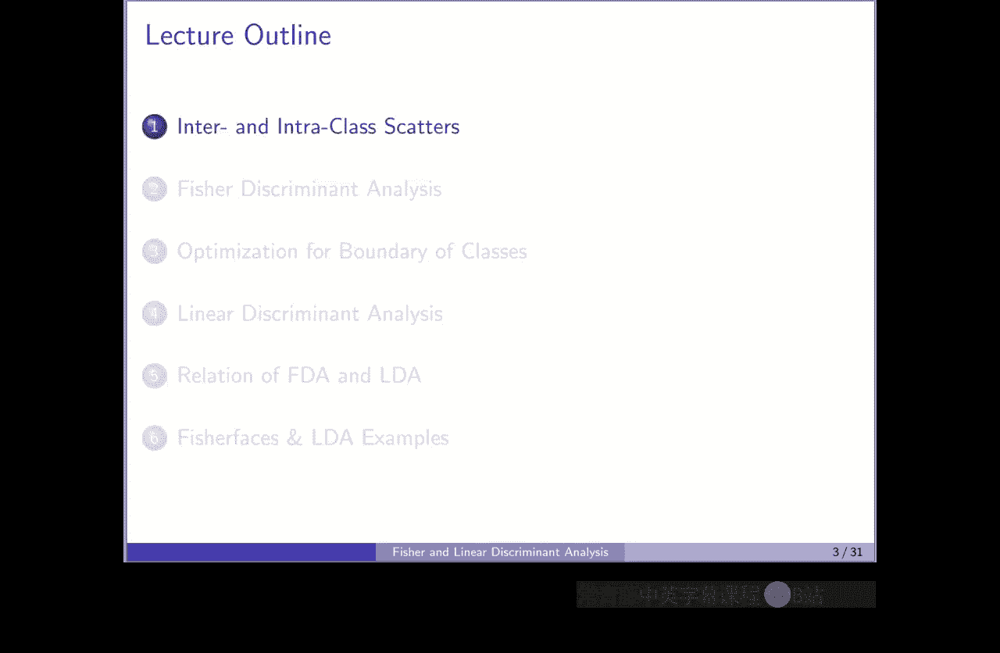
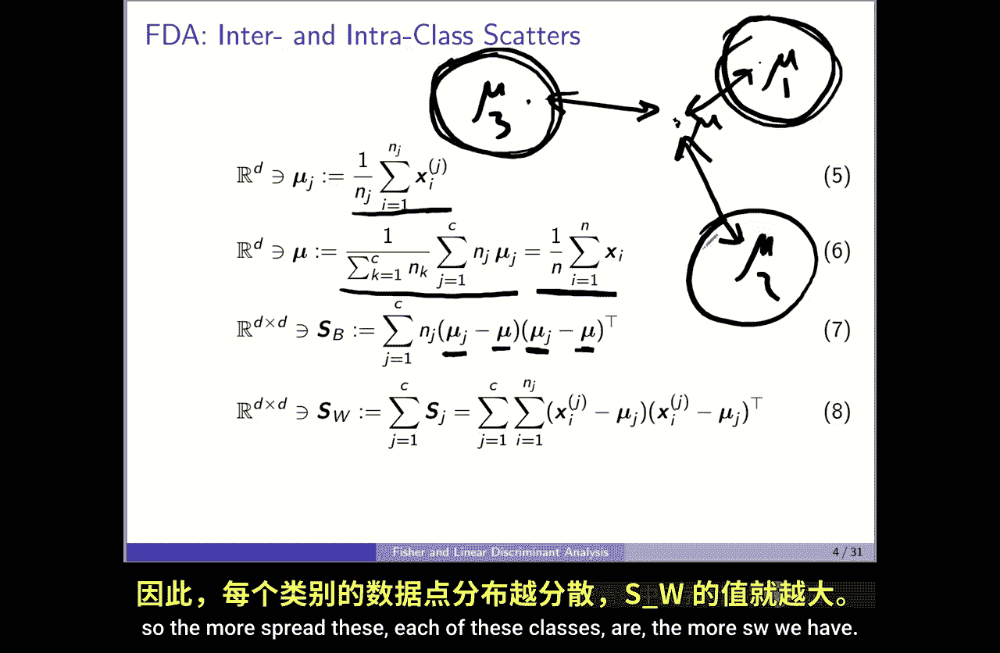
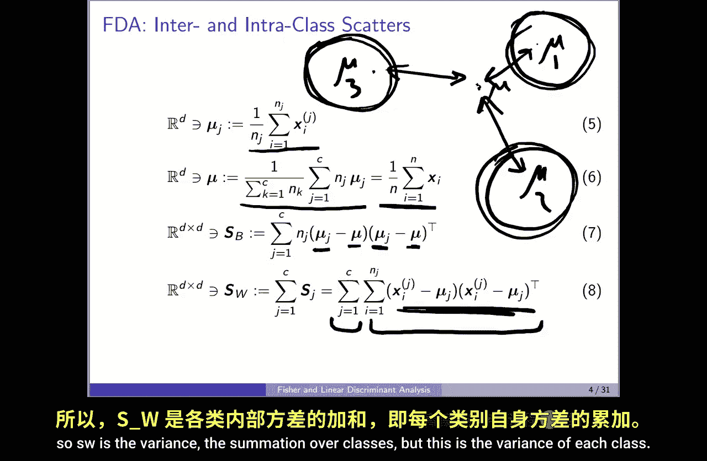
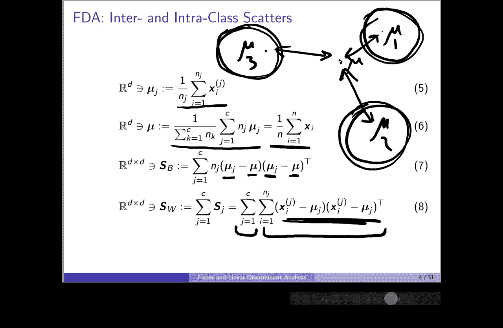
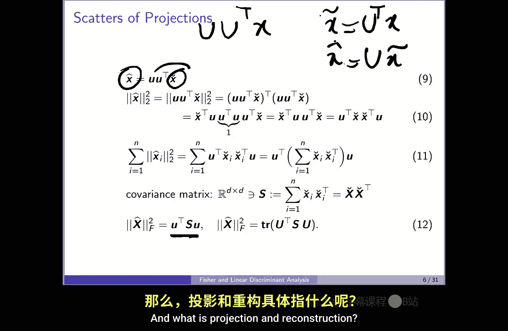
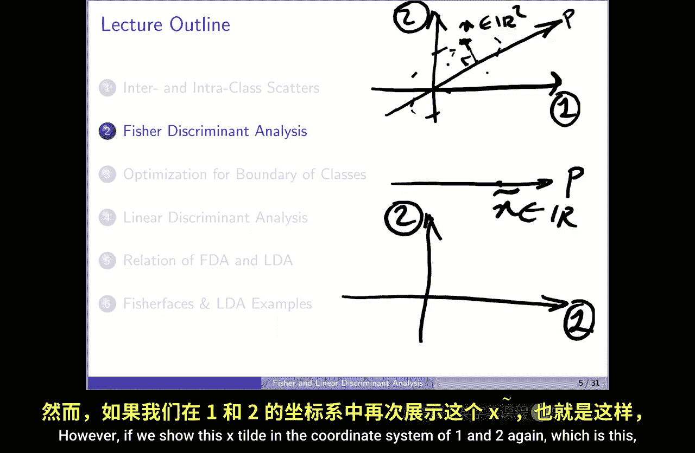
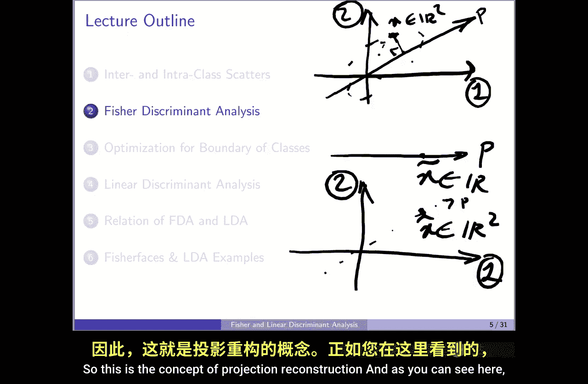
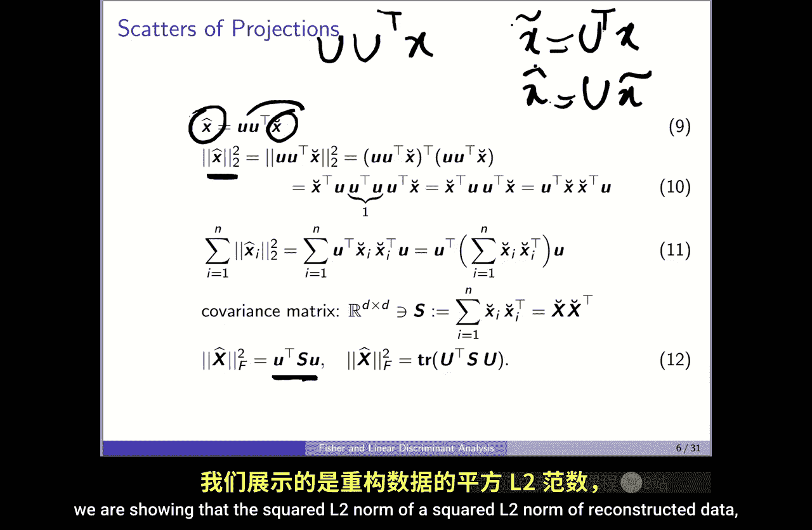
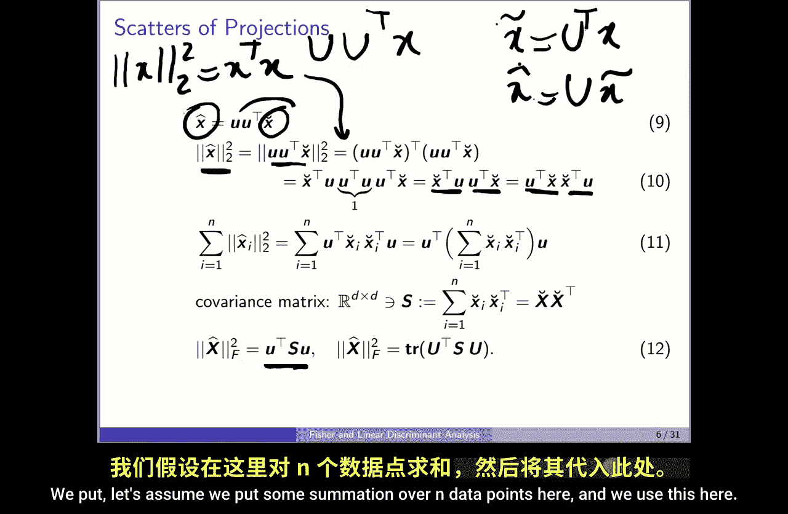

# 003：多伦多大学【中英⚡降维与流形学习｜2023,Dimensionality Reduction and Manifold Learning】 p03 P3 Fisher判别分析(FDA)与线性判别分析(LDA)

## 📚 课程概述
在本节课中，我们将学习两种经典的监督降维与分类方法：Fisher判别分析（FDA）与线性判别分析（LDA）。我们将解释它们的基本概念、数学原理以及两者之间的关系。

---

## 📊 数据与符号表示
首先，我们定义本课程中使用的数据集符号。假设我们有一个带标签的训练数据集。

*   **训练数据点**：每个数据点记为 **X_i**，它是一个 **d** 维向量（d 是数据维度）。我们总共有 **n** 个数据点，即 i 从 1 到 n。
*   **数据矩阵**：将所有列向量（数据点）并排放置，我们得到一个 **D x n** 的矩阵 **X**。
*   **类别标签**：这是一个监督学习问题，因此我们有类别标签。假设总共有 **C** 个类别，类别索引 **J** 从 1 到 C。
*   **第 J 类样本**：第 J 类中的第 i 个样本记为 **X_i^(J)**，它同样是 d 维向量。第 J 类中的样本总数为 **N_J**。
*   **总体均值**：所有训练数据的均值记为 **μ**（或 **μ_x**），它是所有数据点的平均值。
*   **测试数据集**：我们还有一个测试数据集（或样本外数据集），不用于训练投影矩阵。第 i 个测试点记为 **X_Ti**，假设有 **n_T** 个测试点。将它们按列排列，得到 **D x n_T** 的矩阵 **X_T**。

---

## 🎯 Fisher判别分析的核心：类间与类内散度
Fisher判别分析的核心思想围绕两个关键概念展开：**类间散度** 和 **类内散度**。散度是方差的一种表述方式。

*   **第 J 类均值**：记为 **μ_J**，是第 J 类所有数据点的平均值。
*   **总体均值**：记为 **μ**，是所有数据点的平均值，也等于各类均值的加权平均。

以下是两个核心散度矩阵的定义：

1.  **类间散度矩阵 (S_B)**：也称为类间方差。它衡量不同类别均值之间的分散程度。想象一下，**μ** 是总体中心点，**μ_1, μ_2, μ_3** 分别是三个类别的中心。**S_B** 计算的是这些类别中心点距离总体中心 **μ** 有多远。换句话说，它反映了**类别之间的分离程度**。类别中心离得越远，分离度越好。
    *   **公式**：`S_B = Σ_{J=1}^{C} N_J * (μ_J - μ) * (μ_J - μ)^T`

2.  **类内散度矩阵 (S_W)**：也称为类内方差。它衡量每个类别内部数据点的分散程度。想象每个类别的数据点形成一团“云”。**S_W** 计算的是这些“云”内部的紧密程度。每个类别的数据点越集中（方差越小），类内散度越小，分类效果通常越好。
    *   **公式**：`S_W = Σ_{J=1}^{C} Σ_{i=1}^{N_J} (X_i^(J) - μ_J) * (X_i^(J) - μ_J)^T`

上一节我们定义了数据集和核心的散度矩阵，本节中我们来看看FDA如何利用投影来实现降维。

---

## 🔍 投影与重构的概念
Fisher判别分析是一种线性方法，因为它使用线性投影。理解投影和重构至关重要。

*   **投影**：假设我们有一个投影矩阵 **U**（其列向量是投影方向）。数据点 **X** 的投影记为 **X̃**，计算公式为：`X̃ = U^T * X`。**U^T * X** 将数据 **X** 投影到 **U** 的列空间上（即由 **U** 的列向量张成的子空间）。
*   **重构**：将投影后的数据 **X̃** 映射回原始空间，得到重构数据 **X̂**，计算公式为：`X̂ = U * X̃ = U * U^T * X`。
*   **投影方向**：通常我们假设投影矩阵 **U** 是正交的，即其列向量是标准正交基。因此有 `U^T * U = I`（单位矩阵）。

**图示理解**：假设我们有一个二维数据点 **X**，和一个一维的投影方向向量 **P**。
1.  将 **X** 投影到 **P** 方向上，得到一维标量值 **X̃**（在 **P** 子空间中的坐标）。
2.  将这个一维坐标 **X̃** 乘以方向 **P**，映射回原始的二维坐标系，得到二维向量 **X̂**，即 **X** 在 **P** 方向上的“影子”。
3.  原始点 **X** 与重构点 **X̂** 之间的差距称为**重构误差**。

---

## 📐 从重构误差到散度矩阵
现在，我们将投影重构的概念与之前定义的散度矩阵联系起来。考虑中心化后的数据（尽管FDA本身不要求中心化，但在此处有助于解释）。

对于重构数据 **X̂**，其平方L2范数（一种度量大小的方式）可以通过以下推导得到：
`||X̂||^2 = (U * U^T * X)^T * (U * U^T * X) = X^T * U * U^T * U * U^T * X`

由于我们假设 **U** 是正交的（`U^T * U = I`），上式简化为：
`||X̂||^2 = X^T * U * U^T * X`

这个形式非常重要。当我们用投影后的数据来计算**类间散度**和**类内散度**时，它们会呈现出类似 `U^T * S * U` 的形式，其中 **S** 是原始空间中的散度矩阵（`S_B` 或 `S_W`）。这直接将投影变换与我们的优化目标联系了起来。

---

## 🧮 Fisher判别分析的目标函数
Fisher判别分析的核心目标是找到一个投影方向（或一组方向）**U**，使得投影后的数据满足：
*   **最大化类间散度**：不同类别在投影方向上尽可能分开。
*   **最小化类内散度**：同一类别在投影方向上尽可能聚集。

这自然地引出了著名的**Fisher准则**，即最大化类间散度与类内散度的比值：
`J(U) = (U^T * S_B * U) / (U^T * S_W * U)`

我们需要找到矩阵 **U**，使得这个比值 **J(U)** 最大化。这个优化问题的解可以通过求解广义特征值问题得到：
`S_B * u = λ * S_W * u`

其中，**u** 是广义特征向量，**λ** 是对应的广义特征值。我们选择对应最大特征值的特征向量作为最优的投影方向。

---

## 🔗 Fisher判别分析(FDA)与线性判别分析(LDA)的关系
线性判别分析（LDA）通常指用于分类的模型，而Fisher判别分析（FDA）更侧重于寻找最优的投影方向。然而，在历史和理论中，这两个术语常常交织在一起。

*   **本质联系**：**LDA的分类器推导基于FDA找到的投影空间**。在FDA找到的最佳投影子空间中，我们可以假设各类数据服从高斯分布，并在此基础上构建线性决策边界来进行分类。因此，FDA可以看作是LDA的“特征提取”或“降维”步骤。
*   **共同目标**：两者都旨在最大化类间可分性，同时最小化类内变化。
*   **历史背景**：Ronald A. Fisher爵士提出了方差分析（ANOVA）、著名的鸢尾花数据集以及Fisher判别分析。这些方法最初广泛应用于遗传学等领域。现代统计学和机器学习深深受其影响。

---

## 📝 课程总结
本节课我们一起学习了Fisher判别分析（FDA）与线性判别分析（LDA）的核心内容。

1.  **基础**：我们定义了监督学习场景下的数据表示方法，包括训练数据、类别标签和测试数据。
2.  **核心概念**：重点介绍了**类间散度矩阵 (S_B)** 和**类内散度矩阵 (S_W)**，它们分别度量类别之间的分离度和类别内部的紧密度。
3.  **数学工具**：解释了**线性投影**与**数据重构**的概念，这是理解线性降维方法的基础。
4.  **目标与求解**：FDA的目标是最大化类间与类内散度的比值 `J(U)`，这通过求解广义特征值问题 `S_B * u = λ * S_W * u` 来实现。
5.  **关系澄清**：明确了FDA通常作为寻找最佳判别方向的降维技术，而LDA在此基础上构建具体的分类器，两者目标一致，紧密相关。

通过掌握这些原理，你便理解了这两种经典方法如何通过寻找数据的最佳投影来提升后续分类任务的性能。