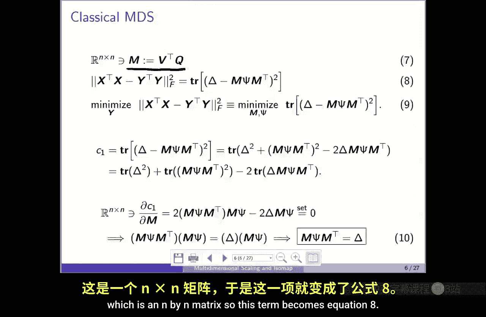

# 004：多维缩放（MDS）与等距映射（Isomap）（可选）

在本节课中，我们将学习两种重要的无监督降维方法：多维缩放（MDS）和等距映射（Isomap）。我们将从MDS的基本概念和数学原理开始，逐步理解其如何通过保持数据点之间的距离或相似性来寻找低维嵌入。

## 数据集与符号说明

首先，我们定义一些符号。我们有一个训练数据集，其中包含 `n` 个数据点，每个数据点是 `D` 维的。我们用 `x_i` 表示每一个数据点。

我们假设这些向量是列向量，并将它们按列排列成一个矩阵 `X`，其维度为 `D × n`。

我们的目标是找到这些训练数据点的低维嵌入，用 `y_i` 表示，它们是 `p` 维的。同样，我们将这些嵌入向量按列排列成矩阵 `Y`，其维度为 `p × n`。

通常，`p` 小于或等于 `D`，并且我们通常希望 `p` 远小于 `D`，因为我们希望找到一个子空间。

## 多维缩放（MDS）概述

多维缩放（MDS）至少有三种不同的类型：
1.  经典MDS（或称广义经典MDS）
2.  度量MDS
3.  非度量MDS

本节课我们将主要讲解经典MDS。

## 经典MDS的核心思想

经典MDS是一种无监督的降维方法。大多数无监督降维方法的目标是：在子空间中，相似的数据点彼此靠近，而不相似的数据点彼此远离。

这里“相似”与“不相似”通常通过数据点在原始高维空间中的距离（如欧氏距离）来衡量。MDS的目标是同时兼顾这两点。它希望数据点在嵌入空间中的距离尽可能接近它们在原始空间中的距离。

换句话说，MDS旨在最小化原始空间距离与嵌入空间距离之间的差异。这可以通过最小化一个基于Frobenius范数的目标函数来实现，该范数类似于矩阵的L2范数，是矩阵元素平方和的平方根。

我们也可以从相似性（内积）的角度来看待这个问题：MDS希望保持数据点之间的相似性关系。其目标是最小化原始空间内积矩阵与嵌入空间内积矩阵之间的Frobenius范数差异。

## 目标函数的推导与简化

我们的目标是最小化以下目标函数：
`||X^T X - Y^T Y||_F^2`

其中 `||·||_F` 表示Frobenius范数。根据矩阵迹的性质，矩阵A的Frobenius范数平方等于 `trace(A^T A)`。因此，我们的目标函数可以写为：
`trace((X^T X - Y^T Y)^T (X^T X - Y^T Y))`

进一步展开并简化，我们得到：
`trace((X^T X)^2) - 2 * trace(X^T X Y^T Y) + trace((Y^T Y)^2)`

接下来，我们对矩阵 `X^T X` 和 `Y^T Y` 进行特征值分解：
*   `X^T X = V Λ V^T`，其中 `V` 是特征向量矩阵，`Λ` 是对角特征值矩阵。
*   `Y^T Y = Q Ψ Q^T`，其中 `Q` 是特征向量矩阵，`Ψ` 是对角特征值矩阵。

将特征值分解代入目标函数，并利用特征向量矩阵的正交性（`V^T V = I`, `Q^T Q = I`）以及迹的循环性质进行化简。我们定义 `M = V^T Q`。

经过一系列代数运算，最终目标函数可以简化为一个关于特征值 `Λ`、`Ψ` 和矩阵 `M` 的表达式。求解这个优化问题，我们发现最优解出现在 `M` 为单位矩阵，并且 `Y^T Y` 的特征值 `Ψ` 取 `X^T X` 的前 `p` 个最大特征值对应的部分时。

因此，经典MDS的解是：嵌入矩阵 `Y` 的行由 `X^T X` 的前 `p` 个最大特征值对应的特征向量组成，每个特征向量需要乘以对应特征值的平方根进行缩放。即：
`Y = sqrt(Λ_p) * V_p^T`
其中 `Λ_p` 是前 `p` 个最大特征值构成的对角矩阵，`V_p` 是对应的特征向量矩阵。

## 等距映射（Isomap）简介

上一节我们详细介绍了经典MDS，它旨在全局保持点对之间的距离。然而，当数据存在于一个非线性流形上时，直接使用欧氏距离可能无法反映流形上的真实几何结构。

本节中，我们简要介绍等距映射（Isomap）。Isomap是MDS的一个扩展，其核心思想是使用**测地线距离**替代欧氏距离。测地线距离是流形上两点之间的最短路径距离。

Isomap的步骤如下：
1.  为每个数据点找到最近的k个邻居（构建邻接图）。
2.  在邻接图上，计算所有点对之间的最短路径距离（例如使用Dijkstra算法），这个距离矩阵近似表示了测地线距离。
3.  将经典MDS应用于这个测地线距离矩阵，从而得到低维嵌入。

这样，Isomap能够发现并保持数据在非线性流形上的内在几何结构。

## 总结

本节课我们一起学习了两种重要的降维技术。
*   我们首先深入探讨了**经典多维缩放（MDS）**，理解了其通过保持内积或距离来寻找低维表示的原理，并推导了其基于特征值分解的解析解。
*   随后，我们介绍了**等距映射（Isomap）**，它通过用测地线距离代替欧氏距离，解决了MDS处理非线性流形数据的局限性。

这两种方法为理解数据的内在维度和结构提供了强大的工具。