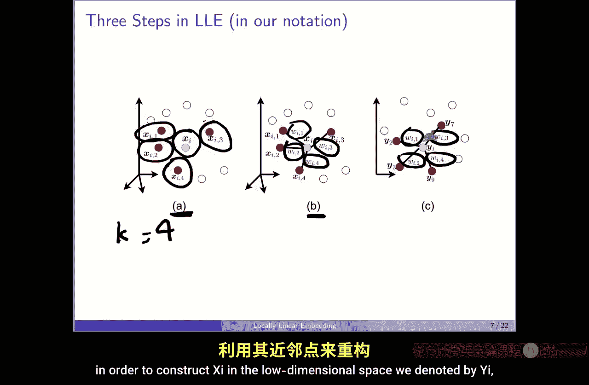

# 005：局部线性嵌入 (LLE) (选学)

在本节课中，我们将要学习一种名为**局部线性嵌入**的非线性降维方法。我们将了解它如何通过“分片”处理来展开复杂的数据流形，并保留数据点之间的局部几何关系。

## 概述

上一节我们介绍了处理非线性数据的两种思路：使用非线性方法或将数据变换到高维空间。本节中我们来看看一种直接的非线性方法——局部线性嵌入。LLE的核心思想是：一个复杂的全局非线性结构，可以由许多简单的局部线性结构拼接而成。它通过三个步骤实现降维，尤其擅长处理卷曲或缠绕的数据流形。

## 局部线性嵌入的原理

考虑以下示例（此示例源自Allioti教授），图A展示了一个非线性的流形。

其正确的展开结果如图B所示，其中点与点之间在流形上的距离得以保持。然而，如果对此非线性流形应用线性降维方法（如图C），则会破坏流形的结构。例如，图C中的绿色点和红色点可能会重叠，尽管它们在原始流形上相距甚远。这是因为线性方法不关心**测地线距离**（即流形表面上的距离）。

因此，对于非线性数据，最好使用非线性方法。LLE就是这样一种非线性方法，它无需先将数据变换到其他空间。

### 内在维度

理解LLE需要先理解**内在维度**的概念。一个流形的内在维度，是指一个在该流形上移动的微小观察者（比如一只蚂蚁）所感知到的维度。

*   对于图A中的曲线流形，一只蚂蚁在上面只能前后移动，最终会到达终点。因此，其内在维度是**1**（像一条线）。
*   对于一个圆环，蚂蚁可以绕圈移动并回到起点，因此其内在维度是**2**。
*   对于一个结（在弦理论或M理论中很有用），蚂蚁沿着它爬行最终也会回到起点，所以其内在维度也是**2**（类似于一个球面）。

LLE的目标就是将数据展开到其**内在维度**。

### 分片展开思想

LLE的想法类似于分段样条重构。它假设可以将一个非线性流形分割成许多小的线性片段，然后逐个展开这些片段，最后将它们拼接起来，从而将整个流形展开到低维空间。例如，一个非线性的二维流形（如曲线）可以被展开成一条一维的线。

## LLE算法步骤

LLE算法主要包含三个清晰的步骤，其过程如下图所示：

以下是每个步骤的详细说明：

### 步骤一：寻找近邻

对于数据集中的每一个数据点 **X_i**，算法会找到它的 **K** 个最近邻点。在图示中，K=8。这构建了每个点的局部邻域。

### 步骤二：计算重构权重

此步骤的目标是，用步骤一中找到的邻居点，通过**线性组合**来重构原始点 **X_i**。也就是说，要找到一组权重 **W_ij**，使得重构误差最小。

用公式表示，即最小化：
`X_i ≈ Σ_j (W_ij * X_j)`，其中 **X_j** 是 **X_i** 的邻居，且 `Σ_j W_ij = 1`。

这一步为每个点 **X_i** 都计算出了一组权重 **W_i**，这组权重编码了该点与其邻居之间的局部线性几何关系。

### 步骤三：低维嵌入

在最后一步，我们进入低维空间（目标维度 **d**）。我们保持第二步中计算出的权重 **W_ij** 不变，在低维空间中寻找一组新的点 **Y_i**。这组新点同样要满足用相同权重的线性组合关系，即最小化：
`Y_i ≈ Σ_j (W_ij * Y_j)`。

这样，高维数据中局部邻域的线性关系，就被**保持**到了低维嵌入中，从而实现了非线性流形的展开。

## 数学符号与表示

为了使描述更精确，我们定义以下符号：

*   **训练集**：我们有 **n** 个 **D** 维数据点，第 **i** 个点记为列向量 **x_i**。将所有点按列排列，得到数据矩阵 **X**，其维度为 **D × n**。
*   **邻居点**：点 **x_i** 的第 **j** 个邻居记为 **x_{i_j}**。将 **x_i** 的 **K** 个邻居按列排列，得到矩阵 **X_i**，维度为 **D × K**。
*   **测试集**：我们有 **n_t** 个测试样本（样本外数据），第 **i** 个测试点记为 **x_i^t**。所有测试点构成矩阵 **X^t**，维度为 **D × n_t**。测试点的邻居来自**训练集**。
*   **权重**：点 **x_i** 由其第 **j** 个邻居重构的权重记为 **w_{ij}**。

## 算法步骤的矩阵表示

我们再次用更形式化的方式描述LLE的三个步骤：

1.  **步骤1（找邻居）**：对每个点 **x_i**，找到其K个最近邻，得到邻居索引集合。
2.  **步骤2（算权重）**：对每个点 **x_i**，求解权重 **w_i = [w_{i1}, w_{i2}, ..., w_{iK}]^T**，使其最小化局部重构误差 `|| x_i - Σ_j w_{ij} x_{i_j} ||^2`，并满足约束 `Σ_j w_{ij} = 1`。
3.  **步骤3（求嵌入）**：在低维空间（维度 **d**）中寻找嵌入向量 **y_i**，通过最小化全局代价函数 `Φ(Y) = Σ_i || y_i - Σ_j w_{ij} y_j ||^2`，并通常施加中心化和单位协方差的约束 `Σ_i y_i = 0` 和 `(1/n) Σ_i y_i y_i^T = I`。

## 总结

本节课我们一起学习了**局部线性嵌入**这一非线性降维方法。我们了解到，LLE通过**保持局部线性重构关系**来展开复杂的非线性流形。其核心在于三个步骤：为每个点寻找局部邻居、计算该点由邻居线性重构的权重、最后在低维空间中保持这些权重关系来得到最终嵌入。这种方法特别适用于发现数据的内在低维结构，且计算过程相对直观。下一节，我们可能会探讨LLE的变种或其他相关的流形学习算法。