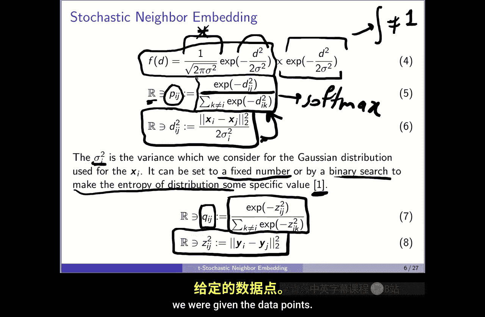

# 006：t-随机邻域嵌入 (t-SNE) 🧠

在本节课中，我们将学习一种强大的数据可视化技术——t-随机邻域嵌入（t-SNE）。我们将从它的前身SNE开始，理解其核心的“软邻域”概率思想，并最终解释t-SNE如何通过改进解决了SNE的关键问题。

## 概述 📋

t-SNE是一种非线性降维方法，特别适用于将高维数据可视化到二维或三维空间。它的核心思想是：在原始高维空间中，相似的数据点应该以高概率成为“邻居”，而不相似的点则以低概率成为“邻居”；降维的目标是在低维嵌入空间中，尽可能忠实地保持这种“邻居”概率关系。

## 数据集与符号表示

首先，我们明确一些符号表示。我们有一个训练数据集，包含 `n` 个数据点。每个数据点 `Xi` 是一个 `d` 维向量。我们通常将向量视为列向量，并将所有数据点按列排列成一个矩阵 `X`，其维度为 `d × n`。

我们的目标是找到每个数据点 `Xi` 的低维嵌入 `Yi`。假设嵌入空间的维度为 `h`，那么所有嵌入点按列排列成的矩阵 `Y` 的维度为 `h × n`。在t-SNE中，`h` 通常为2或3，以实现可视化。

## 从硬邻域到软邻域

在之前的邻域图方法中，一个点要么是另一个点的邻居，要么不是，这是一个“硬”决策。t-SNE的前身SNE（随机邻域嵌入）引入了“软”或概率化的邻域概念。

其核心思想是：每个数据点 `Xi` 都被赋予一个以自身为中心的高斯分布。对于其他任意点 `Xj`，它成为 `Xi` 邻居的概率，由该高斯分布在 `Xj` 处的概率密度决定。如果 `Xj` 离 `Xi` 很近，那么这个概率就高；如果很远，概率就很低。这样，每个点与其他所有点都存在一个非零的邻居概率，只是概率大小不同。

## SNE的核心机制

上一节我们介绍了软邻域的思想，本节中我们来看看SNE如何用数学公式实现它。

在原始高维空间（`d` 维）中，点 `Xj` 成为点 `Xi` 邻居的条件概率 `p_{j|i}` 定义如下：

**公式：**
```
p_{j|i} = exp(-||Xi - Xj||^2 / (2 * σ_i^2)) / Σ_{k≠i} exp(-||Xi - Xk||^2 / (2 * σ_i^2))
```

这个公式本质上是Softmax函数。分子衡量了 `Xj` 与 `Xi` 的接近程度（使用欧氏距离的平方），分母对所有其他点 `k`（不包括 `i` 自身）进行求和，以确保所有 `p_{j|i}` 之和为1，形成一个有效的概率分布。参数 `σ_i` 是围绕点 `Xi` 的高斯分布的方差。

**关于方差的设定：**
`σ_i` 不是固定的。通常通过二分搜索来确定，目标是使以 `Xi` 为中心的概率分布 `P_i` 的熵达到某个指定值。熵 `H(P_i)` 的计算公式为 `H(P_i) = -Σ_j p_{j|i} log(p_{j|i})`。通过控制熵，可以自适应地确定每个点邻域的“有效半径”。


类似地，在低维嵌入空间（`h` 维）中，我们定义点 `Yj` 成为点 `Yi` 邻居的条件概率 `q_{j|i}`：

**公式：**
```
q_{j|i} = exp(-||Yi - Yj||^2) / Σ_{k≠i} exp(-||Yi - Yk||^2)
```

注意，这里通常将方差设为 `1/√2` 并省略，因为嵌入空间 `Y` 的尺度是我们可以自由优化的。

## SNE的优化目标与问题

SNE的目标是让低维空间中的邻居概率分布 `Q` 尽可能匹配高维空间中的邻居概率分布 `P`。它通过最小化两个分布之间的KL散度（Kullback-Leibler Divergence）来实现。

**优化目标（代价函数）公式：**
```
C = Σ_i KL(P_i || Q_i) = Σ_i Σ_j p_{j|i} log( p_{j|i} / q_{j|i} )
```

KL散度衡量的是一个概率分布与另一个概率分布之间的差异。通过梯度下降法优化嵌入 `Y` 来最小化这个代价函数 `C`。

然而，SNE存在两个主要问题：
1.  **对称性问题**：条件概率 `p_{j|i}` 和 `p_{i|j}` 不相等，这可能导致梯度计算复杂且不直观。
2.  **拥挤问题**：在高维空间中，数据点可以有多个“远近”不同的邻居，但映射到低维（如2D）时，没有足够的空间让所有点都保持合适的距离。这导致相似的点在嵌入空间中可能挤在一起，难以区分。

## t-SNE的改进

为了解决SNE的问题，t-SNE做出了两项关键改进。

**第一项改进：使用联合概率分布**
t-SNE定义了对称的联合概率分布 `p_{ij}` 来代替非对称的条件概率 `p_{j|i}`：
```
p_{ij} = (p_{j|i} + p_{i|j}) / (2n)
```
这确保了 `p_{ij} = p_{ji}`，使得梯度计算更简单，代价函数对数据的局部和全局结构更敏感。

**第二项改进：在低维空间使用t分布**
这是t-SNE最核心的改进。在低维空间中，t-SNE使用自由度为1的**学生t分布**（即柯西分布）来定义联合概率 `q_{ij}`，而不是高斯分布：


**公式：**
```
q_{ij} = (1 + ||Yi - Yj||^2)^{-1} / Σ_{k≠l} (1 + ||Yk - Yl||^2)^{-1}
```

t分布比高斯分布有更重的尾部。这意味着：
*   对于**高维空间中相似的点**（`p_{ij}` 大），t分布要求它们在低维空间中距离**非常近**才能保持高的 `q_{ij}`。
*   对于**高维空间中不相似的点**（`p_{ij}` 小），t分布允许它们在低维空间中距离**较远**，同时仍能保持一个很小的 `q_{ij}`。


这个特性完美地缓解了“拥挤问题”。t分布的重尾为不相似的点提供了更大的“空间”去散开，从而为相似的点簇留出了更清晰的可视化区域。

t-SNE的最终代价函数是衡量两个联合概率分布 `P` 和 `Q` 的KL散度：
```
C = KL(P || Q) = Σ_i Σ_j p_{ij} log( p_{ij} / q_{ij} )
```

## 总结 🎯



本节课中我们一起学习了t-SNE的原理。我们从SNE的软邻域概率思想出发，理解了它如何用高斯分布定义邻居概率，并通过KL散度匹配高维与低维分布。接着，我们分析了SNE存在的对称性和拥挤问题。最后，我们详细探讨了t-SNE的两大核心改进：使用对称的联合概率 `p_{ij}` 以及在低维空间使用具有重尾特性的t分布来定义 `q_{ij}`。这些改进使得t-SNE能够产生效果卓越、簇间分离清晰的高维数据可视化图，成为探索性数据分析的利器。