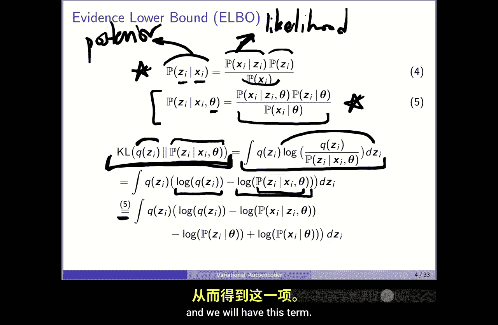
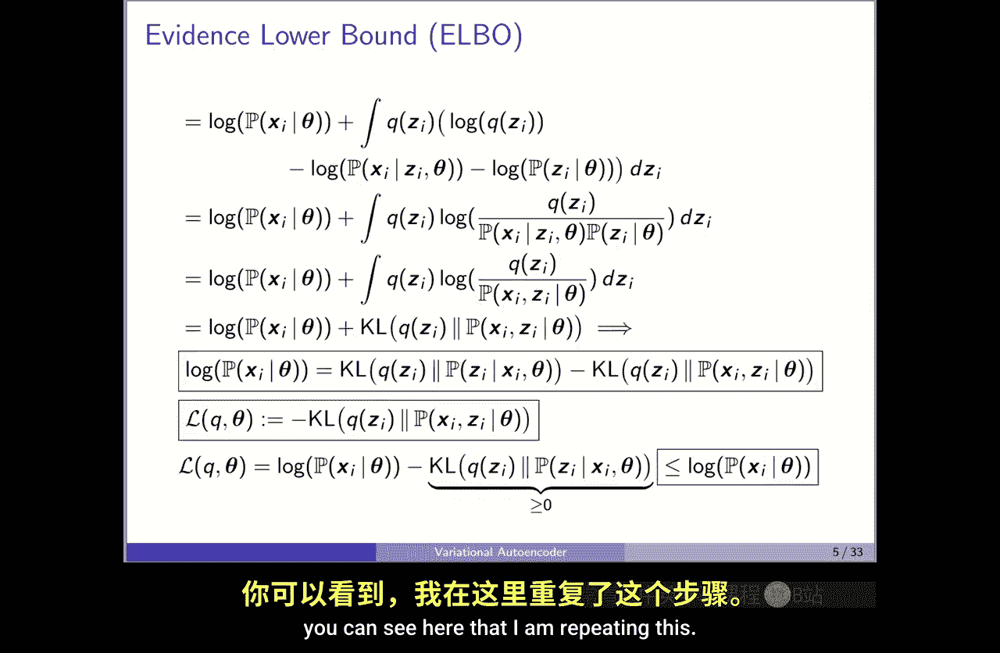
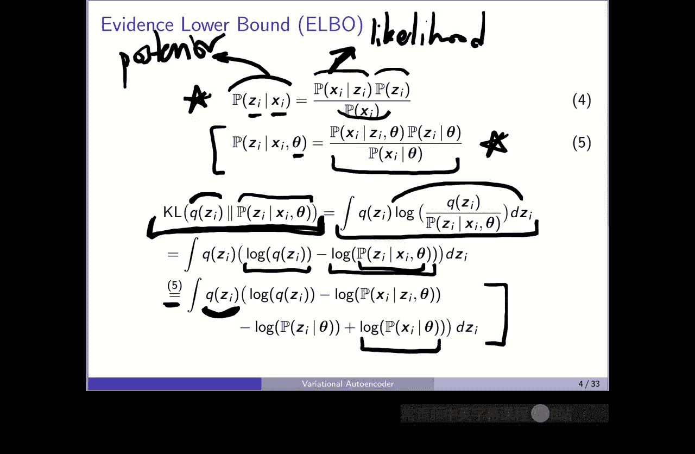
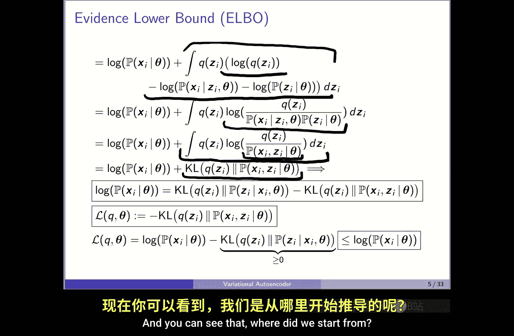
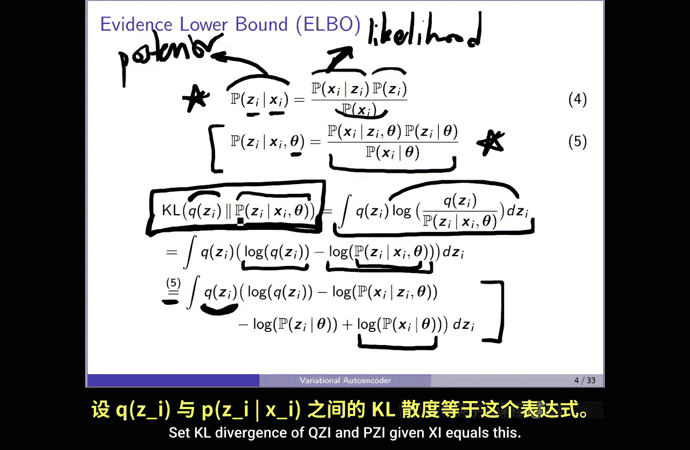
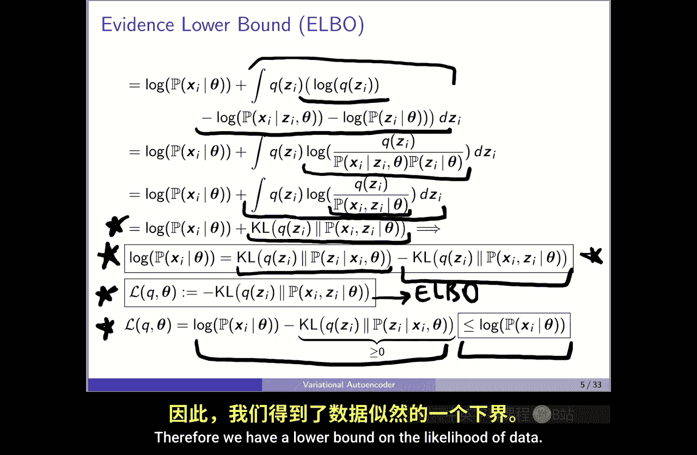
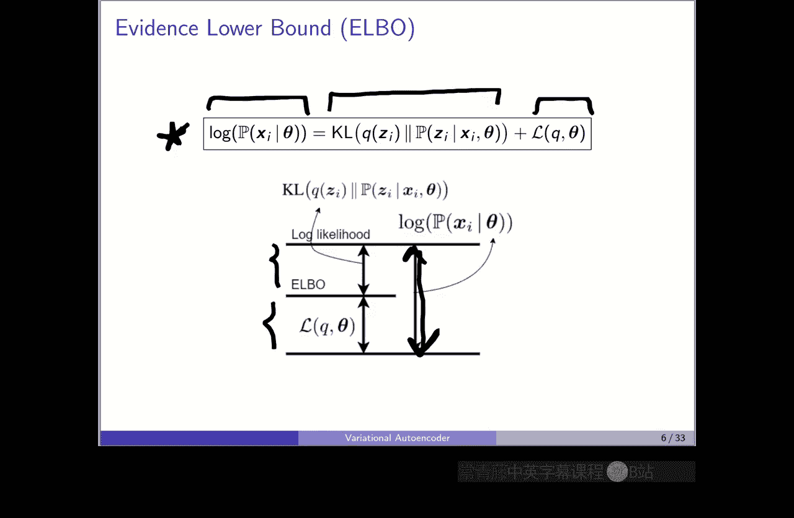

# 007：变分自编码器 (VAE) (选学) 🧠

在本节课中，我们将学习变分自编码器的核心概念。VAE是一种结合了深度学习和概率图模型的生成模型，它通过学习数据的潜在低维表示（隐变量）来生成新的数据样本。我们将从基础的概率模型和证据下界开始，逐步理解VAE的工作原理。

## 数据集与符号表示

首先，我们定义一些基本符号。假设我们有一个训练数据集，其中每个数据点用 **X_i** 表示。我们总共有 **n** 个数据点，每个数据点的维度是 **d**。这里的向量都是列向量。

如果我们按列将这些向量排列成一个矩阵，就会得到一个 **D × n** 的矩阵 **X**。

同时，我们假设这些训练数据存在嵌入表示，即潜在因子。我们假设每个数据点 **X_i** 都是由一个潜在因子或潜在变量 **Z_i** 生成的。这可以用一个概率图模型来表示。

这个潜在因子可以被视为一个低维变量。如果 **X** 是高维的，那么 **Z_i** 就可以看作是 **X_i** 的低维嵌入。我们假设 **Z_i** 是一个 **p** 维向量。如果我们有 **n** 个数据点，并将它们的潜在变量按列排列，就会得到一个 **P × n** 的矩阵 **Z**。

**X** 是 **D** 维的，**P** 通常小于或等于 **D**，并且在大多数情况下，**P** 远小于 **D**。

在变分推断和变分自编码器的框架中，我们假设的就是上面描述的概率图模型。不过，也存在其他概率方法，如因子分析和概率主成分分析，它们假设 **X_i** 是某个潜在变量加上一些噪声的和。但在变分自编码器中，我们暂时不引入噪声项。

## 证据下界

接下来，我们解释证据下界。考虑贝叶斯规则：

**P(Z_i | X_i) = [P(X_i | Z_i) * P(Z_i)] / P(X_i)**

如果我们有一个参数集 **θ** 用于定义给定 **Z_i** 时 **X_i** 的条件概率（这个参数也可以被视为随机变量），那么贝叶斯规则就变为：

**P(Z_i | X_i, θ) = [P(X_i | Z_i, θ) * P(Z_i | θ)] / P(X_i | θ)**

现在，我们考虑一个分布 **Q(Z_i)** 与后验分布 **P(Z_i | X_i, θ)** 之间的KL散度。

首先，**Q(Z_i)** 可以看作是 **Z_i** 的一个先验分布，而 **P(Z_i | X_i, θ)** 是其后验分布。KL散度是衡量两个分布差异的一种度量。当两个分布完全相同时，KL散度为0；差异越大，KL散度值越大。

KL散度的定义如下：

**D_KL[ Q(Z_i) || P(Z_i | X_i, θ) ] = ∫ Q(Z_i) * log[ Q(Z_i) / P(Z_i | X_i, θ) ] dZ_i**

如果我们对这个对数项进行简化，将对数除法转化为对数减法，并根据方程5（贝叶斯规则）替换 **P(Z_i | X_i, θ)**，我们可以得到：

**D_KL[ Q(Z_i) || P(Z_i | X_i, θ) ] = ∫ Q(Z_i) * log Q(Z_i) dZ_i - ∫ Q(Z_i) * log P(X_i, Z_i | θ) dZ_i + log P(X_i | θ)**

进一步简化，我们可以将前两项重新组合，并利用 **P(X_i, Z_i | θ) = P(X_i | Z_i, θ) P(Z_i | θ)** 的性质。最终，我们可以将KL散度表达为：

**D_KL[ Q(Z_i) || P(Z_i | X_i, θ) ] = log P(X_i | θ) - ∫ Q(Z_i) * log [ P(X_i, Z_i | θ) / Q(Z_i) ] dZ_i**

现在，我们定义证据下界：

**ELBO = ∫ Q(Z_i) * log [ P(X_i, Z_i | θ) / Q(Z_i) ] dZ_i**

将这个ELBO代入上面的KL散度公式，并进行整理，我们得到：

**log P(X_i | θ) = ELBO + D_KL[ Q(Z_i) || P(Z_i | X_i, θ) ]**

由于KL散度总是大于或等于0，因此ELBO总是小于或等于对数似然 **log P(X_i | θ)**。所以，ELBO是对数据似然的一个下界。在概率方法中，我们通常希望最大化数据的对数似然，而通过最大化ELBO，我们可以间接地最大化这个似然。

我们可以用下图来可视化这个关系：整个矩形代表数据的对数似然 **log P(X_i | θ)**，它被分解为ELBO（蓝色部分）和KL散度（橙色部分）之和。

## 总结

本节课我们一起学习了变分自编码器的基础。我们首先定义了数据及其潜在变量的表示方法，引入了概率图模型。然后，我们深入探讨了证据下界，它是VAE的核心。我们推导了ELBO与数据对数似然以及后验分布KL散度之间的关系，证明了最大化ELBO等价于在最大化数据似然的同时，让近似后验分布 **Q(Z_i)** 尽可能接近真实后验分布 **P(Z_i | X_i, θ)**。这为后续理解VAE如何通过神经网络参数化这些分布并进行训练奠定了理论基础。