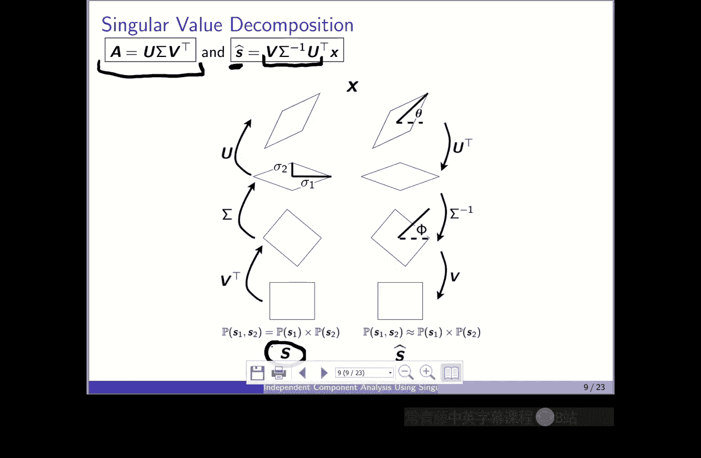

# 008：使用奇异值分解进行独立成分分析

在本节课中，我们将要学习独立成分分析，这是一种用于从混合信号中分离出独立源信号的技术。我们将重点介绍如何使用奇异值分解这一数学工具来实现ICA。

## 鸡尾酒会效应与盲源分离

上一节我们介绍了ICA的目标，本节中我们来看看一个经典的ICA应用场景。

鸡尾酒会效应描述了一个场景：在一个鸡尾酒会上，有多组人在同时交谈。周围有很多声音，很难分辨哪个声音来自哪一组人。为了简化，假设只有两组人在交谈。他们说话的音调或内容都不同，因此他们的声音不完全相关，但它们是混合在一起的。

我们有两个声源 **S1** 和 **S2**。假设我们用两个麦克风 **X1**  和 **X2** 在派对上录制这些声音。**X1** 和 **X2** 是测量值，记录了派对上的混合声音，而 **S1** 和 **S2** 是产生声音的源。ICA的目标是找到这些声音的独立成分，以便分离这些源，这被称为盲源分离。

## ICA的数学表示

现在，让我们进入ICA的数学表示。

我们有两个源 **S1** 和 **S2**，以及两个测量值 **X1** 和 **X2**。我们假设每个测量值都是源的线性组合。通常，自然界中会发生这种情况。因此，如果 **X1** 是 **S1** 和 **S2** 的线性组合，**X2** 也是 **S1** 和 **S2** 的线性组合。

我们可以用权重 **a11, a12, a21, a22** 来表示这种线性组合。如果我们处理的是图像数据而非声音数据，那么 **X1** 和 **X2** 是图像，我们需要将它们重塑为列向量。**S1** 和 **S2** 也是向量。它们可以是标量，但通常是向量。

我们可以将 **X1** 和 **X2** 连接成一个向量 **X**，同样将 **S1** 和 **S2** 放入向量 **S** 中。于是我们有了测量值向量 **X** 和源向量 **S**。

在矩阵形式中，这可以写成：
**X = A * S**
其中矩阵 **A** 被称为混合矩阵。

## ICA的基本假设

在这个方程中，我们唯一知道的是 **X**。因为我们有麦克风的测量值，但我们不知道混合矩阵 **A**，也不知道源 **S**。我们最终想知道的是源 **S**，这使得问题变得困难。

因此，ICA有一些基本假设：
*   首先，我们对测量值 **X1** 和 **X2** 进行中心化处理。这类似于PCA中的操作，目的是简化计算。
*   其次，我们假设源 **S1** 和 **S2** 的分布不是高斯的。通常，自然图像和数据都不是高斯的，所以这个假设是合理的。我们做出这个假设的一个原因是，如果源是高斯的，算法可能会混淆，无法确定正确的独立成分。
*   最后，我们假设源在统计上是独立的。这意味着它们的联合分布可以写成各自边缘分布的乘积。

## 使用奇异值分解进行ICA

回顾一下，我们有 **X = A * S**，其中 **A** 和 **S** 都未知，只有 **X** 已知。

现在，让我们对矩阵 **A** 应用奇异值分解。根据方程，**A** 可以分解为：
**A = U * Σ * V^T**
其中 **U** 是左奇异向量矩阵，**V** 是右奇异向量矩阵，**Σ** 是奇异值对角矩阵。

将 **A** 的SVD分解代入方程 **X = A * S**，我们得到：
**X = U * Σ * V^T * S**

我们想估计源 **S**。如果我们能近似得到 **A** 的逆，那么 **S** 的估计值 **Ŝ** 可以表示为：
**Ŝ = A^(-1) * X**

将 **A** 的SVD形式代入：
**Ŝ = (U * Σ * V^T)^(-1) * X**

根据矩阵逆的性质，多个矩阵乘积的逆等于各矩阵逆的逆序乘积：
**Ŝ = (V^T)^(-1) * Σ^(-1) * U^(-1) * X**

在奇异值分解中，**U** 和 **V** 是正交矩阵。根据正交矩阵的定义，**U^T = U^(-1)**，**V^T = V^(-1)**。因此，**(V^T)^(-1) = V**，**U^(-1) = U^T**。

代入上式，我们得到源信号的估计公式：
**Ŝ = V * Σ^(-1) * U^T * X**

然而，**V**、**Σ^(-1)** 和 **U^T** 同样是未知的，我们需要计算它们。这个公式的几何解释是：我们通过一系列旋转和缩放变换，试图从混合信号 **X** 中恢复出原始的独立源信号 **S**。

---

本节课中我们一起学习了独立成分分析的基本概念及其应用场景——鸡尾酒会效应。我们建立了ICA的数学模型 **X = A * S**，并明确了其中已知量与未知量的关系。接着，我们介绍了ICA的三个关键假设：数据中心化、源信号的非高斯性以及统计独立性。最后，我们重点推导了如何利用奇异值分解这一工具来求解ICA问题，得到了源信号的估计公式 **Ŝ = V * Σ^(-1) * U^T * X**，这为后续实际计算分离信号奠定了基础。