# Hinton@多伦多大学《机器学习的神经网络｜Neural Networks for Machine Learning 2016》claude-4s p01 -01-Lecture 1.1 — Why do we need machine learning  -Neural Networks for Machine -BV1HtkUB2EZD_p1-

Hello。Welcome to the Coursera course on neural Networks for Mach learning。

Before we get into the details of neural network learning algorithms。

 I want to talk a little bit about machine learning。Why we need machine learning？

The kinds of things we use it for。And show you some examples of what it can do。

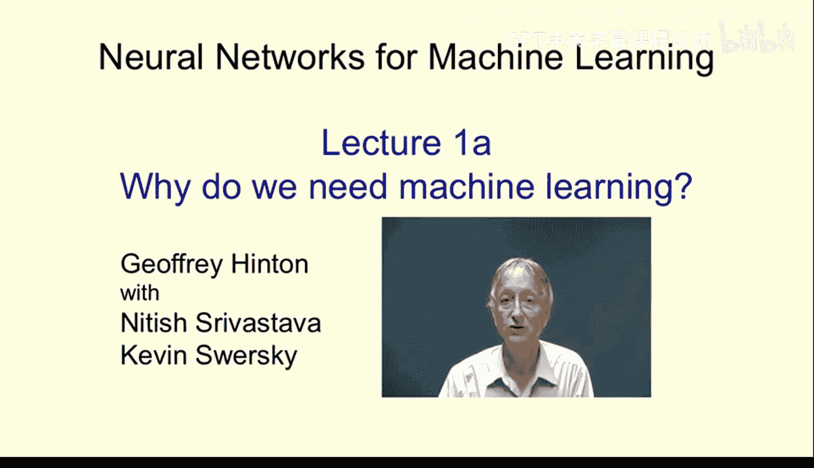

So the reason we need machine learning。Is that the some problems where it's very hard to write the programs。

Recogsizing a three dimensional object， for example。

 when it's from a novel viewpoint in new lighting conditions in a collecteded scene。

He's very hard to do。We don't know what program to write。

 because we don't know how it's done in our brain。And even if we did know what programme write。

 it might be that it was a horrendously complicated program。

Another example is detecting a fraudulent credit card transaction。Where there may not be any nice。

 simple rules that will tell you it's fraudulent。 You really need to combine a very large number of not very reliable rules。

And also， those rules change over time because people change the tricks they use for fraud。

So we need a complicated program that combines unreliable rules and that we can change easily。

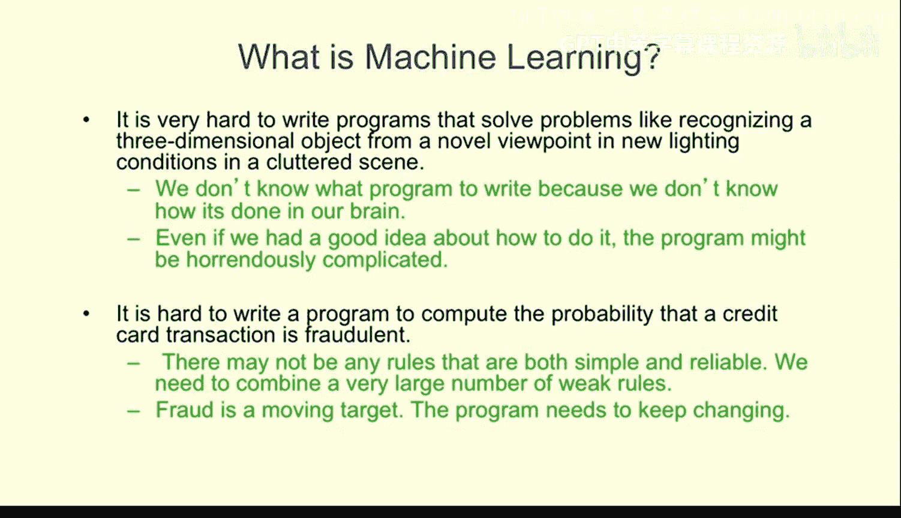

The machine learning approach is to say， instead of writing each program by hand for each specific task。

For a particular task， we've collect a lot of examples that specified the correct output for a given input。

A machine learning algorithm then takes these examples and produces a program that does the job。

The program produced by the learning algorithm may look very different from a typical handwritten program。

For example， it might contain millions of numbers about how you weight different kinds of evidence。

If we do it right， the program should work for new cases as well as the ones it's trained on。

And if the data changes， we should be able to change the programme relatively easily by retraining it on the new data。

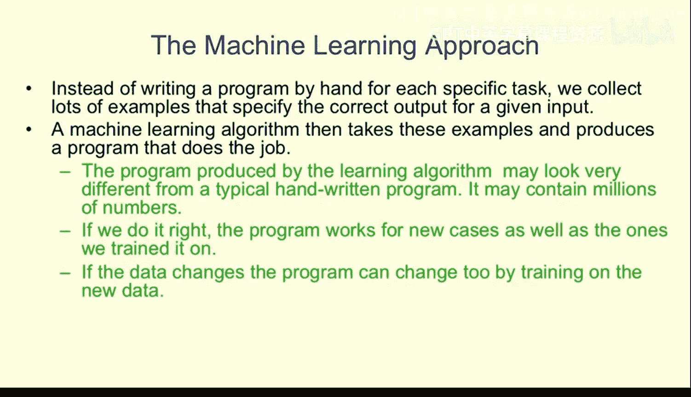

And now massive amounts of computation are cheaper than paying someone to write a program for a specific task so we can afford big。

 complicated machine learning programs to produce these task specific systems for us。

Some examples of the things that are best done by using a learning algorithm。

Are recognizing patterns。So， for example， objects in real scenes。

Or the identities or expressions of people's faces。Or spoken words。

There's also recognizing anomalies。So an unusual sequence of credit card transactions will be an anomaly。

Another example of an anomaly would be an unusual pattern of sensor readings in a nuclear power plant。

And you wouldn't really want to have to deal with those by doing supervised learning。

 where you look at the ones that blow up and see what what caused them to blow up。

 You'd really like to recognize that something funny is happening without having any supervision signal。

 It's just not behaving in its normal way。And then this prediction。

So typically predicting future stock prices or currency exchange rates。

Or predicting which movies a person will like from knowing which other movies they like and which movies a lot of other people liked。

So in this course， I'm going to use a standard example for explaining a lot of the machine learning algorithms。

This is done in a lot of science。 In genetics， for example， A lot of genetics is done on fruit flies。

And the reason is they're convenient。 They breed fast。

And a lot is already known about the genetics of fruit flies。The Mni database of handwritten digits。

Is the machine learning equivalent of fruit flies。It's publicly available。

We can get machine learning algorithms to learn how to recognize these10 digits quite quickly。

 so it's easy to try lots of variations。And we know huge amounts about how well different machine learning methods do on Mnist。

And in particular， the different machine learning methods were implemented by people who believed in them so we can rely on those results。

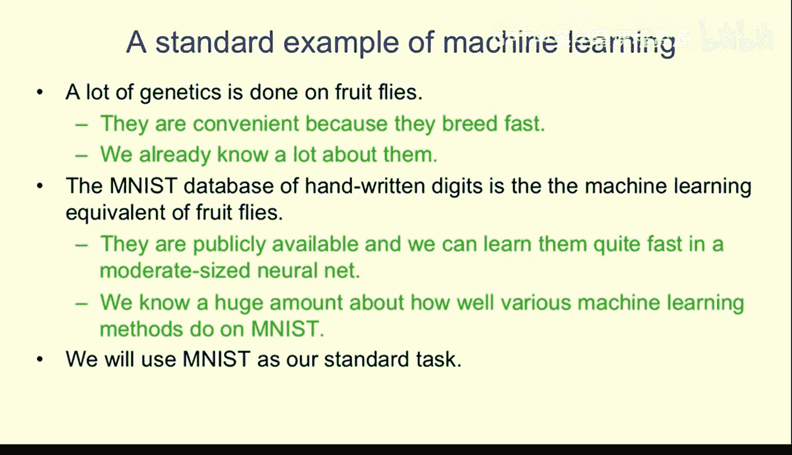

So for all those reasons， we're going to use Mnis as our standard task。

Here's an example of some of the digits in Emunist。

These are ones that were correctly recognized by neuralral net the first time it saw them。

But the ones where the neural net wasn't very confident。And you can see why。

I've arranged these digits in standard scan line order， so zero is then ones， and twos， and so on。

If you look at a bunch of twos， like the ones in the green rectangle。You can see that。

If you knew they were 10written digit， you'd probably guess they were twos。

But it's very hard to say what it is that makes them tos。

 There's nothing simple that they all have in common。In particular。

 if you try and overlay one on another， you'll see it doesn't fit。 And even if you skew it a bit。

 it's very hard to make them overlay on each other。 So a template isn't going to do the job。

And in particular， template is going to be very hard to find that it'll fit those two in the green box and won't also fit the things in the red boxes。

So that's one thing that makes recognizing1 digits a good task for machine learning。

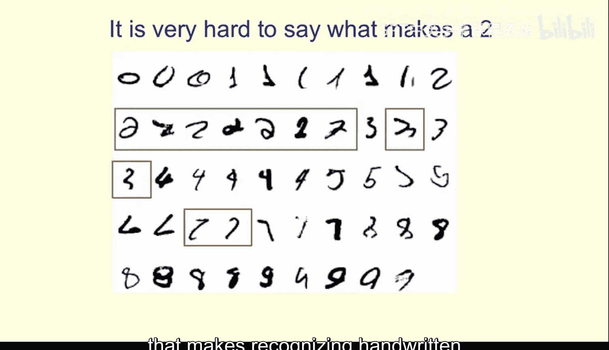

Now， I don't want you to think that's the only thing we can do。

It's a relatively simple thing for a machine learning system to do now。

And to motivate the rest of the course， I want to show you some examples of much more difficult things。

So we now have neural nets with approaching 100 million parameters in them。

That can recognize 1000 different object classes。In 1。

3 million high resolution training images got from the web。So there was a competition in 2010。

 and the best system got 47% error rate。 If you look at its first choice and 25% error rate。

 if you say it got it right if it was in its top five choices。

 which isn't bad for 1000 different objects。Gendra Malik。

 who's an eminent neural net skeptic and a leading computer vision researcher。

Has said that this competition is a good test of whether deep neural networks can work well for object recognition。

And a very deep neural network can now do considerably better than the thing that won the competition。

 It can get less than 40 per cent error for its first choice and less than 20% cent error for its top  five choices。

 I'll describe that in much more detail in lecture 5。

 Here's some examples of the kinds of images you have to recognize these images from the test set that it's never seen before。

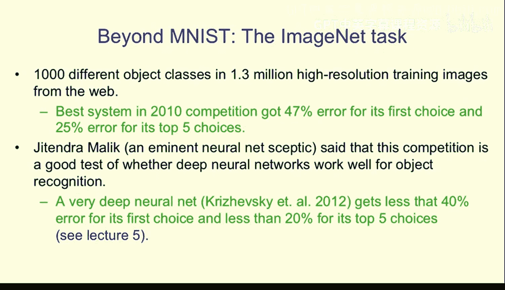

And below the examples， I'm showing you what the neural net thought the right answer was。

 where the length of the horizontal bias is how confident it was。And the correct answer is in red。

So if you look in the middle， it correctly identified that as a snow plow。

But you can see that his other choices were also fairly sensible。

 It does look a little bit like a drilling platform。And if you look at its third choice， a lifeboat。

 it actually looks very like a lifeboat。 You can see the flag on the front of the boat and the bridge of the boat and the flag at the back and the high surf in the background。

So it's errors tell you a lot about how it's doing it， and they're very plausible errors。

If you look on the left。It gets it wrong， possibly because the beak of the bird is missing and because the feathers of the bird look very like the wet fur of an otter。

But he gets it in his top 5。 And it does better than me。

 I wouldn't know if that was a quail or a roughed grace， or a partridge。If you look on the right。

 it gets it completely wrong。It agillotin， you can see why it says that。

 you can possibly see why it says Arangutang because of the sort of jungle looking background and something orange in the middle。

 but it fails to get the right answer。

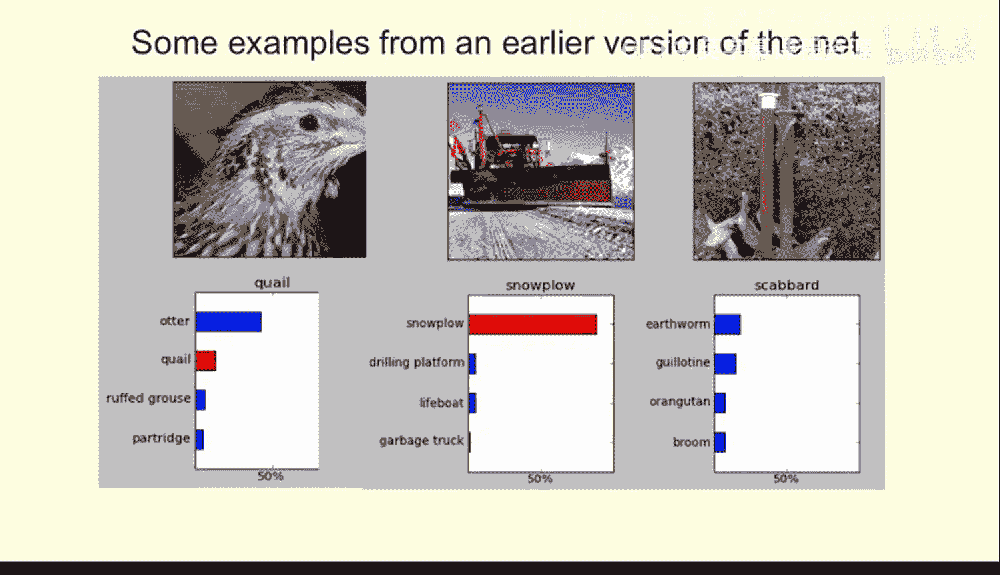

It can， however， deal with a wide range of different objects。 if you look on the left。

I would have said microwave is my first answer。 The labels aren't very systematic。 So actually。

 the correct answer there is electric range and does get it in its top 5。In the middle。

 it's getting a turnst， which is a distributed object。Itt。

 It can do more than just recognise compact things， and it can also deal with pictures。

 as well as real scenes like the bulletproof vestest。

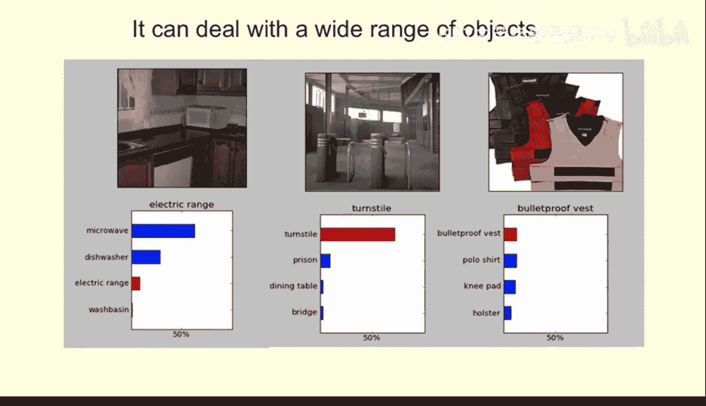

And it makes some very cool errors。If you look at the image on the left。That's an earphone。

It doesn't get anything like an earphone。 But if you look at its fourth bet， it thinks it's an ant。

And to me you think that's crazy。 But then if you look at it carefully。

 you can see it's a view from an ant from underneath。 The eyes are looking down at you。

 Then you can see the antennae behind it。 It's not the kind of view of ant you'd like to have if you were a greenf。

If you look at the one on the right， it doesn't get the right answer。

 but all of its answers are cylindrical objects。

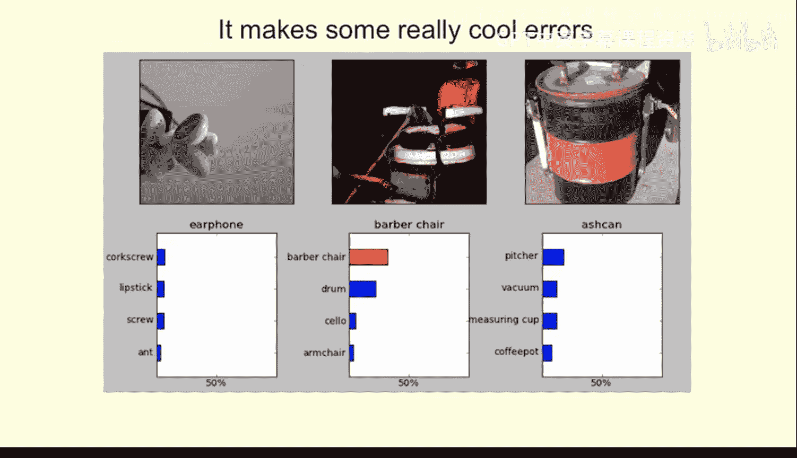

Another task that neural nets and I are very good at is speech recognition。

Or at least part of a speech recognition system。So speech recognition systems have several stages。

First， they pre process the sound wave to get a vector of acoustic coefficients。

For each 10 milliseconds of sound wave。And so they get 100 of those vectors per second。

They then take a few adjacent vectors of acoustic coefficients。

And they need to place bets on which part of which phoneme is being spoken。

So they look at this little window and they say in the middle of this window。

 what do I think the phony is and which part of the phony miss it。

And a good speech recognition system will have many alternative models for a phoneme and each model it might have three different parts。

 so it might have many thousands of alternative fragments that it thinks this might be。

And you have to replace bets on all those thousands of alternatives。

And then once you place those bets， you have a decoding stage。That does the best job it can。

Of using plausible beds， but piecing them together into a sequence of bets that corresponds to the kinds of things that people say。

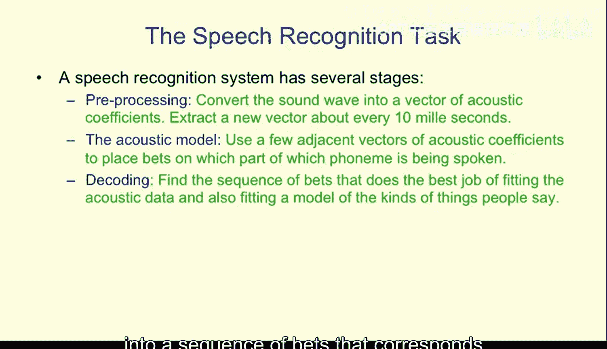

Currently， deep neural networks pioneered by George Darle and Abdral Raman。

 Muhammamed at the University of Toronto。Are doing better than previous machine learning methods for the acoustic model。

 and they're now beginning to be used in practical systems。So Da Muhammad。呃。

Developed a system that uses many layers of。Binary neurons。

To take some acoustic frames and make bets about the labels。

 they were doing it on a fairly small database， and then used 183 alternative labels。

And to get their system to it， where they did some pre training。

 which will be described in the second half of the course。After standard post processing。They got 20。

7% error rate on a very standard benchmark， which is kind of like the endist for speech。

The best previous result on that benchmark for speaker independent recognition was 24。4%。

And a very experienced speech researcher at Microsoft Research realized that that was a big enough improvement that probably this would change the way speech recognition systems were done。

 and indeed it has。

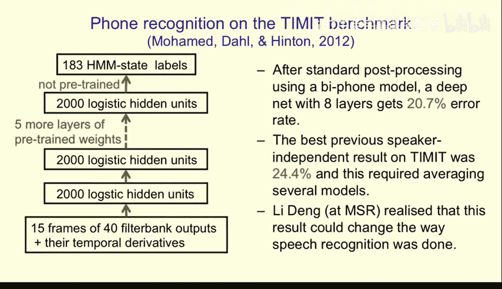

So if you look at recent results。From several different leading speech groups。

Microsoft showed that this kind of deep neural network when used as the acoustic model in a speech system。

Reduce the error rate from 27。4 per cent to 18。5 per cent。 Or alternatively。

 you could view it as reducing the amount of training data you needed from 2000 hours down to 309 hours to get comparable performance。

IBM， which has the best system for one of the standard。

Speech recognition and tasks for large vocabulary speech recognition。

Showed that even its very highly tuned system that was getting 18。

8% can be beaten by one of these deep neural networks。

And Google fairly recently trained a deep neural network on a large amount of speech，5800 hours。

 That was still much less than their trained their Gasian mixture model on。

But even with much less data， it did a lot better than the technology they had before。

 so it reduced the error rate from 16% to 12。3% and the error rate is still falling。

And in the latest Android， if you do voice search， it's using one of these deep neural networks in order to do very good speech recognition。

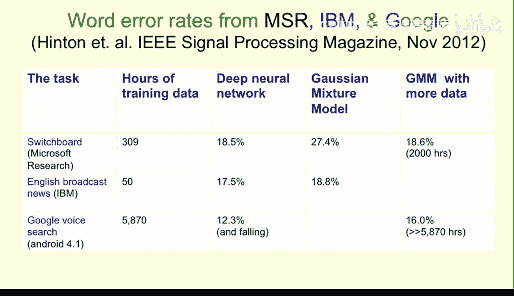