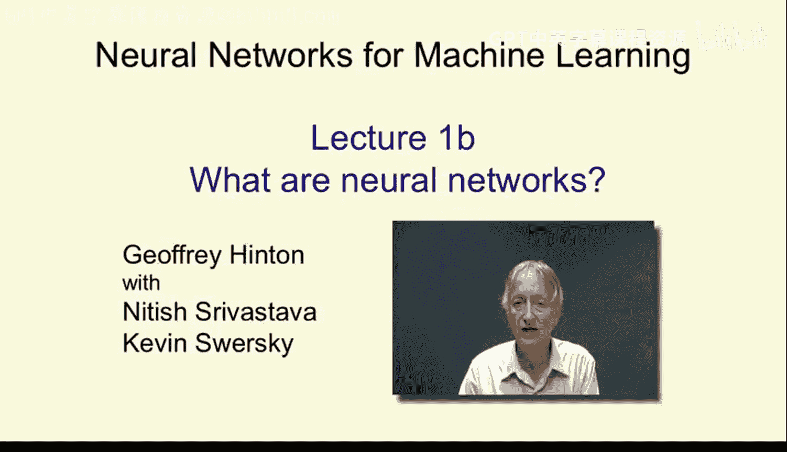
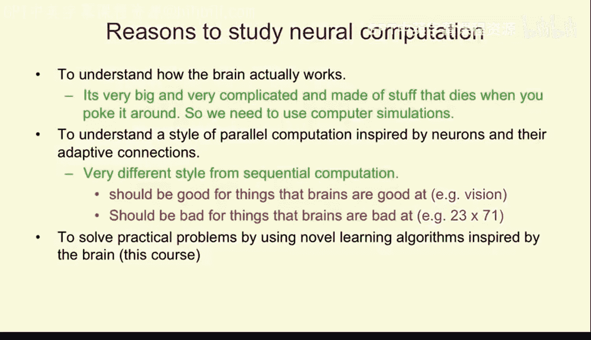
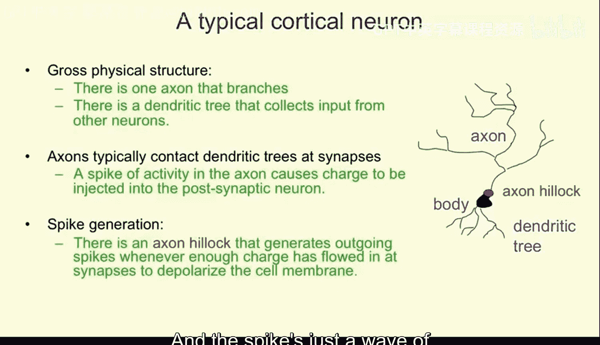
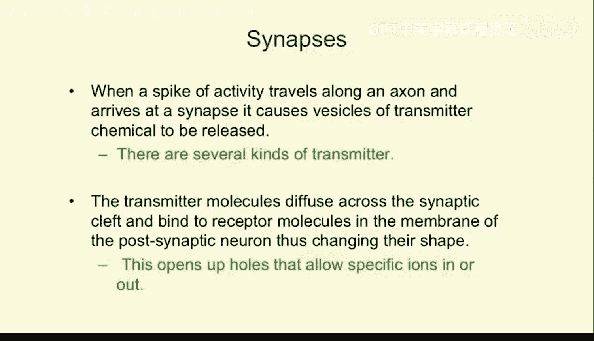
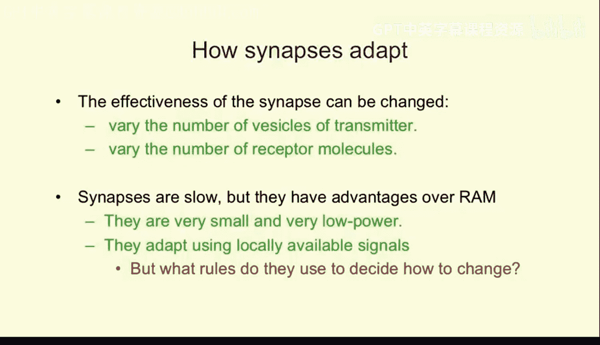
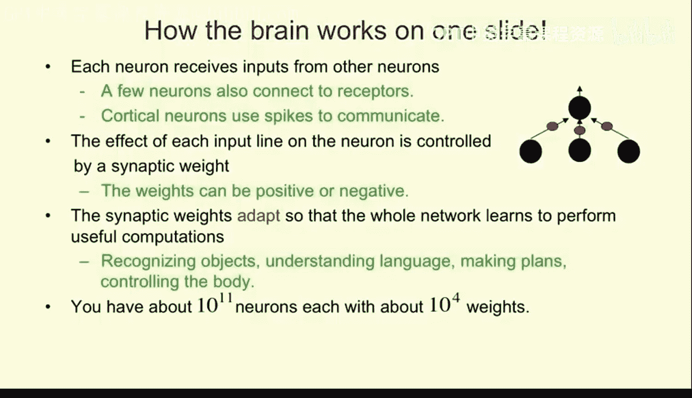
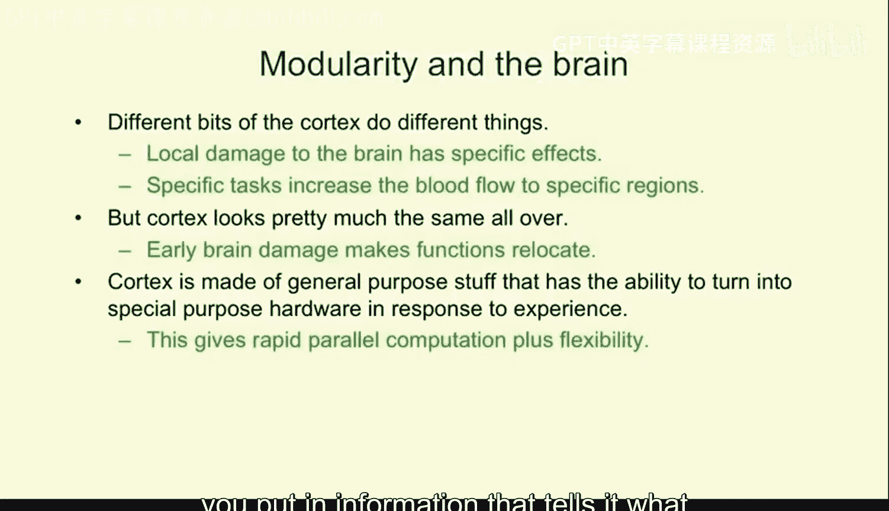

# Hinton@多伦多大学《机器学习的神经网络｜Neural Networks for Machine Learning 2016》claude-4s p02 -02-Lecture 1.2 — What are neural networks  -Neural Networks for Machine Learnin -BV1HtkUB2EZD_p2-

In this video， I'm going to tell you a little bit about real neurons on the real brain。

Which provide the inspiration for the artificial neural networks that we're going to learn about in this course。

In most of the course， we won't talk much about real neurons。

 but I wanted to give you a quick overview at the beginning。

There are several different reasons to study how networks of neurons can compute things。

The first is to understand how the brain actually works。

You might think we could do that just by experiments on the brain。

 but it's very big and complicated and it dies when you poke it around。

 and so we need to use computer simulations to help us understand what we're discovering in empirical studies。

The second。Is to understand a style of parallel computation that's inspired by the fact that the brain can compute with a big parallel network of relatively slow neurons。

 If we can understand that style of parallel computation。

 we might be able to make better parallel computers。😊。

It's very different from the way computation is done on a conventional serial processor。

It should be very good for things that brains are good at， like vision。

And it should also be bad for things that brains are bad at， like multiplying two numbers together。

A third reason， which is the relevant one for this course。

 is to solve practical problems by using novel learning algorithms that were inspired by the brain。

These algorithms can be very useful， even if they're not actually how the brain works。

So in most of this course， we won't talk much about how the brain actually works。

 It's just used as a source of inspiration to tell us that big parallel networks of neurons can compute very complicated things。

I'm going to talk more in this video， though， about how the brain actually works。

A typical cortricical neuron。Has a gross physical structure that consists of a cell body。

And an axon where it sends messages to other neurons。

And a dendritic tree where it receives messages from other neurons。

Where an axon from one neuron contacts a denric tree of another neuron。

 there's a structure called a synapse。And a spike of activity travelling along the axon。

Causes charge to be injected into the postsaptic neuron。At a synapse。

And neuron generates spikes when it's received enough charge in its dendritic tree to depolarize a part of the cell body called the axon Hillock。

And when that gets depolarized， the neuron sends a spike out along its axon。

 and the spikes just a wave of depolarization that travels along the axon。

Synapses themselves。Have interesting structure， they contain little vesicles of transmitter chemical。

 and when a spike arrives in the axon。It causes these vesicles to migrate to the surface and be released into the synaptic cleft。

There's several different kinds of transmitter chemical。

 There's ones that implement positive weights and ones that implement negative weights。

The transmital molecules diffuse across synaptic clef and bind to receptor molecules in the membrane of the postsynaptic neuron。

And by binding to these big molecules in the membrane， they change their shape。

And that creates holes in the membrane。These holes。

Allow specific ions to flow in or out of the postssynaptic neuro。

And that changes their state of depoorization。Synapses adapt。And that's what most of learning is。

 changing the effectiveness of a synapse。

They can adapt by varying the number of vesicles that get released when a spike arrives or by varying the number of receptor molecules that are sensitive to the released transmitter molecules。

Synapses are very slow compared with computer memory。

But they have a lot of advantages over the random access memory on a computer。

They're very small and very low power。And they can adapt。 That's the most important property。

 They use locally available signals to change their strengths。

 And that's how we learn to perform complicated computations。The issue， of course。

 is how do they decide。How to change their strength， What is the。

 what are the rules for how they should adapt。

So。All on one slide， this is how the brain works。Each neuron receives inputs from other neurons。

A few of the neurons receive inputs from the receptors。 It's a large number of neurons。

 but only a small fraction of them。And the neurons communicate with each other in the cortex by sending these spikes of activity。

The effect of an input line on a neuron is controlled by synaptic weight。

Which can be positive or negative。And these snappy weights adapt。And by adapting these weights。

 the whole network learns to perform different kinds of computation。 For example。

 recognizing objects， understanding language， making plans， controlling the movements of your body。嗯。

You have about 10 to the 11 neurons， each of which has about 10 to the four weights。

So you probably have 10 to the 15 or maybe only 10 to the 14 synaptic weights。

And a huge number of these weights， quite a large fraction of them。

 can affect the ongoing computation。In a very small fraction of a second， in a few milliseconds。

That's much better bandwidth to stored knowledge than even a modern workstation has。

One final point about the brain is that the cortex is modular。Or at least it learns to be modular。

 Different bits of the cortex end up doing different things。Genetically。

 the inputs from the senses go to different bits of the cortex。

And that determines a lot about what they end up doing。If you damage the brain。Of an adult。

Local damage to the brain causes specific effects。 Dage to one place might cause you to。

Lose your ability to understand language。 Dage to another place might cause you to lose your ability to recognize objects。

We know a lot about how functions are located in the brain。

 because when you use a part of the brain for doing something， it requires energy。

 and so it demands more blood flow。And you can see the blood flow in a brain scanner。

 So that allows you to see which bits of the brain you are using for particular tasks。

But the remarkable thing about cortex is it looks pretty much the same all over。

And that strongly suggests。That it's got a fairly flexible， universal learning algorithm in it。

That's also suggested by the fact that if you damage the brain early on。

 functions will relocate to other parts of the brain。So it's not genetically predetermined。

 at least not directly。Which part of the brain will perform Which function。

There's convincing experiments on baby ferrets。That show that if you cut off the input to the auditory cortex comes from the ears and instead rero the visual input to auditory cortex。

 then the auditory cortex that was destined to deal with sounds will actually learn to deal with visual input。

And create neurons that look very like the neurons in the visual system。

This suggests the cortex is made of general purpose stuff that has the ability to turn into special purpose hardware for particular tasks in response to experience。

And that gives you a nice combination of。Rapid parallel computation once you've learned plus flexibility。

 so you can put， you can learn new functions， so you're learning to do the parallel computation。

 It's quite like an FPGA where you build some standard parallel hardware And then after it's built。

 you put in information that tells it what particular parallel computation to do。

Conventional computers get their flexibility by having a stored sequential program。

 but this requires very fast central processes to access the lines in the sequential program and perform long sequential computations。

