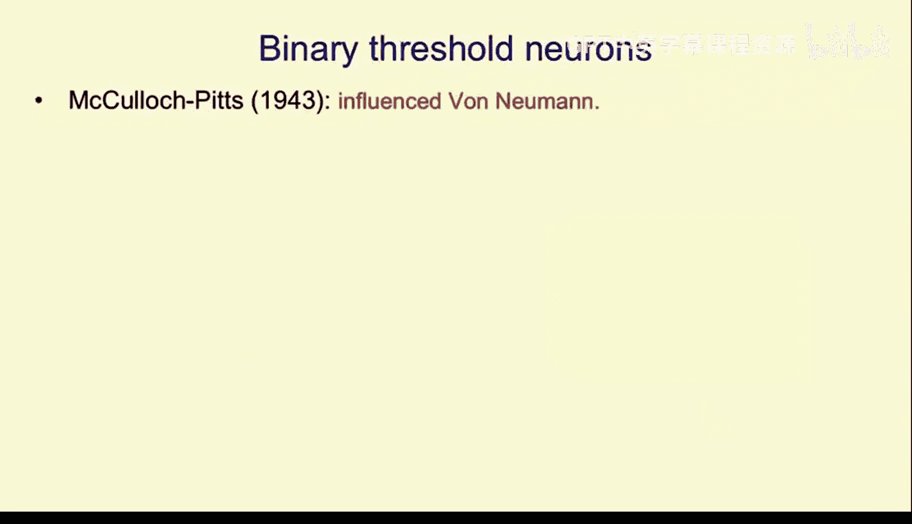
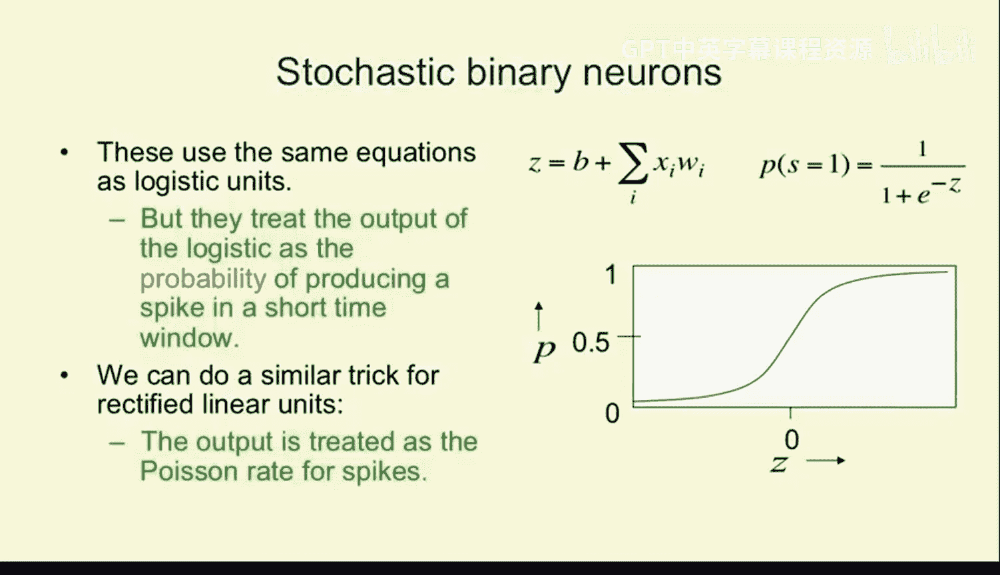

# Hinton@多伦多大学《机器学习的神经网络｜Neural Networks for Machine Learning 2016》claude-4s p03 -03-Lecture 1.3 — Some simple models of neurons  -Neural Networks for Machine Le -BV1HtkUB2EZD_p3-

In this video。I'm going to describe some relatively simple models of neurons。

I'll describe a number of different models， starting with simple， linear and threshold neurons。

 and then describing slightly more complicated models。These are much simpler than real neurons。

 but they're still complicated enough to allow us to make neural nets that do some very interesting kinds of machine learning。

In order to understand anything complicated。We have to idealize it。That is。

 we have to make simplifications。That allow us to get a handle on how it might work。With atoms。

 for example， we simplified them as behaving like little solar systems。

Idealization removes the complicated details that are not essential for understanding the main principles。

It allows us to apply mathematics and to make analog knowledge to other familiar systems。

And once we understand the basic principles。It's easy to add complexity and make the model more faithful to reality。

Of course， we have to be careful when we idealize something not to remove the thing that's giving it its main properties。

It's often worth understanding models that are known to be wrong as long as we don't forget they're wrong。

So， for example。A lot of work on neural networks uses neurons that communicate real values rather than discrete spikes of activity。

 And we know cortical neurons don't behave like that。

 but it's still worth understanding systems like that。 And in practice。

 they can be very useful for machine learning。The first kind of neuron I want to tell you about is the simplest。

 It's a linear neuron。It's simple， it's computationally limited in what it can do。

It may allow us to get insights into more complicated neurons， but it may be somewhat misleading。

So in a linear neuron， the output y。Is a function of a bias of the neuron B。And the sum over all。

 its incoming connections。Of the activity on an input line times the weight on that line。

 That's the synaptic weight on the input line。And if we plot that as a curve。

Then if we plot on the x axis， the bias plus the weighted activities on the input lines。

 we get a straight line that goes through0。

Very different from linear neurons， The binary threshold neurons that were introduced by Mccalican pits。

They actually influenced Von Neuman when he was thinking about how to design a universal computer。

In a binary threshold neuron， your first computer weighted some of the inputs。

And then you send out a spike of activity if that weighted sum exceeds the threshold。

McCican Pits thought that the spikes were like the truth values of propositions。

So each neuron is combining the truth values it gets from other neurons to produce the truth value of its own。

 And that's like combining some propositions to compute the truth value of another proposition。

At the time in the 1940s， logic was the main paradigm for how the mind might work。Since then。People。

Thinking about how the brain computes and become much more interested in the idea that the brain is combining lots of different sources of unreliable evidence。

 And so logic isn't such a good paradigm for what the brain's up to。For binary threshold neuron。

You can think of its input output function as if the weighted input is above the threshold。

 it gives an output of  one， Otherwise it gives an output to 0。

There are actually two equivalent ways to write the equations for a binary threshold neuron。

We can say that the total input Z is just the activities on the input lines times the weights。

And then the output y is one if that z is above the threshold and zero otherwise。Alternatively。

 we could say that the total input includes a bias term。

So the total input is what comes in on the input lines times the weights plus this bias term。

And then we can say the output is one。 if that total input is above 0 and is 0 otherwise。

And the equivalence is simply that the threshold in the first formulation is equal to the negative of the bias in the second formulation。

A kind of neuron that combines the properties of both linear neurons and binary threshold neurons is a rectified linear neuron。

It first computes a linear weighted sum of its inputs。

 but then it gives an output that's a linear function of this weighted sum。

So we compute Z in the same way as before。If Z is below 0， we give an output of 0。Otherwise。

 we give an output that's equal to z。 So above 0 is linear and at 0。 it makes a hard decision。

So the input output curve looks like this。It's definitely not linear。But above there， it is linear。

So with a neuron like this， we can get a lot of the nice properties of linear systems when it's above 0。

 we can also get the ability to make decisions。At zero。

The neurons that we' use a lot in this course and are probably the commonest kinds of neurons to use in artificial neurons nets。

 are sigmoid neurons。They give a real valued output。

 That is a smooth and bounded function of their total input。

It's typical to use the logistic function。Where the total input is computed as before。

 is a bias plus what comes in on the input lines weighted。

The output for a logistic neuron is one over one plus E to the minus the total input。

If you think about that， it the total inputs big and positive。

E to the minus a big positive number is 0。And so the output will be one。

Is the total input big and negative？E to the minus a big negative number is a large number。

And so the output will be0。So the inerible function looks like this。When the total input is 0。

E to the minus0 is1， so the outputs are half。And the nice thing about sigmoid is it has smooth derivatives。

 The derivatives change continuously。😊，And so they're nicely behaved and they make it easy to do learning。

 as we'll see in lecture three。Finally， the stochastic binary neurons。

They use just the same equations as logistic units。They compute their total input the same way。

 and they use the logistic function to compute a real value。

 which is the probability that they would output a spike。

But then instead of outputting that probability as a real number。

 they actually make a probabilistic decision。 And so what they actually output is either a  one or a 0。

 They're intrinsically random。So they're treating the P as the probability of producing a one。

 not as a real number。Of course， if the input is very big and positive。

 they will almost always produce a one， and if the input's big and negative。

 they'll almost always produce a zero。We can do a similar trick with rectified linear units。

We can say that the output， this real value that comes out of a rectified linear unit。

 if its input is above 0。Is the rate of producing spikes。 So that's deterministic。

But once we've figured out this rate of producing spikes。

 the actual times at which spikes are produced is a random process。 It's a poisson process。

So the rectphy linear unit determines the rate， but intrinsic randomness in the unit determines when the spikes are actually produced。

