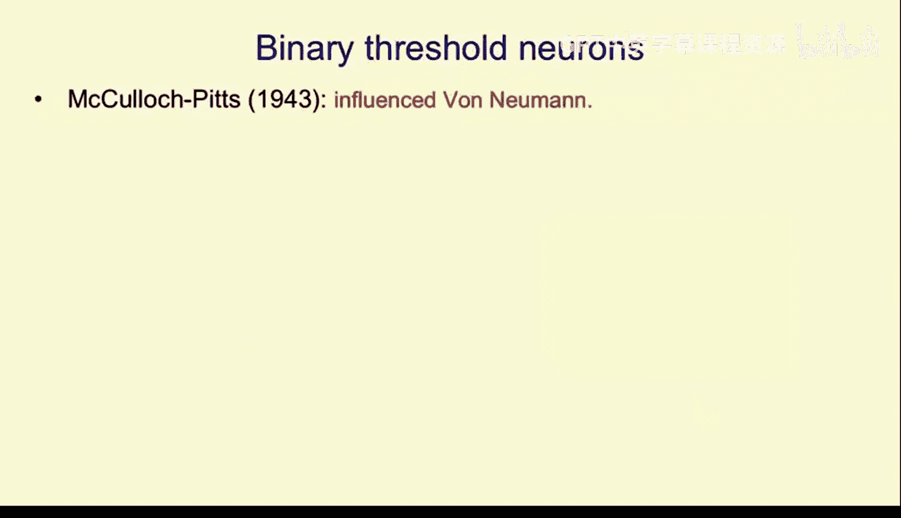
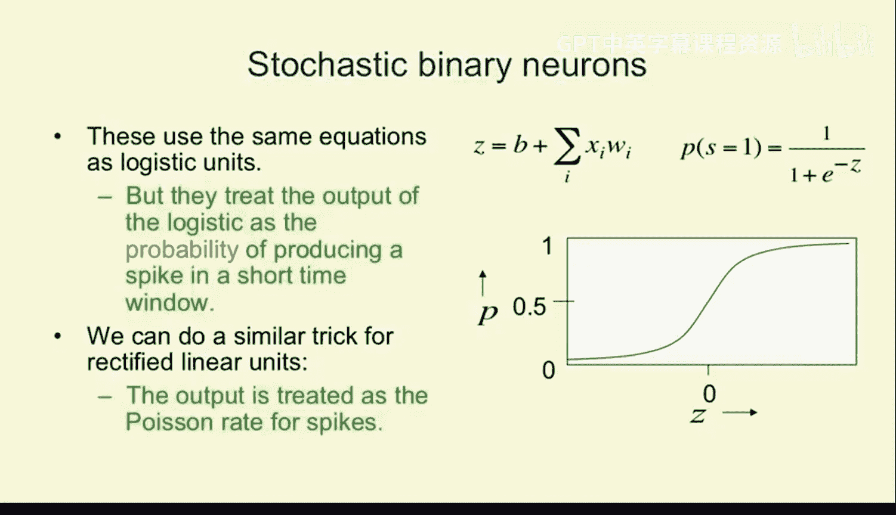

# 神经网络基础：1.3：几种简单的神经元模型 🧠

在本节课中，我们将学习几种相对简单的神经元模型。我们将从最简单的线性神经元和阈值神经元开始，逐步介绍一些稍复杂的模型。这些模型远比真实的生物神经元简单，但它们仍然足够复杂，能让我们构建出可以进行有趣机器学习的神经网络。

为了理解任何复杂的事物，我们必须对其进行理想化。这意味着我们需要进行简化，以便掌握其工作原理。例如，对于原子，我们将其简化为类似小型太阳系的行为。

理想化移除了那些对于理解主要原理并非必要的复杂细节。它允许我们应用数学，并与其他熟悉的系统进行类比。一旦我们理解了基本原理，就很容易增加复杂性，使模型更贴近现实。当然，在进行理想化时，我们必须小心，不要移除赋予事物主要特性的部分。只要我们不忘记它们是错误的，理解那些已知是错误的模型通常也是有价值的。

例如，许多神经网络研究使用输出实数值而非离散脉冲的神经元。我们知道大脑皮层神经元并非如此工作，但理解这类系统仍然有价值，并且在实践中，它们对机器学习非常有用。

## 线性神经元

首先，我们来介绍最简单的神经元类型：线性神经元。它很简单，计算能力有限。它可能帮助我们洞察更复杂的神经元，但也可能有些误导性。

在一个线性神经元中，输出 `y` 是神经元偏置 `b` 与所有输入连接加权和的一个函数。具体来说，加权和是每条输入线上的活动值乘以该线上的权重（即输入线上的突触权重）。

其公式可以表示为：
`y = b + Σ (x_i * w_i)`

如果我们以偏置 `b` 加上输入线的加权活动值之和为横轴，输出 `y` 为纵轴绘图，会得到一条穿过原点的直线。

## 二元阈值神经元

与线性神经元截然不同的是由麦卡洛克和皮茨提出的二元阈值神经元。冯·诺依曼在设计通用计算机时，实际上受到了它们的影响。

在二元阈值神经元中，首先计算输入的加权和。如果这个加权和超过了某个阈值，神经元就会发放一个活动脉冲。

麦卡洛克和皮茨认为，这些脉冲就像命题的真值。因此，每个神经元都在组合来自其他神经元的真值，以产生自己的真值。这就像组合一些命题来计算另一个命题的真值。在20世纪40年代，逻辑是解释心智如何运作的主要范式。自那以后，人们思考大脑如何计算时，开始对大脑组合许多不同来源的不可靠证据这一想法更感兴趣，因此逻辑不再是解释大脑活动的好范式。

对于二元阈值神经元，可以将其输入输出函数理解为：如果加权输入高于阈值，则输出为1；否则输出为0。

实际上，有两种等价的方式来描述二元阈值神经元的方程：

1.  我们可以说总输入 `z` 就是输入线上的活动值乘以权重：`z = Σ (x_i * w_i)`。然后，如果 `z` 高于阈值 `θ`，则输出 `y` 为1，否则为0：`y = 1 if z > θ else 0`。
2.  或者，我们可以说总输入包含一个偏置项：`z = b + Σ (x_i * w_i)`。然后，如果总输入 `z` 大于0，则输出 `y` 为1，否则为0：`y = 1 if z > 0 else 0`。

这两种表述的等价性在于，第一种表述中的阈值 `θ` 等于第二种表述中偏置 `b` 的负值：`θ = -b`。

## 整流线性神经元

一种结合了线性神经元和二元阈值神经元特性的神经元是整流线性神经元。

它首先计算其输入的线性加权和，但其输出是这个加权和的线性函数。我们像之前一样计算 `z`。如果 `z` 小于0，则输出0；否则，输出等于 `z`。因此，在0以上是线性的，而在0点则做出一个硬性决策。

其输入输出曲线如下图所示。它肯定不是线性的，但在0以上是线性的。使用这样的神经元，当输入大于0时，我们可以获得线性系统的许多优良特性，同时也获得了在0点做出决策的能力。

## Sigmoid神经元

本课程中我们将大量使用，并且可能是人工神经网络中最常用的神经元类型是Sigmoid神经元。它们输出一个实数值，该值是其总输入的平滑且有界函数。

通常使用逻辑函数。总输入的计算方式与之前相同：偏置 `b` 加上加权输入线信号之和 `Σ (x_i * w_i)`。

逻辑神经元的输出公式为：
`y = 1 / (1 + e^(-z))`

思考一下这个公式：如果总输入 `z` 是一个很大的正数，`e^(-z)` 趋近于0，因此输出 `y` 将趋近于1。如果总输入 `z` 是一个很大的负数，`e^(-z)` 是一个很大的数，因此输出 `y` 将趋近于0。所以其输入输出函数曲线如下图所示。当总输入为0时，`e^0 = 1`，所以输出是0.5。

Sigmoid函数的优点在于它具有平滑的导数。导数连续变化，因此它们行为良好，使得学习过程更容易进行，我们将在第三讲中看到这一点。

## 随机二元神经元

最后，我们来介绍随机二元神经元。

它们使用与逻辑单元完全相同的方程来计算总输入 `z`，并使用逻辑函数计算一个实数值 `p`，这个值代表它们输出一个脉冲的概率。

但是，它们并不将这个概率 `p` 作为实数值输出，而是实际做出一个概率性决策。因此，它们实际输出的是1或0。它们是内在随机的。所以，它们将 `p` 视为产生1的概率，而不是一个实数值。当然，如果输入是非常大的正数，它们几乎总是产生1；如果输入是非常大的负数，它们几乎总是产生0。

## 随机脉冲与整流线性单元

我们可以对整流线性单元进行类似的变换。

我们可以说，当整流线性单元的输入大于0时，其输出的实数值是产生脉冲的速率。这是确定性的。

但是，一旦我们计算出这个脉冲产生速率，脉冲实际产生的时间就是一个随机过程，它是一个泊松过程。因此，整流线性单元决定了速率，但单元内在的随机性决定了脉冲实际产生的时间。

---

本节课中，我们一起学习了从线性神经元、二元阈值神经元到整流线性神经元、Sigmoid神经元以及随机二元神经元等多种简单的神经元模型。我们了解了每种模型的基本计算方式和特点，例如线性神经元的简单加权和、阈值神经元的决策特性、Sigmoid神经元的平滑非线性以及随机神经元的概率性输出。理解这些基础模型是构建和理解更复杂神经网络的关键第一步。