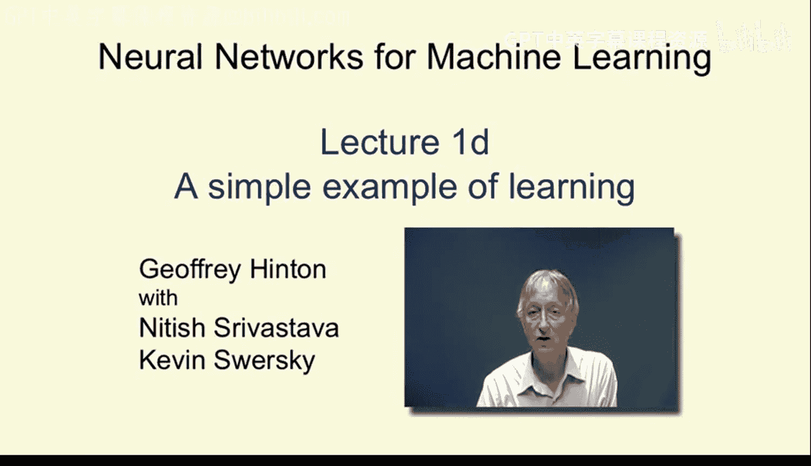
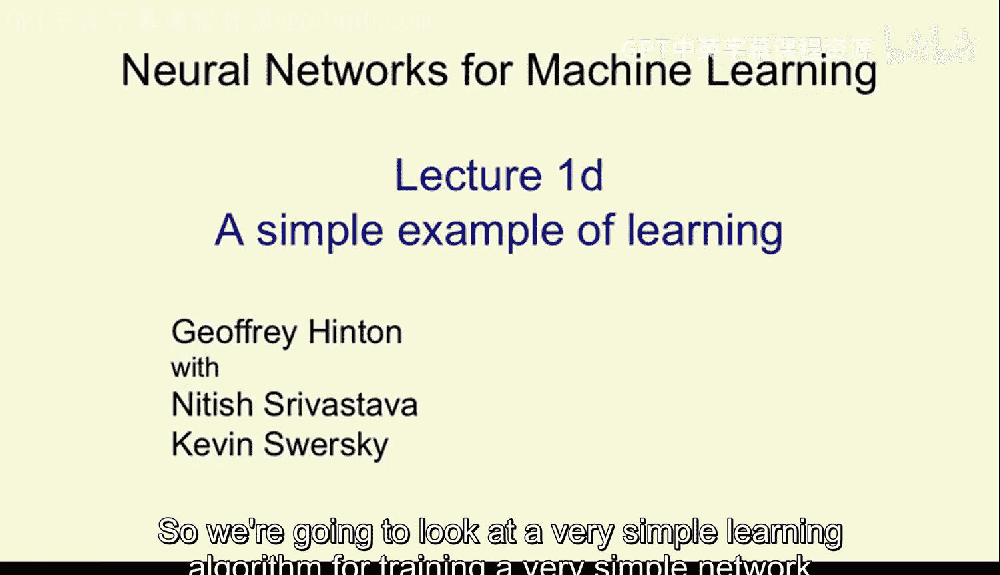
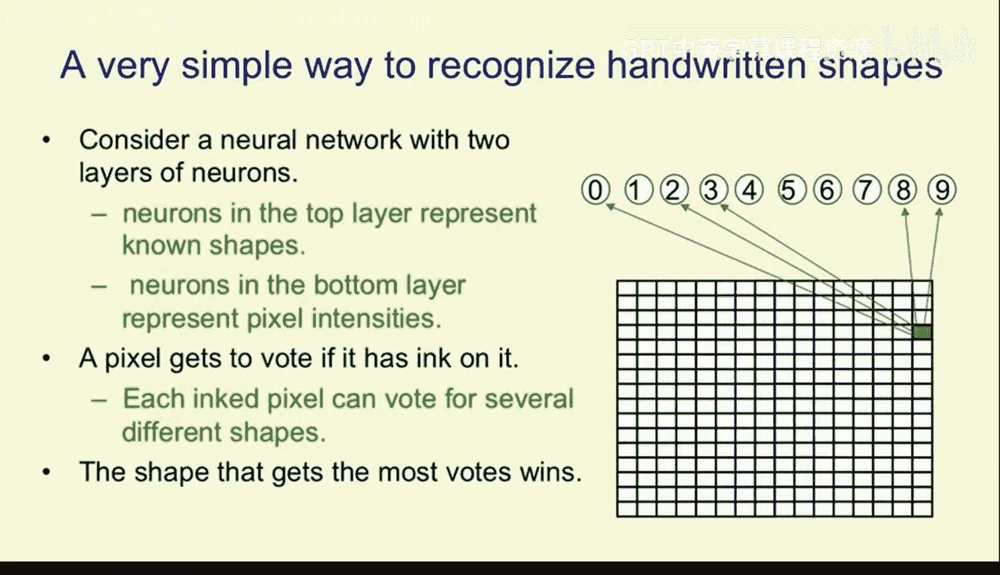
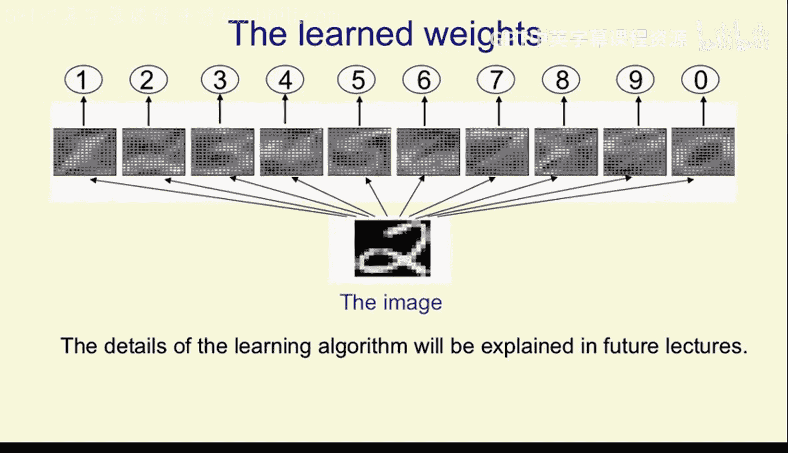
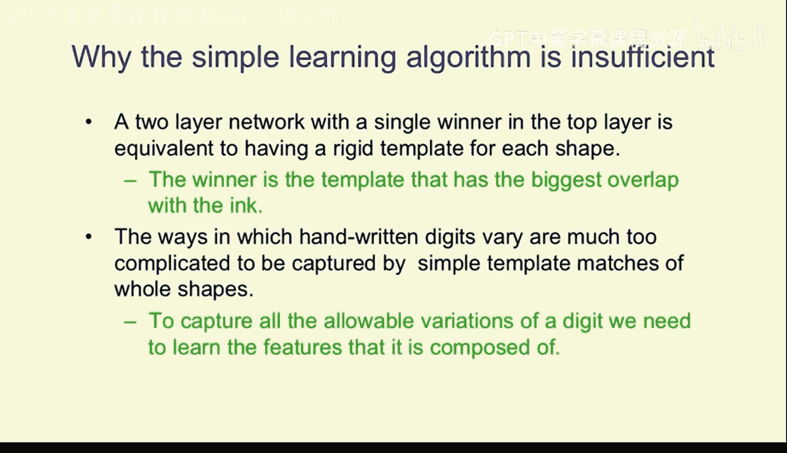
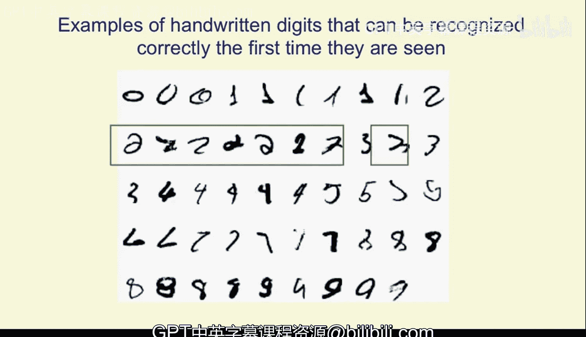

# Hinton@多伦多大学《机器学习的神经网络｜Neural Networks for Machine Learning 2016》claude-4s p04 -04-Lecture 1.4 — A simple example of learning  -Neural Networks for Machine Lea -BV1HtkUB2EZD_p4-

In this video。I'm going to show you an example of machine learning。

It's a very simple kind of neural net， and it's going to be learning to recognize digits。

And you're going to be able to see how the weights evolve as we run a very simple learning algorithm。

So we're going to look at a very simple learning algorithm。

For training a very simple network to recognise handwritten shapes。

The network only has two layers of neurons。It's got input neurons whose activities represent the intensities of pixels and output neurons whose activities represent the classes。

What we'd like is that when we show it a particular shape。

 the output neuron for that shape gets active。If a pixel is active。

 what it does is it votes for particular shapes， namely the shapes that contain that pixel。

Each int pixel can vote for several shapes， and the votes can have different intensities。

The shape that gets the most vote wins。 So we're assuming there's competition between the output units。

 that's something I haven't explained yet。 and we'll explain in a later lecture。

So first， we need to decide how to display the weights。

And it seems natural to write the weights on the connection between an input unit and an output unit。

 but we'd never be able to see what was going on if we did that。

We need a display in which we can see the values of thousands of weights。

So the idea is for each output unit， we make a little map。 and in that map。

We show the strength of the connection coming from each input pixel in the location of that input pixel。

And we show the strength of the connections by using black and white blobs whose area represents the magnitude and whose sign whose color represents the sign。

So the initial weights that you see there are just small random weights。

Now what we're going to do is show that networks some data and get it to learn weights that are better than the random weights。

The way we're going to learn。Is when we show it an image。

We're going to increment the weights from the active pixels in the image。To the correct class。

If we just did that， the weights could only get bigger。

 and eventually every class would get huge input whenever we showed an image。

So we need some way of keeping the weights under control and what we're going to do is we're also going to decrement the weights。

From the active pixels toward class the network guesses。

So we're really training it to do the right thing rather than the thing it currently has a tendency to do。

If， of course， it does the right thing。Then the increments we make in the first step of the learning rule will exactly cancel the decrements。

 And so nothing will change， which is what we want。So those are the initial weights。

 now we're going to show it a few hundred training examples。And then， look at the weights again。

And so now the weights have changed。Theyve become to they've started to form regular patterns。

And we show it a few more hundred examples， and the weights have changed the more and a few more hundred examples。

And a few more hundred examples。a few more hundred。

And now the weights are pretty much of their final values。

I'll talk more in future lectures about the precise details of the learning algorithm。

But what you can see is the weights now look like little templates for the shapes。

If you look at the weights going into the one unit， for example。

 they look like a little template for identifying ones。They're not quite templates。

 if you look at the weight it's going into the nine unit。

They don't have any positive weights below the halfway line。

That's because we're telling the difference between nines and sevens。

The weights below the halfway line aren't much use。

 you have to tell the difference by deciding whether there's a loop at the top or a horizontal bar at the top。

And so。Those output units are focused on that discrimination。

One thing about this learning algorithm is because the network so simple。

 it's unable to learn a very good way of discriminating shapes。

The what it learns is equivalent to having a little template for each shape。

And then deciding the winner based on which shape has the template that overlaps most with the ink。

The problem is that the ways in which handwrittendigenous fery are much too complicated to be captured by simple template matches of whole shapes。

You have to。Modelally allowable variations of a digit。

By first extracting features and then looking at the arrangements of those features。

So here's examples we've seen already。And if you look at those twos in the green box。

 you can see there's no template that will fit all those well and will fail to fit that three in the red box well。

So the task simply can't be solved。By a simple network like that。The network did the best it could。

 but it can't solve this problem。

