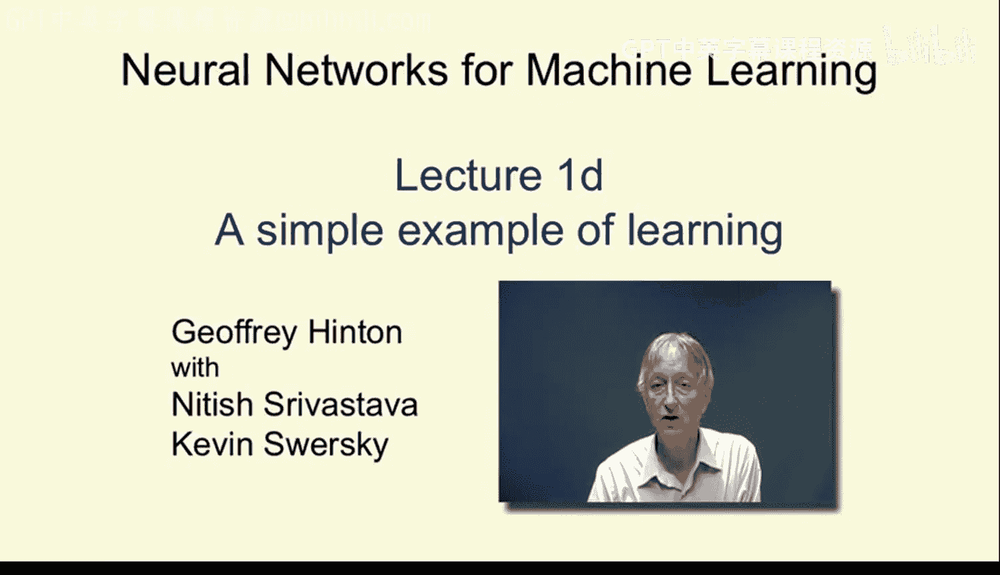
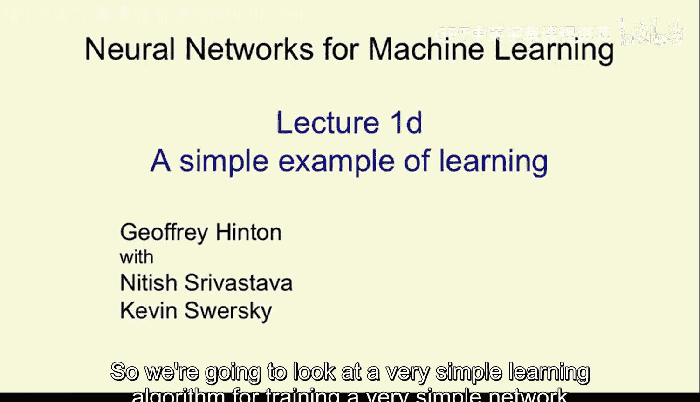
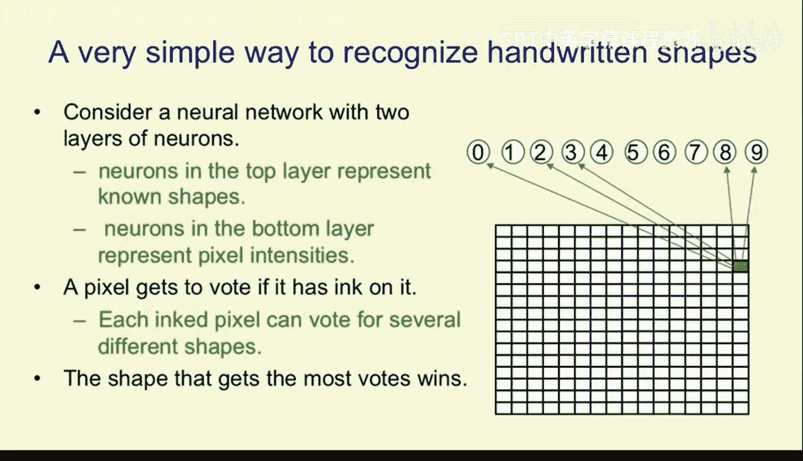
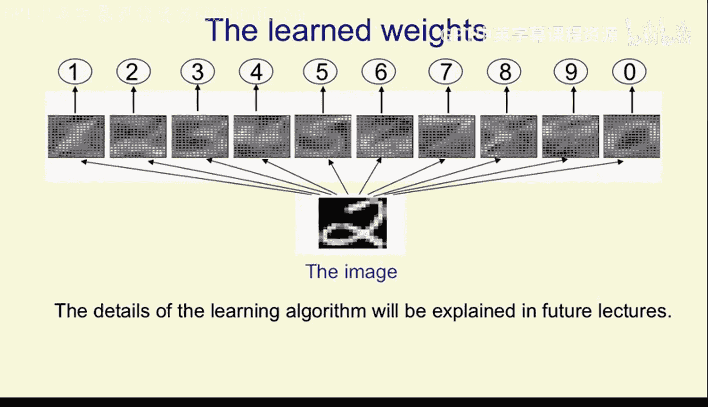
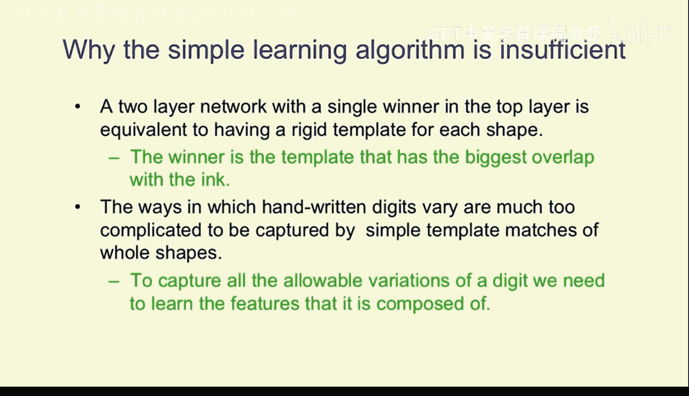
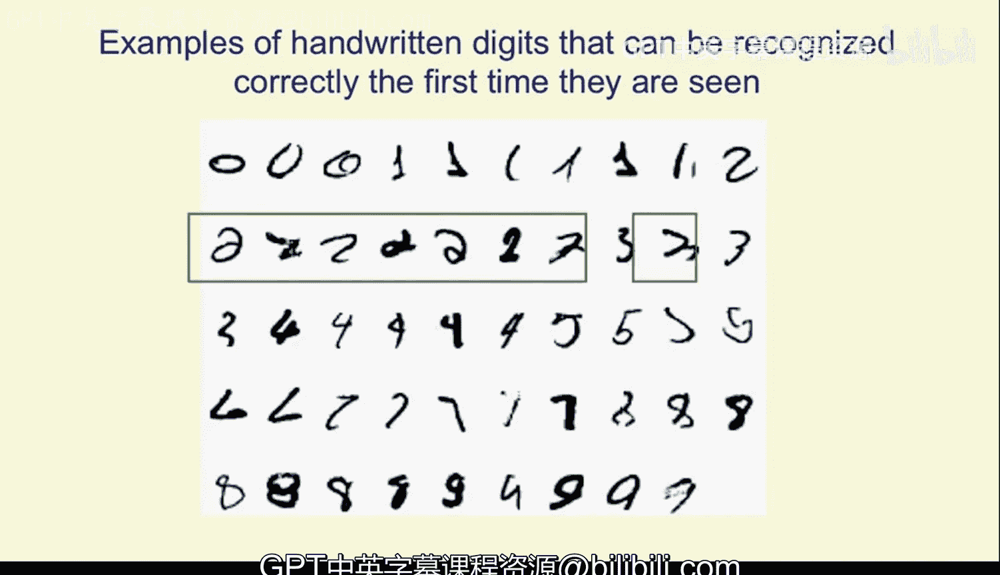

# 神经网络与机器学习：1.4：一个简单的学习示例 🧠

在本节课中，我们将通过一个非常简单的神经网络示例，来直观地理解机器学习是如何工作的。我们将看到这个网络如何学习识别手写数字，并观察在学习算法运行过程中，网络权重是如何演变的。

## 网络结构与学习目标

上一节我们介绍了神经网络的基本概念，本节中我们来看看一个具体的应用实例。我们将训练一个极其简单的网络来识别手写形状。

这个网络只有两层神经元：
*   **输入层神经元**：其活动代表图像像素的灰度值。
*   **输出层神经元**：其活动代表不同的数字类别（0-9）。

我们的目标是：当向网络展示一个特定形状（例如数字“2”）时，代表该形状的输出神经元（“2”号神经元）能够被激活。其工作原理是，每个活跃的像素会为包含该像素的形状“投票”。一个像素可以为多个形状投票，且投票的“强度”可以不同。获得最多投票的形状将胜出。这里我们假设输出单元之间存在竞争机制，这个机制我们将在后续课程中详细解释。

## 权重的可视化方法

为了理解学习过程，我们首先需要决定如何展示成千上万的连接权重。将权重直接写在每条连接线上是不可行的。

因此，我们为每个输出单元创建一个小型权重图。在这张图中，每个输入像素的位置上，我们显示从该像素连接到当前输出单元的权重强度。我们使用黑白圆点来表示权重：
*   **圆点面积**：代表权重的**大小**。
*   **圆点颜色**：代表权重的**正负**（例如，黑色为正，白色为负）。

你最初看到的权重只是随机初始化的小权重值。

## 简单的学习算法

接下来，我们将向网络展示数据，并让它学习比随机权重更好的权重值。

我们采用的学习规则如下：
1.  **增强正确连接**：当展示一张图像时，我们**增加**从图像中活跃像素连接到**正确类别**输出单元的权重。
2.  **抑制猜测连接**：同时，我们**减少**从活跃像素连接到网络当前**猜测类别**输出单元的权重。

如果我们只做第一步，权重只会不断增大，最终任何图像都会导致每个类别获得巨大的输入。因此，我们需要一种控制权重的方法。通过同时执行第二步，我们实际上是在训练网络去做正确的事，而不是强化它当前倾向于做的事。

当然，如果网络已经猜对了，那么第一步的增强和第二步的抑制将会**完全抵消**，权重保持不变，这正是我们期望的结果。

## 观察学习过程

以下是学习过程的直观展示。初始时，所有权重都是随机的小值。

现在，我们向网络展示几百个训练样本，然后再次观察权重。可以看到，权重已经开始变化，并初步形成了有规律的图案。

我们再展示几百个样本，权重的变化更加明显。继续这个过程，经过数千次训练后，权重基本达到了它们的最终值。

关于学习算法的具体细节，我们将在未来的课程中深入讨论。但现在你可以看到，学习后的权重看起来像是每个数字的“小模板”。例如，连接到“1”号输出单元的权重，看起来就像一个识别“1”的模板。

但它们并不完全是完美的模板。例如，观察连接到“9”号单元的权重，你会发现中线以下几乎没有正权重。这是因为网络需要区分“9”和“7”（或“4”），中线以下的像素对于这个区分任务用处不大，网络必须通过判断顶部是圆圈还是横杠来区分。因此，这些输出单元将注意力集中在了关键的区分特征上。

## 简单网络的局限性

这个学习算法的一个特点是，由于网络结构过于简单，它无法学会一种非常有效的形状区分方法。

它所学到的东西，等价于为每个形状准备一个模板，然后根据哪个形状的模板与墨水（像素）重叠最多来决定胜者。问题在于，手写数字的变化方式过于复杂，无法通过简单的整体形状模板匹配来捕捉。

你必须首先**提取特征**（如线条、端点、圆圈），然后再分析这些特征的组合方式，才能有效建模数字的允许变体。

## 示例说明

这里有一些我们已经看过的例子。观察绿色框中的那些“2”，你会发现没有一个模板能很好地匹配所有这些“2”，同时又能明确地不匹配红色框中的那个“3”。

因此，像这样的简单网络**根本无法解决**这个复杂的问题。网络已经尽了最大努力，但它能力有限。

## 总结

本节课中，我们一起学习了一个简单的两层神经网络如何通过“增强正确连接，抑制猜测连接”的规则来学习识别手写数字。我们看到了权重如何从随机值演变为类似数字模板的图案，同时也认识到这种简单网络的局限性——它只能进行简单的模板匹配，无法处理手写数字复杂多变的结构。这为我们后续学习更强大的、能够自动提取特征的深层神经网络奠定了基础。