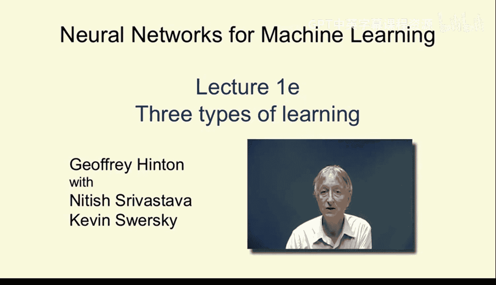
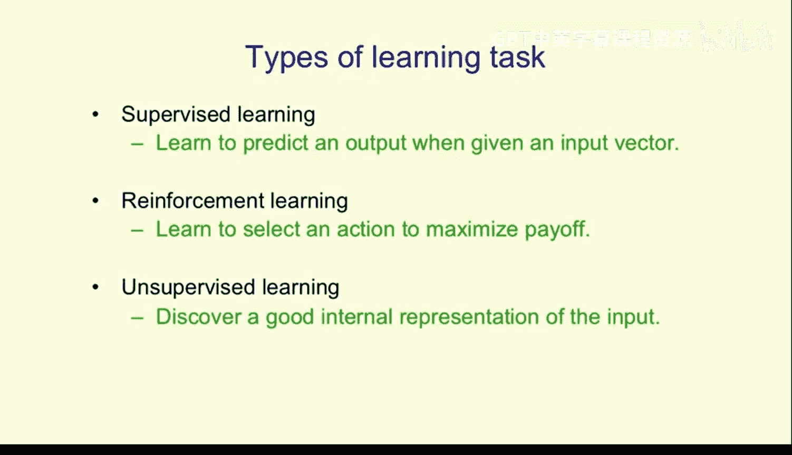
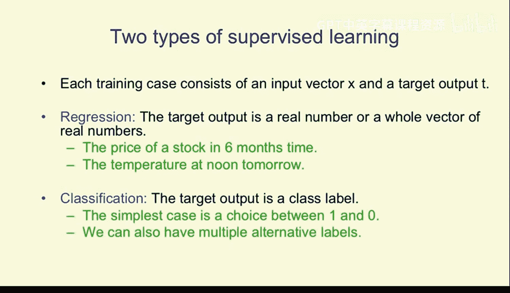
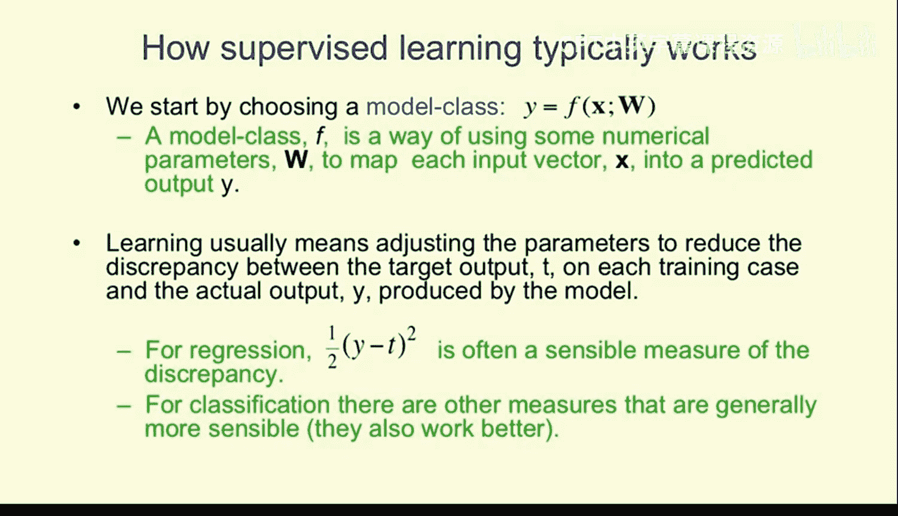
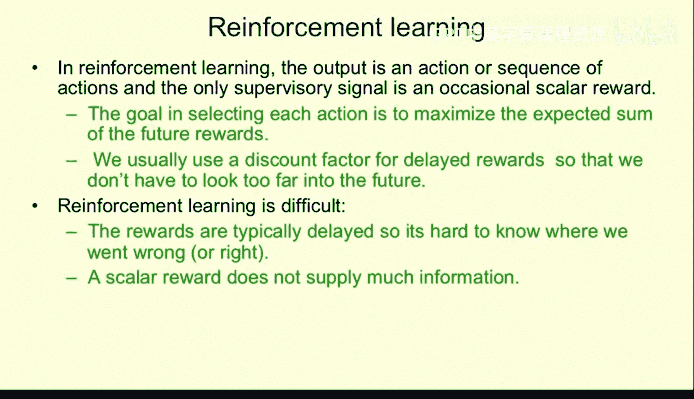
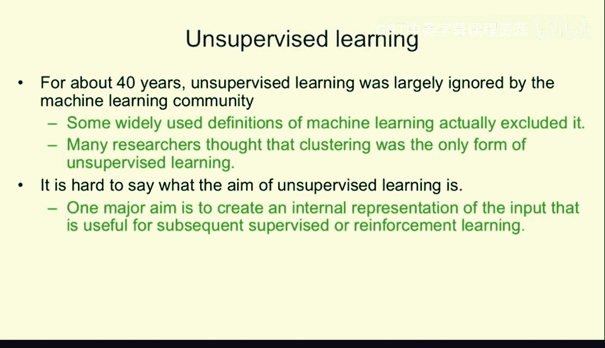
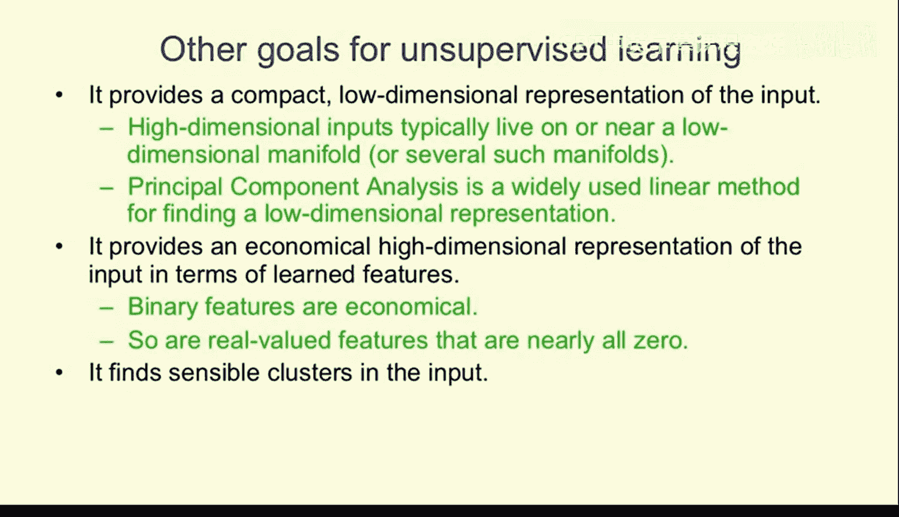

# Hinton@多伦多大学《机器学习的神经网络｜Neural Networks for Machine Learning 2016》claude-4s p05 -05-Lecture 1.5 — Three types of learning  -Neural Networks for Machine Learning -BV1HtkUB2EZD_p5-

In this video， I'm going to talk about three different types of machine learning。

 supervised learning， reinforcement learning， and unsupervised learning。Broadly speaking。

 the first half of the course will be about supervised learning。

The second half of the course will be mainly about unsupervised learning。

And reinforcement learning will not be covered in the course because we can't cover everything。

Learning can be divided into three broad groups of algorithms。In supervised learning。

You're trying to predict an output when given an input vector。

 So it's fairly clear what the point of supervised learning is。In reinforcement learning。

You're trying to select actions or sequences of actions to maximize the rewards you get。

 and the rewards may only occur occasionally。In unsupervised learning。

 you're trying to discover a good internal representation of the input。

And we'll come later to what that might mean。

Supervised learning itself comes in two different flavors。In regression。

 the target output is a real number or a whole vector of real numbers。

 such as the price of a stock in six months time or the temperature at noon tomorrow。

And the aim is to get as close as you can to the correct real number。In classification。

The target output is a class label。The simplest case is a choice between one and 0。

 between positive and negative cases。But， obviously。We can have multiple alternative labels。

 as when we classifying1written digits。

Supervised learning works by initially selecting a model class that is a whole set of models that we're prepared to consider as candidates。

You can think of a model class as a function that takes an input vector in some parameters and gives you an output why。

So a model class is simply a way of mapping。An input to an output using some numerical parameters， W。

And then we adjust these numerical parameters to make the mapping fit the supervised training data。

What we mean by fit is minimizing a discrepancy between the target output on each training case and the actual output produced by our machine learning system。

And an obvious measure of that discrepancy， if we're using real values as outputs。

Is the square difference between the output from our system Y and the correct output T。

And we put in that half。 So it cancels the two when we differentiate。For classification。

You could use that measure， but there's other more sensible measures which will come to later。

 and these more sensible measures typically work better as well。

In reinforcement learning。The Act puts an action sequence of actions。

And you have to decide on those actions， based on occasional rewards。

The goal in selecting each action is to maximize the expected sum of the future awards。

And we typically use a discount factor so that you don't have to look too far in the future。

 We say that rewards far in the future don't count for as much as rewards you get fairly quickly。

Reinforcement learning is difficult。It's difficult because the rewards are typically delayed。

 so it's hard to know exactly which action was the wrong one in a long sequence of actions。

It's also difficult because a scr reward， especially one that only occurs occasionally。

 does not supply much information on which to base the changes in parameters。

 so typically you can't learn millions of parameters using reinforcement learning。

Where supervised learning and unsupvised learning， you can。Typically， in reinforcement learning。

 you're trying to learn dozens of parameters or maybe 1 thousand00 parameters， but not millions。

In this course， we can't cover everything， and so we're not going to cover reinforcement learning。

 even though it's an important topic。Unsupervised learning。

Is going to be covered in the second half of the course。For about 40 years。

 the machine learning community basically ignored unsupervised learning except for one very limited form called clustering。

In fact， they used definitions of machine learning that excluded it。

 so they defined machine learning in some textbooks as mapping from inputs to outputs。

And many researchers thought that clustering was the only form of unsupervised loan。

One reason for this is that it's hard to say what the aim of unsupervised learning is。

One major aim is to create an internal representation of the input that is useful for subsequent supervised or reinforcement learning。

And the reason we might want to do that in two stages is we don't want to use， for example。

 the payoff from reinforcement learning in order to set the parameters for our visual system。

So you can compute the distance to a surface by using the disparity between the images you get in your two eyes。

But you don't want to learn to do that computation of distance by repeatedly stubbbing your toe and adjusting the parameters in your visual system every time you stub your toe。

That would involve stuck your toe a very large number of times。

 and there's much better ways to learn to fuse two images based purely on the information in the inputs。

Other goals for unsupervised learning。Are to provide compact。

 low dimensional representations of the input。So high dimensional inputs like images。

 typically live on or near a low dimensional manifold。

Or several such manifolds in the case of the handwritten digits。What that means is。

Even if you have a million pixels， there aren't really a million degrees of freedom in what can happen。

 There may only be a few hundred degrees of freedom in what can happen。

So what we want to do is move from a million pixels to a representation of those few hundred degrees of freedom。

 which would be equivalent to saying where we are on a manifold。Also。

 we need to know which manifold we're on。A very limited form of this is principal components analysis。

 which is linear， it assumes that there's one manifold and the manifold is a plane in the high dimensional space。

Another definition of unsupervised learning or another goal for unsupervised learning。

Is to to provide an economical representation for the input in terms of learned features。If。

 for example， we can represent the input in terms of binary features。

 that's typically economical because it only takes one bit to say the state of a binary feature。

Alternatively， we could use a large number of real valued features， but insist that for each input。

Almost all of those features are exactly 0。In that case， feature input。

 we only need to represent a few real numbers， and that's economic。As I mentioned before。

 another definition of unsupvised learning or another goal for unsupvised learning is to find clusters in the input。

And clustering could be viewed as a very sparse code。 that is we have one feature per cluster。

 and we insist that all of the features except one are0， and that one feature has a value of one。

So clustering is really just an extreme case of finding sparse features。

