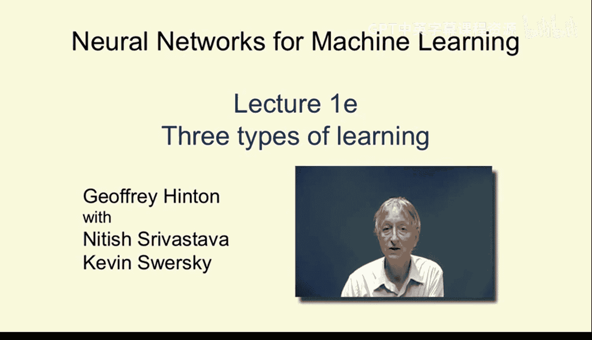
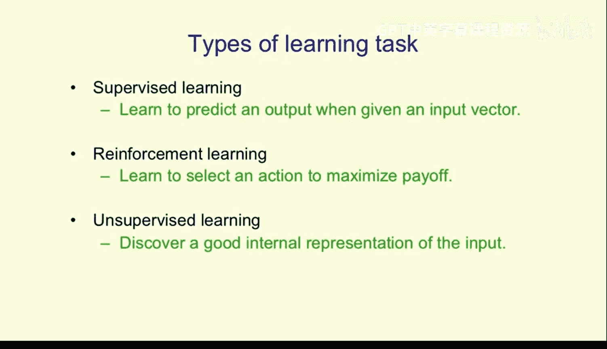
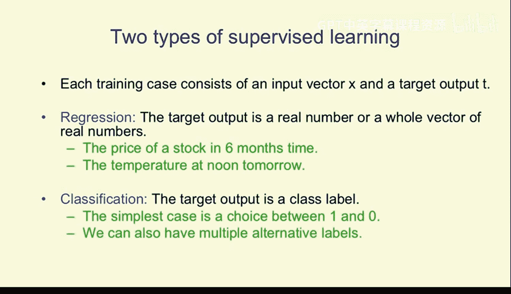
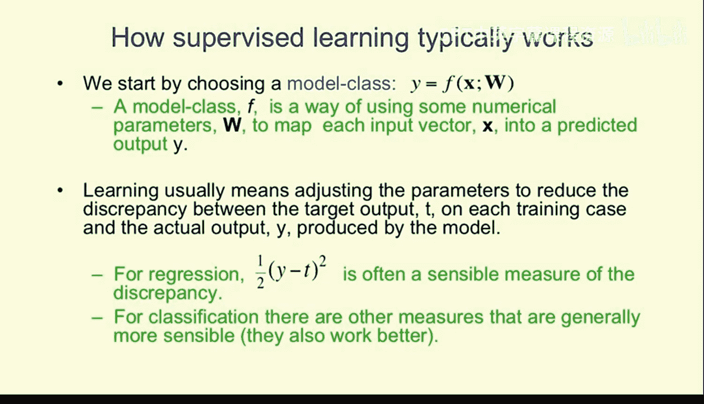
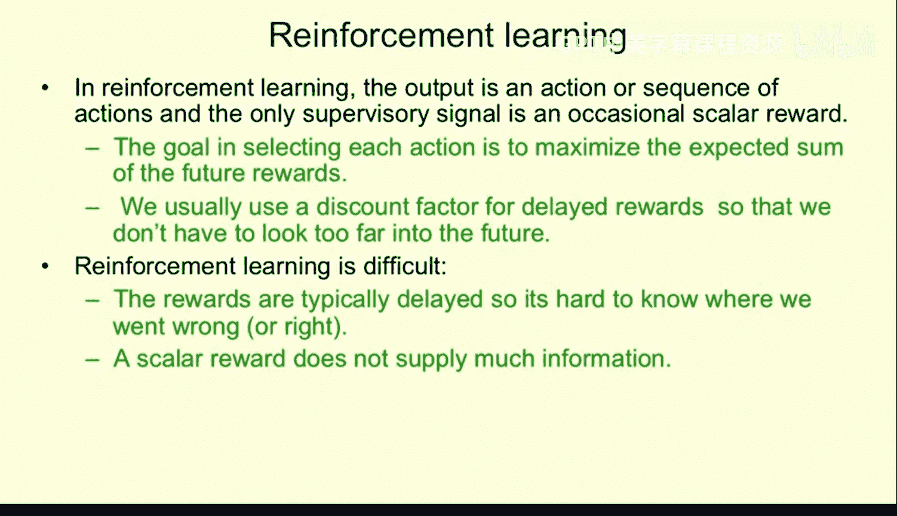
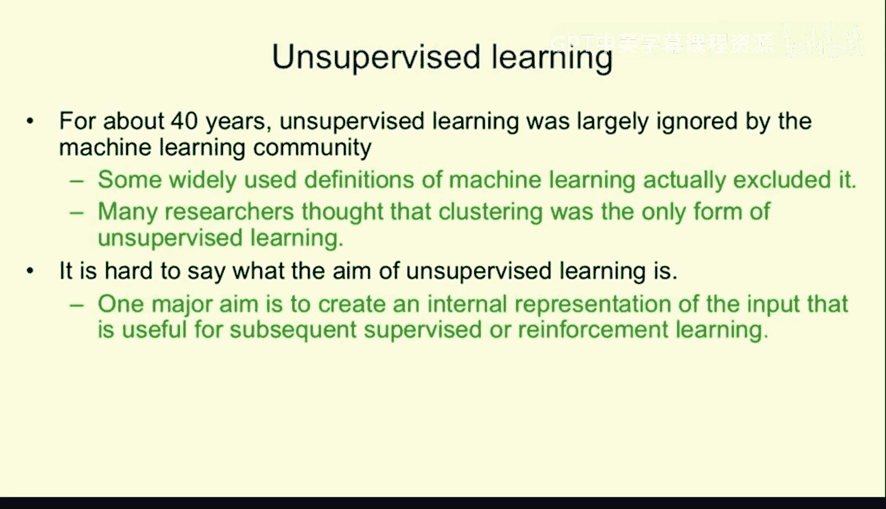
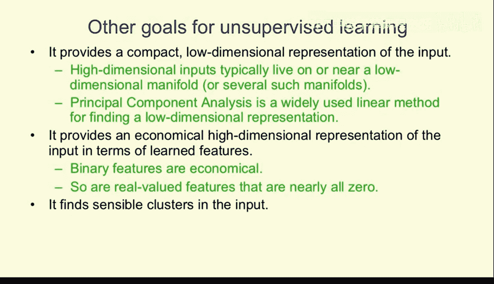

# 神经网络与机器学习：1.5：三种学习类型 🧠

在本节课中，我们将学习机器学习的三种主要类型：监督学习、强化学习和无监督学习。我们将逐一探讨它们的定义、目标、应用场景以及核心区别。课程的前半部分将重点介绍监督学习，后半部分则主要关注无监督学习，而强化学习将不在本课程中详细展开。

---

## 监督学习

上一节我们介绍了机器学习的三种主要类型，本节中我们来看看第一种：监督学习。在监督学习中，我们的目标是在给定输入向量时，预测一个输出。监督学习的目的非常明确。

监督学习本身又分为两种不同的形式：

以下是两种主要的监督学习任务：

*   **回归**：目标输出是一个实数或一个实数向量。例如，预测一支股票六个月后的价格或明天中午的温度。其目标是尽可能接近正确的实数。
*   **分类**：目标输出是一个类别标签。最简单的情况是在1和0（正例和负例）之间做选择。当然，我们也可以有多个备选标签，例如对手写数字进行分类。

监督学习的工作原理如下：首先选择一个**模型类**，即我们准备考虑作为候选的一整套模型。你可以将模型类看作一个函数，它接收一个输入向量和一些参数，并给出一个输出 `y`。因此，模型类只是一种使用某些数值参数 `W` 将输入映射到输出的方式。

然后，我们调整这些数值参数，使映射关系**拟合**监督训练数据。所谓“拟合”，是指最小化每个训练案例的目标输出与我们的机器学习系统产生的实际输出之间的**差异**。

如果输出是实数值，一个衡量差异的直观指标是我们的系统输出 `Y` 与正确输出 `T` 之间的**平方差**。我们通常会加上一个 `1/2` 系数，以便在求导时消去系数 `2`。

对于分类任务，虽然也可以使用这个指标，但后续我们会介绍其他更合理的衡量标准，而且这些标准通常效果也更好。

---

## 强化学习

在了解了需要明确目标输出的监督学习后，我们来看看第二种类型：强化学习。在强化学习中，智能体需要选择动作或动作序列，其依据是偶尔获得的奖励。

选择每个动作的目标是最大化未来奖励的期望总和。我们通常会使用一个**折扣因子**，这样就不必看得太远。这意味着，遥远的未来奖励不如近期获得的奖励重要。

强化学习是困难的。其难点在于奖励通常是延迟的，因此很难在长序列的动作中确切知道是哪个动作导致了问题。此外，稀疏的奖励（尤其是偶尔才出现的奖励）所提供的用于调整参数的信息量很少。因此，通常无法使用强化学习来学习数百万个参数。

而在监督学习和无监督学习中，则可以做到。通常，在强化学习中，我们试图学习几十个或可能几百个参数，但不会是数百万个。

---

## 无监督学习

由于课程无法涵盖所有内容，我们将不涉及强化学习，尽管它是一个重要主题。无监督学习将在课程的后半部分进行讲解。

在大约40年的时间里，机器学习界基本上忽视了无监督学习，除了一种非常有限的形式——**聚类**。事实上，他们使用的机器学习定义甚至将其排除在外。在一些教科书中，机器学习被定义为从输入到输出的映射。许多研究人员认为聚类是无监督学习的唯一形式。

造成这种情况的一个原因是，很难说清无监督学习的目标是什么。

一个主要目标是创建一种对输入有用的**内部表示**，以用于后续的监督学习或强化学习。我们之所以希望分两个阶段进行，是因为我们不想（例如）使用强化学习的回报来设置我们视觉系统的参数。

你可以通过双眼图像之间的视差来计算到物体表面的距离。但你不想通过反复撞到脚趾，并在每次撞到脚趾时调整视觉系统的参数来学习这种距离计算。那将需要撞到脚趾非常多次。有更好的方法，可以仅基于输入中的信息来学习融合两幅图像。

无监督学习的其他目标包括：

以下是几个无监督学习的目标：

*   **提供输入的紧凑、低维表示**：像图像这样的高维输入，通常位于或接近一个低维**流形**。对于手写数字这样的数据，可能存在多个这样的流形。这意味着，即使你有一百万个像素，实际可能发生的变化自由度并没有一百万那么多，可能只有几百个。因此，我们希望从一百万个像素转换到能表示这几百个自由度的表示，这相当于说明我们在流形上的位置。同时，我们还需要知道我们位于哪个流形上。一个非常有限的形式是**主成分分析**，它是线性的，并假设只有一个流形，且该流形是高维空间中的一个平面。
*   **提供基于学习特征的输入的经济表示**：例如，如果我们能用二进制特征来表示输入，这通常是经济的，因为表示一个二进制特征的状态只需要一个比特。或者，我们可以使用大量实值特征，但要求对于每个输入，这些特征中几乎全部恰好为0。在这种情况下，对于每个输入，我们只需要表示少数几个实数，这也是经济的。
*   **在输入中发现聚类**：如前所述，聚类可以被视为一种非常稀疏的编码。也就是说，我们为每个聚类设置一个特征，并要求除了一个特征外，所有特征都为0，而那个特征值为1。因此，聚类实际上是寻找稀疏特征的一个极端情况。

---

## 总结

本节课中，我们一起学习了机器学习的三种主要类型。**监督学习**旨在根据输入预测明确的输出，分为回归（预测实数值）和分类（预测类别标签）。**强化学习**则关注通过选择动作来最大化延迟的、稀疏的奖励总和，其学习过程更具挑战性。最后，**无监督学习**的目标是发现输入数据中有用的内部结构或表示，例如降维、特征学习或聚类，它为理解复杂数据提供了基础，而无需明确的输出标签。本课程后续将重点深入探讨监督学习和无监督学习。