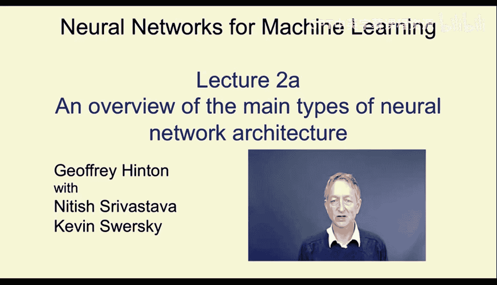
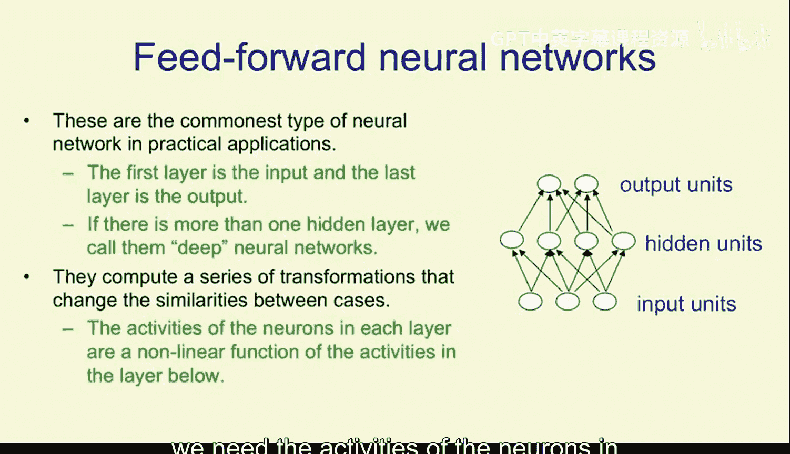
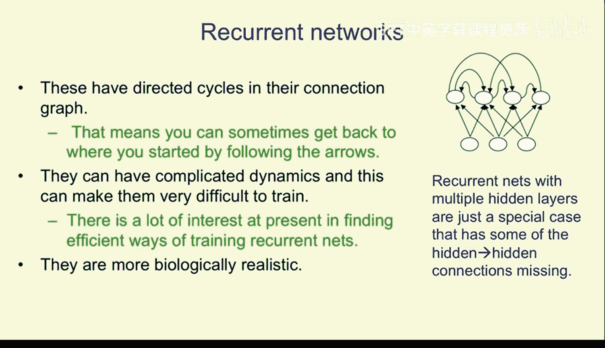
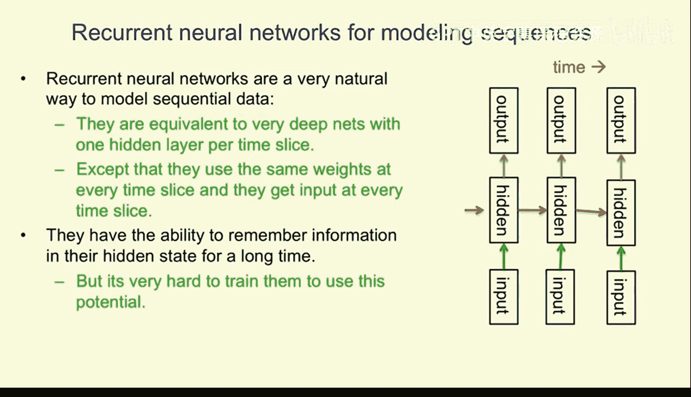
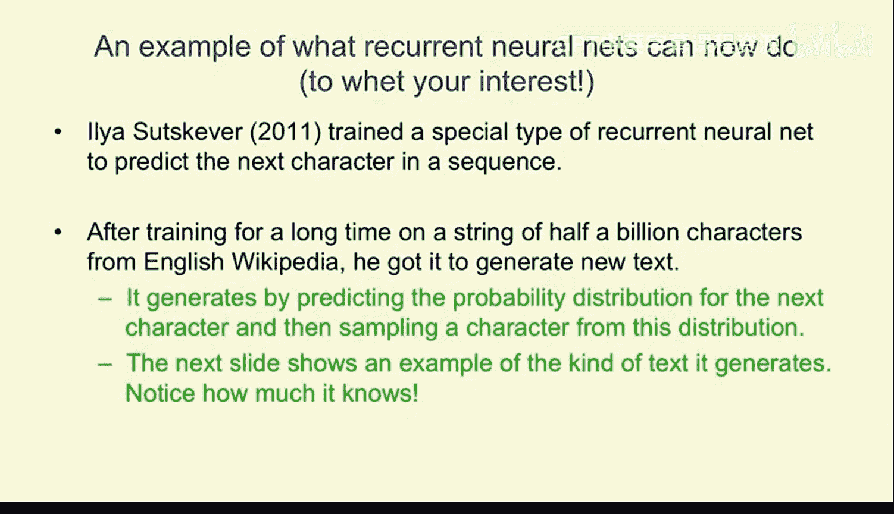
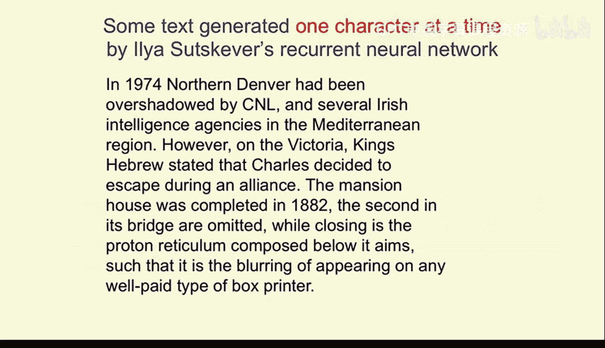
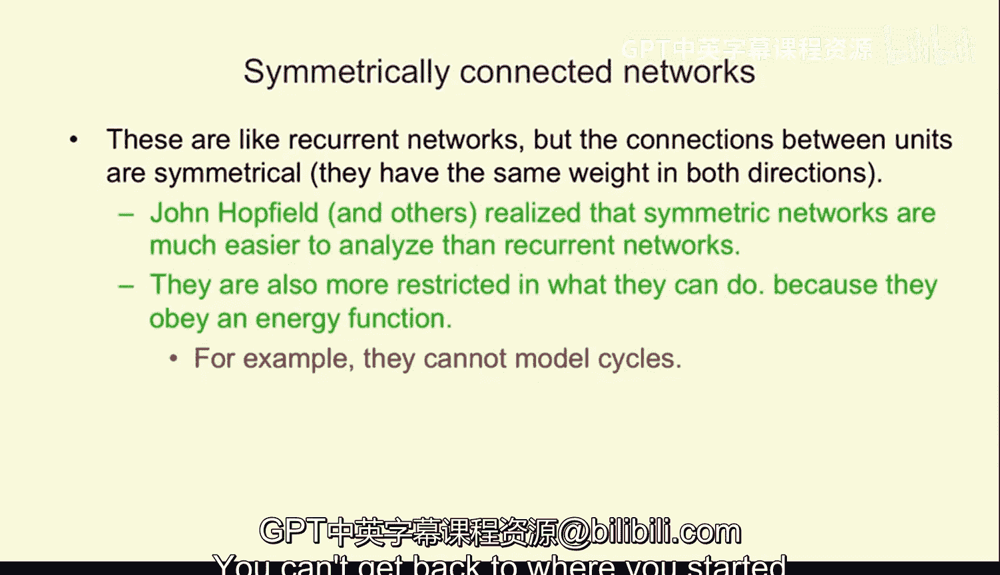

# Hinton@多伦多大学《机器学习的神经网络｜Neural Networks for Machine Learning 2016》claude-4s p06 -06-Lecture 2.1 — Types of neural network architectures  -Neural Networks for Ma -BV1HtkUB2EZD_p6-

In this video， I'm going to describe various kinds of architectures for neural network。

What I mean by an architecture is the way in which the neurons are connected together。By far。

 the commonest type of architecture in practical applications is a feed forward neural network where the information comes in at the input units and flows in one direction through hidden layers until it reaches the output units。

A much more interesting kind of architecture is a recurrent neural network。

In which information can flow round in cycles。These networks can remember information for a long time。

They can exhibit all sorts of interesting oscillations。But they're much more difficult to train。

 in part， because they are so much more complicated in what they can do。Recently， however。

 people have made a lot of progress in training on current neural networks。

 and they can now do some fairly impressive things。

The last kind of architecture Ill describe is a symmetrically connected network。

 one in which the weights are the same in both directions between two units。

The commonest type of neural network in practical applications is a feed forward neural network。

This has some input units。And in the first layer at the bottom。

Some output units in the last layer at the top。And one or more layers of hidden units。

If there's more than one layer of hidden units， we call them deep neural networks。

These networks compute a series of transformations between their input and their output。

So at each layer， you get a new representation of the input。

In which things that were similar in the previous layer may have become less similar。

All things that were dissimilar in the previous layer may become more similar。

So in speech recognition， for example， we'd like the same things said by different speakers to become more similar and different things said by the same speaker to become less similar as we go through the layers of the network。

In order to achieve this， we need the activities of the neurons in each layer to be a nonlinear function with the activities in the lab below。

Recurrent neural networks are much more powerful than feed forward neural networks。

They have directed cycles in the direct， in their connection graph。

What this means is that if you start at a node or a neuron and you follow the arrows。

 you can sometimes get back to the neuron you started at。They can have very complicated dynamics。

And this can make them very difficult to train。There's a lot of interest at present in finding efficient ways of training your current nets because they are so powerful if we can train them。

They're also more biologically realistic。Recurrent neural networks with multiple hidden layers are really just a special case of a general recurrent neural network that has some of its hidden to hidden connections missing。

Recurrent neural networks are a very natural way to model sequential data。

So what we do is we have connections between hidden units。

And the hidden units act like a network that's very deep in time。So at each time step。

 the states of the hidden units determines the states of the hidden units at the next time step。

One way in which they differ from fee coordinates is that we use the same weights at every time step。

So if you look at those red arrows， where the hidden units are determining the next state of the hidden units。

 the weight matrix depict by each red arrow is the same at each time step。

They also get inputs at every time step and often give outputs at every time step。

 And those all use the same weight matrices， too。Recurrent nets have the ability to remember information in their hidden state for a long time。

Unfortunately， it's quite hard to train them to use that ability。However。

Recent algorithms have been able to do that。

So just to show you what recurrent neural nets can now do。I'm going to show you a net。

Designed by Elis at Sva。It's a special kind of recurrent neural net slightly different from the kind in the diagram on the previous slide。

And it's used to predict the next character in a sequence。

So Iya trained it on lots and lots of strings from English Wikipedia。

It's seeing English characters and trying to predict the next English character。

He actually used 86 different characters to allow for punctuation and digits and capital letters and so on。

After he trained it。One way of seeing how well it can do。

Is to see whether it assigns high probability to the next character that actually occurs。

Another way of seeing what it can do is to get it to generate text。

So what you do is you give it a string of characters and get it to predict probabilities for the next character。

Then you pick the next character from that probability distribution。

It's no use picking the most likely character。 If you do that after a while。

 it starts saying the United States of the United States， of the United States of the United States。

That tells you something about Wikipedia。But if you pick。From the probability distribution。

 So if it says there's a1 in 100 chance it was a Z， you pick a Z one time in 100。

Then you see much more about what it's learned。The next slide shows an example of the text that it generates。

And it's interesting to notice how much is learned just by reading Wikipedia and trying to predict the next character。

So remember， this text was generated one character at a time。

Notice that it makes reasonably sensible sentences。

 and they're composed almost entirely of real English words。 Occaion， it makes non word。

 but they're typically sensible words。And notice that within a sentence， it has some thematic sense。

 So the phrase several Irish intelligence agencies in the Mediterranean region。Has problems。

 but it's almost good English。Notice also the thing it says at the end。

Such that it is the blurring of appearing on any well paid type of box printer。

 There's a certain sort of thematic thing there about appearance and printing。

 And the syntax is pretty good。

And remember， that's one character at a time。Quite different from recurren nets。

 are symmetrically connected networks。In these， the connections of train units have the same weight in both directions。

John Hoptfield and others realized that symmetric networks are much easier to analyze than recurrent networks。

This is mainly because they're more restricted in what they can do。

And that's because they obey an energy function。So they can't， for example， model cycles。

 You can't get back to where you started in one of these symmetric networks。

