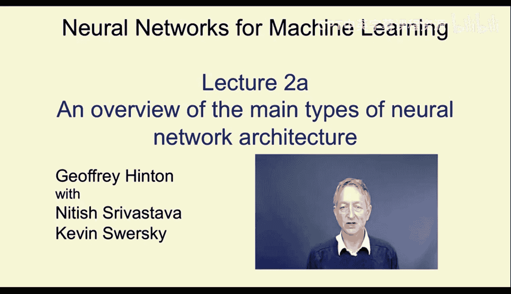
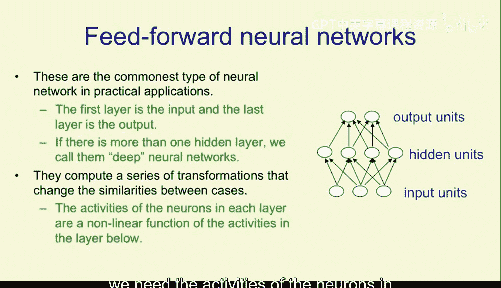
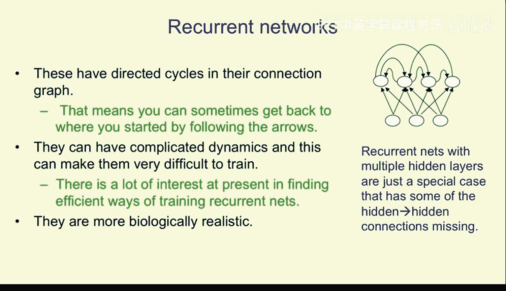
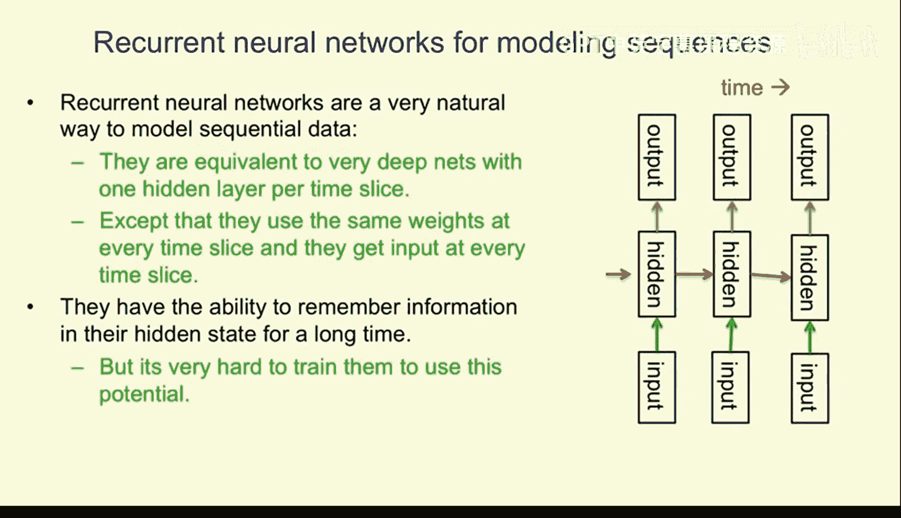
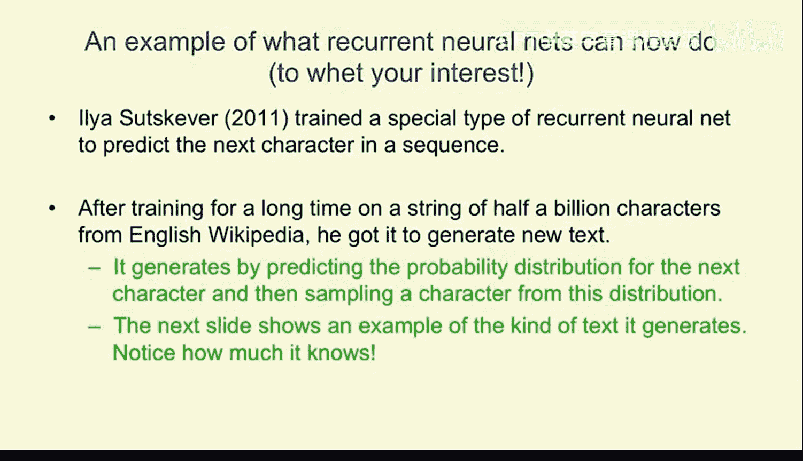
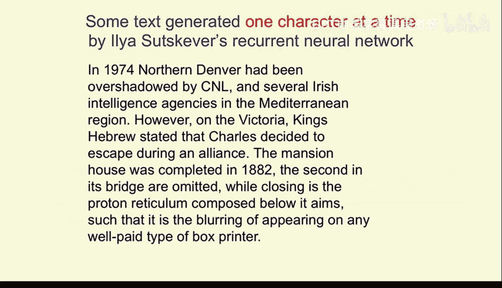
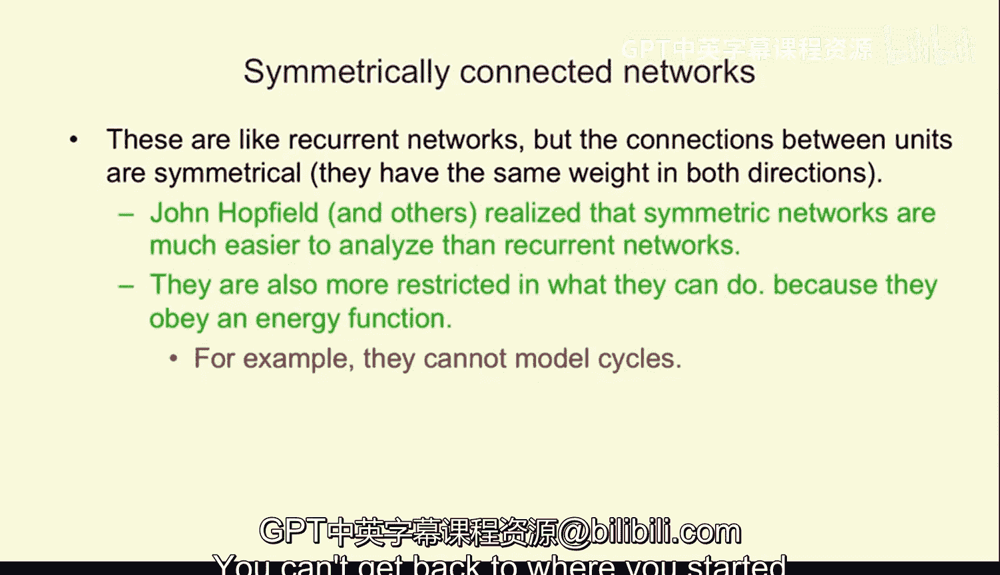

# 神经网络架构：2.1：神经网络架构类型 🧠

在本节课中，我们将学习神经网络的不同架构类型。所谓“架构”，指的是神经元之间的连接方式。理解这些基本架构是深入学习神经网络工作原理的第一步。

## 前馈神经网络 📤

最常见的神经网络架构是前馈神经网络。在这种网络中，信息从输入单元进入，沿着单一方向流经一个或多个隐藏层，最终到达输出单元。

以下是前馈神经网络的主要特点：
*   **结构层次**：包含输入层、一个或多个隐藏层以及输出层。
*   **深度网络**：当隐藏层多于一层时，我们称之为深度神经网络。
*   **信息变换**：网络在输入和输出之间计算一系列变换。每一层都会生成输入的一个新表示。
*   **非线性**：为了实现有效的表示学习，每一层神经元的激活值必须是其下层神经元激活值的**非线性函数**。例如，在语音识别中，我们希望不同说话者说的相同内容在经过网络各层后变得更相似，而同一说话者说的不同内容变得更不相似。

上一节我们介绍了最常见的前馈网络，本节中我们来看看一种功能更强大但也更复杂的架构。

## 循环神经网络 🔁

循环神经网络比前馈神经网络更强大。它们的连接图中包含有向循环，这意味着从一个神经元出发，沿着箭头方向有时可以回到起点。这种结构带来了复杂的动态特性，但也使得训练它们非常困难。

目前，人们非常关注寻找训练循环网络的有效方法，因为一旦能够成功训练，它们将非常强大。此外，循环神经网络也更接近生物神经网络的实际情况。具有多个隐藏层的循环网络，实际上只是更一般的循环网络的一种特例，其中某些隐藏层到隐藏层的连接被省略了。

循环神经网络是建模序列数据的自然方式。以下是其工作原理：
*   **时间深度**：隐藏单元之间的连接使得网络在时间上非常“深”。在每一个时间步，隐藏单元的状态决定了下一个时间步隐藏单元的状态。
*   **权重共享**：与普通前馈网络不同，循环网络在每个时间步使用相同的权重矩阵（如图中红色箭头所示）。输入和输出在每个时间步也使用相同的权重矩阵。
*   **记忆能力**：循环网络有能力在其隐藏状态中长时间记住信息。然而，训练它们使用这种能力相当困难。幸运的是，近期的算法已经在这方面取得了进展。

为了展示循环神经网络的能力，我们来看一个由Ilya Sutskever设计的网络示例。该网络经过大量英文维基百科文本训练，用于预测序列中的下一个字符。训练后，让它根据给定的字符序列生成文本（通过从预测的概率分布中采样下一个字符），结果如下：

> “Several Irish intelligence agencies in the Mediterranean region... Such that it is the blurring of appearing on any well paid type of box printer.”

请注意，这段文本是一个字符一个字符生成的。它能够组成基本合理的句子，并且几乎全部由真实的英文单词构成。句子内部也具有一定的主题连贯性。这表明网络通过阅读维基百科并尝试预测下一个字符，学到了大量的语言结构知识。

## 对称连接网络 ⚖️

与循环网络截然不同的是对称连接网络。在这种网络中，两个单元之间的连接在两个方向上具有相同的权重。

John Hopfield等人意识到，对称网络比循环网络更容易分析。这主要是因为它们的功能受到更多限制，因为它们遵循一个能量函数。例如，它们无法建模循环动态，你无法在这样的对称网络中回到起点。

---

本节课中我们一起学习了三种主要的神经网络架构：**前馈神经网络**、**循环神经网络**和**对称连接网络**。前馈网络结构简单、应用广泛；循环网络擅长处理序列数据并具有记忆能力，但训练复杂；对称网络则因其能量函数的特性而易于分析。理解这些基础架构是探索更高级神经网络模型和应用的关键。