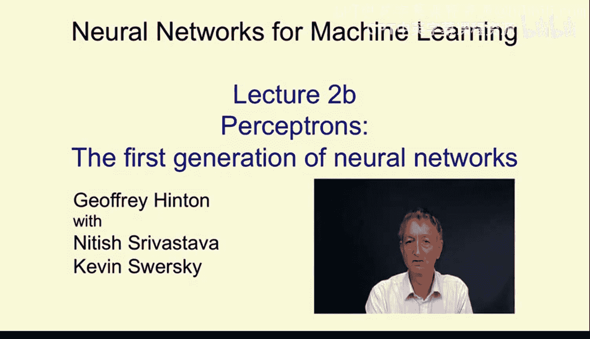
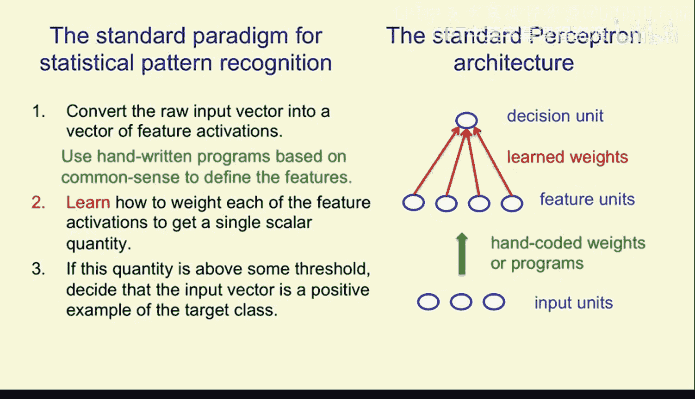
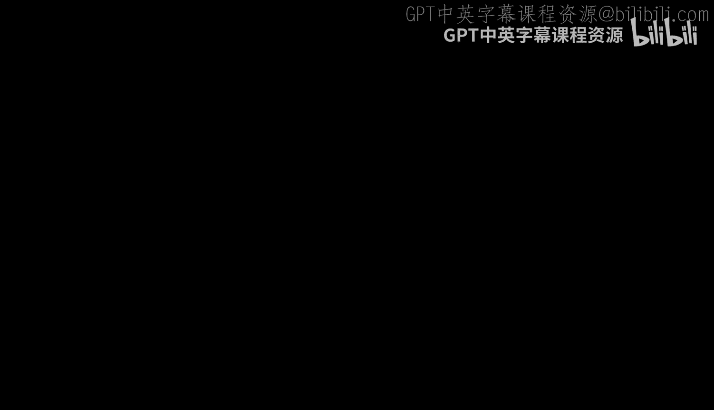
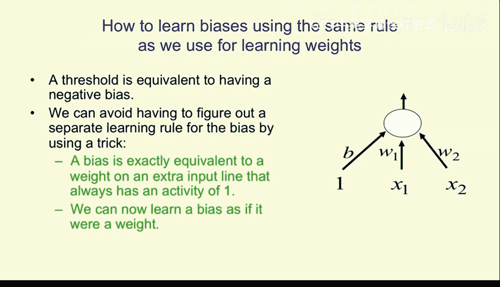
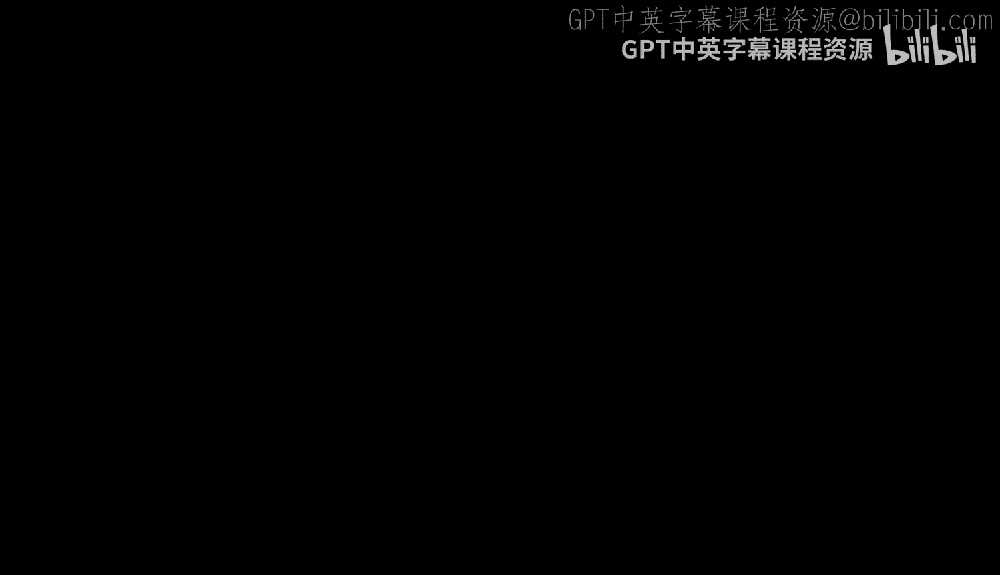
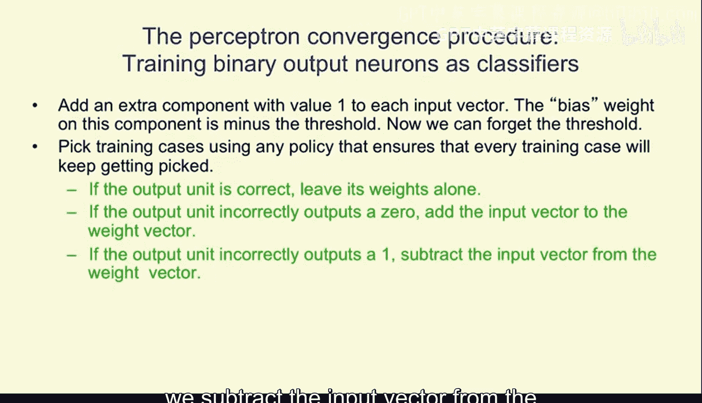

# Hinton@多伦多大学《机器学习的神经网络｜Neural Networks for Machine Learning 2016》claude-4s p07 -07-Lecture 2.2 — Perceptrons_ first-generation neural networks  -Neural Network -BV1HtkUB2EZD_p7-

In this video。I'm gonna talk about perceptrons。These were investigated in the early 1960s。

 and initially， they looked very promising as learning devices。But then， they fell into disfavour。

Because Minsky and puppets showed they were rather restricted in what they could learn to do。

In statistical pattern recognition。There's a standard way to recognize patterns。

We first take the raw input。And we convert it into a set or vector of feature activations。

We do this using handwritten programs， which are based on common sense。

 So that part of the system does not learn。We look at the problem。

 We decide what the good features should be。 We try out some features。

 We see if they work If they don't work。 We try some more features。 And eventually。

 we get a set of features that allow us to solve the problem by using a subsequent learning stage。

What we learn is how to weight each of the feature activations in order to get a single single scalar quantity。

So the weights on the features。Represent how much evidence the feature gives you in favour or against the hypothesis that the current input is an example of the kind of pattern you want to recognise。

And when we add up all the weighted features， we get a sort of total evidence in favour of hypothesis that this is the kind of pattern we want to recognize。

And if that evidence is above some threshold， we decide that the imperfectctor is a positive example of the class of patterns we're trying to recognize。

A perceptron is a particular example of a statistical pattern recognition system。

So there were actually many different kinds of perceptron， but the standard kind。

 which Rosenblt called an alpha perceptron。Consists of some inputs。

 which are then converted into feature activities。 They might be converted by things that look a bit like neurons。

 but that stage of the system does not learn。Once you've got the activities of the features。

 you then learn some weights。So that you can take the feature activities， times the weights。

And you decide whether or not it is an example of the class you' are interested in by seeing whether that sum of feature activities times learned Waits is greater than a threshold。

Pceptrons have an interesting history。 They were popularized in the early 1960s， by Frank Rosenblt。

He wrote a great big book called Principles of Neurodynamics。

 in which he described many different kinds of perceptrons。

And that book was full of ideas。The most important thing in the book was a very powerful learning algorithm or something that appeared to be a very powerful learning algorithm。

A lot of grand claims were made for what perceptrons could do using this learning algorithm。

For example。People claimed they could tell the difference between pictures of tanks and pictures of trucks。

Even if the tanks and trucks were sort of partially obscured in a forest。Now。

 some of those claims turned out to be false。In the case of the tanks and the trucks。

 it turned out the pictures of the tanks were taken on a sunny day。

 and the pictures of the trucks were taken on a cloudy day。

And all the perceptron was doing was measuring the total intensity of all the pixels。

 That's something that we humans are fairly insensitive to。 We notice the things in the picture。

 but a perceptron can easily learn to add up the total intensity。😊。

That's the kind of thing that gives an algorithm a bad name。In 1969。

 Minskin Papper published a book called Perceptrons。That analyzed what perceptrons could do。

And shared their limitations。Many people thought those limitations apply to all neural network models。

And the general feeling within artificial intelligence was that Minsky Pat had shown that neural network models were nonsense or that they couldn't learn difficult things。

Minsky and Pat themselves knew they hadn't shown that。 They'd just shown that perceptrons。

Of the kind for which the powerful learning algorithm applied。Could not do a lot of things。Or rather。

 they couldn't do them by learning。 They could do them if you sort of handwi the answer in the inputs。

 but not by learning。But that result got wildly over generalized。

 And when I started working on neural network models in the 1970s。

 people in artificial intelligence kept telling me that Minsky and Pat proved that these models were no good。

Actually， the perceptron convergence procedure。Which we'll see in a minute is still widely used today for tasks that have very big feature vectors。

 So Google， for example， uses it to predict things from very big vectors of features。

So the decision unit in a biceptron is a binary threshold neuron。 We've seen those before。

 and just to refresh you on those。They computer weighted some of the inputs they get from other neurons。

 They add on a bias。To get their total input。 And then they give an output of one。

 if that sum exceeds 0 and they give an output of 0 otherwise。

We don't want to have to have a separate learning rule for learning biases。

And it turns out we can treat biases just like weights。

 If we take every input vector and we stick a one on the front of it and repeat the bias as like the weight on that first feature that always has a value of one。

So the bias is just the negative of the threshold。And using this trick。

 we don't need a separate learning rule for the bias。 It's exactly equivalent。

To learn your weight on this extreme point line。

So here's the very powerful learning procedure for perceptrons。

 And it's a learning procedure that's guaranteed to work， which is a nice property to have。😊。

Of course， you have to look at the small print later about why that guarantee isn't quite as good as you think it is。

So we first had this extra component with a value of one to every input vector。

 Now we can forget about the viruses。And then we keep picking training cases using any policy we like。

As long as we ensure that every training case gets picked without waiting too long。

I'm not gonna define precisely what I mean by that。If you're a mathematician。

 you can think about what might be a good definition。Now， having picked a training case。

 you look to see if the outputs correct。If it is correct， you don't change the weights。

If the output unit outputs are 0， when it should have output a 1。 In other words。

 it said it's not an instance of the pattern we're trying to recognize when it really is。

Then all we do is we add the input vector to the weight vector of the perceptron。Conversely。

 if the output unit outputs are one when it should output a 0。

 we subtract the input vector from the weight vector of the receptorcept。

And what's surprising is that that simple learning procedure is guaranteed to find you a set of weights that will get the right answer for every training case。

The parrizo is that it can only do it if there is such a set of weights。

And for many interesting problems， there is no such set of weights。

Whether or not a set of weights exist depends very much on what features you use。

So it turns out that for many problems the difficult bit is deciding what features to use if you're using the appropriate features。

 learning then may then become easy， if you're not using the right features。

 learning becomes impossible and all the work is in deciding the features。

