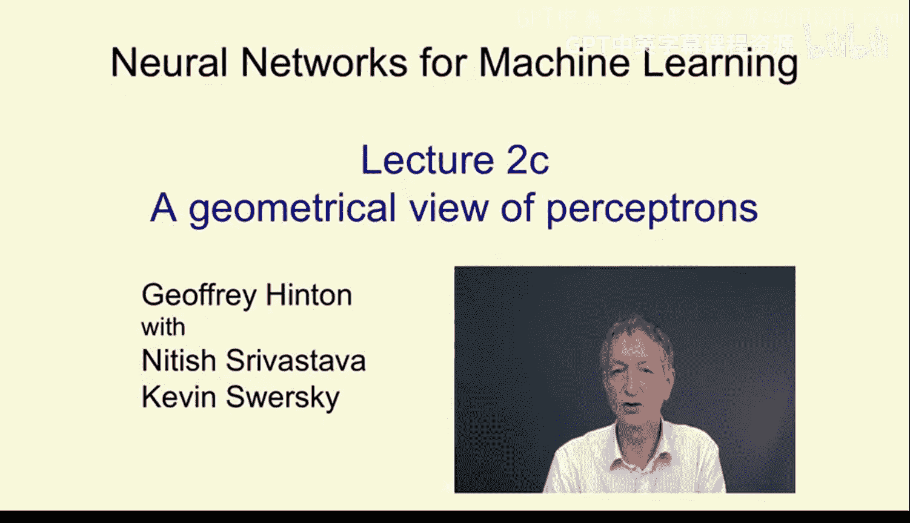
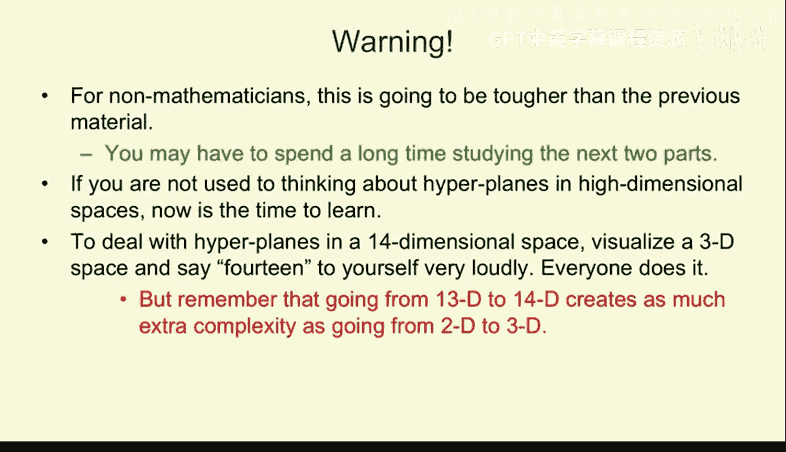
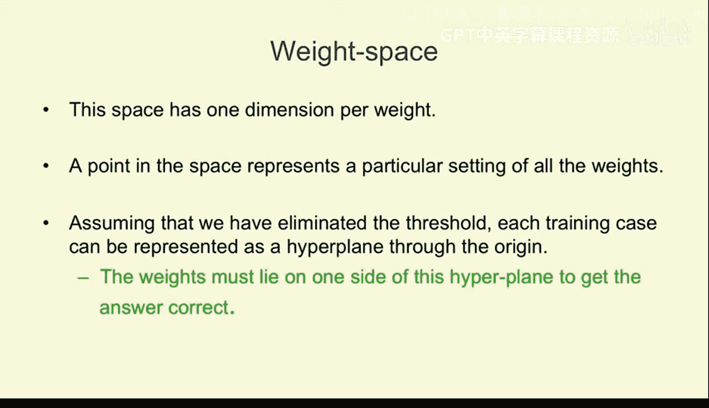
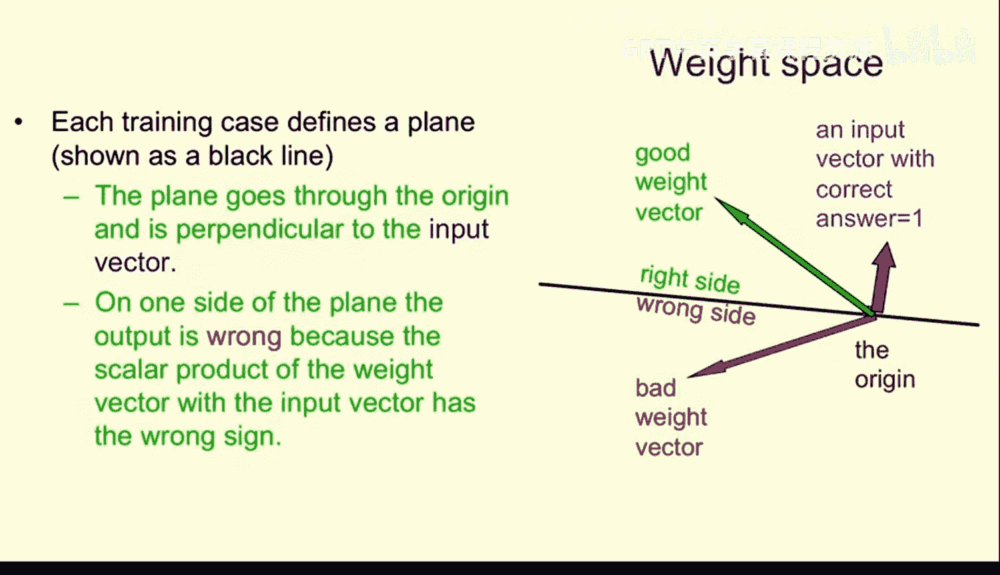
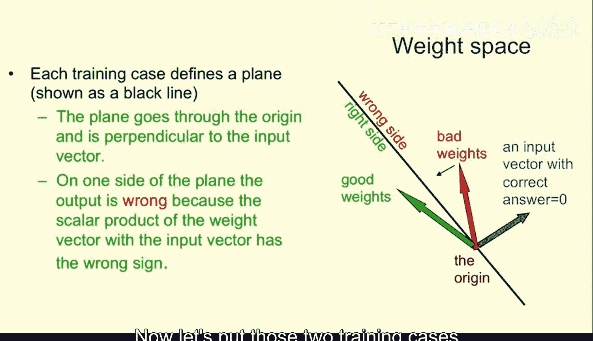
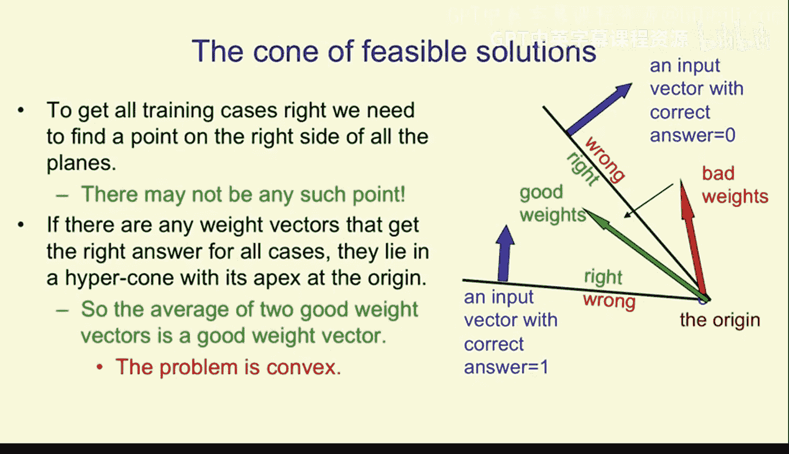

# Hinton@多伦多大学《机器学习的神经网络｜Neural Networks for Machine Learning 2016》claude-4s p08 -08-Lecture 2.3 — A geometrical view of perceptrons  -Neural Networks for Machin -BV1HtkUB2EZD_p8-

In this video。We're going to get a geometrical understanding of what happens when a perceptron learns。

To do this， we have to think in terms of a weight space。

 It's a high dimensional space in which each point corresponds to a particular setting for all the weights。

In this space， we can represent the training cases as planes。

 and learning consists of trying to get the weight vector on the right side of all the training planes。

For non mathematicians， this may be tougher than previous material。

You may have to spend quite a long time studying the next two parts。In particular。

 if you're not used to thinking about hyperplanes in high dimensional spaces。

 you're going to have to learn that。To deal with hyperplanes in a 14 dimensional space， for example。

What you do is you visualize your three dimensional space， and you say 14 to yourself very loudly。

 Everybody does it。But remember that when you go from a 13 dimensional space to a 14 dimensional space。

 you are creating as much extra complexity as when you go from a 2D space to a 3D space。

140 dimensional space is very big and very complicated。

So we're going to start off by thinking about weight space。

This is a space that has one dimension for each weight in the perceptron。

A point in the space represents a particular setting of all the weights。

Assuming we've eliminated the threshold。We can represent every training case as a hyperplane through the origin in white space。

So points in the space correspond to weight vectors and training cases correspond to planes。And。

For a particular training case。The weights must lie on one side of that hyperplane in order to get the answer correct for that training case。

So let's look at a picture of it so we can understand what's going on。

Here is a picture of weight space。The training case。

 we're going to think of one training case for now。It defines a plane。

 which in this 2D picture is just the black line。The plane goes through the origin。

And it's perpendicular to the input vector for that training case， which is shown as a blue vector。

We're going to consider a training case in which the correct answer is one。

And for that kind of training case。The weight vector needs to be on the correct side of the hyperplane in order to get the answer right。

 it needs to be on the same side of the hyperplane as the direction in which the training vector points。

For any weight vector like the green 1 that's on that side of the hyperplane。

 the angle with the input vector will be less than 90 degrees。So the scalar product。

Of the input vector， with the weight factor。Will be positive。

And since we already got rid of the threshold， that means the perceptrum will give an output of one。

 It'll say yes。 And so we'll get the right answer。Conversely。

 if we have a weight vector like the red one that's on the wrong side of the plane。

The angle with the input vector will be more than 90 degrees。

So the scalar product of the weight vector and the input vector will be negative。And。

We'll get a scner product that's less than 0。 So the perceptron。Will say no or zero。And in this case。

 we'll get the wrong answer。So， to summarize。On one side of the plane。

All the weight vectors will get the right answer。 And on the other side of the plane。

All the possible weight factors will get the wrong answer。

Now let's look at a different training case in which the correct answers are0。

So here we have the weight space again。We've chosen a different imp vector。

 And for this input factor， the right answer is 0。So， again。

The input case corresponds to a plane shown by the black line。And in this case。

Any weight vectors that make an angle of less than 90 degrees with the input vector。

Will give us a positive scalear product and so they' are cause of exception to say yes or one。

And it will get the answer wrong。Conversely， any input vector on the other side of the plane。

Will have an angle of greater than 90 degrees， and they will correctly give the answer of 0。

So as before the plane goes through the origin， it's perpendicular to the input factor。

And on one side of the plane， all the weight vectors are bad and on the other side， they're all good。

Now let's put those two training cases together in one picture of weight space。

My picture of white space is getting a little bit crowded。I've moved the input vectors over。

 so we don't have all the vectors in quite the same place。And now you can see that there's a cone。

Of possible weight factors。And any weight vectors inside that comb will get the right answer for both training cases。

Of course， there doesn't have to be any cone like that。

It could be that are no weight vectors that get the right answers for all of the training cases。

 but if there are any， they'll line of code。So what the learning algorithm needs to do。

Is consider the training cases one at a time。And move the white vector around in such a way that it eventually lies in this coat。

One thing to notice is。That if you get a good weight vector。

 that is something that works for all the training cases。It'll lie on the cone。

 And if you get another one， it'll lie on the cone。

 And so if you take the average of those two weightt factors， that would also lie in the cone。

 That means the problems conves。 The average of two solutions is itself， a solution。And in general。

 machine learning。If you can get a convex learning problem， that makes life easy。

