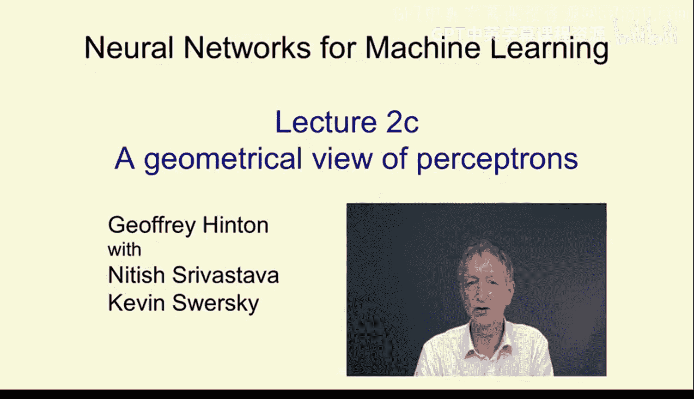
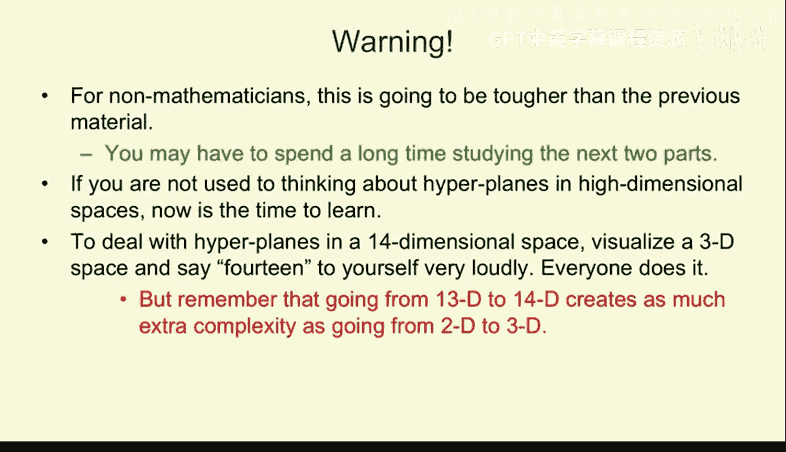
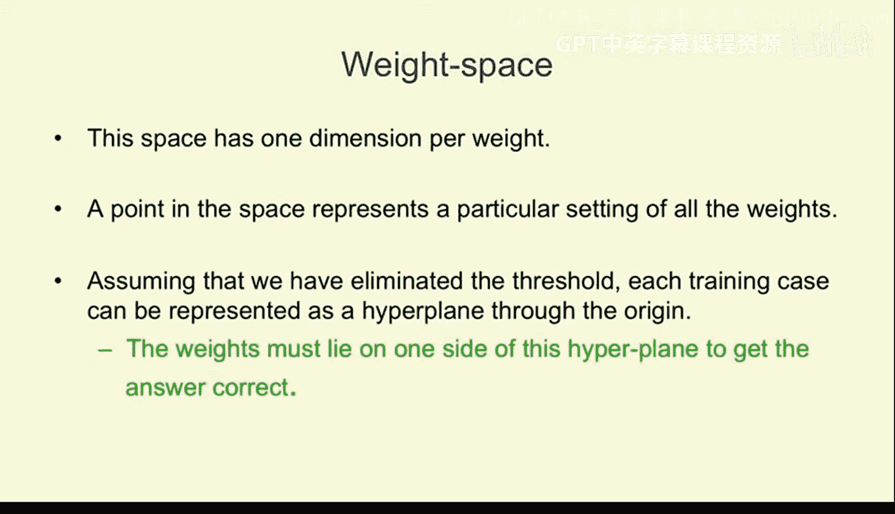
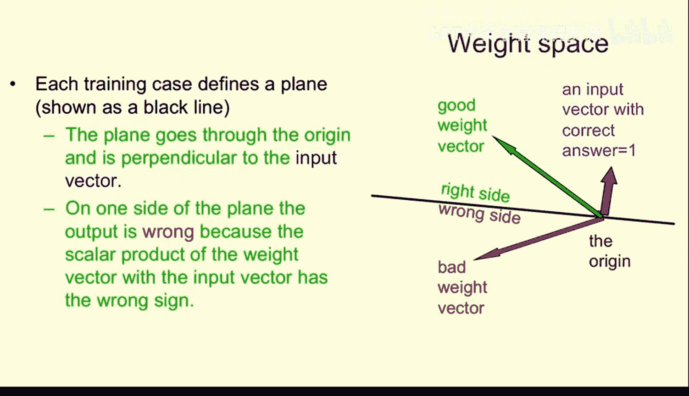
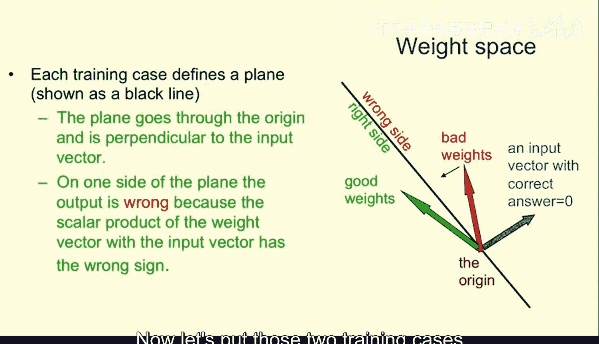
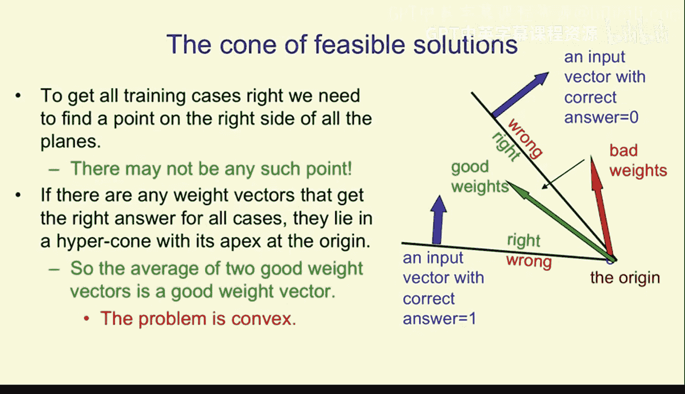

# 机器学习的神经网络：2.3：感知器的几何视角 🧠

在本节课中，我们将从几何角度理解感知器学习时发生了什么。我们将引入“权重空间”的概念，并在此空间中用平面表示训练样本。学习的目标是让权重向量移动到所有训练样本平面正确的一侧。

## 理解权重空间 📐

上一节我们介绍了感知器的基本工作原理，本节中我们来看看如何从几何视角理解它。

为了做到这一点，我们必须从“权重空间”的角度来思考。这是一个高维空间，空间中的每一个点都对应着所有权重的一个特定设置。

在这个空间中，我们可以将训练样本表示为平面。学习的过程就是尝试让权重向量移动到所有训练平面的正确一侧。

对于非数学背景的学习者，这部分内容可能比之前的材料更难。你可能需要花相当长的时间来学习接下来的两部分内容。

特别是，如果你不习惯思考高维空间中的超平面，你将需要学习这个概念。例如，要处理14维空间中的超平面，你需要先在脑海中想象三维空间，然后对自己大声说“14”。每个人都是这么做的。

但请记住，当你从13维空间进入14维空间时，你所增加的复杂度，与从2维空间进入3维空间时增加的复杂度是相当的。140维空间非常庞大且复杂。

## 权重空间与训练平面 🔍

现在，让我们开始思考权重空间。这个空间的维度数量等于感知器中权重的数量。空间中的一个点代表了所有权重的一个特定设置。

假设我们已经消除了阈值，那么每个训练样本都可以在权重空间中表示为一个穿过原点的超平面。

因此，空间中的点对应权重向量，而训练样本对应平面。对于一个特定的训练样本，权重必须位于该超平面的某一侧，才能为该样本给出正确答案。

让我们通过一张图来理解发生了什么。

这是一张权重空间的示意图。我们暂时只考虑一个训练样本。它定义了一个平面，在这张二维图中就是那条黑线。该平面穿过原点，并且垂直于该训练样本的输入向量（图中显示为蓝色向量）。

我们考虑一个正确答案为1的训练样本。对于这类样本，权重向量需要位于超平面的正确一侧才能得到正确答案，即它需要位于与训练向量所指方向相同的超平面那一侧。

对于任何位于超平面那一侧的权重向量（如图中绿色的向量），其与输入向量的夹角将小于90度。因此，输入向量与权重向量的**标量积（点积）**将是正数。

由于我们已经去除了阈值，这意味着感知器将输出1（即“是”），从而得到正确答案。

反之，如果我们有一个位于平面错误一侧的权重向量（如图中红色的向量），其与输入向量的夹角将大于90度。因此，权重向量和输入向量的标量积将为负数。我们将得到一个小于0的标量积，所以感知器将输出0（即“否”），在这种情况下，我们会得到错误答案。

总结一下：在平面的一侧，所有权重向量都会得到正确答案；在平面的另一侧，所有权重向量都会得到错误答案。

现在，让我们看一个正确答案为0的不同训练样本。

这里我们再次看到权重空间。我们选择了一个不同的输入向量，并且对于这个输入向量，正确答案是0。

同样，这个输入样本对应一个由黑线表示的平面。在这种情况下，任何与输入向量夹角小于90度的权重向量，都会给出正的标量积，从而导致感知器输出1（“是”），从而得到错误答案。

反之，任何位于平面另一侧的输入向量，其夹角将大于90度，它们将正确地给出0的答案。

和之前一样，平面穿过原点，垂直于输入向量。在平面的一侧，所有权重向量都是“坏”的（给出错误答案），在另一侧，它们都是“好”的（给出正确答案）。

现在，让我们把这两个训练样本放在同一张权重空间图中。

我的权重空间图变得有点拥挤了。我把输入向量移开了一点，这样所有向量就不会完全在同一个位置。现在你可以看到，存在一个可能的权重向量构成的锥形区域。

任何位于这个锥形区域内的权重向量，都会为两个训练样本都给出正确答案。

当然，也可能不存在这样的锥形区域。可能没有任何权重向量能为所有训练样本给出正确答案。但如果存在这样的向量，它们就会位于这个锥形区域内。

因此，学习算法需要做的是：逐个考虑训练样本，并以某种方式移动权重向量，使其最终落在这个锥形区域内。

需要注意的一点是：如果你得到一个好的权重向量（即对所有训练样本都有效的向量），它将位于锥形区域内。如果你得到另一个好的权重向量，它也会位于锥形区域内。因此，如果你取这两个权重向量的平均值，这个平均值也会位于锥形区域内。这意味着问题是**凸的**。两个解的平均值本身也是一个解。

一般来说，在机器学习中，如果你能得到一个凸的学习问题，事情就会变得简单。

## 核心概念总结 📝

以下是本节课的核心概念总结：

*   **权重空间**：一个高维空间，每个维度对应一个权重。空间中的一个点代表一个完整的权重向量配置。
*   **训练样本表示为平面**：每个训练样本在权重空间中对应一个穿过原点的超平面。
*   **学习目标**：调整权重向量，使其位于所有训练样本平面的“正确一侧”。
*   **凸性**：如果存在解（即能正确分类所有样本的权重向量），那么这些解构成一个凸集（如锥形区域）。凸性意味着解的线性组合（如平均值）仍然是解，这简化了学习过程。

本节课中我们一起学习了如何从几何视角理解感知器的学习过程。我们引入了权重空间的概念，并看到训练样本如何在该空间中表示为平面。学习的目标是找到位于所有训练平面正确一侧的权重向量，这通常对应一个凸区域。理解这个几何视角有助于我们更直观地把握感知器的工作原理和学习算法的目标。