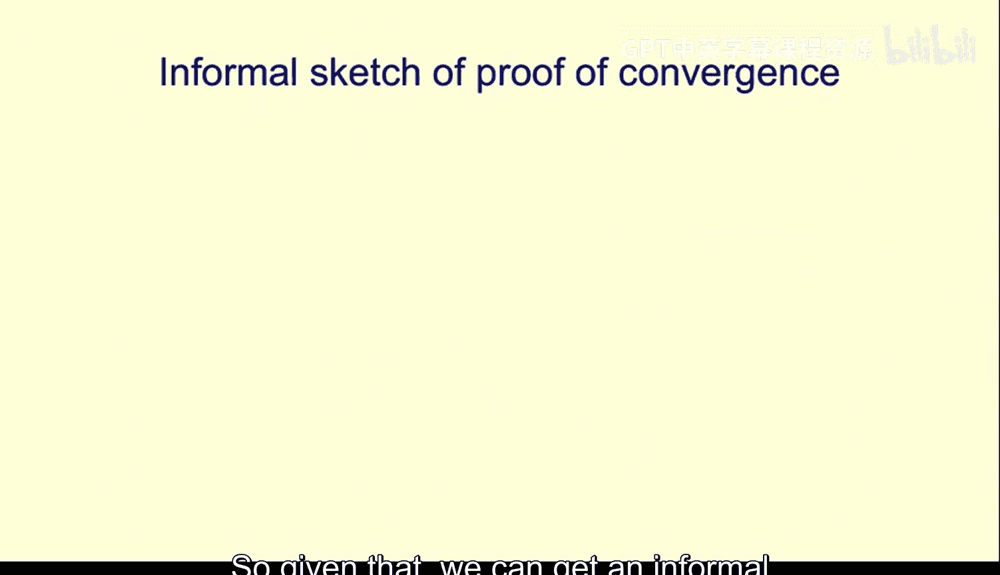
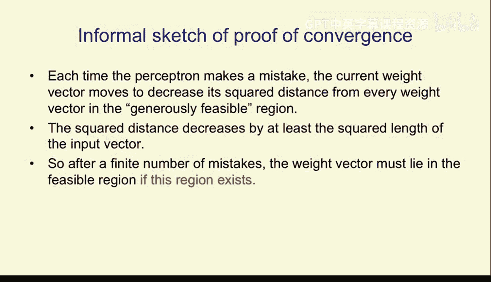

# Hinton@多伦多大学《机器学习的神经网络｜Neural Networks for Machine Learning 2016》claude-4s p09 -09-Lecture 2.4 — Why the learning works  -Neural Networks for Machine Learning- -BV1HtkUB2EZD_p9-

In this video。We're going to look at a proof。That the perceptron learning procedure will eventually get the weights into the cone of feasible solutions。

I don't want you to get the wrong idea about the course from this video。In general。

 it's going to be about engineering， not about proofs of things。

 There'll be very few proofs in the course。But we get to understand quite a lot more about perceptrons when we try and prove that they will eventually get the right answer。

So we're going to use our geometric understanding of what's happening in weight space as a pcron learns。

To get proof。That the perceptron will eventually find a weight vector that gets the right answer for all of the training cases。

 if any such vector exists。And our proof is going to assume that there is a vector that gets the right answer for all training cases。

Well call that a feasible vector。 and an example of a feasible vector is shown by the green dot in the diagram。

So we start with a weight vector that's getting some of the training cases wrong。And in the diagram。

 we shown in a training case that is getting wrong。And what we want to show。

 this is the idea for the proof。Is that every time he gets a training case wrong。

It will update the current weight factor。In a way that makes it closer。

To every feasible weight vector。So we can represent the square distance of the current weight vector。

From a feasible white factor。As the sum。Of a square distance along the line of the input vector that defines the training case。

And another square distance orthogonal to that line。The orthogonal squared distance won't change。

And the square distance along the line of the impof vector。Willll get smaller。So。

 our hopeful claim is that。Every time the pisceptrum makes a mistake。

Our current weight factor is going to get closer to all feasible weight factors。Now。

 this is almost right。But there's an unfortunate problem。

If you look at the feasible white vector in gold。It's just on the right side。

Of the plane that defines one of the turning cases。

And the current weight vector is just on the wrong side。And the input vector is quite big。

 So when we add the input vector to the current weight vector， we actually get further away。

From that gold， feasible white factor。So our hopeful claim doesn't work。

But we can fix it up so that it does。So what we're going to do is we're going to define a generously feasible white vector。

That's a weight factor that not only gets every training case right。

 but it gets it right by at least a certain margin。

Where the margin is as big as the input factor for that training case。

So we take the cone of feasible solutions and inside that we have another cone of generously feasible solutions。

Which get everything right， by at least the size of the input factor。And now， our proof will work。

Now， we can make the claim that every time the pcra makes a mistake。

 the square distance to all of the generously feasible weight vectors will be decreased by at least the squared length of the input vector。

 which is the update we make。So given that， we can get an informal sketch of a proof of convergence。

 I'm not going to try and make this formal。 I more interested in the engineering than the mathematics。

 If you're a mathematician， I'm sure you can make it formal yourself。

So every time the presentra makes a mistake。The current weight factor。Moves。

 and it decreases its square distance。From every fe generously feasible weight vector。

 by at least the square length of the current input vector。

And so the squared distance to all the generously feasible weight factors。

Decreases by at least that squared length。 and assuming that none of the input vectors are infinitesimally small。

That means。That after a finite number of mistakes。The weight vector must lie in the feasible region。

 if this region exists。Notice it doesn't have to lie in the generously feasible region。

 but it has to at least get into the feasible region to make to stop it making mistakes。

And that's it。 That's our informal sketch of a proof that the perceptron conversionence procedure works。

But notice， it all depends on the assumption that there is a generously feasible weight factor。

And if there is no such factor， the whole proof falls apart。

