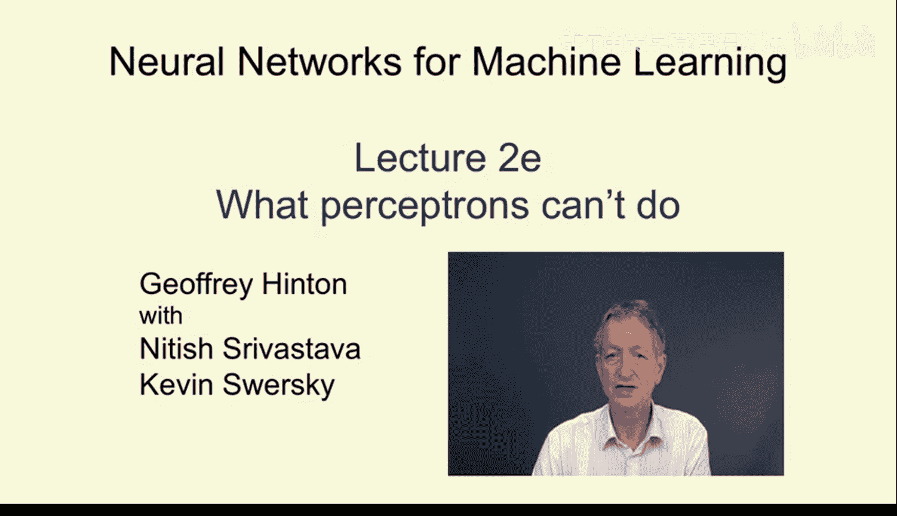
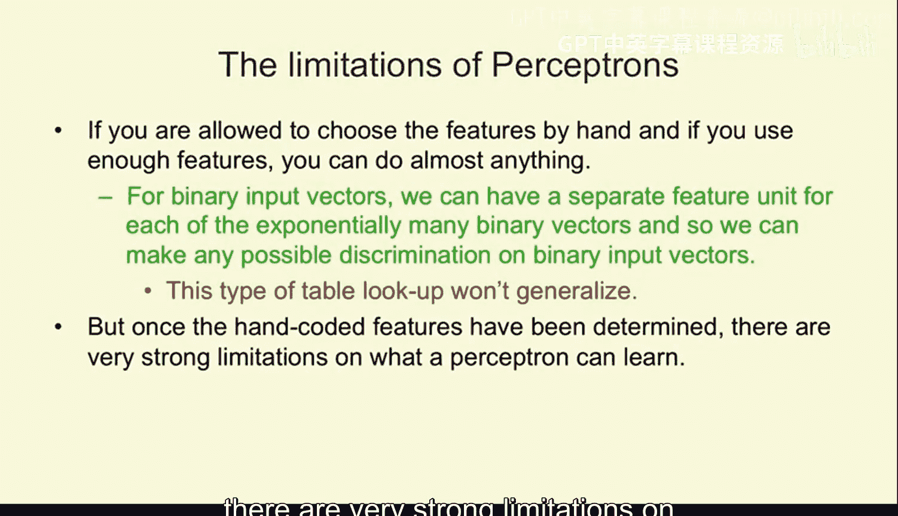
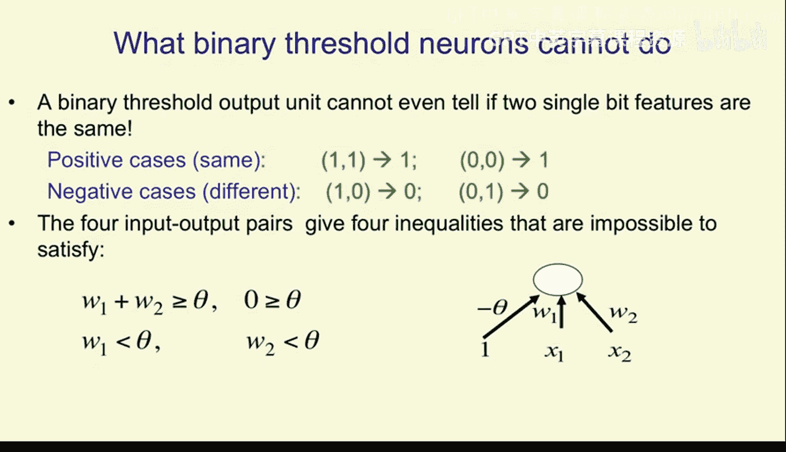
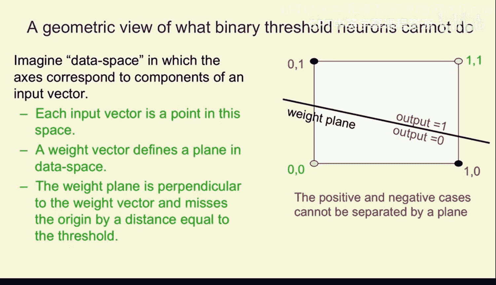
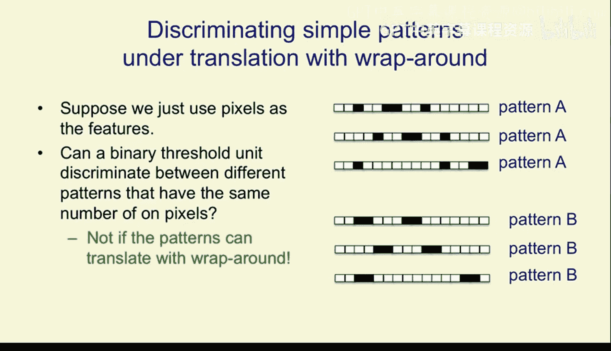
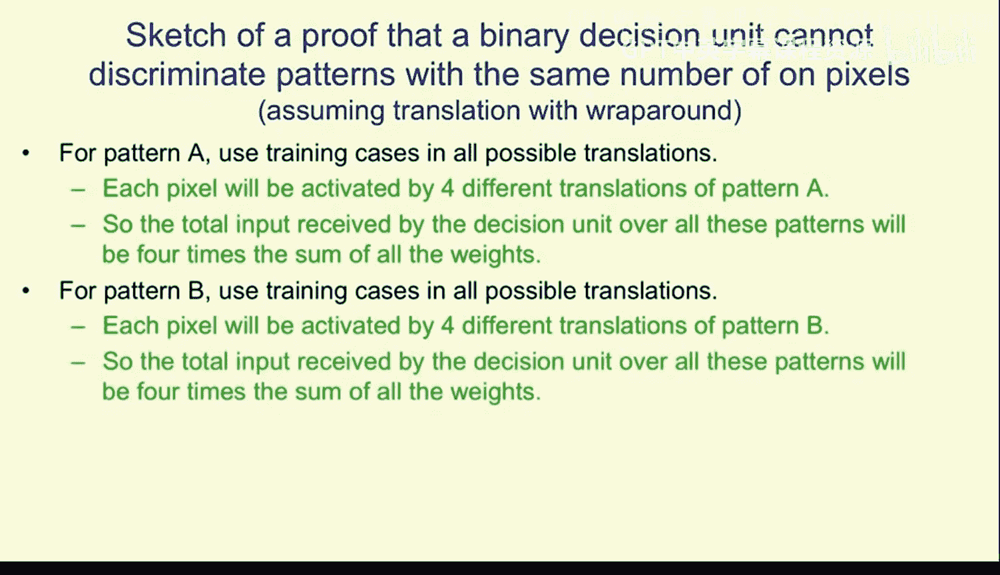
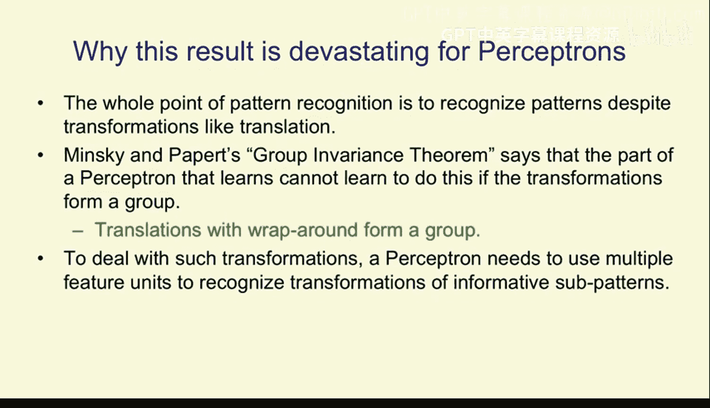
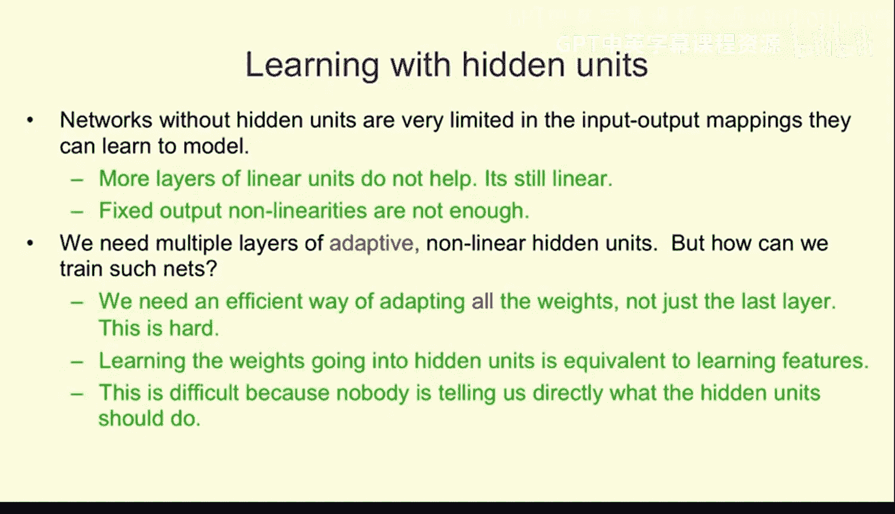

# Hinton@多伦多大学《机器学习的神经网络｜Neural Networks for Machine Learning 2016》claude-4s p10 -10-Lecture 2.5 — What perceptrons cant do -Neural Networks for Machine Learning -BV1HtkUB2EZD_p10-

In this video， we're going to look at the limitations of perceptrons。

These limitations stem from the kinds of features you use。 If you use the right features。

 you can do almost anything。If you use the wrong features。

 they're extremely limited in what the learning part of a bisceptron can do。

And that's what caused perceptrons to go out of favour。And it emphasizes。

That the difficult bit of learning is to learn the right features。

There is still a lot you can do with learning， even if you don't know features。For example。

 if you want to say whether a sentence is a plausible English sentence。

 you could hand to a huge number of features。And then learn how to wait them in order to decide whether a particular sentence is likely a good English sentence。

But in the long run， you need to learn features。

So the reason that neural network research came to a halt in the late 1960s and early 1970s。

Is that perceptrons were shown to be very limited。And we're now going to understand what those limitations are。

If you are like to choose the features by hand。And if you use enough features。

 you can make a acept to almost anything。Suppose， for example， we have binary input vector。

And we create a separate feature unit。That gets activated by exactly one of those binary input vectors。

Will need exponentially many feature units。But now we can make any possible discrimination on binary input vectors。

So for binary input vectors， there's no limitation if you're willing to make enough feature units。

But， of course， that's not a very good strategy for solving a practical problem。

Because you need an awful lot of feature units， and it won't generalize。

You can't look at a subset of all possible cases and have any hope of getting the remaining cases right。

 because those remaining cases require new feature units。

 and you don't know what weights to put on those feature units。

Once you've decided the hand coded features。That is， once they've been determined。

There are very strong limitations on what a perceptron can learn to do。

So here's a classic example。What we're interested in is what can you learn to do with the binary threshold decision。

Unit， that is by changing its weights。And we're going to show that there's very simple things that it can't learn to do。

So the simplest example is。Consider a problem which there's two positive cases。

And two negative cases。And the features are just single bit features that have values， either 1 or 0。

So the two positive cases consist of both features being on in which case right answers is one。

Or both features being off， in which case the right answer is one。

And the two negative cases are when one features on and the other one's off。

 in which case the right answer is 0。So all we're asking the binary threshold unit to do。

Is decide whether the two features have the same value。And he can't even learn to do that。

We can prove that algebraically。Those four input output pairs that I showed you give rise to four inequalities。

 and it's impossible to satisfy them。So， the first positive case。When the two feature values are one。

 the output should be one。That gives us the inequality that one times W 1 plus 1 times W 2 has got to be greater than the threshold。

 So we give an output of one。And the second positive case gives us the inequality that 0 times W 1 plus 0 times W2 must also be greater than the threshold。

And the negative cases。Give us the inequalities that1 times W1 plus 0 times W2 must be less than the threshold。

And similarly，0 times W1 plus1 times W2 must be less than a threshold。Now。

 if you take those first two inequalities and you add them up。You get the W1 plus W 2。

Must be greater than twice the threshold。And if you take the second two inequalities and you add them up。

 you get W1 plus W2 must be less than twice the threshold。

So there's clearly no way to satisfy all four inequalities。Or to put it another way。

If you look at the binary decision unit。Where we're going to put the threshold as a negative weighter on input line that always has value of one。

If you take that。Binary threshold unit shown at the bottom right。

 There's no way to set the threshold and the two weights。 So it gets all four cases right。

We can also see this geometrically。

So we're going to imagine a data space now。In which the axes correspond to components of an input vector。

So in this space， each point。Corresponds to a data point。And。

A weight factor is going to define a plane in this space。

 So it's just the opposite of what we're doing with weight space。 In weight space。

 we made each point be a weight factor。And we used a plane to define an input case。Of course。

 that plane was defined by an imper vectorctor。Now。

 what we're going to do is we're going to make each point。Be an imp factor。

 And we're going to use a weight factor to define a plane in the data space。

The plane defined by the weight vector is going to be perpendicular of the weight vector。

 and it's going to miss the origin by a distance equal to the threshold。So here's a picture。

You see the four data cases there。And for the two data cases in red。We need to give an output of。0。

 the two data cases in green， we need to come output of one。

That means we need the green cases to be on the side of the weight plane where the output is one。

And we need the rate cases to be on the site with the output zero。

 and we obviously cannot arrange the weight plane so that that's true。

We call a set of cases like that。Where there's no hyperplane。That will separate the。

Cases where we want the ounce to be one from the cases where we want the ounce to be 0。

 we call that a set of training cases that's not linearly separable。

An even more devastating example for perceptrons， because it's much more general。

Is when we try and discriminate simple patterns。That。

Have to retain that identity when you translate them with rapi。

I'll give you an example of what that means in a minute。But the idea is that we want to recognize。

A patent。And we want to recognize it， even when it's translated。

So suppose we just use pixels as the features。The question is， can a binary threshold unit。

Discriimminate between two different patterns。We can call one positive example and the other is negative examples。

If they've got the same number of pixels in them。And the answer is。No。

 it can't discriminate two patents out of the same number of pixels。

 If that discrimination has to work when the patents are translated。

And if the patterns can wrap around when they translate。

So if you look at these examples of pattern A in a one dimensional image。

 Pat A has four pixels that are on， those four black pixels。It's like a little barcode。

And it's the same pattern when we translate it a bit to the right。

And we're going to allow ourselves to translate the pattern so it goes off the right hand end and comes back on the left hand end。

So the third example is the same pattern that's been translated with some wraparound。And pattern B。

It also has four patterns， but four pixels， but in a different arrangement。

And in the third example of pattern B， it's been translated with wraparound。

 So that's still an example of pattern B。And for two sets of patterns like that。

A binary threshold unit cannot learn to discriminate them。

And here's the proof。What we're going to do is we're going to consider。

That for the positive examples， we have pattern A in all possible translations。Now。

 since Pat Ney has four on pixels。That means if we look at any pixel on the retina。

There'll be four different positions in which we can put pattern A that will activate that pixel。

So each pixel will be activated by four different translations of panet。

That means that the total input received by the decision unit。Overall all。

 those various translations of part May。Will be four times the sum of all the whites in the perceptron。

Because each pixel cell will activate the decision unit four different times。

 And so summed over all those patterns will get four times the sum of the weights。

Now consider pattern B。We're going to make the negative cases be pattern B in all possible translations。

And again， each pixel will be activated by four different translations of pattern B。

So the total input that the decision unit receives over all those different translations of pattern B will again be four times the sum of all the weights。

But the perceptron， in order to discriminate correctly。

Has to have weights so that every single case of pattern A provides more input to the decision unit than every single case of pattern B。

And that's clearly impossible if when you sum over all these cases。

All those different versions of pattern A and all those different versions of pattern B provide exactly the same amount of input to the decision unit。

So， we've proved。That a perceptron cannot recognise patterns under translation。

 if we allow wrapparite。That's a particular case of Minsky pas。Group invariance theorem。

And that result is devastating for perceptrons。 It was historically devastating。

Becauseuse the whole point of patent recognition。Is to recognize patterns that undergo transformations and see that they're still the same pattern despite the transformation。

Like， for example， translation。And when Minsky and Pat showed that a perceptron couldn't do that if the transformations formed a group。

That is， the learning part of a perceptron couldn't learn to do that。

It became clear that the claims that had been made for what perceptrons could learn。

Were somewhat exaggerated。 and that to get them to do anything interesting。

 you had to choose just the right features to make it fairly easy for the last stage to learn the classification。

So the translations with the wraparound former group。

 a Minky Pa proved to general theorem that transformations that form a group。

And make it impossible for a perceptron， for the learning part of a perceptron to do the recognition。

The perceptron architecture can still do the recognition。

But you have to organize the features so they do the difficult part。

So we have to have multiple feature units。That recognize informative sub patternss that tell you something about what class it is。

 And we have to have separate feature units for each position of those informative sub patternss。

 If we're trying to recognise under translation。

So the tricky part of pattern recognition has to be solved by the hand codeed feature detectors。

 not the learning procedure。The temporary conclusion from this is that perceptrons are no good and therefore neural networks are no good。

The longer term conclusion is that neural networks are only going to be really powerful。

If we can learn the feature detectors。I's not enough just to learn weights on feature detectors。

 We have to learn the feature detectors themselves。And the second generation in neural networks。

 which you'll come to in the next lecture， was all about how you learn the feature detectors。

But it took 20 years before people figured out how to do that。

So networks without hidden units are very limited in what they can learn to model。

If we have more layers of linear units， it doesn't help because everythings linear。

We can make them much more powerful by putting in hand codeed hidden units。

 but they're not really hidden units because we hand codeed them。 We told them what to do。

It's not enough just have fixed output， No nonlinearities。

What we need is multiple layers of adaptive， nonlinear hidden units。And the problem is。

 how can we train such nets？We need a way to adapt all the weights， not just the last layer。

 like in a perceptron。And that's hard。In particular。

 learning the way it's going into the hidden units。That's equivalent to learning features。

And that's a hard thing to do， because nobody is telling us directly what the hidden units should be doing。

 when they should be active and when they should not be active。And the real problem is。

 how do we figure out how to learn those weights going into hidden units so that the hidden units turn into the kinds of feature detectors we need for solving a problem where nobody is telling us what the feature detector should be。

