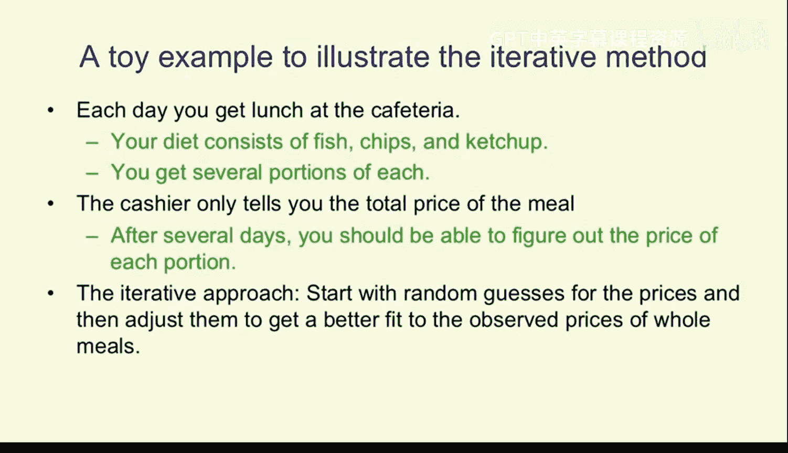
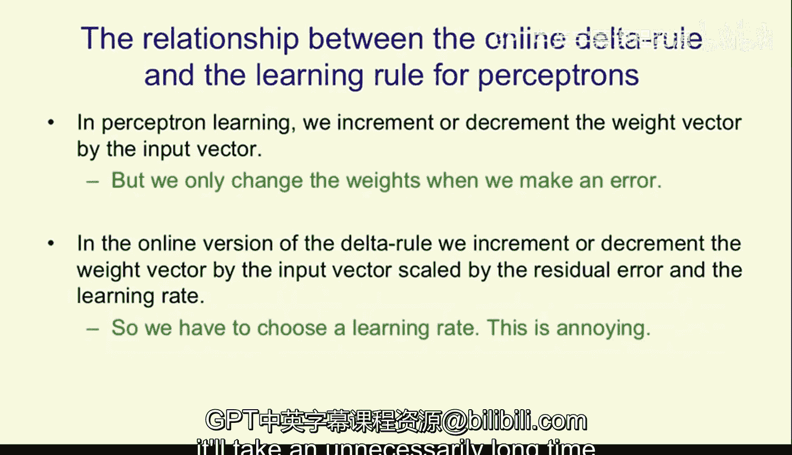

# Hinton@多伦多大学《机器学习的神经网络｜Neural Networks for Machine Learning 2016》claude-4s p11 -11-Lecture 3.1 — Learning the weights of a linear neuron  -Neural Networks for -BV1HtkUB2EZD_p11-

This video introduces the learning algorithm for a linear neuron。

This is quite like the learning algorithm for a perceptron， but it achieves something different。

In a perceptron， what's happening is the weights are always getting closer to a good set of weights。

In a linear neuron， the outputs are always getting closer to the target outputs。

The perceptron conversionence procedure works by ensuring that when we change the weights。

 we get closer to a good set of weights。That type of guarantee cannot be extended to more complex networks。

 because in more complex networks， when you average two good sets of weights。

 you might get a bad set of weights。So for multi la neural networks。

 we don't use the perceptron learning procedure。And to prove that when they're learning。

 something is improving。We don't use the same kind of proof at all。

They should never have been called multilepiceptrons。 It's partly my fault， and I'm sorry。

For multi la nets， we're going to need a different way to show that the loading procedure makes progress。

Instead of showing that the weights get closer to a good set of weights。

 we're going to show that the actual output values get closer to the target output values。

This can be true even for non convex problems in which averaging the weights of two good solutions does not give you a good solution。

It's not true for perceptron learning and perceptron learning。

The outputs as a whole can get further away from the target outputs。

 even though the weights are getting closer to good sets of weights。

The simplest example of learning in which you're making the outputs get closer to the target outputs is learning in a linear neuron with a squared error measure。

Linear neurons， which are also called linear filters in electrical engineering。

 have a real valued output that's simply the weighted sum of their inputs。So， the output y。

Which is the neurons estimate of the target value。Is a sum over all their input's eye。

Of a weight factor times an input factor。So we can write it in summation form or we can write it in vector notation。

The aim of the learning is to minimize the error summed overall training cases。

We need a measure of that error。And to keep life simple。

 we use the square difference between the target output and the actual output。So one question is。

 why don't we just solve it analytically？It's straightforward to write down a set of equations with one equation per training case。

And to solve for the best set of weights。That's the standard engineering approach。

 And so why don't we use it。The first answer。And the scientific answer is we'd like to understand what real neurons might be doing。

 and they're probably not solving a set of equations symbolically。

An engineering answer is that we want a method that we can then generalize to multilay nonlinear networks。

The analytic solution relies on it being linear and having a square error measure。

An iterative method， which we're going to see next， is usually less efficient。

 but much easier to generalize to more complex systems。

So I'm now going to go through a toy example that illustrates an iterative method for finding the weights of a linear neuro。

Suppose that every day you get lunch at a cafeteria。And your diet consists entirely of fish， chips。

 and ketchup。Each day， you order several portions of each。 But on different days。

 it's different numbers of portions。The cashier only tells you the total price of the meal。

 But after a few days， you ought to be able to figure out what the price is for each portion of each kind of thing。

In the iterative approach， you start with random guesses for the prices of portions。

And then you adjust these guesses so that you get a better fit to the prices that the cashier tells you。

 those are the observed prices of whole meals。

So， each meal。

You get a price， and that gives you a linear constraint on the prices of the individual portions。

It looks like this。 The price of the whole meal is the number of portions of fish， X fish。

Times the cost of a portion of fish。 W fish。And the same for chips。 and ketchup。

So the prices of the portions are like the weights of a linear urine。

And we can think of the whole white vector as being the price of a portion of fish。

 the price of a portion of chips and the price of a portion of ketchup。

We're going to start with guesses for these prices。

And then we're going to adjust the guesses slightly so that we agree better with what the cashier says。

So let's suppose that the true weights that the cashier is using to figure out the price。

Are a hundred and 50 for a portion of fish，50 for a portion of chips and 100 for a portion of ketchup。

For the meal shown here， that will lead to a price of 850。 So that's going to be our target value。

Let's suppose that we start with guesses that each portion costs 50。

So for the meal with two portions of fish，5 of chips and three of ketchup。

We're gonna initially think that the price should be 500。That gives us a residual error of 350。

That a residual error is the difference from what the cashier says and what we think the price should be with our current weights。

We're then going to use the Delta rule。For revising our prices of portions。

We make the change in a await， Delta W I。B equal to a learning rate， epsilon。

Times the number of portions of the I thing。Times the residual error。

 the difference between the target and our estimate。So if we make the learning rate be 1 over 35。

 so the math stays simple。Then the learning rate times the residual error for this particular example。

Is 10。And so our change in the weight for fish。Will be  two times 10。Will increase that weight by 20。

 Our change in the weight for chips will be  five times 10。

 and our change in the weight for ketchup will be  three times 10。That'll give us new weights of 70。

180。And notice the weight for chips actually got worse。

 There's no guarantee with this kind of learning that the individual weights will keep getting better。

What's getting better is the difference between what the cashier says and our estimate。

So now we're going to derive the Dlta rule。We start by defining the error measure。

 which is simply our squared residual summed over all training cases。

 That is a squared difference between。The target。And what the neural net predicts or the linear neuron predicts squared in some overall training cases。

 And we put a half in front， which will cancel the two when we differentiate。

We now differentiate that error measure with respect to one of the weights， W。 I。

To do that differentiation， we need to use the chain rule。

The chain rule says that how the error changes as we change your weight will be how the output changes as we change the weight times how the error changes as we change the output。

The chain rule is easy to remember。 You just cancel those two Dys。

 but you can only do that when there's no mathematicians looking。The reason the first one。

 D Y by D W is written with a curly D is because it's a partial derivative。That is。

 there's many different weights you can change to change the output。

 And here are just considering the change to weight I。So DY by GWI is actually equal to Xi。

And that's because y is just W I times X I。And D E by D Y。Is just t minus y。

Because when we differentiate that t minus y squared。And use the half to cancel the two。

 we just get t minus y。So our learning rule is now we change the weights by an amount that's equal to。

The learning rate， epsilon。Times the derivative of the error with respect to weight to E by Dwi I。

And with a minus sign in front， because we want the error to go down。

And that minus sign cancels the minus sign in the line above。And we get that。

 the change in a weight is。The some overall training cases of the learning rate。

Times the input value。Times the difference between the target and actual outputs。Now， we can ask。

 how does this learning procedure， this Delta rule behave。Does it， for example。

 eventually get the right answer。There may be no perfect answer。

 It may be that we give the linear neuron a bunch of training cases with desired answers。

 and there's no set of weights that' will give the desired answer。

There's still some set of weights that gets the best approximation on all those training cases minimizes that error measure。

 some overall training cases。And if we make the learning rate small enough。

And we learn for long enough。 We can get as close as we like to that best answer。Another question is。

 how quickly do we get towards the best answer？And even for a linear system。

The learning can be quite slow， this kind of iterative learning。

If two input dimensions are highly correlated， it's very hard to tell。

How much of the summed weight on both of those input dimensions should be attributed to each input dimension。

So if， for example， we always get the same number of portions of ketchup and chips。

Is we can't decide how much of the price is due to the ketchup and how much is due to the chips。

 And if they're almost always the same， it can take a long time for the learning to correctly attribute the price to the ketchup and the chips。

There's an interesting relationship between the Delta rule and the learning rule for perceptrons。

So if you use the online version of the Delta rule。

 where we change the weights after each training case。

It's quite similar to the pceptron learning Rule。In perceptiontron learning。

 we increment or decrement the weight factor by the input factor。

But we only change the input vector when we make an  error。In the online version of the Delta rule。

We increment or decrement the weight factor。By the imper vectorctor。

 But we scale that by both the residual error and the learning rate。

And one annoying thing about this is we have to choose a learning rate。

If we choose a learning rate that's too big， the system will be unstable。

 and if we choose a learning rate that's too small。

 it'll take an unnecessarily long time to learn a sensible set of weights。

