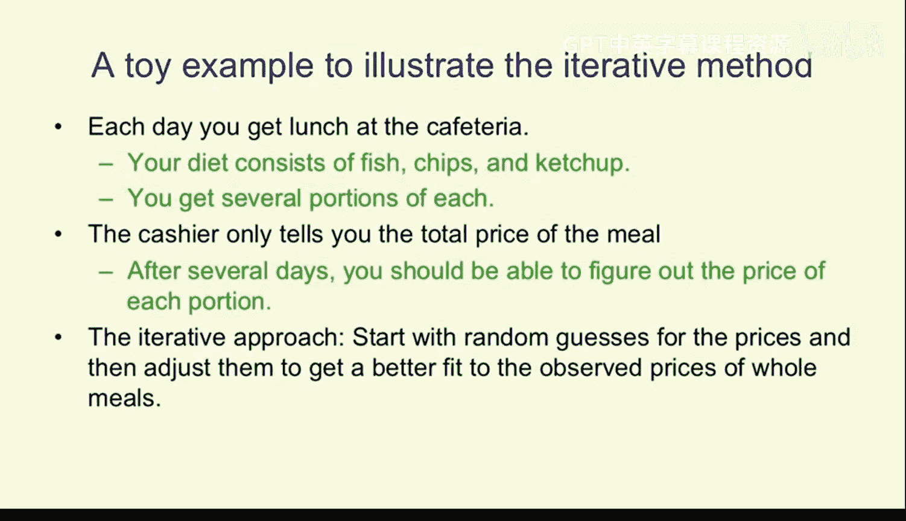
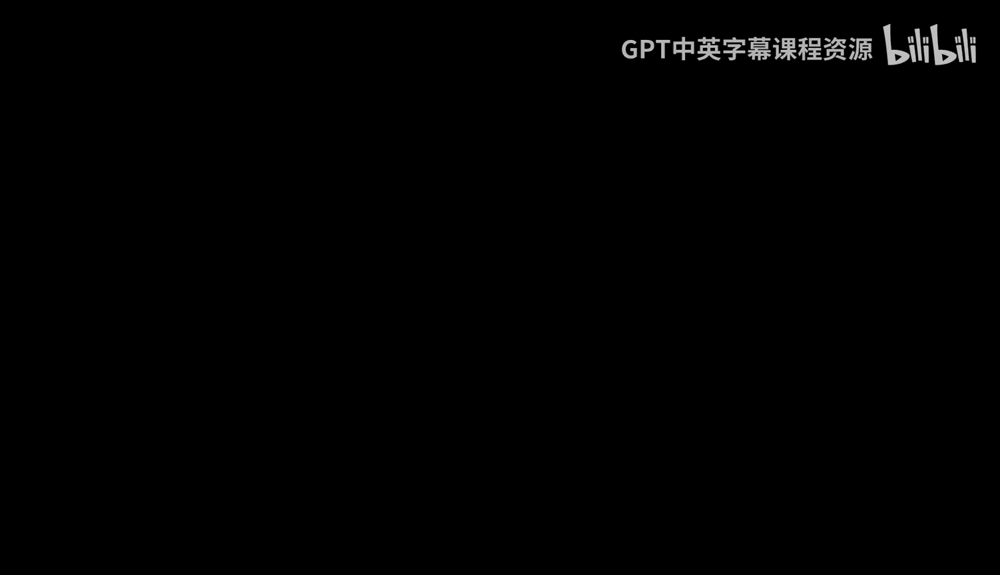
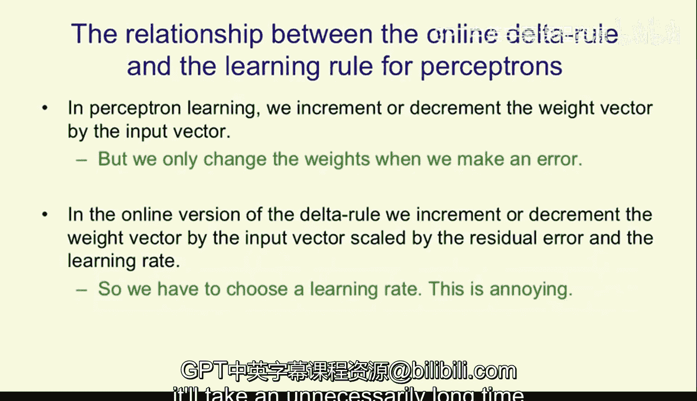

# 神经网络与机器学习：3.1：线性神经元的权重学习 🧠

在本节课中，我们将学习线性神经元的权重学习算法。我们将了解它与感知机学习算法的区别，推导其核心的Delta规则，并通过一个简单的例子来理解其工作原理。

## 概述

本节介绍线性神经元的学习算法。该算法与感知机学习算法相似，但目标不同。感知机学习旨在使权重向量不断接近一组“好”的权重，而线性神经元学习则旨在使神经元的输出值不断接近目标输出值。这种差异对于理解更复杂的多层网络至关重要。

## 线性神经元与感知机学习的区别

上一节我们介绍了感知机，本节中我们来看看线性神经元的学习有何不同。

感知机的收敛过程通过确保每次权重更新都使其更接近一组好的权重来工作。然而，这种保证无法扩展到更复杂的网络。因为在复杂网络中，平均两组好的权重可能会得到一组坏的权重。因此，对于多层神经网络，我们不使用感知机学习过程。

为了证明学习过程在改进，我们使用了完全不同的证明方法。多层网络本不应被称为“多层感知机”，这在一定程度上是我的错，我为此感到抱歉。

对于多层网络，我们需要一种不同的方式来证明学习过程在取得进展。我们不再证明权重更接近一组好的权重，而是证明实际的输出值更接近目标输出值。即使在非凸问题中，这种方法也可能成立，因为平均两个好的解并不一定能得到一个好的解。这在感知机学习中是不成立的。

## 线性神经元与平方误差

使输出值更接近目标输出的最简单学习例子，是使用平方误差度量的线性神经元学习。

线性神经元，在电子工程中也称为线性滤波器，其输出是一个简单的输入加权和。因此，神经元的输出 `y`（即对目标值的估计）是所有输入 `x_i` 与权重 `w_i` 乘积的总和。

我们可以用求和形式或向量符号表示：
`y = Σ (w_i * x_i)` 或 `y = w · x`

学习的目标是最小化所有训练案例的总误差。为了简化，我们使用目标输出 `t` 与实际输出 `y` 之间的平方差作为误差度量：
`E = 1/2 * Σ (t - y)^2`

一个自然的问题是：为什么不直接解析求解？我们可以为每个训练案例写下一个方程，然后求解最佳权重集。这是标准的工程方法。

以下是两个不使用解析解的原因：
*   **科学原因**：我们希望理解真实神经元可能的行为，而它们很可能不是在符号化地求解方程组。
*   **工程原因**：我们希望找到一种可以推广到多层非线性网络的方法。解析解依赖于系统的线性和平方误差度量。我们接下来要看到的迭代方法虽然通常效率较低，但更容易推广到更复杂的系统。

## 一个迭代学习的例子：食堂午餐问题

现在，我们通过一个玩具例子来说明寻找线性神经元权重的迭代方法。

假设你每天都在食堂吃午餐，你的饮食完全由鱼、薯条和番茄酱组成。每天，你点每种食物的份数不同。收银员只告诉你这顿饭的总价。但几天后，你应该能算出每种食物每份的价格。

在迭代方法中，你从对每份食物价格的随机猜测开始，然后调整这些猜测，使其更符合收银员告诉你的整餐价格（即观测到的目标值）。

每顿饭的总价构成了对单个食物份数价格的线性约束，公式如下：
`总价 = (鱼份数 * 鱼单价) + (薯条份数 * 薯条单价) + (番茄酱份数 * 番茄酱单价)`

食物的单价就像线性神经元的权重。我们可以将权重向量 `w` 视为（鱼单价， 薯条单价， 番茄酱单价）。

假设收银员使用的真实权重是：鱼 150， 薯条 50， 番茄酱 100。
对于一顿包含 2 份鱼、5 份薯条、3 份番茄酱的餐，真实总价是 850。这就是我们的目标值 `t`。

假设我们初始猜测每份食物都是 50 元。
那么，根据当前权重，我们预测这顿饭的价格 `y` 是 500。
这产生了 350 的残差误差（目标值与我们当前权重估计值之间的差）。

## Delta 规则

然后，我们使用 Delta 规则来修正我们对单价的猜测。
权重 `w_i` 的变化量 `Δw_i` 等于：
`Δw_i = ε * x_i * (t - y)`
其中 `ε` 是学习率，`x_i` 是第 i 种食物的份数，`(t - y)` 是残差。

如果我们设学习率 `ε = 1/35`（为使计算简单），那么对于这个例子，`ε * (t - y) = 10`。
因此：
*   鱼权重的变化：`Δw_fish = 2 * 10 = 20`，新权重为 70。
*   薯条权重的变化：`Δw_chips = 5 * 10 = 50`，新权重为 100。
*   番茄酱权重的变化：`Δw_ketchup = 3 * 10 = 30`，新权重为 80。

请注意，薯条的权重（从50变为100）实际上变得更差了。这种学习并不保证单个权重会持续变好。变好的是收银员报价与我们估计值之间的总误差。

## Delta 规则的推导

现在我们来推导 Delta 规则。
我们从定义误差度量开始，即所有训练案例的平方残差和：
`E = 1/2 * Σ (t - y)^2`
前面的 `1/2` 是为了在求导时消去产生的 2。

现在，我们对误差 `E` 关于其中一个权重 `w_i` 求导。需要使用链式法则：
`∂E/∂w_i = (∂y/∂w_i) * (∂E/∂y)`

链式法则很容易记住，你可以想象把两个 `∂y` 消掉，但最好别在数学家面前这么做。
*   `∂y/∂w_i` 实际上等于 `x_i`，因为 `y` 就是 `w_i * x_i` 的和（对于特定的 `i`，`y` 对 `w_i` 的偏导就是 `x_i`）。
*   `∂E/∂y` 等于 `-(t - y)`，因为对 `1/2*(t-y)^2` 求导，并用 `1/2` 消去 2，得到 `(t-y)`，再考虑梯度下降需要负号。

因此，`∂E/∂w_i = x_i * (-(t - y)) = -x_i * (t - y)`

我们的学习规则是，权重的变化量与误差关于该权重的负梯度成正比：
`Δw_i = -ε * ∂E/∂w_i`
这个负号是因为我们希望误差下降。将上面的导数代入，负号相消，得到：
`Δw_i = ε * x_i * (t - y)`
对于批量学习，我们需要对所有训练案例求和：
`Δw_i = ε * Σ [x_i * (t - y)]`

## Delta 规则的行为与挑战

我们可以思考这个学习过程，即 Delta 规则，是如何行为的。
*   **它会得到正确答案吗？** 可能不存在完美的答案。即使给线性神经元一堆带有期望答案的训练案例，也可能没有一组权重能给出完全正确的答案。但仍然存在一组权重，能在所有训练案例上得到最佳近似，最小化误差度量。如果学习率足够小，学习时间足够长，我们可以无限接近那个最佳答案。
*   **学习速度有多快？** 即使对于线性系统，这种迭代学习也可能相当慢。如果两个输入维度高度相关，就很难判断这两个输入维度上的总权重应该分别归因于每个维度多少。例如，如果我们总是得到相同份数的番茄酱和薯条，我们就无法决定价格有多少归因于番茄酱，多少归因于薯条。如果它们几乎总是相同，学习过程可能需要很长时间才能正确地将价格归因于番茄酱和薯条。

## Delta 规则与感知机学习规则的关系

Delta 规则的在线版本（在每个训练案例后更新权重）与感知机学习规则非常相似。

以下是两者的比较：
*   **感知机学习规则**：当且仅当输出错误时，才根据输入向量 `x` 来增加或减少权重。
*   **在线 Delta 规则**：总是根据输入向量 `x` 来调整权重，但调整的幅度由残差误差 `(t-y)` 和学习率 `ε` 共同缩放。

Delta 规则的一个烦人之处是必须选择学习率。如果学习率太大，系统会不稳定；如果学习率太小，学习一组合理的权重将不必要地漫长。

## 总结

本节课中我们一起学习了线性神经元的权重学习。我们了解了它与感知机学习在目标上的根本区别：后者优化权重与理想权重的距离，而前者直接优化输出与目标输出的距离。我们通过食堂定价的例子直观理解了迭代学习过程，并推导了核心的 Delta 规则 `Δw_i = ε * x_i * (t - y)`。最后，我们讨论了该规则的行为、其在输入相关时可能遇到的困难，以及它与感知机学习规则的异同。这种基于梯度下降和平方误差的方法，为后续学习更复杂的多层非线性网络奠定了基础。