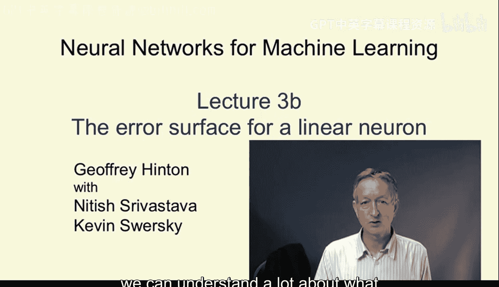
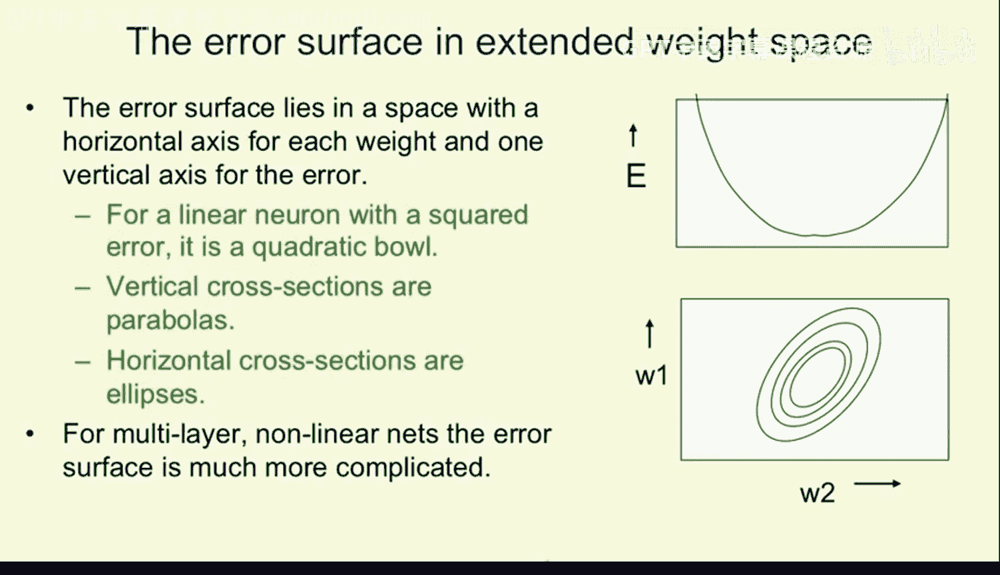
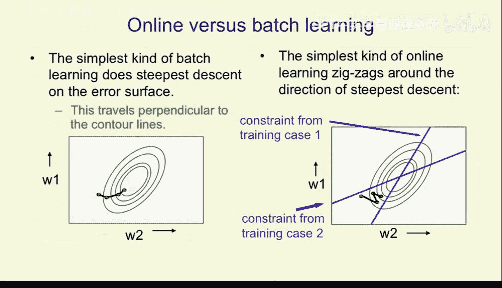
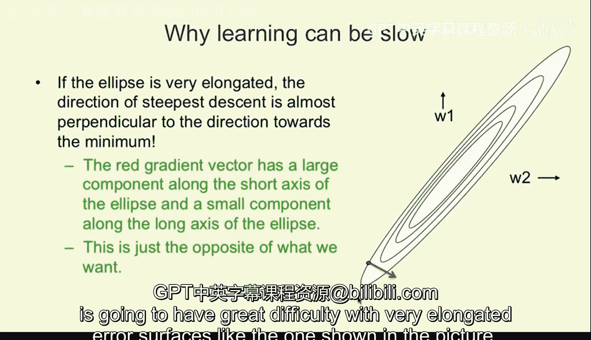

# Hinton@多伦多大学《机器学习的神经网络｜Neural Networks for Machine Learning 2016》claude-4s p12 -12-Lecture 3.2 — The error surface for a linear neuron  -Neural Networks for Ma -BV1HtkUB2EZD_p12-

In this video， we're going to look at the error surface for a linear neuron。

By understanding the shape of this error surface， we can understand a lot about what happens as a linear neuron is learning。

We can get a nice geometrical understanding of what's happening when we learn the weights of a linear neuron by considering a space that's very like the weight space that we use to understand perceptrons。

 but it has one extra dimension。So we imagine a space in which all the horizontal dimensions correspond to the weights。

 And there's one vertical dimension that corresponds to the error。So in this space。

 points on the horizontal plane correspond to different settings of the weights。

And the height corresponds to the error that you're making with that set of weights。

 summed overall training cases。For a linear neuron。The errors that you make for each set of weights。

Define an error surface。And this error surface。Is a quadratic ball。That is。

If you take a vertical cross section， it's always a parabola。

And if you take a horizontal cross section， it's always an ellipse。

This is only true for linear systems with a squared error。

 As soon as we go to multi layer non linear neural nets。

 this error surface will get more complicated。As long as the weights aren't too big。

 the air surface will still be smooth， but it may have many local minima。

Using this error surface， we can get a picture of what's happening as we do gradient descent learning using the Delta rule。

So what the Delta rule does is it computes。The derivative of the error， with respect to the weights。

And if you change the weights in proportion to that derivative。

That's equivalent to doing steepest descent on the error surface。To put it another way。

 if we look at the error surface from above， we get elliptical contour lines。

And the Delta rule is going to take us at right angles to those elliptical contour lines。

 as shown in the picture。That's what happens with what's called batch learning。

 where we get the gradient summed overall training cases。But we could also do online learning。

 where after each training case， we change the weights in proportion to the gradient for that single training case。

That's much more like what we do in perceptrons。And， as you can see。

The change in the weights moves us towardss one of these constraint plane。

So in the picture on the right， there are two training cases。To get the first training case correct。

 we must lie on one of those blue lines。And to get the second training case correct。

 the two weights must lie on the other blue line。So if we start at one of those red points。

And we compute the gradient on the first training case。

The Delta rule will move us perpendicularly tos that line。

If we then consider the other training case， we'll move perpendicularly towards the other line。

And if we alternate between the two training cases， we'll zigzag backwards and forwards。

 moving towards the solution point， which is where those two lines intersect。

 That's the set of weights that is correct for both training cases。

Using this picture of the error surface， we can also understand the conditions it will make learning very slow。

If that ellipse is very elongated。Which is going to happen if the lines that correspond to training cases are almost parallel。

Then when we look at the gradient。It's going to have a nasty property。

If you look at the red arrow in the picture， the gradient is big。

In the direction in which we don't want to move very far。

 And it's small in the direction in which we want to move a long way。

So the gradient will quickly take us across the bottom of that ravine。

Corresponding to the narrow axis of the ellipse。 and it will take a long time to take us along the ravine。

 corresponding to the long axis of the ellipse。It's just the opposite of what we want。

 We' would like to get a gradient that was small across the ravine and big along the ravine。

 But that's not what we get。 And so simple， steepest descent in which you change each weight in proportion to a learning rate times is error derivative。

Is going to have great difficulty with very elongated error surfaces like the one shown in the picture。

