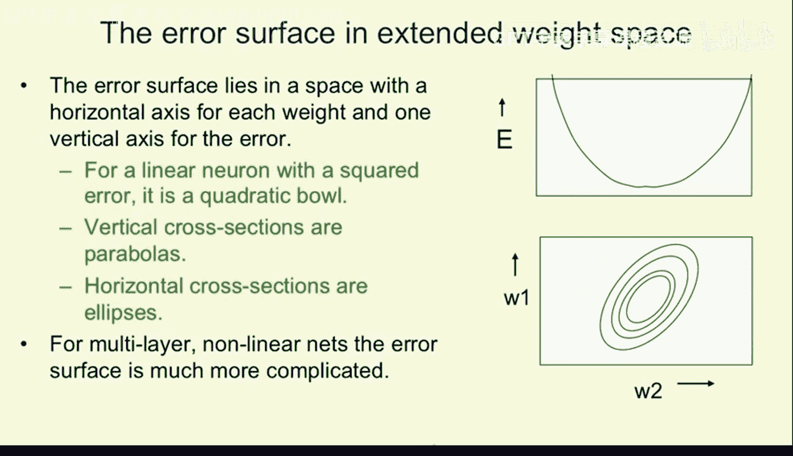
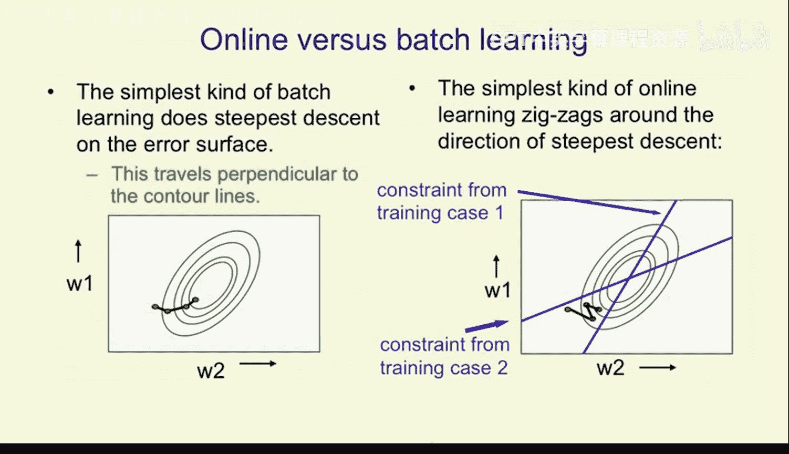
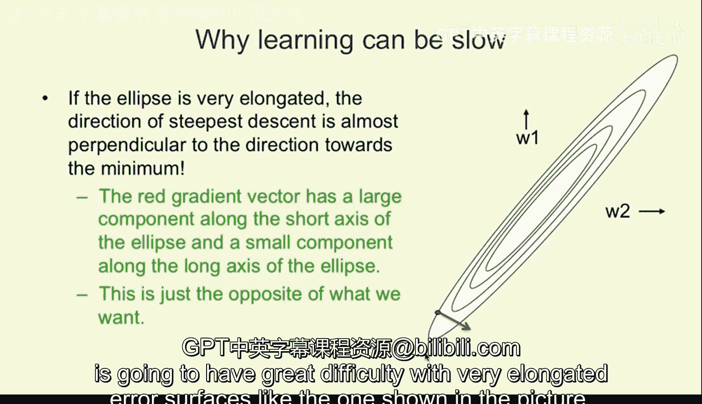

# 神经网络与机器学习：第3.2讲：线性神经元的误差曲面 📉

在本节课中，我们将学习线性神经元的误差曲面。通过理解这个误差曲面的形状，我们可以深入了解线性神经元在学习过程中发生了什么。

## 误差曲面的几何理解

上一节我们介绍了感知器的权重空间。本节中，我们来看看如何通过一个类似但多出一维的空间，来几何化地理解线性神经元权重的学习过程。

我们想象一个空间，其中所有水平维度对应权重，一个垂直维度对应误差。在这个空间中，水平面上的点对应不同的权重设置，而高度则对应使用该组权重在所有训练案例上产生的总误差。

对于一个线性神经元，每组权重产生的误差定义了一个误差曲面。这个误差曲面是一个**二次曲面**。具体来说：
*   如果你取一个垂直截面，它总是一个**抛物线**。
*   如果你取一个水平截面，它总是一个**椭圆**。

> 注意：这仅适用于使用平方误差的线性系统。一旦我们转向多层非线性神经网络，误差曲面将变得更加复杂。只要权重不是太大，误差曲面仍然是平滑的，但可能会有许多局部最小值。

## 梯度下降与Delta规则

利用这个误差曲面，我们可以描绘出使用Delta规则进行梯度下降学习时发生的情况。

Delta规则计算的是误差相对于权重的导数。如果你按该导数的比例改变权重，就相当于在误差曲面上进行最陡下降。换句话说，如果我们从上方观察误差曲面，会看到椭圆形的等高线。Delta规则将引导我们垂直于这些椭圆形等高线移动，如图所示。

以上描述的是**批量学习**的情况，即我们计算所有训练案例的总梯度。但我们也可以进行**在线学习**，即在每个训练案例之后，我们根据该单个训练案例的梯度按比例改变权重。这更类似于我们在感知器中做的操作。

以下是两种学习方式的对比：
*   **批量学习**：计算所有训练数据的平均梯度后更新权重。
*   **在线学习**：每处理一个训练数据就立即更新权重。

如图所示，右侧图片中有两个训练案例。要使第一个训练案例正确，权重必须位于其中一条蓝线上；要使第二个正确，则必须位于另一条蓝线上。如果我们从某个红点开始，计算第一个训练案例的梯度，Delta规则会将我们垂直移向那条线。接着考虑另一个训练案例，我们会垂直移向另一条线。如果我们在两个训练案例之间交替，就会来回曲折地移动，逐渐逼近两条线的交点，即那个对两个训练案例都正确的权重集合。

## 学习缓慢的条件

利用误差曲面的图像，我们也能理解导致学习速度非常缓慢的条件。

如果椭圆被拉得非常长（当训练案例对应的线几乎平行时就会发生这种情况），那么梯度会有一个糟糕的特性。如图中红色箭头所示，梯度在我们**不需要移动很远**的方向上很大，而在我们**需要移动很长距离**的方向上却很小。

因此，梯度会迅速将我们带过那个“沟壑”的底部（对应椭圆的短轴），但需要很长时间才能沿着“沟壑”（对应椭圆的长轴）前进。这与我们期望的恰恰相反。我们期望的梯度是在跨越沟壑时小，沿着沟壑时大，但实际情况并非如此。

所以，在简单的**最陡下降法**中，你按照学习率乘以误差导数的比例来改变每个权重，对于图中所示的这种非常狭长的误差曲面，将会遇到巨大困难。

## 总结

本节课中，我们一起学习了线性神经元的误差曲面。我们了解到，对于使用平方误差的线性神经元，其误差曲面是一个二次曲面（垂直截面为抛物线，水平截面为椭圆）。我们通过这个几何视角，理解了Delta规则如何在该曲面上进行梯度下降，以及批量学习与在线学习的区别。最后，我们探讨了当误差曲面非常狭长（即训练数据特征高度相关）时，会导致梯度下降学习速度缓慢的问题，因为梯度方向并非最有效的更新方向。这为后续学习更高级的优化算法奠定了基础。