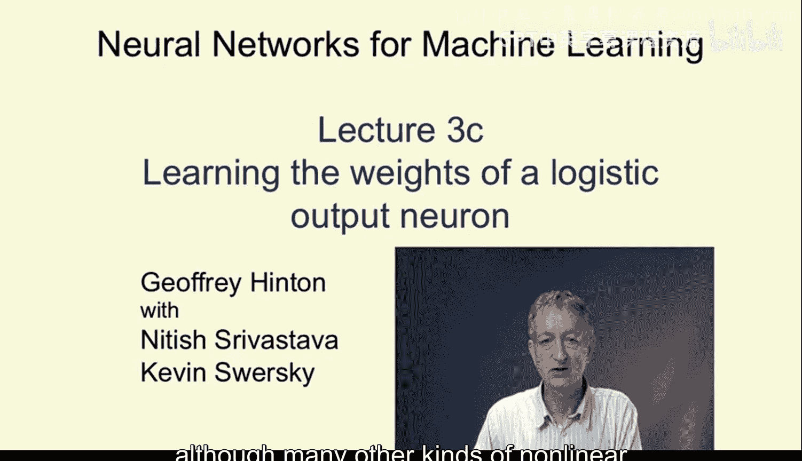
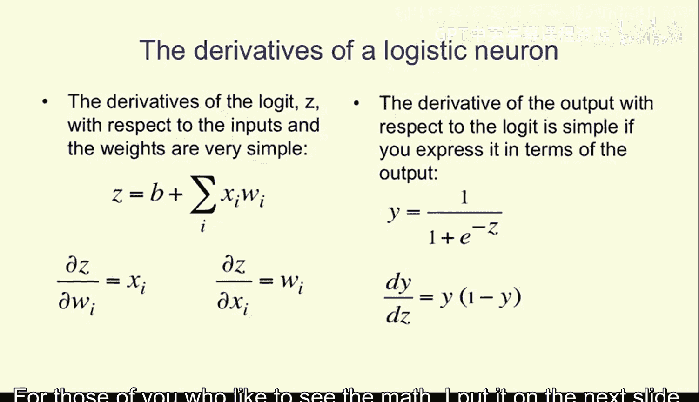
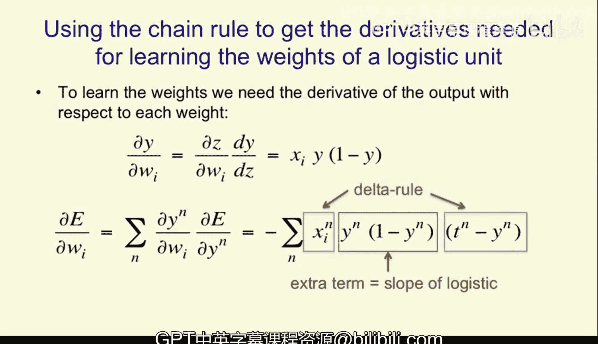

# Hinton@多伦多大学《机器学习的神经网络｜Neural Networks for Machine Learning 2016》claude-4s p13 -13-Lecture 3.3 — Learning weights of logistic output neuron -Neural Networks fo -BV1HtkUB2EZD_p13-

To extend the learning rule for a linear neuron。To a learning rule we can use for multi layer nets of nonlinear neurons。

We need two steps。 First， we need to extend the learning rule to a single nonlinear neuron。

And we're going to use logistic neurons， although many other kinds of nonlinear neurons could be used instead。

We are now going to generalize the learning rule for a linear neuron， to a logistic neuron。

Which is a nonlinear neuron。So， a logistic neuron。Computes its logit Z， which is its total input。

 Its its bias plus a sum over all its input lines of the value of an on an input line X I times the weight on that line。

 W I。It then gives an output Y。 that's a smooth， nonlinear function of that legit。

As shown in the graph here。That function is approximately 0。 whens Z is big and negative。

 approximatelyimate1 whens Z is big and positive， and in in between。

 it changes smoothly and nonlinearly。The fact that it changes continuously。Gives it nice derivatives。

 which make learning easy。So to get the derivatives of a logistic neuron with respect to the weights。

 which is what we need for learning， we first need to compute the derivative of the logit itself。

 That is the total input with respect to a weight。That's very simple。

The logit is just a bias plus the sum of all the input lines of the value on the input line times the weight。

 So when we differentiate with respect to W I， we just get X I。

So the derivative of the logicit with respect to W I is X I， and similarly。

 the derivative of the logicit with respect to X I is W I。

The derivative of the output with respect to the logit， is also simple。

 If you express it in terms of the output。So the output is 1 over 1 plus each of the minus z。

And dy by dz is just y into1 minus y。That's not obvious For those of you who like to see the math。

 I put it on the next slide。

The math is tedious， but perfectly straightforward。 so you can go through it by yourself。

Now that we've got the derivative， the output with respect to the loadit and the derivative of the loadit with respect to the weight。

We can start to figure out the derivative of the output with respect to the weight。

We just use the chain rule， again。So D Y by D W。Is D， Z by D W times D Y by D Z。And D Zbody W。

 as we just saw， is X I。D y by D Z is y into1 minus y。And so。We now have the learning rule。

For a logistic neuron， we've got Dy by D W。 And all we need to do is use the chain rule once more and multiply it by D E by D Y。

And we get something that looks very like the Delta rule。

So the way the error changes as we change a weight to E by Dwi I is just the sum of all the training cases N。

Of the v input line， X， I N。Times。The residual， the difference between the target and the output and the actual output of the neuron。

But it's got this extra term in it， which comes from the slope of the logistic function。

Which is y n into one minus y n。So a slight modification of the Dlta rule。

Gives us the gradient descent learning rule for training a logistic unit。

