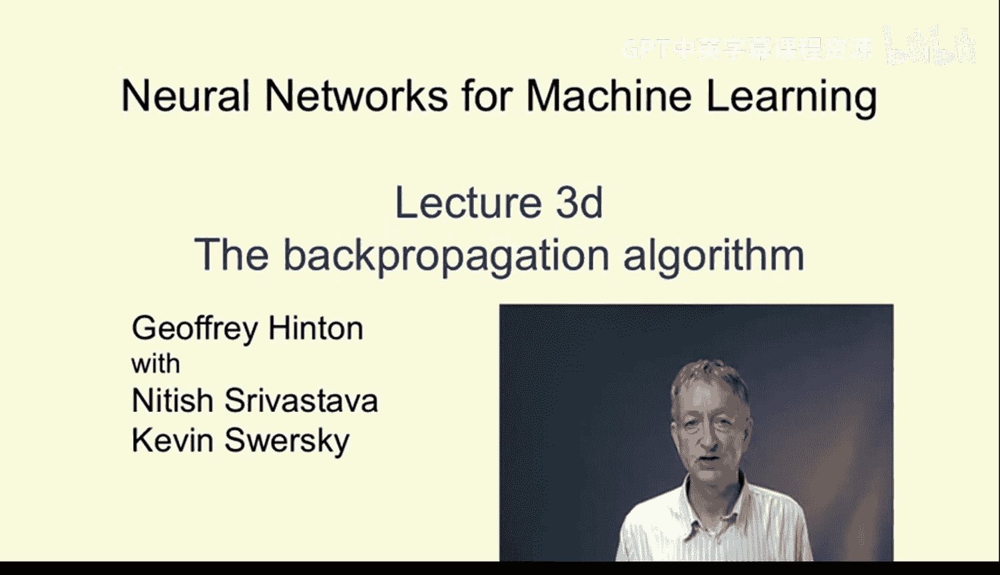
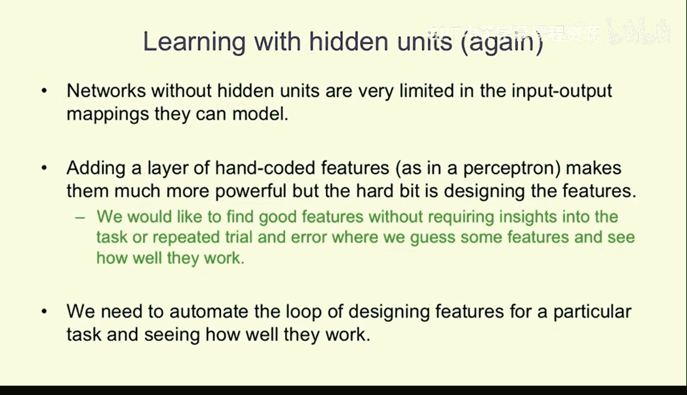
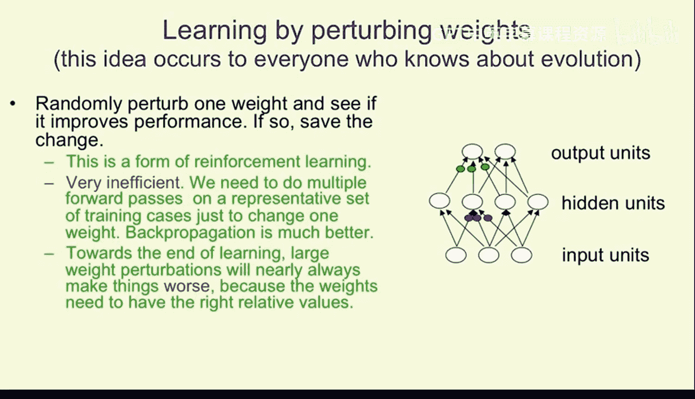
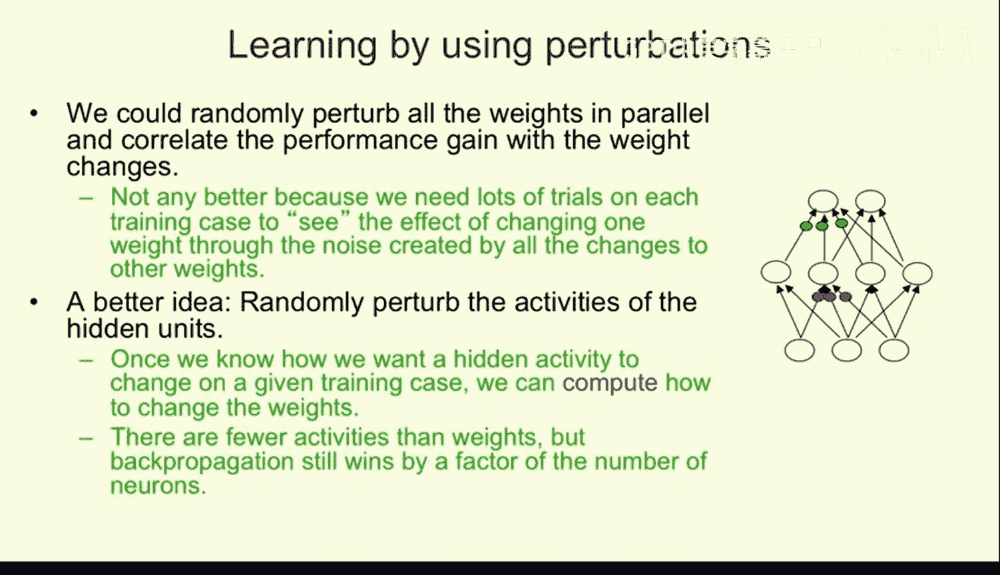
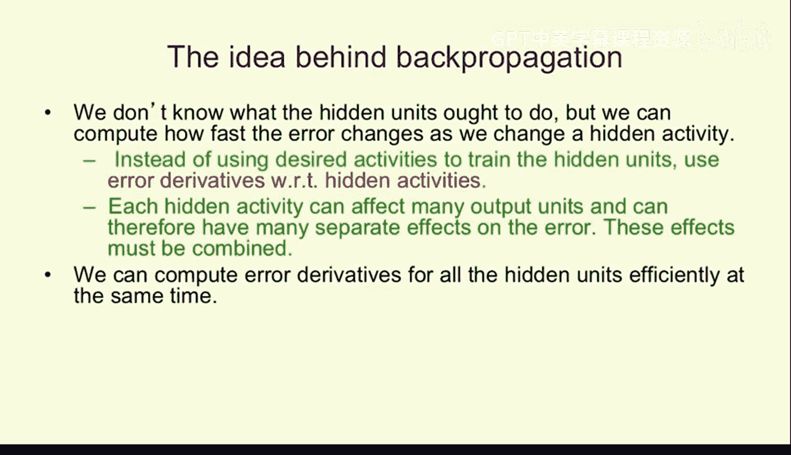
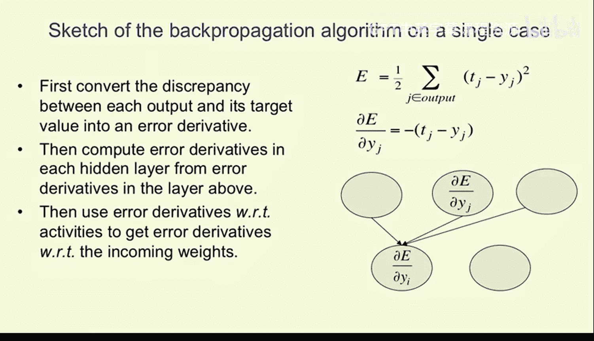
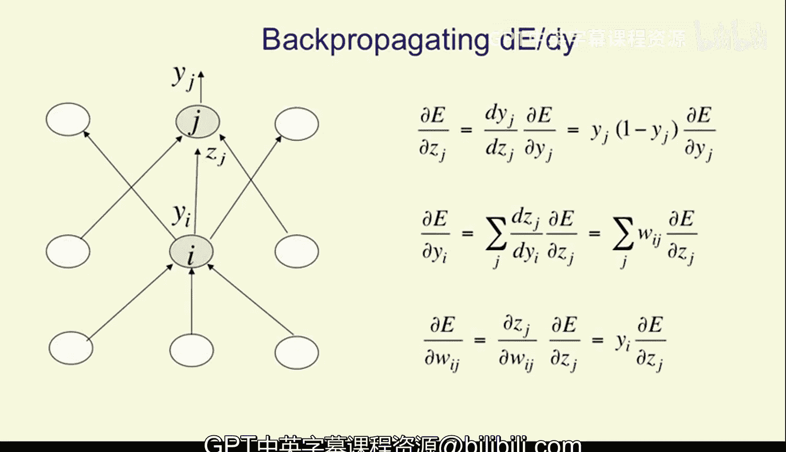

# Hinton@多伦多大学《机器学习的神经网络｜Neural Networks for Machine Learning 2016》claude-4s p14 -14-Lecture 3.4 — The backpropagation algorithm  -Neural Networks for Machine Le -BV1HtkUB2EZD_p14-

Now that we have the preliminaries out the way， we can get back to the central issue。

 which is how to learn multiple layers features。So in this video。

 I'm finally going to describe the back propagation algorithm。

Which was the main advance in the 1980s that LED to an explosion of interest in neural networks。

Before I describe back propagation， I can describe another very obvious algorithm that does not work nearly as well。

 but iss something that many people think of。

Now that we know how to learn the weights of a logistic unit。

 we're going to return to the central issue， which is how to learn the weights of hidden units。

If you have neural networks without hidden units， they're very limited in the input output mappings they can model。

If you had a layer of hand coated features， as in a perceptron。You make the net much more powerful。

 but the difficult bit for a new task is designing the features。

The learning won't solve the hub problem。 You have to solve it by hand。

What we'd like is a way of finding good features without requiring insights into the task or repeated trial and error where we guess some features and see how well they work。

In effect， what we need to do is automate the loop of designing features for a task and seeing how well they work。

 We'd like the computer to do that loop instead of having a person in the loop。

So the thing that occurs to everybody who knows about evolution。

Is to learn by perturbing the weights。You randomly perturb one weight。

 So that's meant to be like a mutation。And you see if it improves performance。

 and if it improves the performance of the net， you save that change in the weight。

You can think of this as a form of reinforcement learning。

Your action consists of making a small change。And then you check whether that pays off。

 And if it does， you decide to perform that action。The problem is， it's very inefficient。

Just to decide whether to change one weight， we need to do multiple forward passes on a representative set of training cases。

We have to see if changing that weight improves things。

 and you can't judge that by one training case alone。

Relative to this method of randomly changing a weight and seeing if it helps。

 back propagation is much more efficient。 It's actually more efficient by a factor of the number of weights in the network。

 which could be millions。An additional problem with randomly changing weights and seeing if it helps is that towards the end of learning。

 any large change in a weight will nearly always make things worse。

Because the weights have to have the right relative values to work properly。

So towards the end of learning， not only do you have to do a lot of work to decide whether each of these changes helps。

 but the changes themselves have to be very small。

There are slightly better ways of using perturbations in order to learn。

One thing we might try is to perturb all the weights in parallel and then correlate the performance gain with the weight changes。

That actually doesn't really help at all。The problem is that we need to do lots and lots of trials with different random perturbations of all the weights in order to see the effect of changing one weight through all the noise that is created by changing all the other weights。

So it doesn't help to do it all in parallel。Something that does help is to randomly perturb the activities of the hidden units instead of perturbing the weights。

Once you've decided that perturbing the activity of a hidden unit on a particular training case is going to make things better。

You can then compute how to change the weights。Since there's many fewer activities than weights。

 there's less things that you're randomly exploring。 And this makes the algorithm more efficient。

But it's still much less efficient than back propagation。

Back propagation still wins by a factor of the number of neurons。So the idea behind back propagation。

Is that we don't know what the hidden units ought to be doing。

 Theyre called hidden units because nobody is telling us what their states ought to be。

But we can compute how fast the error changes as we change a hidden activity on a particular training case。

So instead of using activities of the hidden units as the desired states。

 we use the error derivatives with respect to activities。

Since each hidden unit can affect many different output units。

It can have many different effects on the overall error if we have many output units。

These effects have to be combined。And we can do that efficiently。

So that allows us to compute error derivatives for all of the hidden units efficiently at the same time。

Once we've got those error derivatives for the hidden units。

 that is we know how fast the error changes as we change the hidden activity on that particular training case。

It's easy to convert those aero derivatives for the activities。

 into aero derivatives for the weights coming into a hidden unit。

So here's a sketch of how back propagation works for a single training case。First。

 we have to define the error and here we'll use the error being the square difference between the target values of the output unit J and the actual value that the net produces for the output unit J。

And we're going to imagine the several output units， in this case。We differentiate that。

And we get our familiar expression for how the error changes as you change the activity of an output unit。

 J。And I'll use a notation here where the index on a unit will tell you which layer it's in。

So that the output layer has a typical index of J。 and the layer in front of that。

 the hidden layer below it in the diagram will have a typical index of I。

 And I won't bother to say which layer we're in， because the index will tell you。

So once we've got the error derivative。With respect to the output of one of these output units。

We then want to use all those derivatives in the output layer to compute the same quantity in the hidden layer that comes before the output layer。

So back propagation， the core of back propagation。Is taking error derivatives in one layer。

And from them， computing the error derivatives in the layer that comes before that。

So we want to compute D E by D Y， I。Now， obviously， when we change the output。Of unit， I。

It'll change the activities of all three of those output units。

And so we have to sum up all those effects。So， we're going to have an algorithm。

That takes a derivatives we've already computed for the top layer here。And combines them。

Using the same weights as we use in the forward pass to get error derivatives in the lab below。

So this slide is going to explain the back propagation algorithm。

And you really need to understand this slide。 And the first time you see it。

 you may have to study it for a long time。This is how you back propagate the error derivative with respect to the output of a unit。

So we'll consider an output unit J and a hidden unit I。The output of the hidden unit， I will be Y I。

 The output of the output unit J will be Y J， and the total input received by that output unit。

 J will be Z J。The first thing we need to do。Is convert。

The error derivative with respect to Y J into an error derivative with respect to Z J。To do that。

 we use the chain rule， so we say D E by Dzj。Equals Dyj by Dzj。Times D E by D， Y J。

And as we've seen before， when we were looking at logistic units， that's just Y J into 1 minus Y J。

Times the error derivative with respect to the output of unit J。

So now we've got the error derivative with respect to the total input received by unit J。

Now we can compute the error derivative with respect to the output of unit I。

It's going to be the sum over all of the three outgoing connections of unit I。Of this quantity。D Z。

 J by D Y， I times D E by D Z， J。So the first term there。

Is how the total input to unit J changes as we change the output of unit I。

And then we have to multiply that。By how the error changes as we change the total input to unit J。

 which we computed on the line above。And as we saw before when studying the logistic unit。

 DZJ by DY I is just the weight on the connection， W I J。So what we get is that the error derivative。

With respect to the output of unit I。Is the sum over all the outgoing connections to the layer above。

Of。The weight W I J and that connection。Times a quantity we will have already computed。

 which is E by D Z J for the layer above。And so you can see the computation looks very like what we do on the forward pass。

But we're going in the other direction。What we do for each unit in that hidden layer that contains eye。

Is we compute this sum。Of a quantity in the layer above times the weights on the connections。

Once we've got D E by D Z J， which we computed on the first line here。

It's very easy to get the error derivatives for all the weights come into unit， J。

The E by DWI J is simply。Di。E by D Zj， which we computed already。Times how Z J changes， as we change。

The weight on the connection。And that's simply。The activity of the unit in the lab below Y I。

So the rule for changing the weight is just you multiply this quantity you've computed at a unit。

D E by D Z， J。By the activity coming in from the layer below。

 And that gives you the error derivative with respect to weight。So on this slide。

 we've seen how we can start with。D E by D， Y， J。And back propagate to get D E by D Y I。

 We've gone backwards through one layer and computed the same quantity。

 The derivative of the error with respect to the output in the previous layer。

So we can clearly do that for as many layers as we like。

And after we've done that for all these layers， we can compute how the error changes as you change the weights on the connections。

That's the back propagation algorithm。It's an algorithm for taking one training case and computing efficiently for every weight in the network。

How the error will change as on that particular training case， as you change the weight。

