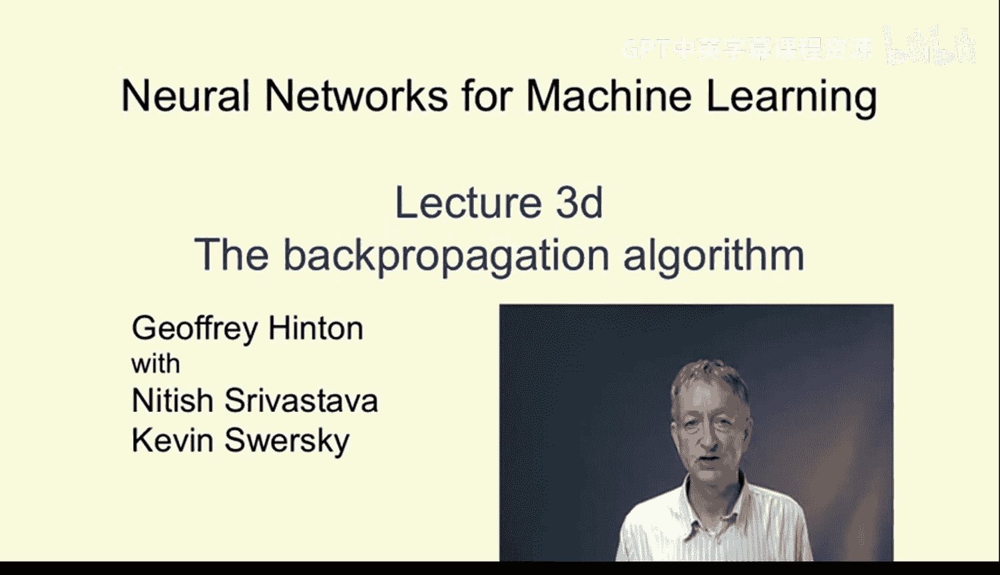
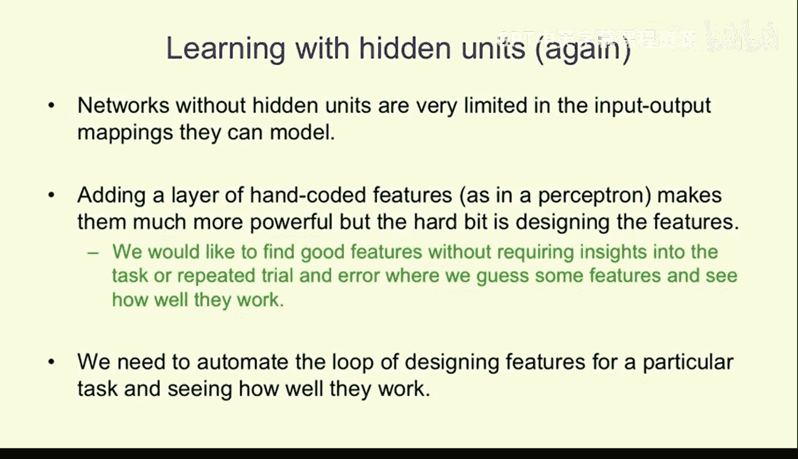
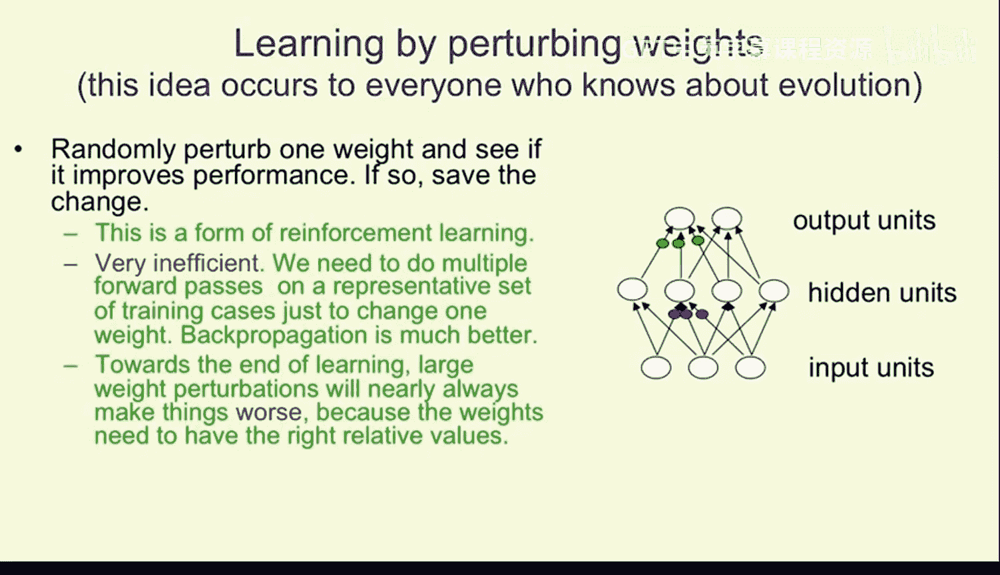
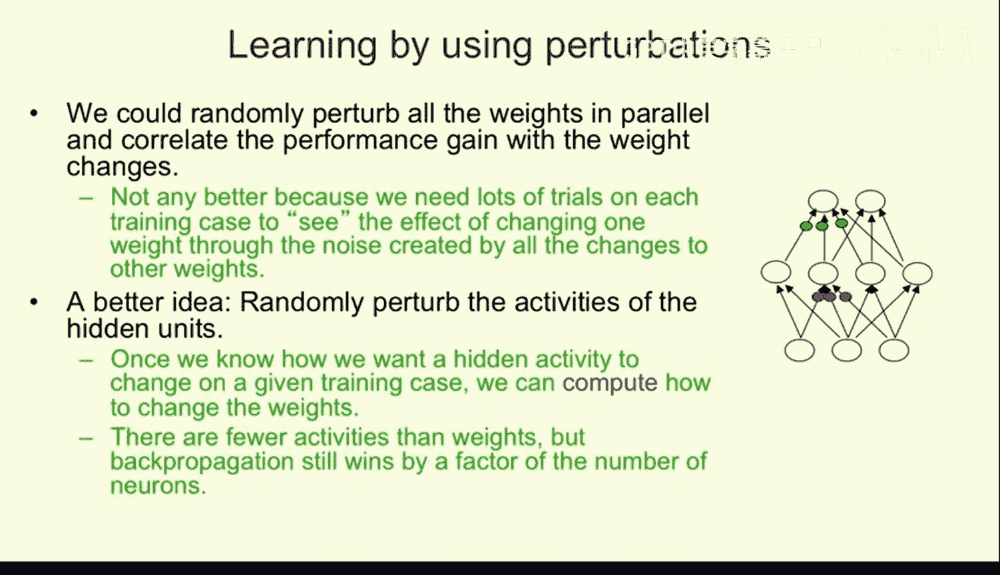
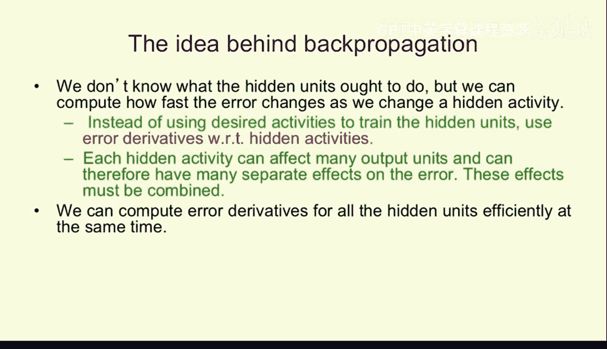
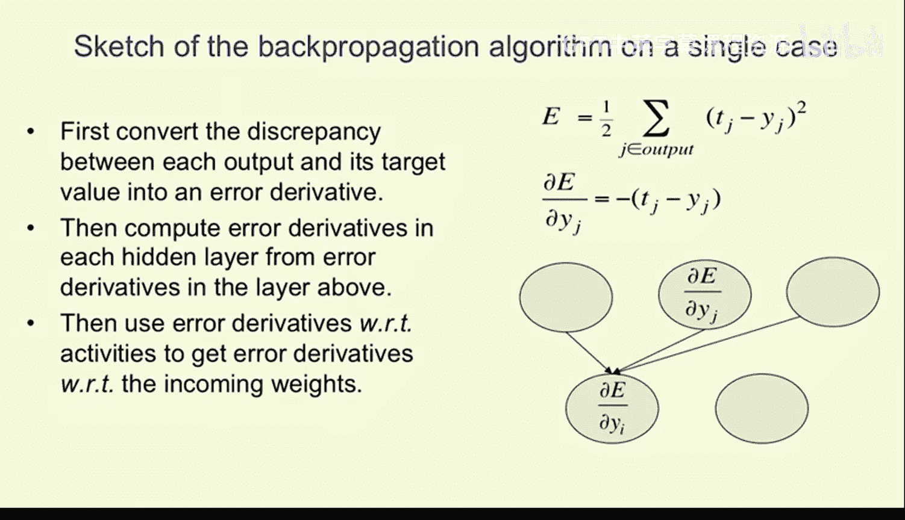
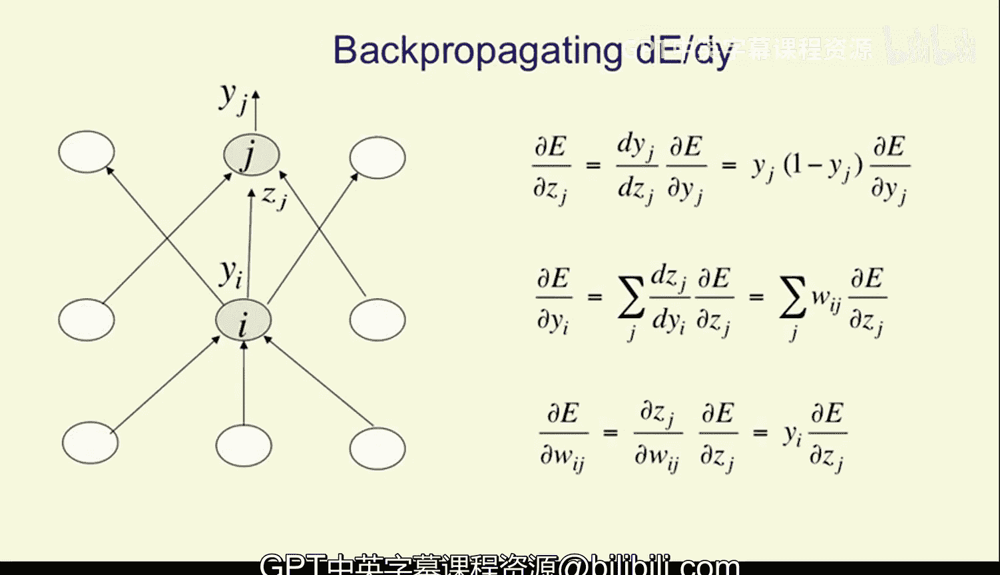

# 神经网络与机器学习：3.4：反向传播算法 🧠

在本节课中，我们将学习神经网络的核心算法——反向传播。我们将了解为什么需要这个算法，它如何高效地计算网络中每个权重的误差梯度，以及它是如何工作的。



## 从预备知识到核心问题

上一节我们介绍了如何学习单个逻辑单元的权重。本节中，我们将回到核心问题：如何学习多层网络中隐藏单元的权重。

没有隐藏单元的神经网络，其输入输出映射能力非常有限。如果像感知机那样使用一层手工设计的特征，网络会强大得多，但对于新任务来说，难点在于设计这些特征。学习过程无法解决特征设计问题，必须手动完成。

我们希望找到一种方法，能够自动发现好的特征，而不需要深入了解任务本身，也不需要反复试错。本质上，我们需要自动化“为任务设计特征并评估其效果”这个循环，让计算机代替人来完成这个循环。



## 低效的替代方法：权重扰动法

了解进化论的人首先想到的方法是：通过扰动权重来学习。你随机扰动一个权重（这类似于突变），然后观察它是否改善了网络的性能。如果改善了，就保留这个权重的改变。

你可以将其视为一种强化学习。你的动作是做出一个小的改变，然后检查这个改变是否带来了回报。如果是，你就决定执行这个动作。问题是，这种方法效率非常低下。

仅仅为了决定是否改变一个权重，我们就需要在有代表性的训练集上进行多次前向传播。我们必须观察改变这个权重是否改善了结果，而仅凭一个训练案例是无法判断的。

与这种随机改变权重并观察是否有效的方法相比，反向传播要高效得多。实际上，它的效率是网络权重的数量级，而网络权重可能多达数百万个。

随机改变权重方法的另一个问题是：在学习接近尾声时，对权重的任何大改动几乎总是会让情况变得更糟。因为权重必须具有正确的相对值才能正常工作。因此，在学习后期，你不仅需要做大量工作来判断每个改变是否有益，而且改变本身也必须非常微小。

## 改进的扰动方法及其局限



有一些稍好的方法可以利用扰动进行学习。

一种可能尝试的方法是：并行扰动所有权重，然后将性能增益与权重变化相关联。但这实际上并没有帮助。问题在于，我们需要进行大量试验，每次试验都对所有权重进行不同的随机扰动，才能透过改变其他所有权重所产生的“噪音”，看清改变某一个权重的效果。因此，并行操作并无帮助。

一种确实有帮助的方法是：随机扰动隐藏单元的活动值，而不是扰动权重。一旦你确定在某个特定训练案例上扰动一个隐藏单元的活动值会改善结果，你就可以计算如何改变权重。由于活动值的数量远少于权重的数量，你需要随机探索的东西就更少，这使得算法更高效。但它仍然远不如反向传播高效。

反向传播的效率优势仍然是神经元数量的倍数级。



## 反向传播的核心思想

反向传播背后的思想是：我们不知道隐藏单元应该做什么（它们被称为“隐藏”单元，正是因为没有人告诉我们它们的状态应该是什么）。但是，我们可以计算在特定训练案例上，当我们改变一个隐藏单元的活动值时，误差的变化速度。

因此，我们不是使用隐藏单元的活动值作为期望状态，而是使用误差相对于活动值的导数。由于每个隐藏单元可以影响许多不同的输出单元，如果我们有许多输出单元，它可能对总误差产生多种不同的影响。这些影响必须被合并，而我们可以高效地做到这一点。

这使我们能够同时高效地计算所有隐藏单元的误差导数。



## 反向传播算法详解

一旦我们获得了隐藏单元的误差导数（即我们知道在特定训练案例上改变隐藏单元活动值时，误差的变化速度），就很容易将这些关于活动值的误差导数，转换为关于进入该隐藏单元的权重的误差导数。

以下是反向传播算法针对单个训练案例的工作原理概述。

首先，我们必须定义误差。这里我们使用误差作为输出单元 *j* 的目标值与网络实际产生的输出值之间的平方差。我们假设有多个输出单元。

我们对该误差进行微分，得到熟悉的表达式，表示当你改变输出单元 *j* 的活动值时，误差如何变化。这里我将使用一种标记法：单元的索引会告诉你它在哪一层。因此，输出层的典型索引是 *j*，而它前面的层（图中位于其下方的隐藏层）的典型索引是 *i*。我不会特意说明我们在哪一层，因为索引会告诉你。

一旦我们得到了误差相对于某个输出单元输出的导数，我们就想利用输出层中的所有导数，来计算位于输出层之前的隐藏层中的相同量。

反向传播的核心是：获取某一层的误差导数，并由此计算前一层（更靠近输入层）的误差导数。

我们想要计算 **∂E/∂yᵢ**。显然，当我们改变单元 *i* 的输出时，它会改变所有三个输出单元的活动值。因此，我们必须汇总所有这些影响。所以，我们将有一个算法，它获取我们已经在顶层计算好的导数，并使用我们在前向传播中使用的相同权重来组合它们，从而得到下一层的误差导数。

### 算法步骤解析



这个部分将解释反向传播算法。你真的需要理解这部分内容，第一次看到时，可能需要花很长时间研究。这就是如何反向传播误差相对于单元输出的导数。

我们考虑一个输出单元 *j* 和一个隐藏单元 *i*。隐藏单元 *i* 的输出是 **yᵢ**，输出单元 *j* 的输出是 **yⱼ**，该输出单元 *j* 接收的总输入是 **zⱼ**。

我们需要做的第一件事是：将误差相对于 **yⱼ** 的导数转换为误差相对于 **zⱼ** 的导数。为此，我们使用链式法则：
```
∂E/∂zⱼ = (∂yⱼ/∂zⱼ) * (∂E/∂yⱼ)
```
正如我们之前研究逻辑单元时所见，**∂yⱼ/∂zⱼ** 就是 **yⱼ * (1 - yⱼ)**，乘以误差相对于单元 *j* 输出的导数。

现在我们已经得到了误差相对于单元 *j* 接收的总输入的导数。

接下来，我们可以计算误差相对于单元 *i* 输出的导数。它将是单元 *i* 所有三个输出连接上的以下量的总和：
```
(∂zⱼ/∂yᵢ) * (∂E/∂zⱼ)
```
其中第一项 **∂zⱼ/∂yᵢ** 是单元 *j* 的总输入如何随单元 *i* 输出的变化而变化。然后我们必须将其乘以误差如何随单元 *j* 总输入的变化而变化（我们在上一行已经计算了 **∂E/∂zⱼ**）。

正如我们之前研究逻辑单元时所看到的，**∂zⱼ/∂yᵢ** 就是连接上的权重 **wᵢⱼ**。因此我们得到，误差相对于单元 *i* 输出的导数是：
```
∂E/∂yᵢ = Σⱼ [ wᵢⱼ * (∂E/∂zⱼ) ]
```
即，对连接到上一层的所有输出连接求和，权重 **wᵢⱼ** 乘以我们已经计算好的量 **∂E/∂zⱼ**。

你可以看到，这个计算看起来非常像我们在前向传播中所做的，但方向相反。对于包含单元 *i* 的隐藏层中的每个单元，我们计算这个总和：上一层中的某个量乘以连接上的权重。

一旦我们得到了 **∂E/∂zⱼ**（我们在第一行已经计算），就很容易得到进入单元 *j* 的所有权重的误差导数。**∂E/∂wᵢⱼ** 就是：
```
∂E/∂wᵢⱼ = (∂E/∂zⱼ) * (∂zⱼ/∂wᵢⱼ)
```
而 **∂zⱼ/∂wᵢⱼ** 简单地等于来自下一层的单元活动值 **yᵢ**。

因此，改变权重的规则就是：将你在单元处计算出的量 **∂E/∂zⱼ**，乘以来自下一层的活动值 **yᵢ**，这就得到了误差相对于该权重的导数。

## 算法总结与扩展

在这一部分，我们看到了如何从 **∂E/∂yⱼ** 开始，反向传播得到 **∂E/∂yᵢ**。我们反向穿过一层，计算了相同的量——误差相对于前一层输出的导数。

显然，我们可以对任意多层进行此操作。在对所有这些层完成此操作后，我们就可以计算当你改变连接上的权重时，误差如何变化。这就是反向传播算法。

它是一个针对单个训练案例，高效计算网络中每个权重的误差变化（在该特定训练案例上，当你改变权重时）的算法。

---



本节课中，我们一起学习了反向传播算法。我们首先探讨了为什么需要自动学习多层特征，然后分析了简单但低效的权重扰动法及其局限。接着，我们深入讲解了反向传播的核心思想：利用误差导数而非期望状态来指导学习。最后，我们详细拆解了反向传播的数学推导过程，展示了如何通过链式法则将输出层的误差导数高效地反向传播到隐藏层乃至输入层，并计算出所有权重的更新梯度。反向传播是神经网络得以有效训练的关键，它使得大规模多层网络的学习成为可能。