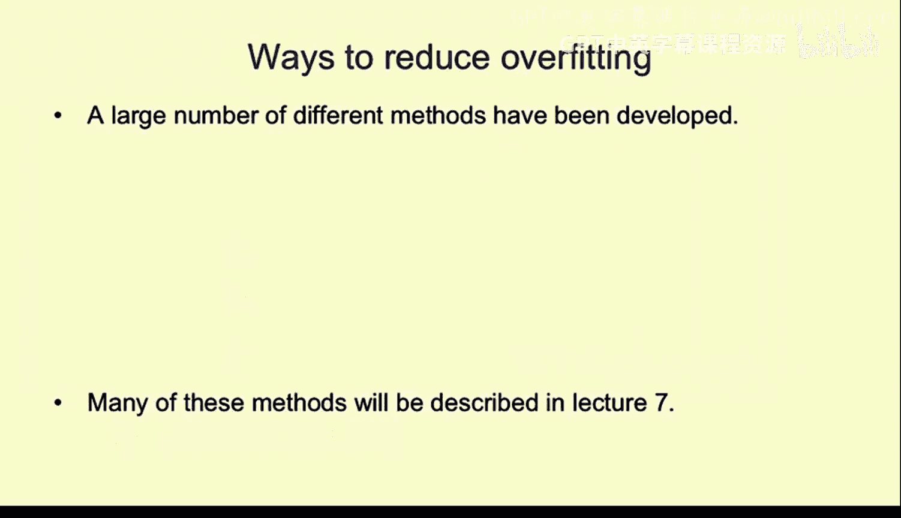
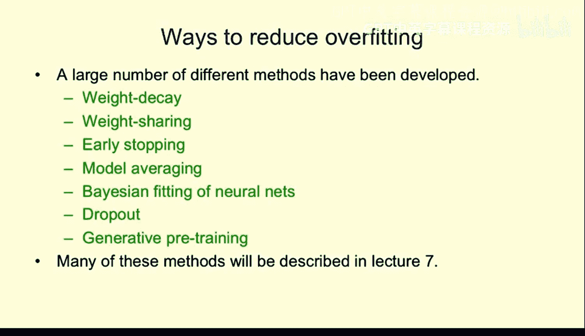

# 神经网络与机器学习：3.5：使用反向传播的导数 🧠

在本节课中，我们将学习如何利用反向传播算法计算出的导数，来构建一个完整、高效且能良好泛化的神经网络学习过程。我们将探讨权重更新的时机与幅度，以及防止模型过拟合的关键策略。

上一节我们介绍了反向传播算法如何高效地计算单个训练样本的误差相对于每个权重的导数。然而，这本身还不是一个完整的学习算法。要得到一个完善的学习流程，还需要指定许多其他事项。

我们需要做出许多其他决策。其中一部分决策关乎如何进行优化，即如何利用单个样本的误差导数来找到一组好的权重。这些内容将在第6讲中详细描述。另一组问题是如何确保我们学到的权重能够良好地泛化，也就是如何保证它们能在训练时未见过的样本上有效工作。第7讲将专门讨论这个问题。现在，我将对这两组问题做一个非常简要的概述。

## 优化问题：如何使用权重导数

优化问题关注的是如何使用权重导数。第一个问题是：应该多久更新一次权重？

我们可以尝试在每个训练样本之后更新权重。具体做法是，使用反向传播计算一个训练样本上的误差，然后对权重做一个小的调整。显然，这会带来曲折的路径，因为每个训练样本都会给出不同的误差导数。但平均而言，如果我们把权重变化设置得足够小，它最终会朝着正确的方向前进。

更明智的做法似乎是使用**全批次训练**。在这种方法中，你需要完整地遍历所有训练数据，将每个样本上得到的误差导数相加，然后沿着这个总方向迈出一小步。这种方法的一个问题是，我们初始的权重可能很差，而训练集可能非常大。我们并不希望为了修正一些已知很差的权重，而完成遍历整个训练集这样繁重的工作。

实际上，我们只需要观察少量训练样本，就能对权重应该朝哪个方向移动有一个合理的判断。直到学习接近尾声时，我们才需要查看大量的训练样本。

这就引出了**小批次学习**。我们随机抽取一小部分训练样本组成一个批次，并沿着这个批次计算出的总梯度方向更新。这会产生一些曲折，但远不如每次只用一个样本的在线学习那么曲折。当在大数据集上训练大型神经网络时，小批次学习是人们的典型做法。

接下来是更新权重幅度的问题，即我们应该做多大的改变。

我们可以手动尝试并选择一个固定的学习率，然后通过将每个权重改变为我们计算出的导数乘以该学习率来学习权重。更明智的做法是让学习率能够自适应调整。我们可以让计算机来调整它。例如，如果误差持续上下振荡，我们就降低学习率；如果我们正在稳步取得进展，我们可能会提高学习率。

我们甚至可以为网络中的每个连接设置单独的学习率，这样一些权重可以学得快，而另一些权重学得慢。或者我们可以更进一步，说我们其实根本不想沿着最陡下降的方向前进。

请看右边的图。当我们有一个非常扁长的椭圆时，最陡下降的方向几乎与我们想要找到的最小值方向成直角。这在大多数学习问题中，尤其是在学习接近尾声时，是非常典型的情况。因此，存在比最陡下降方向好得多的方向。问题在于，要找出这些方向相当困难。

## 泛化问题：如何防止过拟合

第二组问题涉及网络对训练期间未见过的样本的泛化能力。这里的问题是，训练数据包含了从输入到输出映射的规律性信息，但也包含两种类型的噪声。

第一种噪声是目标值可能不可靠。对于神经网络来说，这通常只是一个小问题。第二种噪声是**抽样误差**。如果我们取任何一个特定的训练集，特别是如果它很小，就会存在由我们选择的特定样本引起的偶然规律性。

例如，如果你向某人展示一些多边形。如果你是个糟糕的老师，你可能会选择展示一个正方形和一个矩形。它们都是多边形，但对方无法从中意识到多边形可能有三条边或七条边，也无法理解角度不一定非要是直角。

如果你是个稍好一点的老师，你可能会展示一个三角形和一个六边形。但是，同样地，对方无法从中判断多边形是否总是凸的，也无法判断多边形的内角是否总是60度的倍数。无论你如何精心选择示例，对于任何有限的示例集，都会存在偶然的规律性。

现在，当我们拟合一个模型时，模型无法区分哪些是仅仅因为我们选择的特定样本而存在的偶然规律，哪些是能够正确泛化到新样本的真实规律。因此，模型会同时拟合这两种规律。如果你有一个庞大而强大的模型，它将非常擅长拟合抽样误差，这将是一场真正的灾难，导致其泛化能力极差。

通过一个小例子可以最好地理解这一点。

这里，我们有六个用黑色显示的数据点。我们可以用一条直线来拟合它们。这是一个具有两个自由度的模型，它根据6个x值拟合6个y值。或者，我们考虑一个具有六个自由度的多项式。我用手工画了一条红线，代表我认为的具有6个自由度、拟合这些数据的多项式。你会看到这个多项式恰好穿过了所有数据点。因此，它对数据的拟合要好得多。

但你信任哪个模型？复杂的模型当然对数据的拟合好得多，但它不经济。要让一个模型有说服力，你希望它是一个能出人意料地很好地解释大量数据的简单模型。而多项式模型做不到这一点。它解释了这六个数据点，但它有6个自由度。所以，无论这些数据点在哪里，它都能解释它们。我们不会惊讶于一个复杂的模型能很好地拟合这些数据，这并不能让我们信服这是一个好模型。

请看箭头所指的位置。对于这个输入值，你预测哪个输出值？你必须对多项式模型有极大的信心，才会预测一个超出你目前所见所有训练数据值范围的值。我想几乎所有人都会更倾向于预测绿线上的蓝色圆圈，而不是红线上的那个。

然而，如果我们有10倍多的数据，并且所有这些数据点都非常接近红线，那么我们肯定会更倾向于红线。

## 减少过拟合的方法

针对神经网络以及许多其他模型，人们已经开发了多种减少过拟合的方法。我在这里仅做一个简要的概述。

*   **权重衰减**：你试图保持网络的权重较小，或者试图让许多权重保持为0。其思想是，这将使模型更简单。
    *   `新的损失函数 = 原始损失 + λ * Σ(权重²)`，其中λ是衰减系数。
*   **权重共享**：你再次通过强制要求许多权重彼此具有完全相同的值来简化模型。你不知道这个值是什么，你将学习它，但它对于许多权重必须是完全相同的。我们将在下一讲中看到权重共享是如何使用的。
*   **早停法**：你为自己制作一个假的测试集。在训练网络时，你观察这个假测试集上的表现。一旦假测试集上的性能开始变差，你就停止训练。
*   **模型平均**：你训练许多不同的神经网络，然后将它们平均在一起，希望这能减少你所犯的错误。
*   **神经网络的贝叶斯拟合**：这实际上只是模型平均的一种高级形式。
*   **丢弃法**：你尝试通过在训练时随机丢弃隐藏单元来使你的模型更加鲁棒。
*   **生成式预训练**：这比我将在课程末尾描述的要复杂一些。

本节课中，我们一起学习了如何将反向传播计算出的导数整合到一个完整的学习框架中。我们探讨了权重更新的频率（在线、全批次、小批次）和幅度（固定学习率、自适应学习率、更优的搜索方向）等优化问题。更重要的是，我们深入理解了模型过拟合的本质——模型同时学习了数据中的真实规律和抽样噪声导致的偶然规律。为了应对过拟合，我们简要介绍了权重衰减、权重共享、早停法、模型平均、贝叶斯方法、丢弃法和生成式预训练等多种正则化技术。理解这些概念是设计出高效且泛化能力强的神经网络的关键。