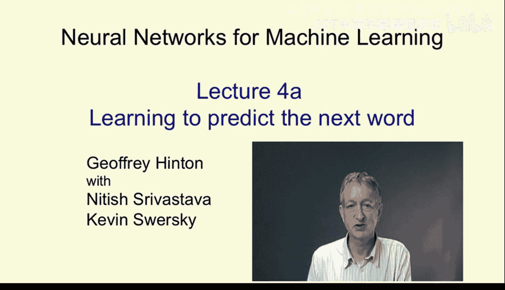
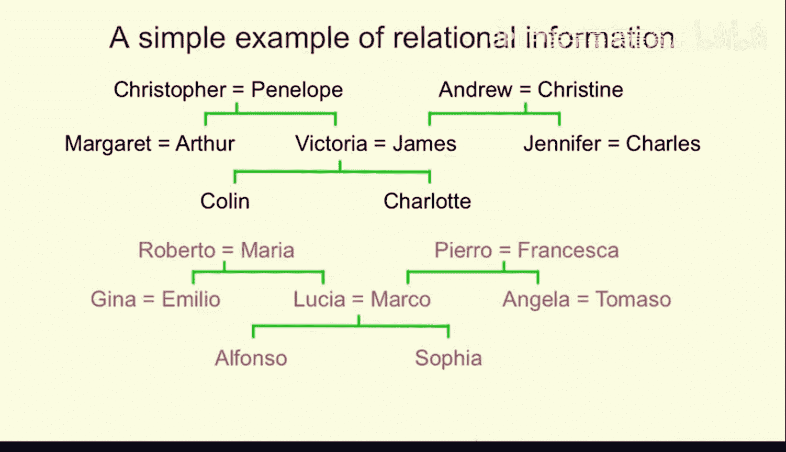
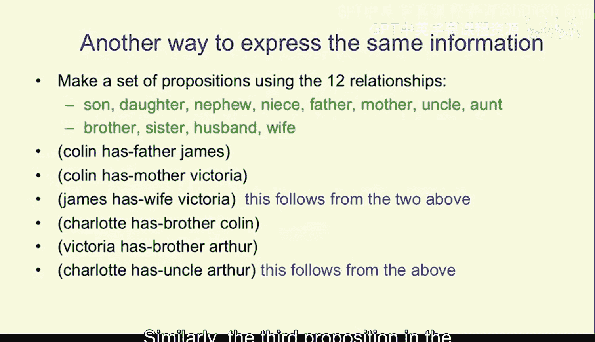
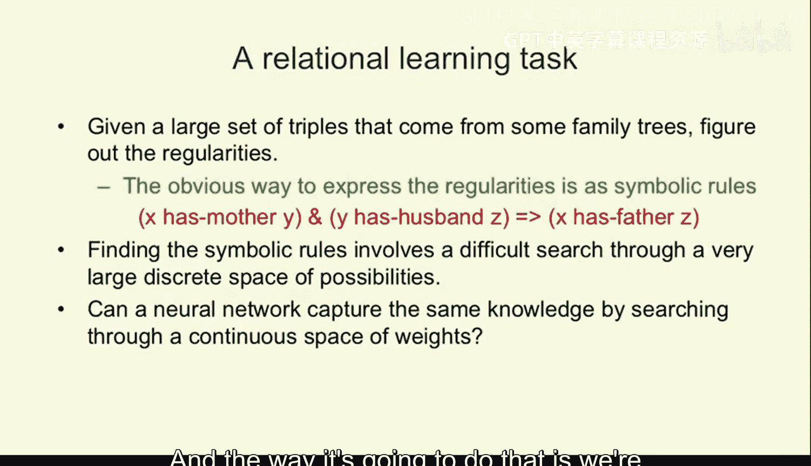
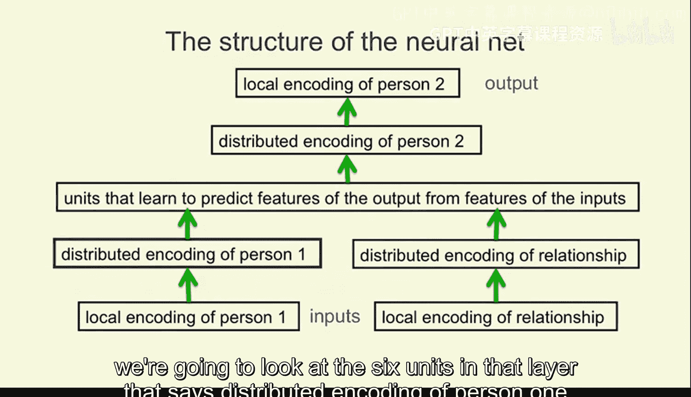
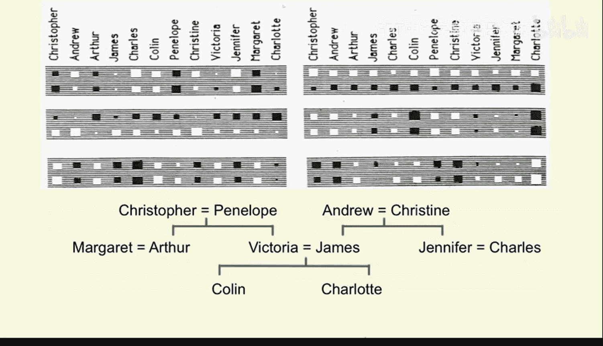
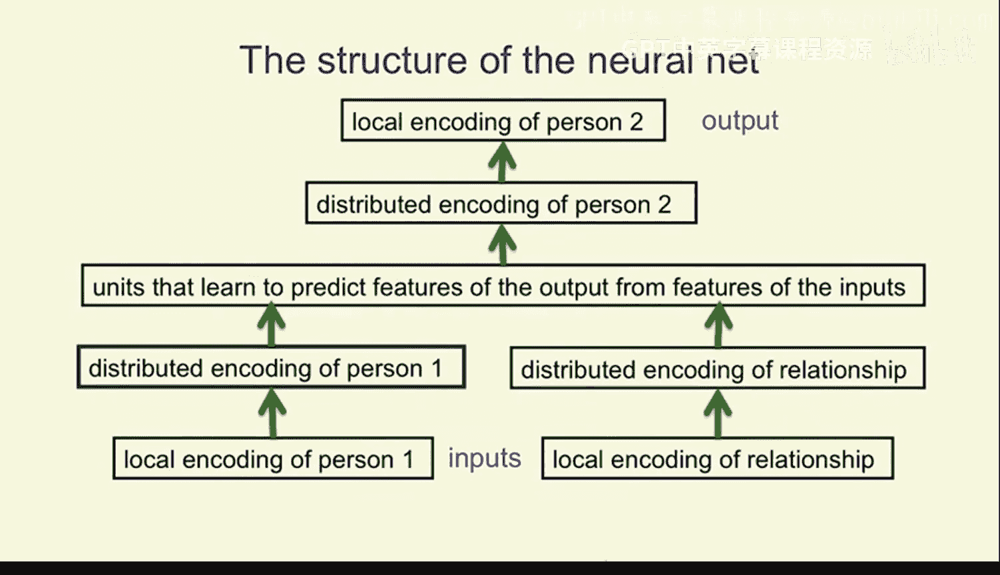
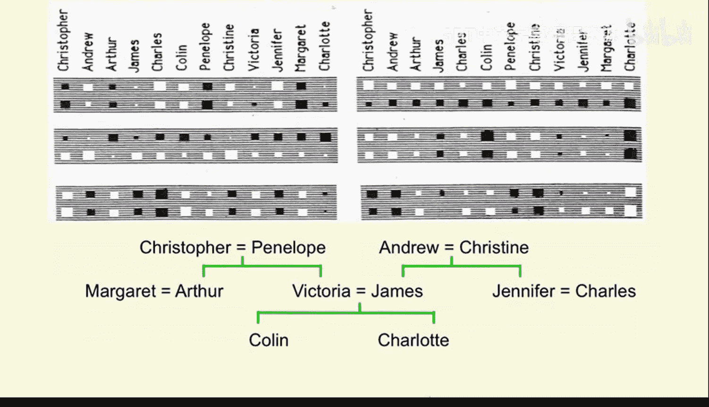
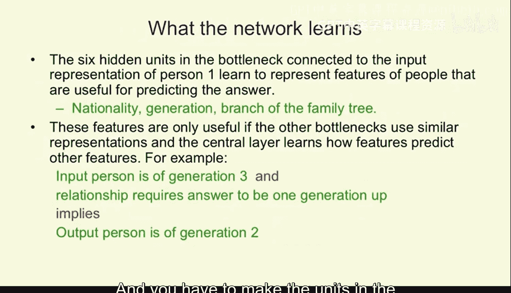
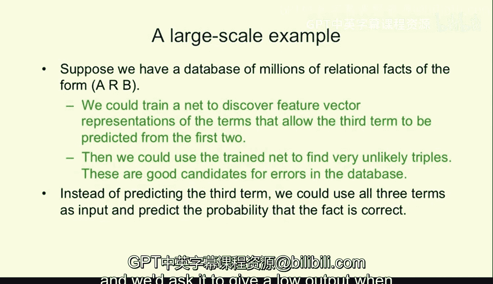

# Hinton@多伦多大学《机器学习的神经网络｜Neural Networks for Machine Learning 2016》claude-4s p16 -16-Lecture 4.1 — Learning to predict the next word  -Neural Networks for Machin -BV1HtkUB2EZD_p16-

The next few videos are about using the back propagation algorithm。

To learn a feature representation of the meaning of a word。

I'm going to start with a very simple case from the 1980s when computers were very slow。

 It's a small case， but it illustrates the idea about how you can take some relational information。

And use the back propagation algorithm to turn relational information into feature vectors that capture the meanings of words。

This diagram shows a simple family tree。In which， for example。

 Christopher and Penelope marry and have children， Arthur and Victoria。

What we'd like is to train a neural network to understand the information in this family tree。

We've also given it another family tree of Italian people。

 which has pretty much the same structure as the English tree。

And perhaps when it tries to learn both sets of facts。

 the neural net is going to be able to take advantage of that analogy。

The information in these family trees can be expressed as a set of propositions。

If we make up names for the relationships depicted by the trees。

So we're going to use the relationship。 son， daughter， nephew niece， father， mother， uncle， aunt。

 brother， sister and husband， wife。And using those relationships， we can write down a set of triples。

 such as Colin has Father James。 Colin has mother Victoria， and James has wife， Victoria。

And in the nice， simple families depicted in the diagram。

The third proposition follows from the previous two。Similarly。

The third proposition in the next set follows from the previous two。

So the relational learning task。That is the task of learning the information in those family trees。

Can be viewed as figuring out the regularities in a large set of triples that express the information in those trees。

Now， the obvious way to express theregularities is as symbolic rules。For example。

 X has mother Y and Y has husband Z implies X has father Z。We could search for such rules。

 but this would involve a search through quite a large space。

 a combinatorily large space of discrete possibilities。

A very different way to try and capture the same information。

Is to use a neural network that searches through a continuous space of real valued weights。

To try and。Capture the information。And the way it's going to do that is we're going to say it's captured the information if it can predict。

The third term at triple from the first two terms。So at the bottom of this diagram here。

We're going put in。A person and a relationship。And the information is going to flow forwards through this neural network。

And what we're gonna try and get out of the neural network after it's learned。

Is the person who's related to the first person by that relationship。

The architecture of this net was designed by hand。 That is， I decided how many layers it should have。

 and I also decided where to put bottlenecks to force it to learn interesting representations。

So what we do is we。Encode the information in a neutral way。There are 24 possible people。

So the block at the bottom of the diagram that says local encoding of person 1 has 24 neurons。

 and exactly one of those will be turned on for each training case。Similarly。

 there are 12 relationships， and exactly one of the relationship units will be turned on。

And then for a relationship that has a unique answer。We would like one of the 24 people at the top。

 one of the 24 April people to turn on to represent the answer。

By using a representation in which exactly one of the neurons is on。

We don't accidentally give the network any similarities between people。

 All pairs of people are equally dissimilar。So， we're not。

Choing by giving the network information about who's like， who。The people。

 as far as the network are concerned， are uninterpreted symbols。

But now in the next layer of the network， we've taken the local encoding of person one。

And we've connected it to a small set of neurons。 I actually use 6 neurons for this。

And because of are 24 people， it can't possibly dedicate one neuron to each person。

 It has to re represent the people as patterns activity over those six neurons。And what we're hoping。

Is that when it learns these propositions。The way in which it encodes a person。

In that distributed pattern of activity。Will reveal  structure in the task or structure in the domain。

So what we're going to do is we're going to train it up on 112 of these propositions。

And we go through the  hundred 12 propositions many times， slowly changing the weights as we go。

 using back propagation。And after training。We're going to look at the six units in that layer that says distributed encoding of person  one。

To see what they're doing。 So here are those six units as the big gray blocks。

And I laid out the 24 people。With the 12 English people in a row along the top and the 12 Italian people in a row underneath。

So each of these blocks， you'll see， has 24 blobs in it。

And the blobs tell you the incoming weights for one of the hidden units in that layer。

So going back to the previous slide， if you look at that layer that says distributed encoding a person one。

There are six neurons there， and we're looking at the incoming weights of each of those six neurons。

If you look at the big gray rectangle on the top right。

You'll see an interesting structure to the weights。The weights along the top。

That come from English people are all positive， and the weights along the bottom are all negative。

That means this unit tells you whether the input person is English or Italian。

We never gave it that information explicitly， but obviously。

 it's useful information to have in this very simple world。

Because in the family trees that we're learning about。If the input person is English。

 the output person is always English。And so just knowing that someone's English already allows you to predict one bit of information about the output。

Which is equivalent to saying it halves the number of possibilities。If you look at the gray blob。

Immediately below that。The second one down on the right。

 you'll see that it has four big positive weights at the beginning。

Those correspond to Christopher and Andrew， or their Italian equivalents。

Then it has some smaller weights。 Then it has two big negative weights that correspond to Colin or his Italian equivalent。

Then there's four more big positive weights corresponding to Penelope or Christina their Italian equivalents。

 And right at the end。Those two big negative weights corresponding to Charlotte or her Italian equivalent。

By now， you've probably realized that that neuron represents what generation somebody is。It has big。

 positive weights。To the oldest generation， big， negative weights to the youngest generation and intermediate weights that are roughly 0。

To the intermediate generation。So that's really a three valued feature。

And it's telling you the generation of the person。Finally。

 if you look at the bottom gray rectangle on the left hand side。You'll see。 that has。

A different structure。And if we look at the top row and we look at the negative weights in the top row of that unit。

It has a negative weight to Andrew， James， Charles， Christine and Jennifer。And now。

 if you look at the English family tree， you'll see Andrew， James， Charles。

 Christine and Jennifer are all in the right hand branch of the family tree。

So that unit has learned to represent which branch of the family tree someone one is in。Again。

 that's a very useful feature to have for predicting the output person。

 because if you know it's a close family relationship。

 you expect the output to be in the same branch of the family tree as the input。

So the networks in the bottleneck have learned to represent features of people that are useful for predicting the answer。

And notice we didn't tell it anything about what features to use。

 We never mentioned things like nationality or branch， or family tree or generation。

It figured out that those are good features for expressing the regularity in this domain。Of course。

 those features are only useful if the other bottlenecks。

 the one for relationships and the one near the top of the network before the output person use similar representations。

And the central layer is able to say how the features of the input person and the features of the relationship predict the features of the output person。

So for example， if the input person is of generation3 and the relationship requires the output person to be one generation up。

 then the output person is of Gene2。But notice to capture that rule。

You have to extract appropriate features at the。First hidden layer and the last hidden layer of the network。

 And you have to make the units in the middle relate those features correctly。

Another way to see that the network works。Is to train it on all but a few of the triples and see if it can complete those triples correctly。

 So does it generalise。So there's  a hundred and 12 triples。

 and I trained it on 1 hundred08 of them and tested on the remaining four。 I did that several times。

And it got either two or three of those right。 That's not so bad for a 248 choice。

So its true makes mistakes， but it didn't have much training data。

There's not enough triples in this domain to really nail down the regularities very well。

And it does much better than chance。If you train it on a much bigger data set。

 it can generalize from a much smaller fraction of the data。

So if you have thousands and thousands of relationships。

 you only need to show it a small percentage before it can start guessing the other ones correctly。

 That research was done in the 1980s and was a way of showing that back propagation could learn interesting features。

 And it was a toy example。Now we have much bigger computers and we have databases of millions of relational facts。

Many of which are of the form A R B。A has relationship R to B。

We could imagine training a net to discover feature vector representations of A and R that allow it to predict the feature vector representation of B。

If we did that， it would be a very good way of cleaning a database。

It wouldn't necessarily be able to make perfect predictions。

But it could find things in the database that it thought were highly implausible。

So if the database contained information， like， for example。Buck was born in 1902。

It could probably realise that was wrong cause Bark's a much older kind of person and everything else he's related to is much older than 1902。

Instead of actually using the first two terms to predict the third term。

We could use the whole set of terms， three of them in this case， but possibly more。

And predict the probability that the fact is correct。To train aette to do that。

 we'd need examples of a whole bunch of correct facts， and we'd ask it to give a high output。

 We'd also need a good source of incorrect facts， and we'd ask it to give a low output when wed told it something that was false。

