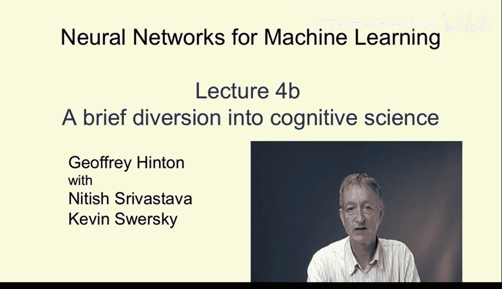
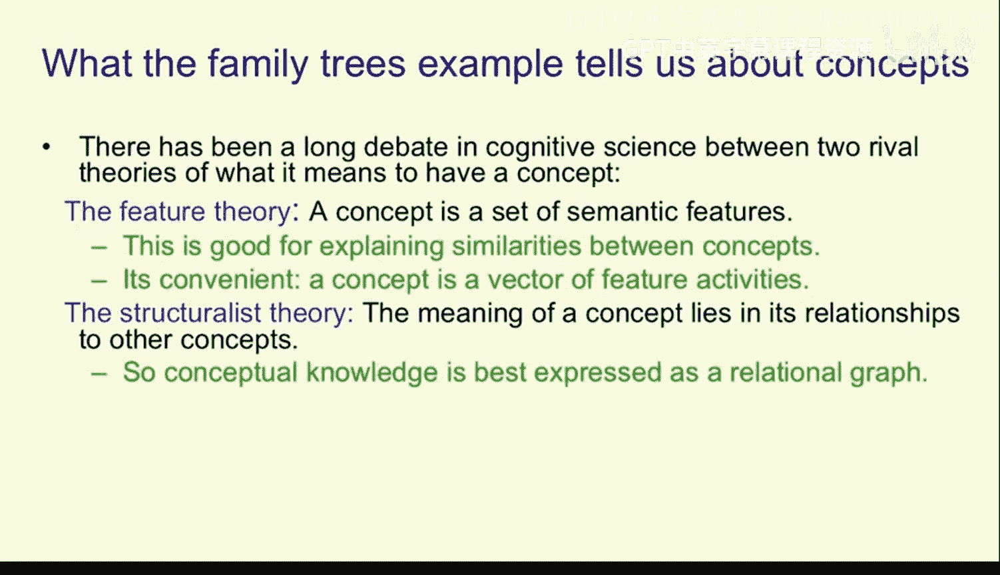
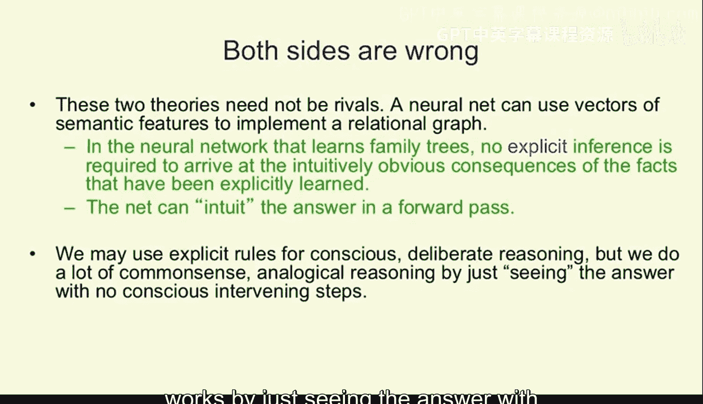
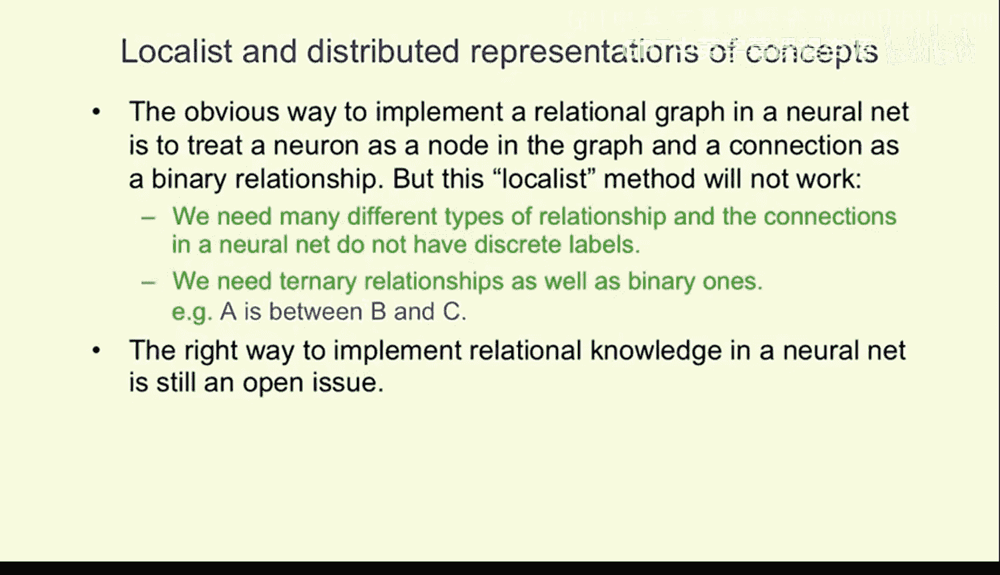

# Hinton@多伦多大学《机器学习的神经网络｜Neural Networks for Machine Learning 2016》claude-4s p17 -17-Lecture 4.2 — A brief diversion into cognitive science  -Neural Networks for -BV1HtkUB2EZD_p17-

We're now going to talk a little bit about an issue that's of interest to cognitive scientist。

But may not be of much interest to engineers。 So if you're an engineer。

 you can just ignore this video。In cognitive science， there's been a debate going on for。

Nearly 100 years about the relationship between feature vector representations of concepts。

And representations of concepts via their relations to other concepts。

And the learning algorithm we've just seen for family trees has a lot to say about that debate。

We're now going to make a brief diversion into cognitive science。

There's been a long debate between two rival theories of what it means to have a concept。

The feature theory says a concept is a big set of semantic features。

This is good for explaining similarities between concepts。

And it's convenient for things like machine learning。

 because we like to deal with vectors of activities， the structureless theory。

Says that the meaning of a concept lies in its relationships to other concepts。

So conceptual knowledge is best expressed not as a big vector， but as a relational graph。

In the early 1970s， Marvin Minsky used the limitations of perceptrons as evidence against feature vectors and in favour of relational graph representations。

My belief is that both sides in this debate are wrong。

Because both sides believe that the two theories are rivals， and they're not rivals at all。

A neural net can use vectors of semantic features to implement a relational graph。

In the neural network that learns family trees。We can think of explicit inference as I give you person1。

 and I give you a relationship。 and you tell me person 2。And to arrive at that conclusion。

The neural net doesn't follow a whole bunch of rules of inference。

 It just passes information forwards through the net。As far as the neural net is concerned。

 the answer is intuitively obvious。Now， if you look at the details of what's happening。

 there's lots of probabilistic features that are influencing each other。

We call these micro features to sort of emphasize their not like explicit conscious features。

In a real brain， there might be millions of them and millions of interactions。

 And as a result of all these interactions， we can make one step of explicit inference。

And that's what we believe is involved in just seeing the answer to something。

There are no intervening conscious steps， but nevertheless。

 there law of computation going on in the interactions of neurons。

So we may use explicit rules for conscious， deliberate reasoning。

But a lot of our common sense reasoning， particularly analog reasoning。

 works by just seeing the answer with no conscious intervening steps。

And even when we do conscious reasoning。We have to have some way of just seeing which rules apply in order to avoid an infinite regress。

So many people， when they think about implementing a relational graph in a neural net。

Just assume that you should make a neuron correspond to a node in the relational graph。

And a connection between two neurons correspond to a binary relationship。

But this method doesn't work。For a start， the relationships come in different flavours in the different kinds of relationship like mother of or aunt of。

And a connection in a neural net only has a strength。 It doesn't come in different types。Also。

 we need to deal with turnernary relationships like A' is between B and C。

We still don't know for sure the right way to implement relational knowledge in a neural net。

But， it seems very probable。That many neurons are used for representing each of the concepts we know。

And each of those neurons is probably involved in dealing with many different concepts。

This is called a distributed representation。It's a many to many mapping between concepts and neurons。

