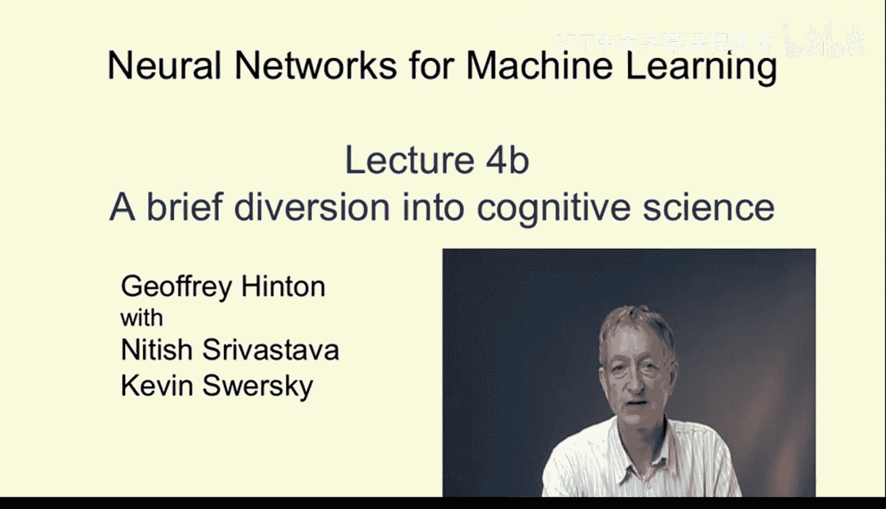
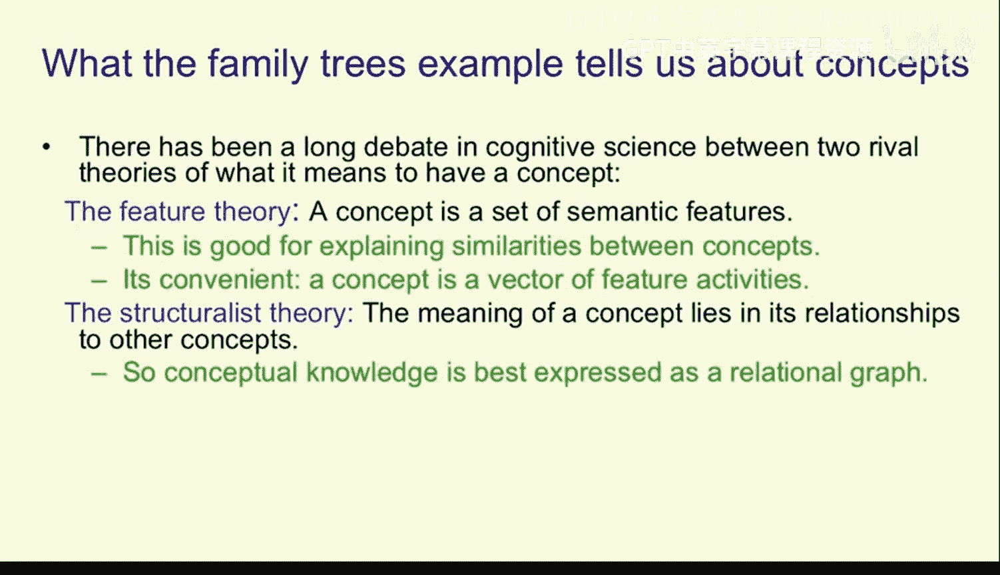
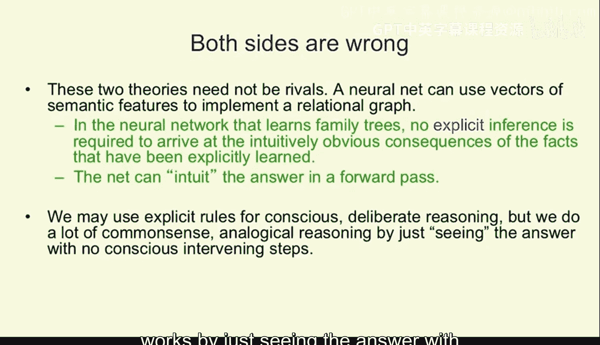
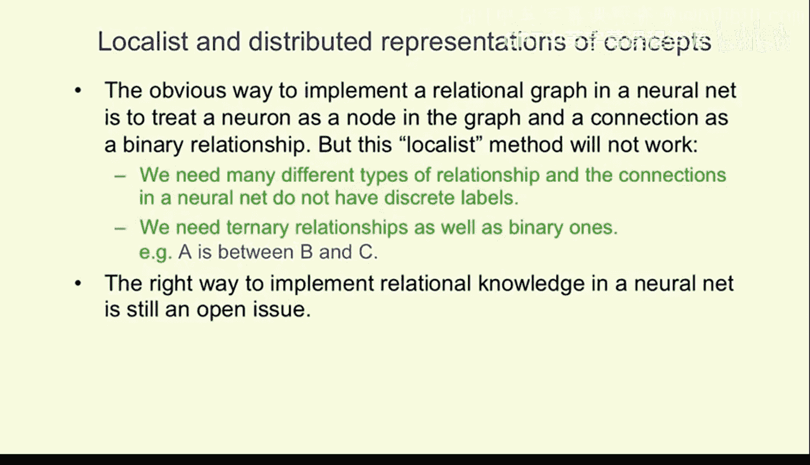

# 机器学习的神经网络：4.2：认知科学中的一次短暂探讨 🧠

在本节课中，我们将探讨一个认知科学家感兴趣，但工程师可能不太关心的话题。如果你是一名工程师，可以忽略这部分内容。我们将了解神经网络如何为一场持续近百年的认知科学辩论提供新的视角。

## 概念表征的两种理论

上一节我们介绍了神经网络如何学习家族树关系。本节中，我们来看看认知科学中关于概念如何被表征的长期争论。这场争论主要围绕两种对立的理论展开。

**特征理论**认为，一个概念是一组**语义特征**的集合。这种理论便于解释概念之间的相似性，并且非常适合机器学习，因为我们习惯于处理**活动向量**。

**结构理论**则认为，一个概念的意义在于它与其他概念之间的**关系**。因此，概念性知识最好表示为关系图，而不是一个大的特征向量。

## 明斯基的批评与神经网络的调和

在20世纪70年代初，马文·明斯基曾用感知机的局限性来反对特征向量理论，并支持关系图表征。

然而，我认为这场辩论的双方都错了，因为他们错误地认为这两种理论是互斥的。实际上，它们并非对手。一个神经网络可以利用**语义特征向量**来实现一个**关系图**。

在我们学习家族树的神经网络中，我们可以将显式推理理解为：给定一个人（person1）和一种关系，网络会告诉你另一个人（person2）。为了得出这个结论，神经网络并不遵循一大堆推理规则，它只是通过网络向前传递信息。对神经网络而言，答案是直观且显而易见的。

## 微观特征与直觉推理

如果我们深入观察其中发生的细节，会发现有许多**概率性特征**在相互影响。我们称这些为**微观特征**，以强调它们不同于显式的、有意识的特征。在一个真实的大脑中，可能存在数百万个这样的特征和相互作用。正是所有这些相互作用的结果，使我们能够进行一步显式的推理。

我们认为，这就是我们“看到”某个问题答案时所涉及的过程。中间没有有意识的步骤，但神经元之间的相互作用确实在进行计算。

因此，我们可能会使用明确的规则进行有意识的、深思熟虑的推理。但我们大量的常识推理，特别是类比推理，是通过直接“看到”答案来完成的，中间没有有意识的步骤。

## 在神经网络中实现关系知识的挑战

即使在我们进行有意识推理时，也必须要有某种方式来直接“看到”哪些规则适用，以避免无限倒退。

许多人考虑在神经网络中实现关系图时，会简单地假设应该让一个神经元对应关系图中的一个节点，让两个神经元之间的连接对应一种二元关系。但这种方法行不通。

首先，关系有不同的类型（如“母亲”或“阿姨”），而神经网络中的连接只有强度，没有类型之分。其次，我们还需要处理三元关系，例如“A在B和C之间”。目前，我们仍然不确定在神经网络中实现关系知识的正确方法。

## 分布式表征的可能性

但是，一种可能性似乎非常大：我们已知的每个概念都由许多神经元共同表征，而每个神经元又可能参与处理许多不同的概念。这被称为**分布式表征**。它是概念与神经元之间的一种**多对多映射**。

---

本节课中，我们一起学习了认知科学中关于概念表征的“特征理论”与“结构理论”之争。我们看到，神经网络模型提供了一种调和视角：它可以使用分布式表征的**特征向量**来有效地实现**关系图**，从而完成直观推理。这提示我们，大脑中的知识表征可能是多层次、分布式且高度交互的。