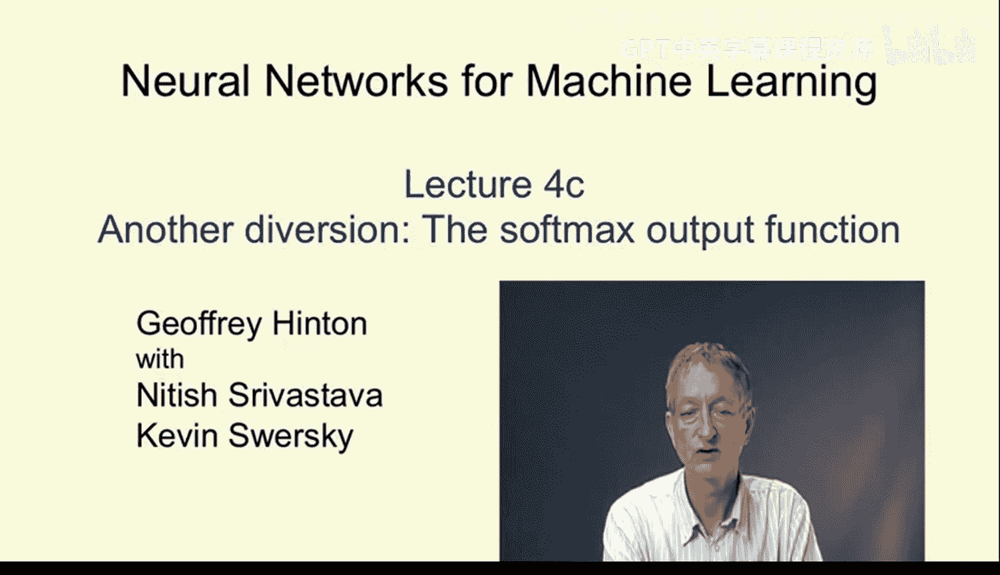
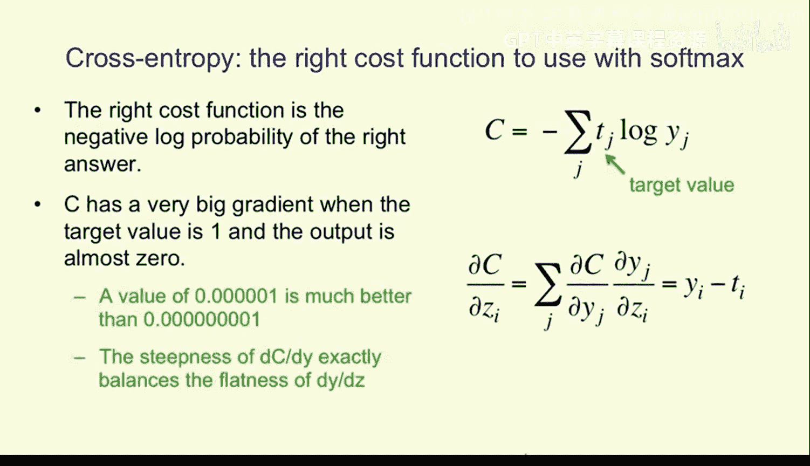

# Hinton@多伦多大学《机器学习的神经网络｜Neural Networks for Machine Learning 2016》claude-4s p18 -18-Lecture 4.3 — The softmax output function  -Neural Networks for Machine Lear -BV1HtkUB2EZD_p18-

In this video， we're going to look at the soft max output function。

This is a way of forcing the outputs of a neural network to sum to one so that they can represent a probability distribution across discrete。

 mutually exclusive alternatives。

Before we get back to the issue of how we learn feature vectors to represent words。

 we're going to have one more digression。 This time， it's a technical diversion。 So far。

 I've talked about using a square error measure for training in neural net。 and for linear neurons。

 that's a very sensible thing to do。But the square error measure has some drawbacks。If， for example。

 the desired output is a1， so you have a target of one and the actual output of a neuron is1 billionth。

Then there's almost no gradient to allow a logistic unit to change。 It's way out on a plateau。

Where the slope is almost exactly horizontal。And so it will take a very。

 very long time to change its weights， even though it's making almost as big an error as it possible to make。

 Also， if we're trying to assign probabilities to mutually exclusive class labels。

 we know that the output should sum to one。Any answer in which we say the probability that it's an A is three/ quarters。

 and the probability that it's a B is also three quarters is just a crazy answer。

And we ought to tell the network that information。 we shouldn't deprive it of the knowledge that these are mutually exclusive answers。

So the question is， is there a different cost function。That will work better。

 Is there a way of telling it that these are mutually exclusive and then using a an appropriate cost function。

The answer， of course， is that there is。What we need to do is force the outputs of the neural net to represent a probability distribution across discrete alternatives。

 if that's what we plan to use them for。The way we do this is by using something called a soft max。

It's a kind of soft， continuous version of the maximum function。

 So the way the units in a soft max group work is that they each receive some total input that they've accumulated from the layer below。

Thats Z I for the I unit。 and that's called the Loit。

And then they give an output Y I that doesn't just depend on their own Z I。

It depends on the Z's accumulated by their rivals， as well。

So we say that the output of the I neuron is E to the Z I。

Divided by the sum over that same quantity for all the different neurons in the softmax group。

And because the bottom line of that equation。Is the sum of the top line over all possibilities。

We know that when you add overall possibilities， you'll get one。

That is the sum of all the Y eyes must come to one。What's more， the Ys have to lie between 0 and 1。

So we forced the Y eyes to represent a probability distribution over mutually exclusive alternatives。

Just by using that softmax equation， the softmax equation has a nice， simple derivative。

If you ask about how the Y I changes as you change the Z I。That， obviously， depends on。

All the others these。But then the Y I itself depends on all the other E。

And it turns out that you get a nice， simple form， just like you do for the logistic unit。

Where the derivative of the output with respect to the input for an individual neuron in a softphmax group is just Y I times 1 minus y I。

It's not totally trivial to derive that。 If you try differentiating the equation above。

You must remember。That。Things turn up in that normalization term on the bottom row。

 It's very easy to forget those terms， and get the wrong answer。Now， the question is。

 if we're using a soft max group for the outputs， what's the right cost function。And the answer。

 as usual， is that the most appropriate cost function is the negative log probability of the correct answer。

That is， we want to maximise the log probability of getting the answer right。

So if one of the target values is a one and the remaining ones are 0。

Then we simply sum over all possible answers。We put zeros in front of all the wrong answers。

And we put one in front of the right answer。 And that gets us the negative log probability of the correct answer。

 As you can see in the equation。That's called the cross entropy cost function。

It has a nice property that it has a very big gradient when the target value is one and the output is almost 0。

You can see that by considering a couple of cases。So a value of one in a million。

Is much better than a value of one in a billion， even though it differs by less than a millionth。

So when you make the output value increase by less than 1 million。The value of C improves by a lot。

That means there's a very， very steep gradient for sea。

One way of seeing why a value of one in a million is much better than a value of one in a billion if the correct answer is one。

Is that if you believe the one in a million， you'd be willing to bet at odds of one in a million and you'd lose a million dollars。

If you thought the answer was one in a billion， you'd lose a billion dollars making the same bet。

So we get a nice property， that。That cost function， C has a very steep derivative。

When the answer is very wrong。And that exactly balances the fact。

That the way in which the output changes is to change the input， D by D Z。

Is very flat when the answer is very wrong。And when you multiply the two together to get the derivative of the cross entropy with respect to the logit going into output unit I。

Use the chain rule。So that derivative is how fast the cost function changes as you change the output of a unit。

Times。How fast the。Iput of the unit changes。As you change the eye。

And notice we need to add up across all the Js。Because when you change the eye。

 the output of all the different units changes。The result。Is just the actual output。

 minus the target output。And you can see that when the actual and target outputs are very different。

 that has a slope of one or minus1。And the slope is never bigger than 1 or -1。

 but the slope never gets small until the two things are pretty much the same。 In other words。

 you're getting pretty much the right answer。

