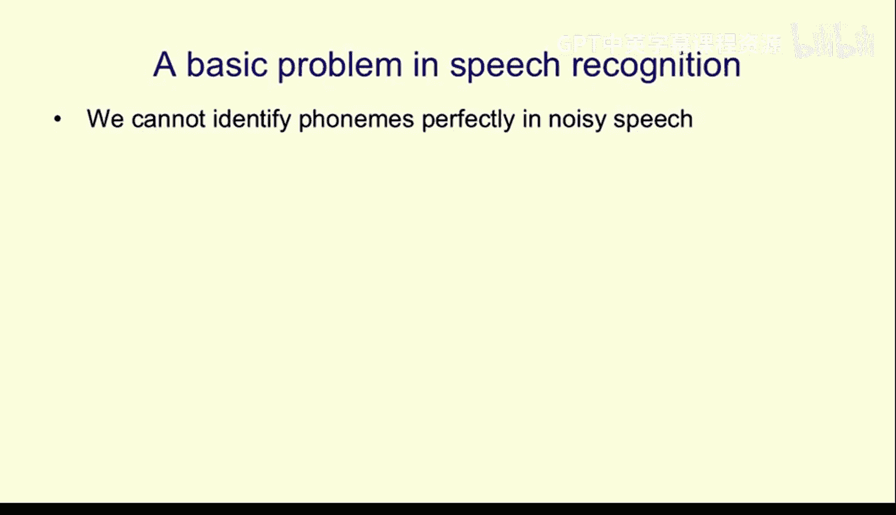
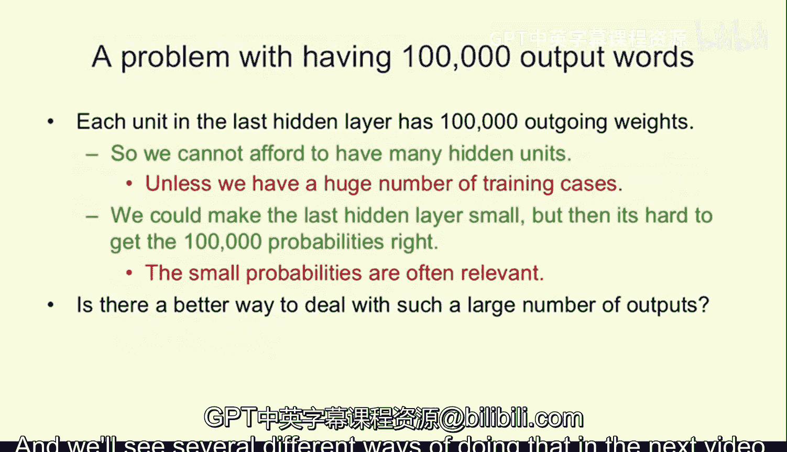

# Hinton@多伦多大学《机器学习的神经网络｜Neural Networks for Machine Learning 2016》claude-4s p19 -19-Lecture 4.4 — Neuro-probabilistic language models  -Neural Networks for Mach -BV1HtkUB2EZD_p19-

In this video， we're going to look at a practical use。For feature vectors that represent words。

The use is in speech recognition systems。Where having a good idea of what somebody might say next is very helpful in recognizing the sounds they make。

We're now going to see an important practical use for feature vectors that describe words。

When we trying to do speech recognition。

It's impossible to identify phonemes perfectly， in noisy speech。

The acoustic input just isn't good enough。 It's often ambiguous。

There may be several different words that fit the acoustic signal equally well。

We don't notice this a lot of the time because we're so good at using the meaning of the utterance to hear the right words。

So if I read the next comment on the slide。I would say we do this unconsciously when we recognize beach。

And you would hear we do this unconsciously when we recognize speech。

You can actually hear the slight difference between recognized speech and recognized speech。

But if you are expecting recognizedd speech， particularly if there's noise around。

You wouldn't here recognize Beach。Okay。So we're very good at doing this。

 We do it all the time when we do it unconsciously。

That means that speech recognises have to know which words are likely to come next and which are not。

Fortunately。Words can be predicted quite well without having a full understanding of what's being said。

So there's a standard method for predicting the probabilities of the various words that might come next。

 It's called the trigram method。You take a huge amount of text。

 and you can't the frequencies of all triples of words。

Then you use these frequencies to make bets on the relative probabilities of the next word。

 given the previous two words。So if we've heard the words A and B。

We can look at the counts that we have in our huge body of text for the sequence。

 ABC and the sequence， A B， D。 We can say that the relative probability that the third world will be C versus the third world will be D is given by the ratio of the two counts。

 ABC and A B， D。Until very recently， this was the state of the art method Forting the probability of the next word to help out the speech recogniser。

 We can't use much bigger context than two previous words。

 because there are just too many possibilities to store。And if we did use bigger contexts。

 the counts would be mostly 0。Even for two word contexts。

 there's many contexts that you will never have heard。For example， if I say dinosaur pizza。

 that's probably a string of two words that you've never heard before。For cases like that。

 we have to back off to individual words。So after dinosaur pizza。

 you predict the next word by just seeing what's likely to come after the word pizza。

 because you've never heard dinosaur pizza before。 What you mustn't do is say that probabilities are 0 just because you haven't seen an example。

 That's clearly not true。Now， the trigram model fails to use a lot of obvious information that will help you predict the next word。

Suppose， for example， you have seen the sentence。 The cat got squashed in the yard on Friday。

That should help you。Predict the words in the sentence the dog got flattened in the yard on Monday。

In particular。The trigram model doesn't understand the similarities between words。

Like cat and dog or squashed and flattened or garden and yard or Friday and Monday。

So it can't use past experience with one of those words to help it with the other one。

To overcome this limitation， what we need to do is convert the words into a vector of semantic and syntactic features。

And use the features of previous words to predict the features of the next word。

Using a feature representation allows us to use much bigger contexts。That contain many more words。

 for example，10 previous words。Joshu Benjo pioneered this approach for language models and his initial network for doing this。

Looks rather familiar。 It is actually very similar to the family T network。

 iss just applied to a real problem， and is much bigger。So， at the bottom。

You can think of us as putting in the index of a word。

And you could think of that as a set of neurons of which just one is on。

And then the weights from that on neuron。Will determine the pattern of activity in the next hidden layer。

And so the weights from the active neuron in the bottom layer will give you the pattern of activity in the layer that has the distributed representation of the word。

 That is its feature vector。But this is just equivalent to saying you do table look up。

 You have a stored feature of active of each word。And with learning， you modify that feature vector。

 which is exactly equivalent to modifying the weights coming from a single active input unit。

 After getting distributed representations of a few previous words。 I've only shown two here。

 but he would typically use， say 5。You can then。Use those distributed representations via hidden layer。

To predict via a huge softm what the probabilities are for all the various words that might come next。

One extra refinement that makes it work better is to use skipler connections that go straight from the input words to the output words。

Because the individual input words are are individually quite informative about what the output word might be。

Benjo's model。Was actually slightly worse than trigrams at predicting the next word。

 But it was in the same ballpark。 And if you combined it with trigrams， it improved things。

Since then， these language models that use feature vectors for words have been improved considerably。

 and they're now considerably better than trigram models。 One problem with having。

A big softm output layer is that you might have to deal with 100000 different output words。

 because typically in these language models， the plural of a word is a different word from the singular。

 and the various different tenses of a verb are different words from other tenses。

So each unit in the last hidden layer of the net might have to have 100000 outgoing weights。

And that means we can only afford to have a few units there before we start overfitting。

That's not necessarily true。 We might have a huge number of training cases。

 So some organization like Google might have so much training data that it can afford to have a very big softmax there。

We could try and make the last hidden less small， so we don't need too many weights。

 but then we have the problem that we have to get the hundred000 probabilities of the various words that might come next。

 fairly accurately right。 It's not just the big probabilities we need。

 A very large number of words will have small probabilities。

And the small probabilities are often relevant。 It might be that the speech recogniser。

Has to decide whether it's two different rare words。 And then it's very relevant。

 which of those is more common in the context， even though both of them are pretty unlikely。

The question is， is there a better way to deal with such a large number of outputs and will see several different ways of doing that in the next video。

