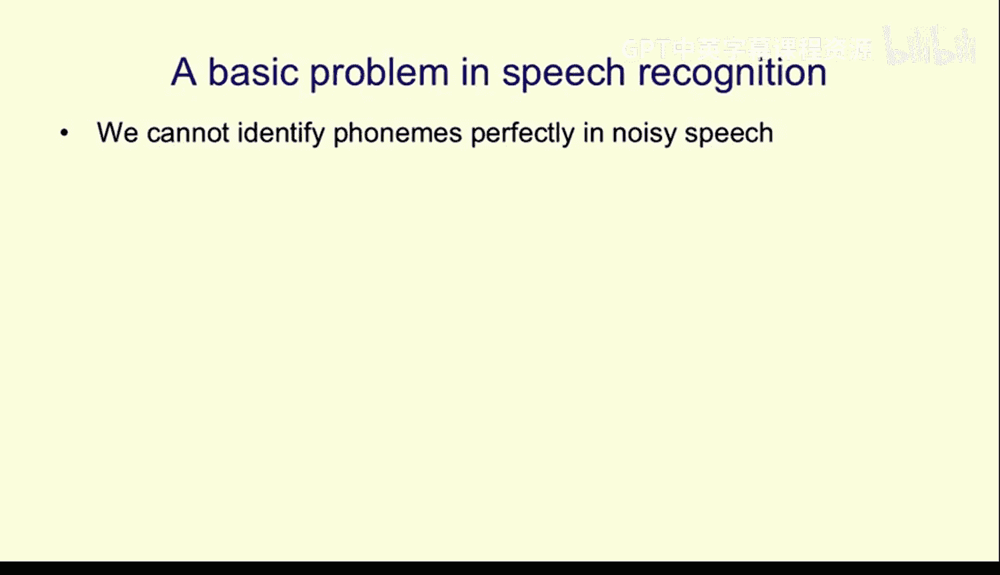
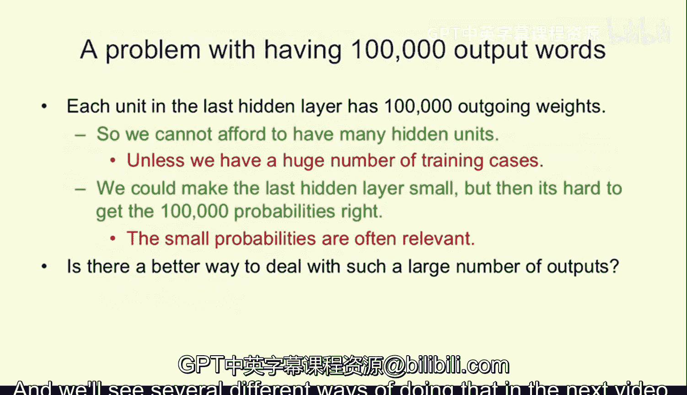

# 神经网络与机器学习：4.4：神经概率语言模型 🧠

在本节课中，我们将学习如何利用表示单词的特征向量来解决一个实际问题——提升语音识别系统的性能。我们将看到传统的统计方法（如三元模型）的局限性，并了解神经网络如何通过捕捉单词之间的语义和句法相似性来构建更强大的语言模型。

## 概述

语音识别系统面临一个核心挑战：在嘈杂的语音环境中，仅凭声学信号往往无法完美地识别音素，因为信号本身可能是模糊的。此时，系统若能对“用户接下来可能说什么”有一个良好的预测，将极大地帮助识别过程。这正是语言模型的任务。

## 传统方法的局限性：三元模型

上一节我们介绍了单词的特征向量表示。本节中，我们来看看如何利用这些特征来构建更好的语言模型。在神经网络方法兴起之前，预测下一个单词概率的标准方法是**三元模型**。

以下是三元模型的工作原理：
*   它基于海量文本，统计所有**三个单词连续出现**的组合频率。
*   给定前两个单词（例如 “A” 和 “B”），通过比较序列 “A B C” 和 “A B D” 的统计次数，来估算下一个单词是 “C” 还是 “D” 的相对概率。公式可以表示为：`P(C|A,B) / P(D|A,B) ≈ count(ABC) / count(ABD)`。

然而，三元模型存在几个明显缺陷：
*   **上下文有限**：由于需要存储所有可能的三元组，无法使用超过两个单词的上下文信息。
*   **数据稀疏性**：即使对于二元上下文，也存在大量从未出现过的组合（例如 “恐龙 披萨”）。对于这些情况，模型必须“回退”到仅使用前一个单词的信息。
*   **无法理解语义**：三元模型无法捕捉单词之间的相似性。例如，它无法理解“猫”和“狗”、“压扁”和“碾平”、“花园”和“院子”、“周五”和“周一”之间的关联。因此，它无法利用关于“猫”的句子来帮助理解关于“狗”的句子。

## 神经网络的解决方案：特征向量与预测

为了克服三元模型的局限性，我们需要将单词转换为包含语义和句法信息的**特征向量**，并利用前几个单词的特征来预测下一个单词的特征。

使用特征表示法允许我们利用更长的上下文（例如前10个单词）。Joshua Bengio 率先将这种方法应用于语言模型。他最初的网络结构与我们之前见过的“家庭树”网络非常相似，只是规模更大且应用于实际问题。

以下是该网络的基本工作流程：
1.  **输入层**：输入一个单词的索引。这可以看作是一组神经元中只有一个被激活。
2.  **特征查找层**：从被激活的输入神经元出发的权重，决定了下一层（隐藏层）的活动模式。这等价于进行了一次**查表操作**，获取了该单词的分布式表示（即其特征向量）。通过训练，我们可以修改这些权重，从而优化每个单词的特征向量。
3.  **上下文整合**：获取前几个单词（例如5个）的分布式表示后，通过另一个隐藏层整合这些信息。
4.  **输出预测**：最后，通过一个巨大的 **Softmax** 输出层，预测所有可能的下一个单词的概率分布。

为了使模型效果更好，Bengio 还引入了**跳跃连接**，让输入单词可以直接影响输出层。这是因为单个输入单词本身对于预测下一个单词就具有很高的信息量。

## 挑战与改进

Bengio 的初始模型在预测下一个单词的任务上，表现略差于三元模型，但处于同一水平。当与三元模型结合时，效果得到了提升。

此后，使用单词特征向量的语言模型得到了显著改进，现在已明显优于三元模型。然而，这类模型面临一个主要挑战：巨大的 Softmax 输出层。

以下是该挑战的具体表现：
*   在典型的语言模型中，单词的单复数、动词的不同时态都被视为不同的词，因此输出层可能需要处理多达 **100,000** 个不同的单词。
*   这意味着网络的最后一个隐藏层中的每个神经元都可能需要有 10 万个输出权重。为了避免过拟合，我们只能在该层使用很少的神经元。
*   但如果我们使用太小的隐藏层，又难以准确预测所有单词（包括大量出现概率很小但有时又很关键的单词）的概率。

## 总结

本节课中，我们一起学习了神经概率语言模型的基本思想。我们了解到，传统的三元模型因数据稀疏和无法理解语义而受限。神经网络通过将单词表示为可学习的特征向量，能够捕捉单词间的相似性并利用更长的上下文，从而构建更强大的语言模型。尽管面临输出维度巨大的挑战，但这仍是推动语言模型发展的核心方向。

在下一个视频中，我们将探讨几种处理这种大规模输出问题的更好方法。