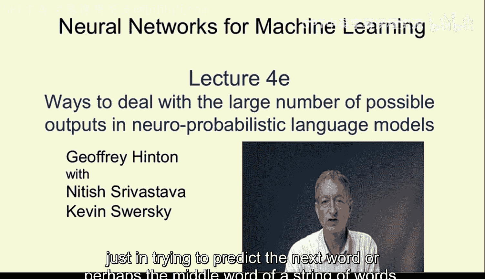
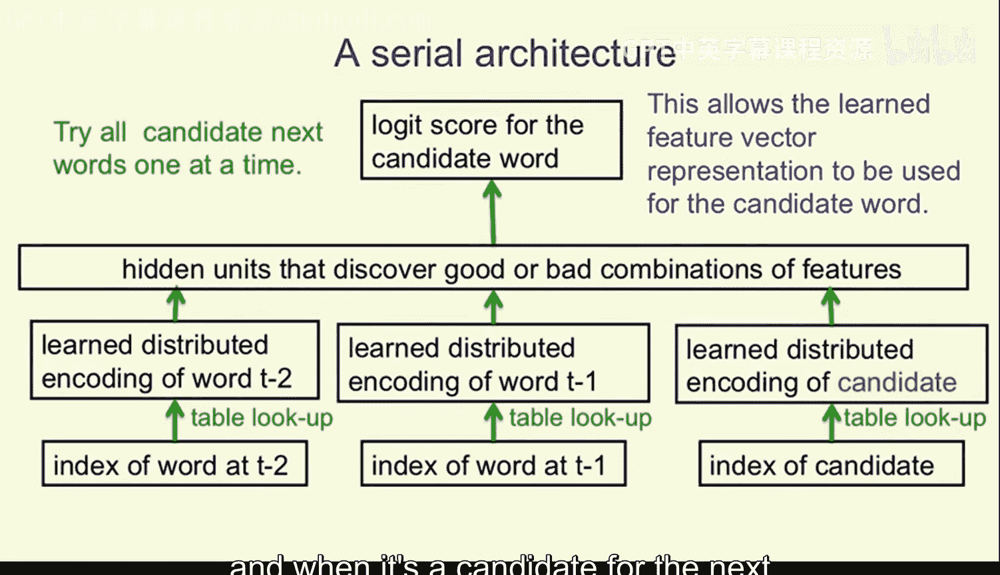
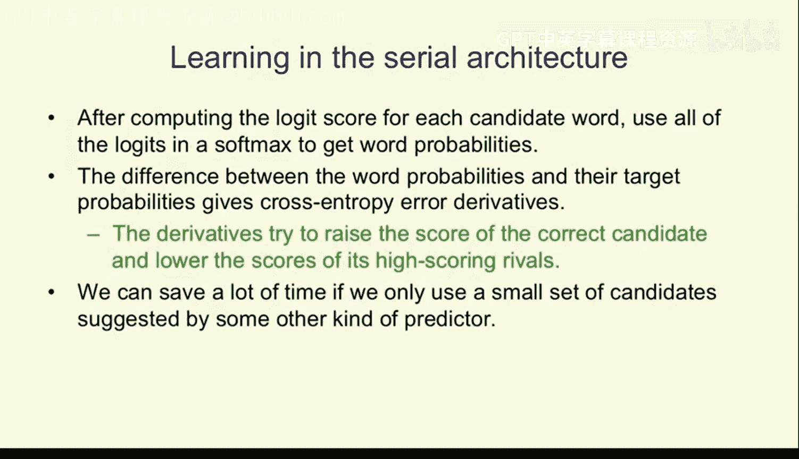
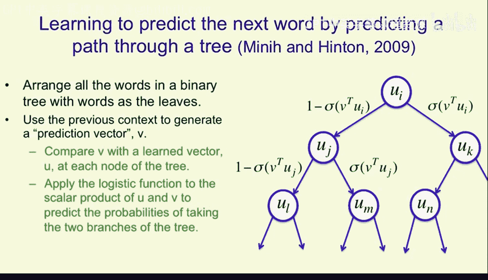
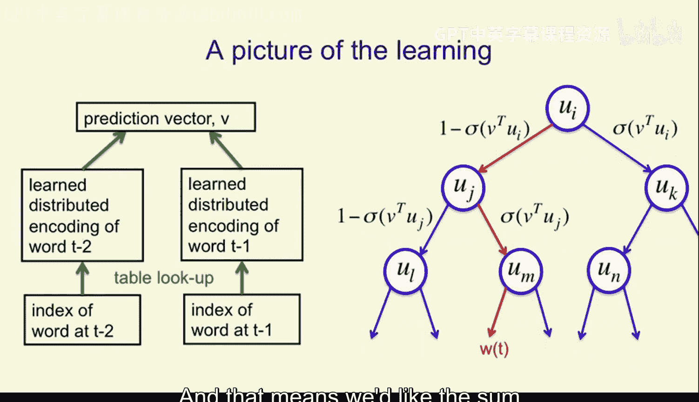
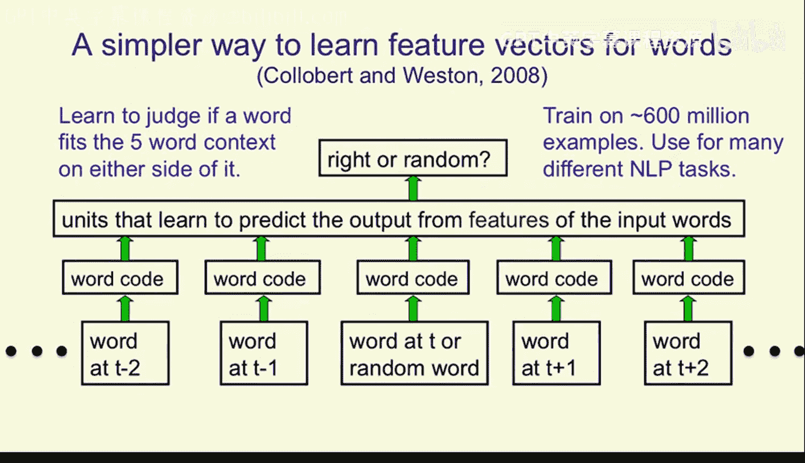
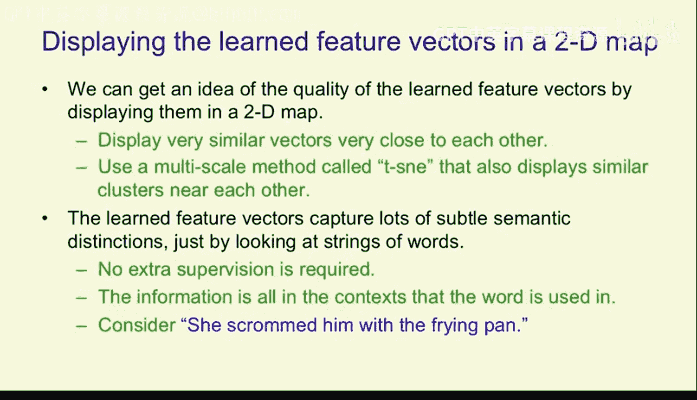
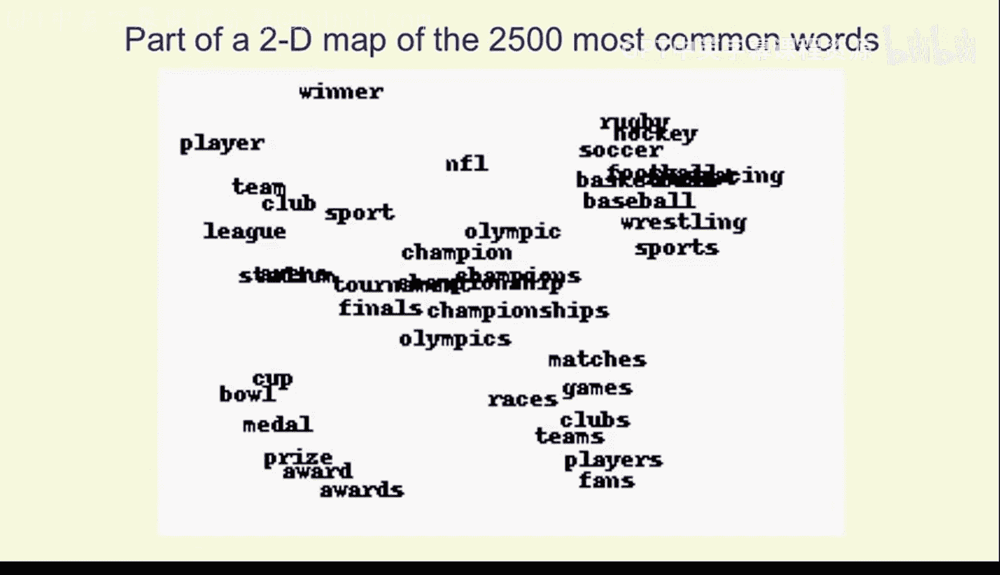
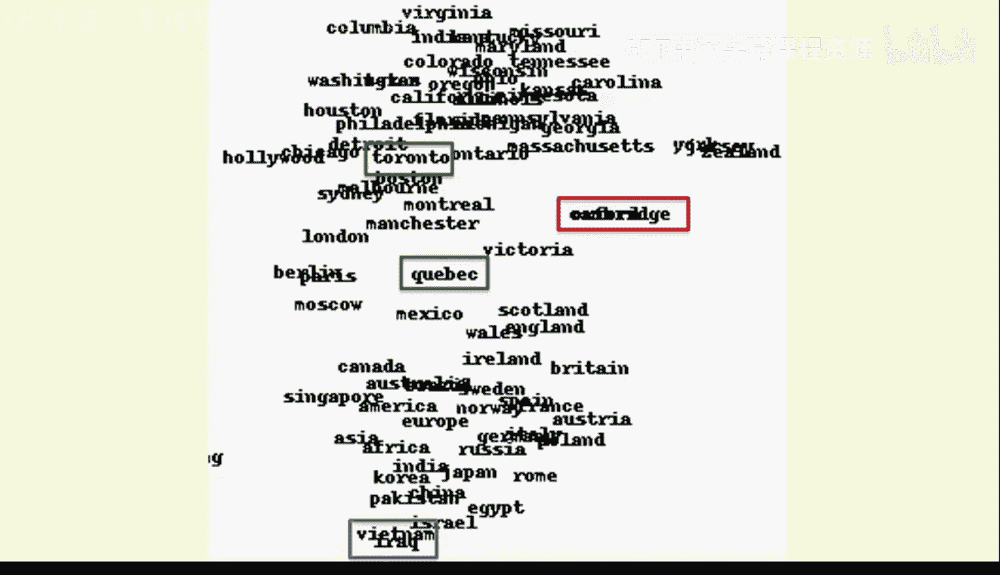
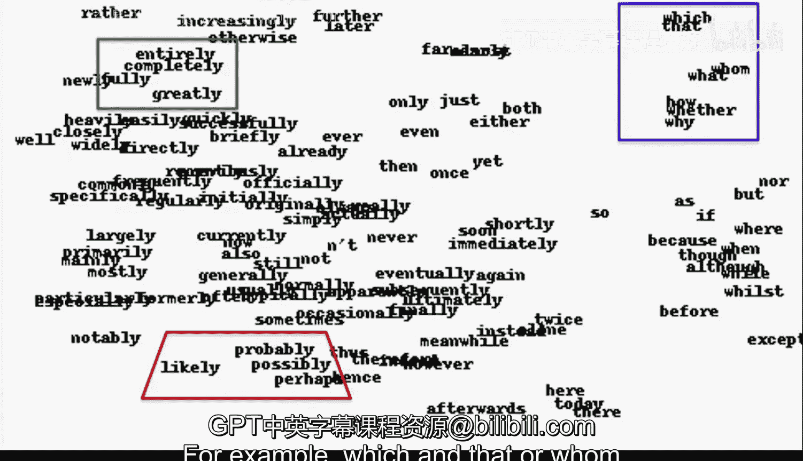

# Hinton@多伦多大学《机器学习的神经网络｜Neural Networks for Machine Learning 2016》claude-4s p20 -20-Lecture 4.5 — Dealing with many possible outputs  -Neural Networks for Machi -BV1HtkUB2EZD_p20-

In this video。We're going to look at various ways to avoid having to use 100。

000 different output units in a softmax if we want to get probabilities for 100，000 different words。

At the end of the video。I'll show an example of the words or the word representations that are learned by a particular method。

To see what these representations look like。What we do is we embed them in a two dimensional space。

 and then we can see which words have extremely similar representations。

That gives us a feel for what the neural network has been able to learn just in trying to predict the next word。

Or perhaps the middle word of a string of words。So one way to avoid having 100000 different output units。

Is to use a serial architecture。We put in the context words as before。

 but now we also put in a candidate for the next word in the same way as the context words。

Then we go forwards through the net。 and what we output is a score for how good that candidate word is in that context。

Of course， we have to run forward through this net many， many times。

 but most of the work only needs to be done once。So the inputs from the context to that big big hidden layer。

Are the same for every different candidate word。 The only bit we need to run。

For each candidate word is the inputs coming from the candidate word and the final output to the score。

And of course， that doesn't have many weights in it。So we try all the candidate words one at a time。

And by putting in the word as a candidate at the bottom， where ablebel。To use。The learned feature a。

That for that candidate word that we learned when it was a context word so we can have the same representation of the word。

When it's part of the context and when it's a candidate for the next word that we're trying to predict。

Learning in the serial architecture。Works in the following way。

 We first compute the score for each possible candidate word。And then we put all those scores。

 which we computed sequentially into a big softmax to get word probabilities。Now。

 the difference between the word probabilities and their target probabilities。

Which is normally one for the correct word and 0 for everything else。

Gives us the cross entropy derivatives。And we use those derivatives to change the weights in such a way that we raise the score for the correct candidate and we lower the scores for all of its high scoring rivals。

We can save a lot of time in this architecture if instead of considering all possible candidate words。

 we only consider a small set， perhaps candidate words suggested by some other predictor。

For example， we could use the neural net to revise the probabilities of the words that the trigram model thinks are likely。

A different way to avoid a great， big softm。Is to structure the words into a tree。

So we arrange all of the words in a binary tree with the words as its leaves。

We then use the context of previous words to generate a prediction vector V。

We compare that prediction vector。With a vector that we learn for each node of the tree。

The way we do the comparison is by taking a scalar product of the prediction vector and the vector that we've learned for the node of the tree。

 And then we apply the logistic function。To that scale a product。

And that will give us the probability of taking the right branch in the tree。

 And  one minus that gives us the probability of taking the left branch in the tree。

So the tree looks like this。And if that sigma is the logistic function。

You can see at the top of the tree that we take the logistic of the prediction vector times the vector that we've learned U I at the top node。

And that tells us the probability of taking the right branch。And conversely。

 we take the left branch with 1 minus that probability。

And so on all the way down the tree to the word we want。So， when we're learning。

We use our context to get a prediction vector。 We use quite a simple neural network。For this work。

Where we take the。Feature vector for each word。 And those feature vectors directly contribute evidence in favour of a prediction vector。

 We simply add up the evidence contributed by those feature vectors。

 and that gives us the prediction vector。 that prediction vector。Then gets compared with the vectors。

That have been learned for all the nodes in the tree on the path to the correct next word。

So that would be nodes I， J and M in this tree。 That red path shows you the path to the word that actually occurred next。

And those are the only nodes we need to consider during learning。What we know is that。

We'd like the probability of predicting that word to be as high as possible。

And so we'd like the probability of taking that path to be as high as possible。

So we'd like the product of the probabilities on the individual elements of that path to be as high as possible。

And that means we'd like the sum of their log probabilities to be high。

So we benefit from a nice decomposition here。That when we try and maxim the probability of picking the correct target word。

 we're really trying to maxim the sum of the log probabilities of taking all the branches on the path that leads to that target word。

 So during learning， we only need to consider the nodes on that correct path。 And that's a huge win。

That's exponentially fewer nodes than considering all of the nodes。

So it's lod to the base two of aim instead of M。For each of those nodes。

 we know the correct branch because we know what the next word is。

We know the current probability of taking that branch by comparing the prediction vector with the learn vector at the node。

And so we can get derivatives for learning both the prediction vector V and the learned vector at that node。

 U。This makes the training hundreds of times faster。Unfortunately， it still slow at test time。

At test time， you need to know the probabilities of many words to help the speech recogniser。

 And so you can't just consider one path。There's a much simpler way to learn feature vectors for words。

 This is worked by Colab and Western。 And what they did was learned feature vectors for words and then showed that the feature vectors they learned were very good for a whole bunch of different natural language processing tasks。

 They're not trying to predict the next word。 They're just trying to get good feature vectors for words。

And so they use both the past context and the future context。So they look at a window of 11 words。

5 in the past and 5 in the future。 And in the middle of that window。

 they put either the correct word， the one that actually occurred in the text or a random word。

 And then they train a neural net。To produce an output that's high if it's the correct word and low。

 if it's a random word， the neural network works the same way as before。

 we map the individual words to feature vectors， these word codes。

 And then we use the feature vectors in the neural net， possibly with more layers in the neural net。

 to try and predict whether this is the right or wrong word for that context。

So what they're really doing is judging whether the middle word。

Is an appropriate word for the five word context on either side of it。

They trained this up on about 600 million examples from Wikipedia。

 and they showed that the vectors they get are good for a variety of different natural language processing tasks。

 One way of getting a sense of the vectors that they learn for words。

Is to display the vectors in a two dimensional map。

 What we want to do is lay out the word vectors in such a way that very similar vectors are very close to one another。

So， then， you'll discover。What。😮，Words， the neural network thinks， have similar meanings。

We're going to use a multi scale method， called Tni。

You can look up Tesney on Google and discover how it works， if you want。And Teni is able。

 in addition to putting very similar words close to each other。

 It's also able to put similar clusters close to each other。

 So it gives you structure at many different scales。

What we see is that the learned feature vectors capture lots of subtle semantic distinctions。

 and they do this just by looking at strings of words from Wikipedia。

 Nobody tells them anything other than the fact that these 11 words occurred in a string。

There's no extra supervision。What's remarkable is that that contextual information。

 the fact that these words occurred together。Tells you an awful lot about what the word means。

In fact， some people think that's the main way we learn the meaning of words。 So here's an example。

If I give you a sentence with a word you've never heard before， Like。

 she scrummed him with the frying pan。From that one sentence。

 you already have a pretty good idea of what scrumbed means。

It's conceivable that she was trying to impress him with her cooking skills。

And so scrumbed means impressed or something like that。

 But probably it means something like wallloped。

So here's part of a two dimensional map。In which we laid out the two and a half thousand commonest words。

And you'll see this part of the map is all about games。Not only that。

 it's got similar kinds of words together。So matches and games and races are together。

It's got players and teams and clubs together。It's got the things you win at games together。

 like cups and bowls and medals and prizes。It's got different kinds of games together。

It's done a very good job of taking these words to do with games。

And finding out which ones are very similar in meaning。

And because it's using very similar feature vectors for those。

It can in any natural language processing task。Say that if one word was a good word for that context。

 the other words probably also a pretty good word for that context。

Here's another part of the map。 This part of the map is entirely about places。 at the top。

 it has US states。Under that， it has some cities， mainly ones in North America。

And under that other cities， then it has some countries。So if you look at the cities。

 this one is clearly Cambridge。 and underneath Cambridge。

 there's something else that's very similar to Cambridge。

Here we see that it's put Toronto with Detroit and Ontario and Boston。

 Toronto's in English speaking Canada。And it's put Quebec， which is in French speaking Canada。

 with Berlin and Paris。If we look at the bottom。We can see that it thinks Iraq is pretty similar to Vietnam。

Here's another example。If you look here， these are adverbs。

 and it's understood that likely and probably and possibly and perhaps all mean very similar things。

It's also understood that entirely， completely， fully and greatly have very similar meanings。

And it's understood various other kinds of similarity， for example， which and that or whom and what。

Or how and whether and why。

