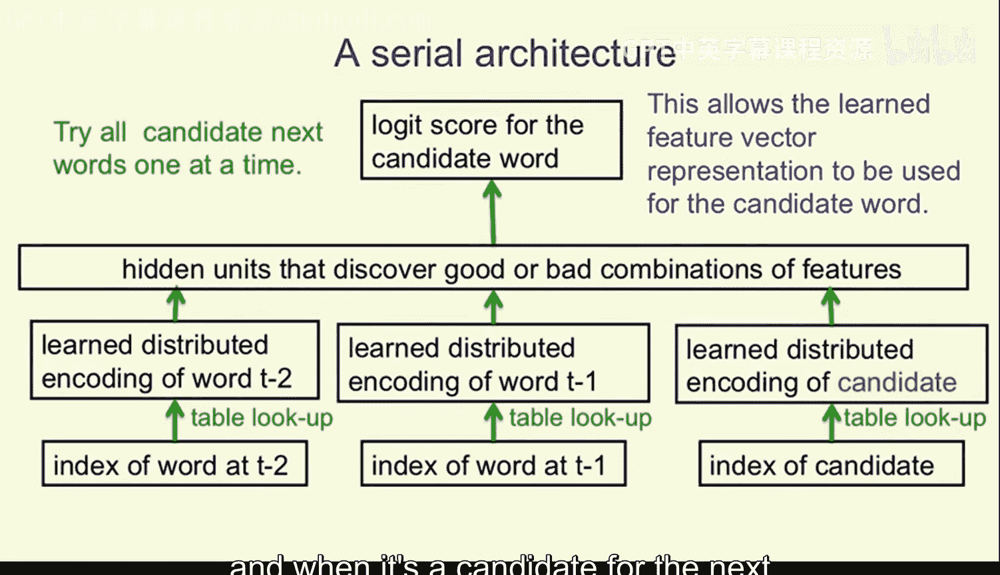
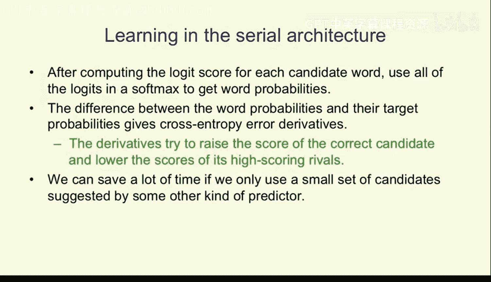
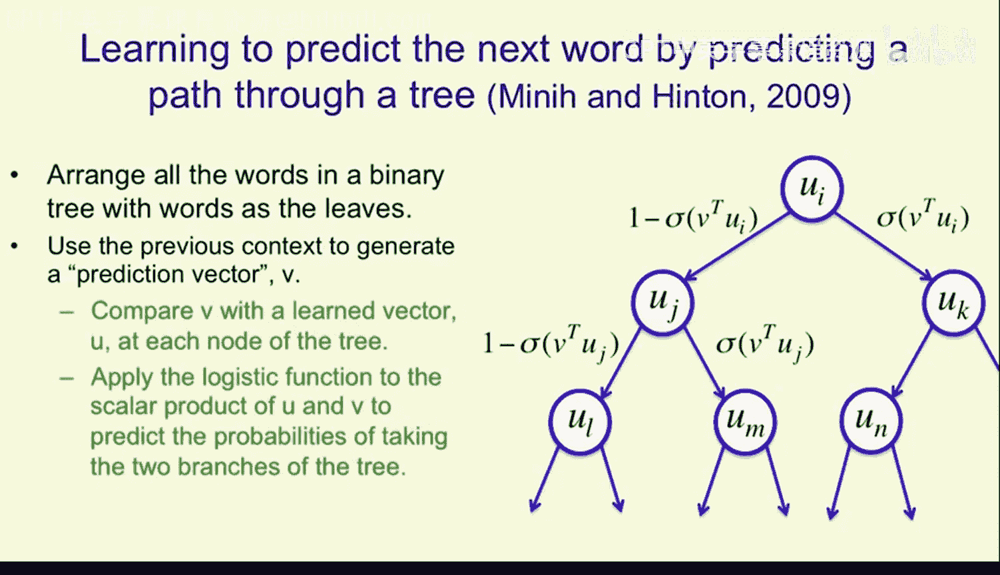
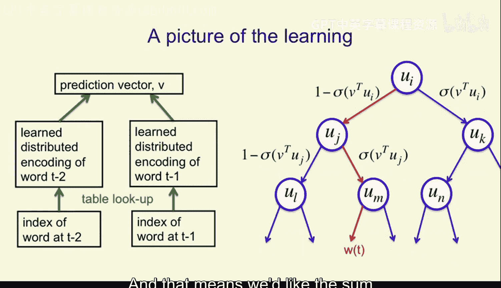
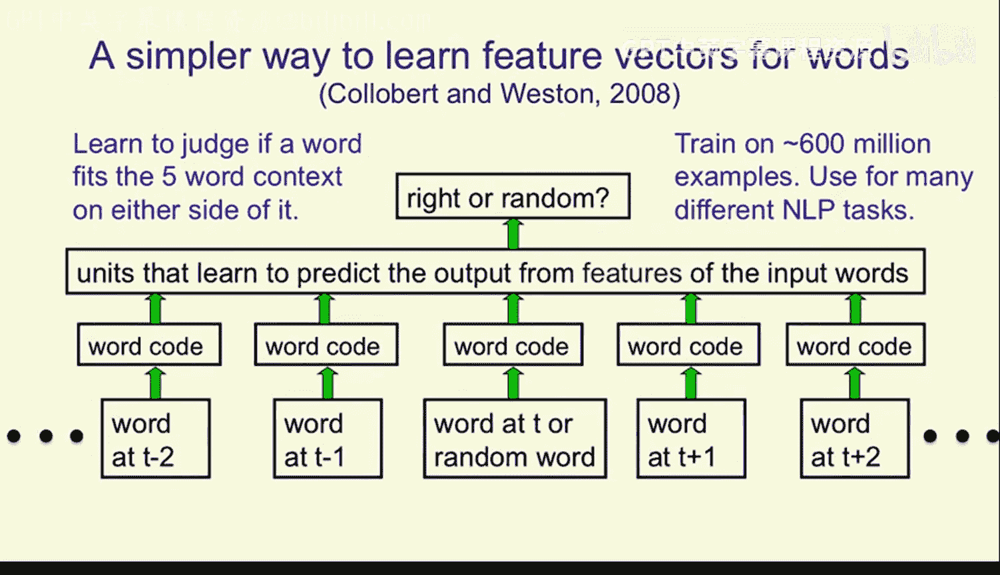
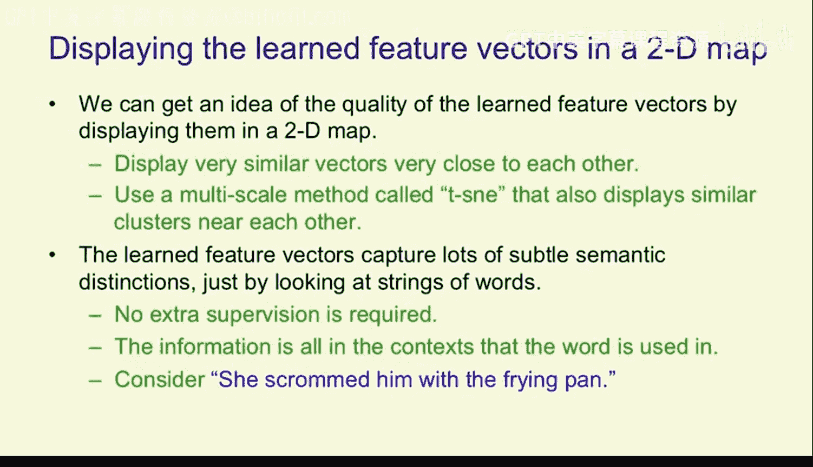
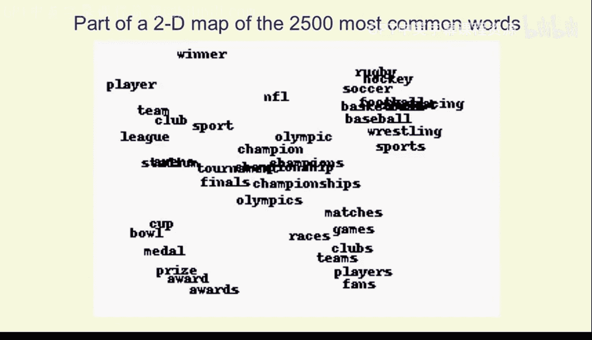
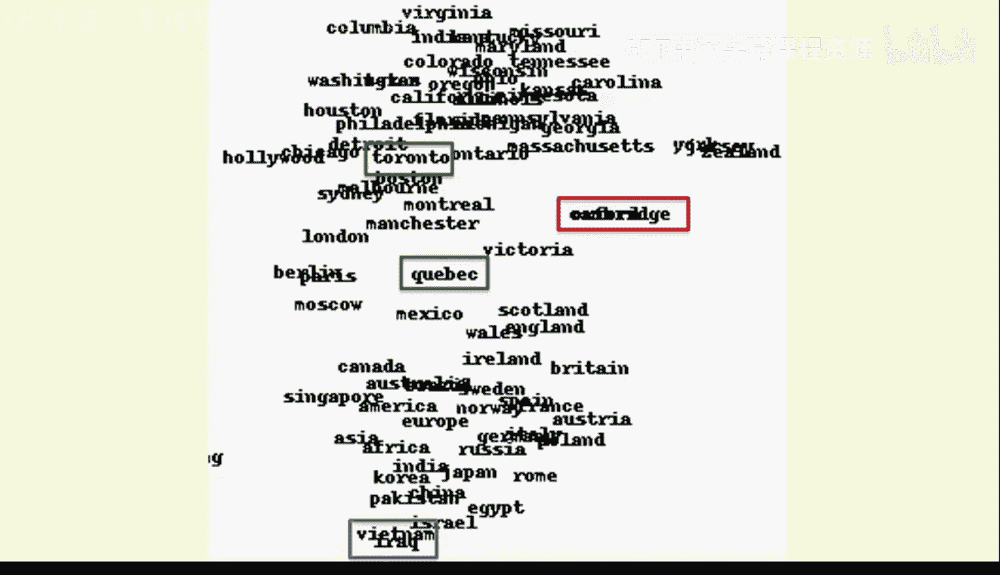
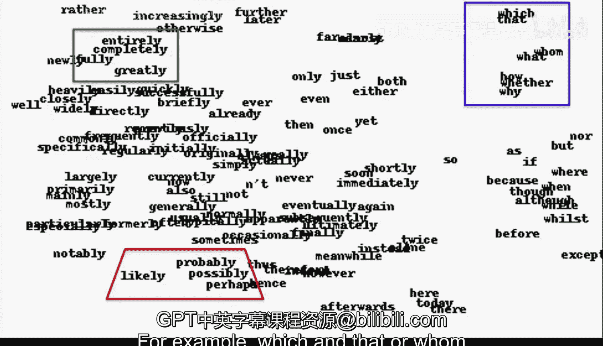

# 神经网络与机器学习：4.5：处理大量可能输出的方法 🧠

在本节课中，我们将学习如何避免在需要为10万个不同单词计算概率时，使用包含10万个输出单元的Softmax层。课程结束时，我们将展示通过特定方法学习到的单词表示示例，以观察这些表示的特征。

## 概述

当词汇表非常庞大时，使用传统的Softmax输出层会带来巨大的计算负担。本节将介绍几种高效的方法来应对这一挑战，核心思想是通过改变网络结构或输出策略，避免直接计算所有单词的概率。

---

## 序列架构法 🔄

上一节我们讨论了标准Softmax的局限性，本节中我们来看看第一种解决方案：序列架构。

这种方法的核心是，我们不一次性输出所有单词的概率，而是依次评估每个候选单词。网络接收上下文单词作为输入，同时也以相同的方式接收一个候选单词。网络前向传播后，输出一个分数，用于衡量该候选单词在当前上下文中的匹配程度。

当然，这需要多次运行网络前向传播，但大部分计算可以复用。具体来说，从上下文到大隐藏层的输入对于所有候选单词都是相同的。对于每个候选单词，我们只需要计算来自该候选单词的输入以及最终输出的分数部分，这部分涉及的权重参数很少。

通过将单词作为候选词输入到底层，我们能够复用该单词作为上下文时学习到的特征表示。这意味着，一个单词无论是作为上下文的一部分，还是作为待预测的候选词，都可以使用相同的特征表示。

**学习过程**如下：
1.  依次计算每个可能候选词的分数。
2.  将所有（顺序计算出的）分数输入到一个大型Softmax函数中，以获得单词概率。
3.  计算单词概率与目标概率（正确单词为1，其他为0）之间的交叉熵导数。
4.  利用这些导数调整权重，以提高正确候选词的分数，并降低其高分竞争对手的分数。

在此架构中可以节省大量时间，如果我们不评估所有可能的候选词，而只考虑一个由其他预测器（例如三元模型）建议的小型候选集。

---

## 分层Softmax法 🌳

序列架构虽然节省了训练时的计算量，但在测试时仍需评估多个候选词。另一种完全避免大型Softmax的方法是：将单词组织成树形结构。

我们将所有单词安排在一棵二叉树的叶子节点上。然后，利用上文单词的上下文信息生成一个预测向量 **V**。我们将这个预测向量与为树中每个节点学习到的向量 **U_node** 进行比较。

比较的方式是计算预测向量 **V** 与节点向量 **U_node** 的点积（标量积），然后对点积结果应用逻辑函数（Sigmoid）。这将给出在该节点选择右分支的概率，而选择左分支的概率则是 `1 - 该概率`。

用公式表示节点分支概率为：
`P(right) = σ(V · U_node)`
`P(left) = 1 - σ(V · U_node)`

这样，从根节点到目标单词叶子节点的路径概率，就是路径上各分支选择概率的乘积。

**学习过程**的优势在于，我们只需要考虑通往正确下一个单词的路径上的节点（例如图中的 I、J、M 节点）。我们希望预测该单词的概率尽可能高，即希望选择该路径的概率尽可能高。这等价于希望路径上各节点分支概率的对数之和尽可能高。

因此，在训练时，我们只需考虑正确路径上的节点，这比考虑所有节点（M个）要少得多，数量级为 `log₂(M)`。对于路径上的每个节点，我们知道正确的分支方向。通过比较预测向量 **V** 和该节点的学习向量 **U_node**，我们可以得到当前选择该分支的概率，并据此计算用于更新 **V** 和 **U_node** 的导数。这使得训练速度提高了数百倍。

---

## 词向量学习法 🔤

上述方法主要关注预测任务。还有一种更简单的方法来学习单词的特征向量（词向量），该方法由Collobert和Weston提出。他们的目标不是预测下一个单词，而是为单词获取高质量的特征向量，并证明这些向量能极大地提升多种自然语言处理任务的性能。

他们同时使用过去和未来的上下文。具体做法是：观察一个包含11个词的窗口（前5个词，后5个词）。在窗口中间，放置一个词——要么是文本中实际出现的正确词，要么是一个随机词。然后训练一个神经网络，如果中间是正确词则输出高分，如果是随机词则输出低分。

神经网络的工作方式与前文类似：将单个词映射为特征向量（词编码），然后可能在更多网络层中使用这些特征向量，来预测中间词对于该上下文是“正确”还是“错误”的。本质上，他们是在判断中间词对于其两侧的五词上下文是否合适。

他们在维基百科的约6亿个例子上训练了这个模型，并证明得到的词向量对于多种不同的自然语言处理任务都非常有效。

---

## 词向量可视化示例 🗺️

为了感受这些学习到的词向量是什么样的，我们可以将它们嵌入到一个二维空间中进行可视化。这样做的目的是以这样一种方式布局词向量：语义非常相似的向量在空间中也彼此接近。通过观察，我们就能发现神经网络认为哪些词具有相似的含义。

我们使用一种称为“t-SNE”的多尺度方法进行降维可视化。t-SNE不仅能够将非常相似的词放在一起，还能将相似的词簇也放在相近的位置，从而在多个不同尺度上展示出结构。

我们可以看到，学习到的特征向量捕捉了许多细微的语义区别，而这一切仅仅是通过观察维基百科中的词序列完成的，没有任何额外的监督信息。令人惊讶的是，这种上下文信息（即这些词共同出现的事实）揭示了单词含义的绝大部分。事实上，有些人认为这是我们学习单词含义的主要方式。

以下是几个可视化示例：

**游戏相关词汇区域**：这个区域的所有词汇都与游戏有关。它不仅将相似类型的词放在一起（如 matches, games, races），还将 players, teams, clubs 放在一起，将游戏中赢得的东西（cups, bowls, medals, prizes）放在一起，也将不同种类的游戏放在一起。这表明模型成功地将与游戏相关的词汇根据语义相似性进行了组织。

**地点相关词汇区域**：这个区域完全关于地点。顶部是美国各州，其下是一些城市（主要是北美城市），再往下是其他城市，然后是一些国家。例如，它将多伦多与底特律、安大略省、波士顿放在一起（多伦多位于英语加拿大），而将魁北克（位于法语加拿大）与柏林、巴黎放在一起。在底部，它认为伊拉克与越南非常相似。

**副词与其他词汇区域**：这里展示了副词。模型理解到 likely, probably, possibly, perhaps 含义非常相似；也理解到 entirely, completely, fully, greatly 含义非常相似。它还理解了其他类型的相似性，例如 which 和 that，whom 和 what，以及 how, whether, why。

---

## 总结

本节课中，我们一起学习了三种处理大规模词汇表输出问题的方法：
1.  **序列架构法**：通过依次评分候选词来复用大部分计算，适用于与快速候选生成器结合的场景。
2.  **分层Softmax法**：将词汇组织成二叉树，将预测复杂度从 O(M) 降低到 O(log M)，极大提升了训练效率。
3.  **词向量学习法**：通过一个简单的二分类任务（判断词是否适合上下文）来学习通用的词向量表示，这些向量能有效捕捉语义信息并提升下游任务性能。

通过将学习到的词向量降维可视化，我们直观地验证了神经网络仅从无监督的文本数据中就能自动发现并编码丰富的语义关系。