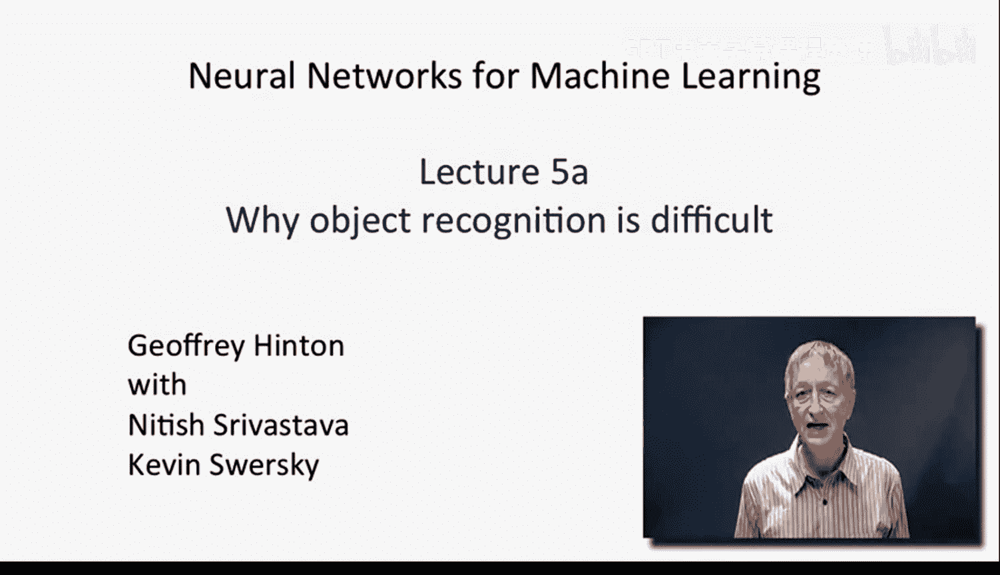
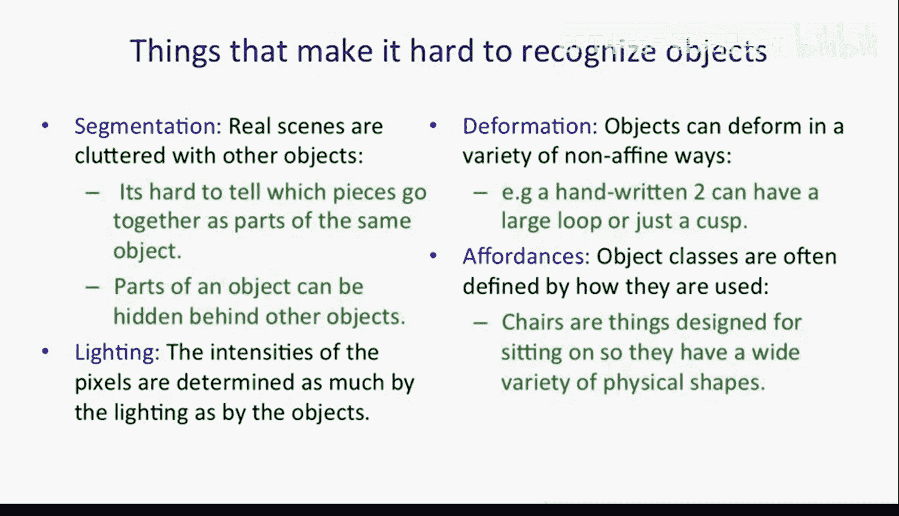
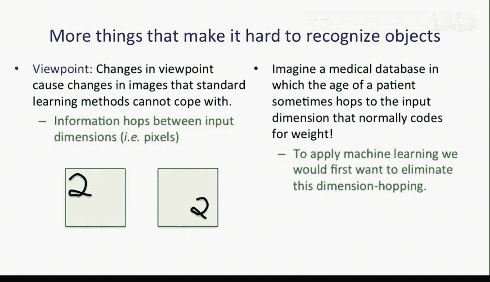

# Hinton@多伦多大学《机器学习的神经网络｜Neural Networks for Machine Learning 2016》claude-4s p21 -21-Lecture 5.1 — Why object recognition is difficult  -Neural Networks for Mach -BV1HtkUB2EZD_p21-

In this video， I'm going to describe some of the things that make it difficult to recognize objects in real scenes。

We're incredibly good at this， and so it's very hard for us to realize how difficult it is to take a bunch of numbers that describe the intensities of pixels。

And go from there to the label of an object。There's all sorts of difficulties。

 we have to segment the object out， we have to deal with variations in lighting， in viewpoint。

 we have to deal with the fact that the definitions of objects are quite complicated。

It's also possible that to get from an image to an object requires huge amounts of knowledge。

Even for the lower level processes that involve segmentation and dealing with viewpoint and lighting。

If that's the case， it's going to be very hard for any hand engineered program to be able to do a good job of those things。

There are many reasons why it's hard to recognize objects in images。First of all。

 it's hard to segment out an object from the other things in an image。In the real world。

 we move around。 And so we have motion cues。 We also have two eyes， so we have stereo cues。

You don't get those in static images。So it's very hard to tell which pieces go together as parts of the same object。

Also， parts of an object can be hidden behind other objects。

 And so you often don't see the whole of an object。

You are so good at doing vision that you don't often notice this。

Another thing that makes it very hard to recognise objects is that the intensity of a pixel is determined as much by the lighting as it is by the nature of the object。

So， for example， a black surface in bright light will give you much more intense pixels。

Than a white surface in very gloomy light。Remember， to recognize an object。

 you've got to convert a bunch of numbers。 That is the inities of the pixels。Into a class lap。And。

These intensities are varying for all sorts of reasons that are nothing to do with the nature of the object。

Or nothing to do with the identity of the object。Objects can also deform in a variety of ways。

So for relatively simple things， like handwritten digits。

There's a wide variety of different shapes that have the same name。A two， for example。

 could be very italic with just a cusp instead of a loop。

Or it could be a very loopy tool with a big loop and very round。

It's also the case that for many types of object， the class。

Is defined more by what the objects fall than by its visual appearance。So consider chairs。

 There's a huge variety of things we call chairs， from arm chairs to modern chairs made with steel frames and wood backs。

To basically anything you can sit on。

One other thing that makes it hard to recognize objects。Is that we have different viewpoints。

So there's a wide variety of viewpoints from which we can recognize a 3D object。Now。

 changes in viewpoint cause changes in the images that standard machine learning methods cannot cope with。

The problem is that information hops about between the input dimensions。

So typically envision the input dimensions correspond to pixels。

And if an object moves in the world and you don't move your eyes to follow it。

The information about the object will occur on different pixels。

That's not the kind of thing we normally have to deal with in machine learning。

Just to stress that point。Suppose we had a medical database in which one of the inputs is the age of a patient。

 and another input is the weight of the patient。And we start doing machine learning。

 and then we realize that some coder has actually changed which input dimension is coding which property。

So for one of the coders， they've put weight where they should have put age and they put age where they should have put weight。

Obviously， we wouldn't just carry on doing our learning。 We try and do something to fix that。

 That's going to make everything go wrong。I call that phenomenon dimension hopping when information jumps from one input dimension to another。

And that's what viewpoint does。 And it's something we need to fix。And preferably。

 we'd like to fix it in a systematic way。

