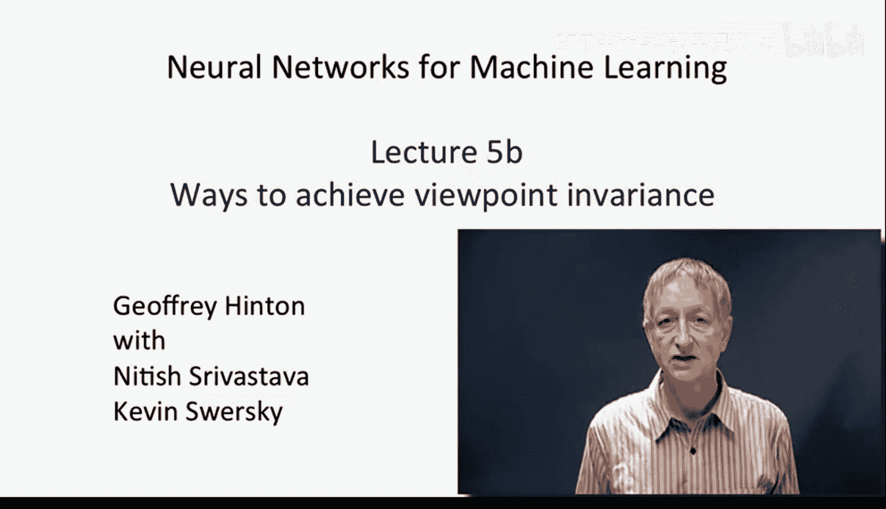
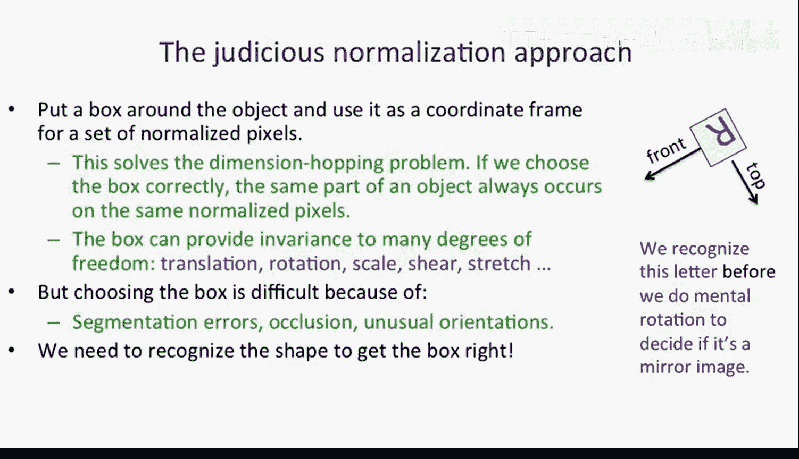
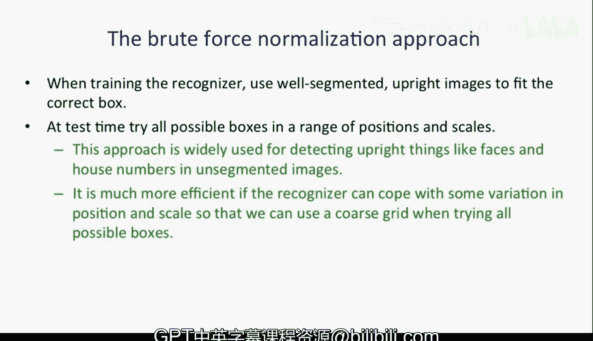

# Hinton@多伦多大学《机器学习的神经网络｜Neural Networks for Machine Learning 2016》claude-4s p22 -22-Lecture 5.2 — Achieving viewpoint invariance  -Neural Networks for Machine L -BV1HtkUB2EZD_p22-

In this video。I'm gonna talk about the issue of viewpoint invariance。

Each time we look at an object in a scene。We typically have a different viewpoint。

 So the object shows up on different pixel cellss。This makes object recognition very unlike most machine learning tasks。

And I'm going to talk about various ways of trying to deal with that issue。

A number of different ways have been suggested for coping with viewpoint variations。

We're so good at it that we don't really appreciate how difficult it is。

 It's one of the main difficulties in making computers perceive。

And the still aren't generally accepted solutions， either in engineering or in psychology。

The first approach is to use redundant invariant features。

The second approach is to put a box around the object so that you can normalize the pixels。

The third approach is to use replicated features。And pull them。

This is called convolutional neural nets。 And I'll go over that in great detail。

And the fourth approach， which I'll talk about at the end of the lecture。

 is to use a hierarchy of parts。And to explicitly represent the poses of the parts relative to the camera or retina。

So， the invariant feature approach。Says you should extract a large and redundant set of features。

 and they should be features that are invariant under the transformations like translation and rotation and scaling。

So here's an example of an invariant feature。It's a pair of roughly parallel lines。

With a red dot between them。That's actually been suggested as the feature that baby Herring girlslls use for knowing where to peck for food。

If you paint that feature on a piece of wood。They'll peck at the appropriate place on the piece of wood。

With enough invariant features， there's only one way to assemble them into an object or an image。

You don't actually need to represent the relationships between features directly。

Because those relationships are captured by other features。

This has been pointed out for strings of letters by a psychologist called Wayne Wiickckergrrant。

It's been pointed out， in vision by Shion Oman。And it's a sort of cute point that all we need is a big bag of features。

Because with overlapping and redundant features。One feature will tell you how two other features are related。

Unfortunately， if you're doing recognition。You're going to get a whole bunch of features that are composed of parts of different objects。

 and they'll be very misleading for recognition。So you'd like to avoid forming features from parts of different objects。

A second approach is what I call judicious normalization。

 So if you look at that upside down capital letter R on the right。I put a box round it。

 Not very well， in fact。And I've labeled a top on a front for that box。And relative to that box。

The R has， for example， a vertical stroke at the back。And it has a loop facing forwards at the top。

So if we describe features of the art relative to that box， they're going to be invariant。

 This is assuming it's a rigid shape。Putting a box around a rigid shape solves the dimension hopping problem。

It gets rid of the effect of changes in viewpoint。 If we choose the box correctly。

The same part of an object would always occur on the same normalized pixels。

It doesn't have to be a rectangular box。We can provide invariance to not only translation and rotation scale。

 but also things like shear and stretch。Unfortunately， choosing the box is difficult。

It's difficult because we might have segmentation errors。We might have occlusion。

 so you can't just shrink a box around things。We might have unusual orientations。That example。

Of the upside down R makes it clear that。We have to use our knowledge of what the shape is to help us decide what the box is。

If， for example。We had a character that was like a lower case D。

 but with an extra stroke coming out of the loop of the D。

 we would see that as an upright one of those characters。So it's a chicken and egg problem。

In order to get the box right， we need to recognize the shape and in order to recognize the shape。

 we need to get the box right。And aside cheer for psychologists。

 many psychologists think we do mental rotation to deal with shapes that aren't oriented， right。

This is complete nonsense。That capital letter R。You recognise perfectly well before you do any mental rotation。

 Indeed， you need to recognize that it is an R and it's upside down in order to know how to rotate it。

You use mental rotation for dealing with judgments like handedness。 That is。

 is it a correct hour or a mirror imager， You can't tell that without doing mental rotation。

But mental rotation is not used for dealing with the fact that it's upside down when we want to recognise it。

The brute force normalization approach works like this。

 You use well segmented upright images that you can judiciously put a box round when you train the recogniser。

 and then at tests time， when you have to deal with clusteruttered images。

You try all possible boxes in a whole range of positions and scales。

This approach is widely used in computer vision， particularly for detecting upright things like faces or house numbers in unsegmented images。

It's much more efficient if the recogniser can cope with some variation in the position and scale。

So that we can use a coarse grid when trying all possible boxes。

