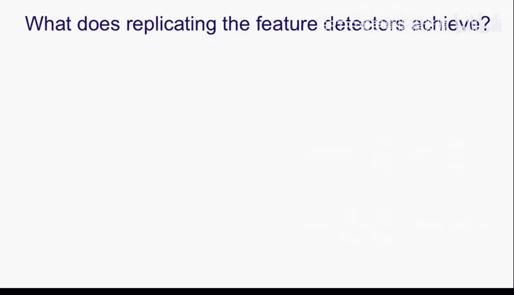
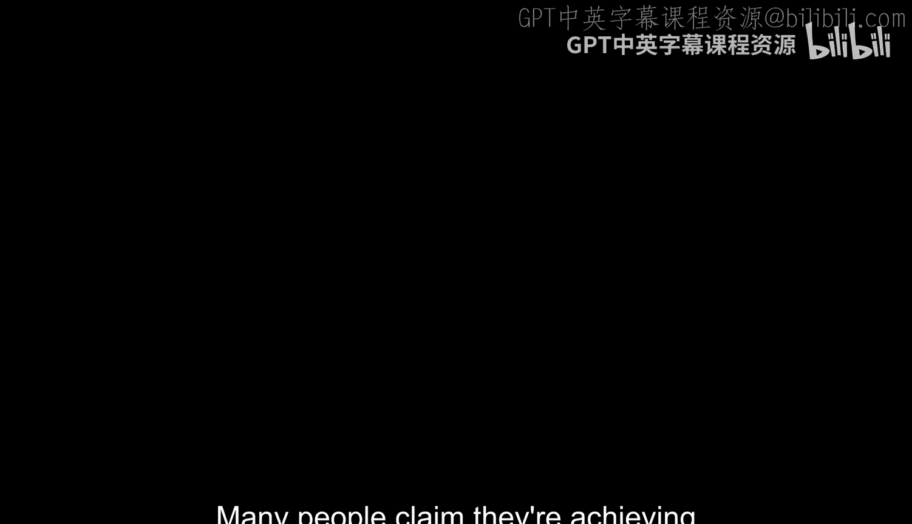
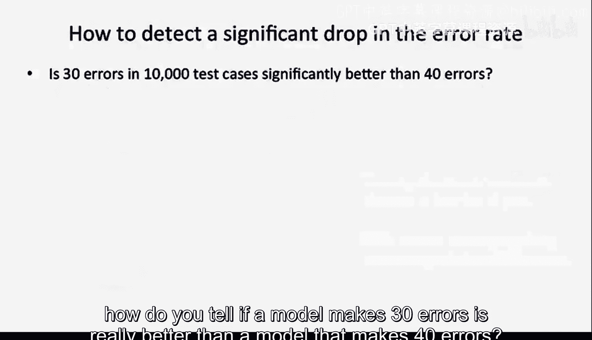
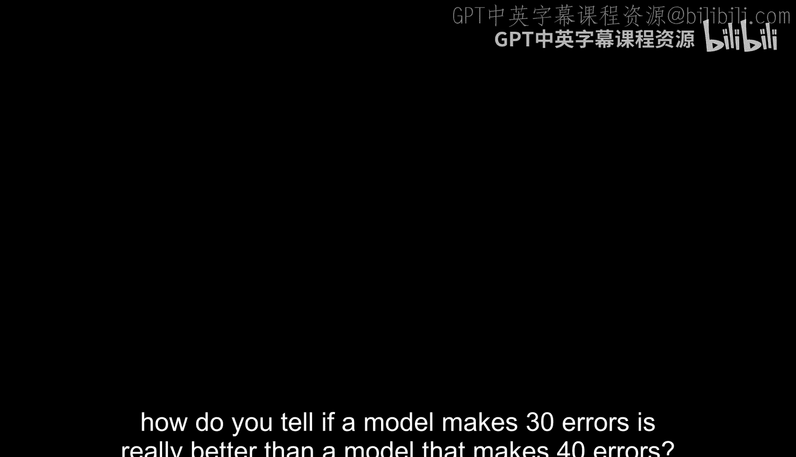
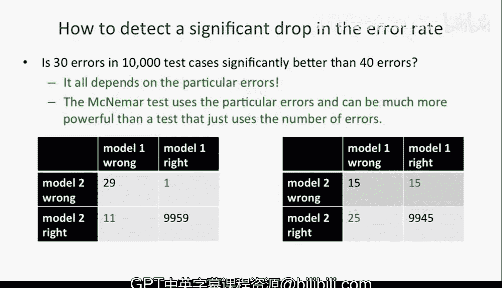

# Hinton@多伦多大学《机器学习的神经网络｜Neural Networks for Machine Learning 2016》claude-4s p23 -23-Lecture 5.3 — Convolutional nets for digit recognition  -Neural Networks for -BV1HtkUB2EZD_p23-

In this video， Im gonna talk about convolutional neural networks for handwritten digit recognition。

This was one of the big success stories of neural networks in the 1980s。

The deep convolutional nets developed by Yalahan and his collaborators。

 did a really good job of recognizing handwriting and were actually used in practice。

They're one of the few examples from that period of deep neural nets。

That it was possible to train on computers that existed then。And that performed really well。

Convolutional neural networks are based on the idea of replicated features。

So because objects move around and show up on different pixels。

If we have a feature detector that's useful in one place in the image。

It's likely that the same feature detector will be useful somewhere else。

So the idea is to build many different copies of the same feature detector in all the different positions。

If you look on the right， I've shown you three feature detectors， which are replicas of each other。

Each of them has weights to 9 pixels。And those weights are identical between the three different feature detectors。

So， the red arrow。Has the same weight on it for all three feature detectors。And when we learn。

 we keep those red arrows all having the same weight as each other。

And we keep the green arrows all having the same weight as each other。

Even though the red and green arrows will have different weights。

We could also try replicating across scale and orientation。

But that's much more difficult and expensive， and probably not a good idea。

Replication across precision greatly reduces the number of three parameters that you have to learn。

So those 27 pixels that you see in those three replicated detectors only have nine different weights。

Now， we don't just want to use one feature type。So we're going to have many maps。

 each map will have replicas of the same feature， features that are constrained to be identical in different places。

And then different maps will learn to detect different features。

This allows each patch of the image to be represented by features of many different types。

Replicated features fit in nicely with back propagation。

 That is is easy to learn them using back propagation。In fact。

 it's easy to modify the back propagation algorithm to incorporate any kind of linear constraint between the weights。

So what we do is we compute the gradients as usual。

But then we modified the gradients so that if the weight satisfied the linear constraint before the weight update。

 they'll also satisfy the linear constraint after the weight update。

So the simplest example is we want two weights to be equal。 We want W1 to equal W 2。

That'll be true if we start off with W1 equal to W2。

And then we make sure that the change in W1 is always equal to the change in W2。

The way we do that is we compute the gradient of the error with respect W1。

And the gradient with respect to W2。And then we use the sum or average of those two gradients for both W1 and W 2。

By using weight constraints like that， we can force back propagation to learn replicated feature detectors。

There's quite a lot of confusion in the literature about what replicated feature detectors are actually achieving。

 Many people claim they're achieving translation invariance。 And that's not true。

Well， at least it's not true in the activities of the neurons。So if you look at the activities。

 what replicated features achieve is equivariance， not invariance。An example should make that clear。

Here's an image。 and the black dots of the activated neurons。Here's a translated image。

 and notice the black dots have also translated。So the image changed and the representation also changed by just as much as the image。

That's equivariance， not invariance。There is something that's invariant。And that's the knowledge。So。

If you learn replicated feature detectors， if you know how to detect a feature in one place。

You will know how to detect that same feature in another place。And it's important to note that。

We're achieving equivariance in the activities， an invariance in the weights。

If you want to achieve some invaris in the activities。

 what you need to do is pool the outputs of replicated feature detectors。

So you can get a small amount of translational invariance at each level of a deep net。

By averaging four neighbouring replicated detectors。

One advantage of this is that it reduces the number of inputs to the next layer。

So that we can have more different maps， allowing us to learn more different kinds of features in the next layer。

It actually works slightly better to take the maximum of four neighbouring feature detectors rather than an average。

 But there is a problem。 And the problem is that after several levels of doing this kind of pooling。

 we've lost precise information about where things are。

That's O if we just want to recognize that there's a face。

 The fact that we've got a few eyes and a nose and a mouth floating about in vaguely the same position is very good evidence that it's a face。

But if you want to recognize whose face it is。You need to use the precise special relationships between the eyes and between the nose and the mouth。

 And that's been lost by these convolutional neurals。I'll come back to that issue， later on。

So the first impressive example of a convolutional neural net。

Was done by Yan Leconn and his collaborators。Who developed a really good recognise of 100 and digits。

Vette had many hidden layers。In each layer， it had many maps of replicated units。

And it had pooling between layers。 So you pool adjacent replicated units before you send them to the next layer。

They also used a wide net that could cope with several characters at once。And that will work。

 even if the characters overlap。So you didn't have to segment out individual characters before you fed them to their net。

And something which people often forget。Is that they used a clever way of training a complete system。

 They weren't just training a recogniser for individual characters。

They were training a complete system。So that you'd put in pixelixs at one end and you get out whole zip codes at the other end and in training that system。

They used a method that would now be called maximum margin。 But when they did it。

 it was way before maximum margin had been invented。

The net they used was at one point responsible for reading about 10% of the Czes in North America。

 So it was a great practical value。There's very nice demos of the net。On Yan's webpage。

And you really should go and look at those。 Look at all of them， because they show you just how。Well。

 it copes with variations in size orientation position， overlap of digits。

And all sorts of background noise that would would kill most methods。

The architecture of the Ne 5 looks like this。There's an input， which is pixels。

And then there's a whole sequence of feature maps followed by subsampling。So in the C1 feature map。

There's six different maps。Each of which is 28 by 28。

 And those maps contain small features that just look at， I think，3 by three pixels。

And their weights are constrained together。So， per map。There's only about 9 parameters。

 That makes learning much more efficient means you need much less data。Then， after the feature map。

There's what they call subsling， which is now called pooling。And so you pull together the outputs。

Of a bunch of neighbouring， replicated features in C 1。And that gives you a smaller map。

Which will then provide the input to the next layer， which is discovering more complicated。

 replicated features。As you got this hierarchy， you get features that are much more complicated。

But are more invariant to position。Here's the errors that Lynette 5 made。

And this shows you that the data it's dealing with is quite tricky。 There's 10000 test cases。

And these are the 82 errors it makes。 So it's doing better than 99%， correct。Nevertheless。

 most of the errors it makes are things people find quite easy to recognise。

 so there's some way to go to。Nobody knows the human error rate on this data。

 but it's probably 20 to 30 errors。Of course， there might be digits that Lanette 5 got right and you would get wrong。

So you have to be careful in estimating the error rate。

You can't just look at these 82 and ask which ones you get right and which ones you get wrong。

You have to worry about all those other ones that Lynette 5 might have got right and you might have got wrong。

I now want to go to a very general point about how to inject prior knowledge in machine learning。

And it applies particularly to neural networks。We can put in prior knowledge。

 as is done in the net 5。By the design of the network。We can have local connectivity。

We can have weight constraints， or we can choose neural activities that are particularly appropriate for the task we're doing。

This is much less intrusive than trying to hand engineer the features。

 but it still prejudices the network towards a particular way of solving the problem that we had in mind。

 We have an idea about how to do object recognition by gradually making bigger and bigger features and by replicating these features across space。

 And we force the network to do it that way。There is an alternative way to put in prior knowledge。

That gives the network a much freer hand。What we can do is use our prior knowledge to create a whole lot more training data。

One of the first examples of this was work by Hoffman and Trep。

On trying to model what happens in a steel mill。They wanted to know the relationship between what comes out of the steel mill and various input variables。

And they actually had a big old fortran simulator that would allow them to simulate the steel mill。

Of course， the stimulator wasn't reality。 It was making all sorts of approximations。

So they had real data and also simulator。And what they did was ran the simulator in order to create some synthetic data。

They then added that to the real data and showed that they could do better than just using the real data alone。

If I remember， right， their great big Fortran simulator was only worth a few dozen extra real examples。

 but nevertheless， they made the point。 Of course， if you generate a lot of synthetic data。

 it may make learning take much longer。So in terms of the speed of learning。

 it's much more efficient to put in knowledge by using things like connectivity and weight constraints。

 as was done in Line Ne 5。But as computers get faster。

 this other way of putting in knowledge by generating synthetic examples begins to look better and better。

In particular， it allows optimization to discover clever ways of using the multiier network that we didn't think of。

In fact， we might never fully understand how it does it。If we just want good solutions to a problem。

That might be fine。So， using the idea of synthetic data。

There is a brute force approach to handwritten digit recognition。

Lette 5 uses knowledge about invariances to design the connectivity in the weight sharing and the pooling。

And that'll choose about 80 errors。Adding a lot more tricks。Including synthetic data。

Marcori Ronzato was able to get that downme to about 40 hours。A group in Switzerland。

LED by Jogen Schmid Hooper went to town with injecting knowledge by putting in synthetic data。

They put a lot of work into creating。Very instructive， synthetic data。

So for every real training case。They transformed it to make many more training examples。

They then trained a large net with many units per layer， and many layers。

On a graphics processor unit。The graphics processor unit gave them a factor of 30 in computation。

And because of all the synthetic data they put in， it didn't overfit。

 If they'd just used a large net with a GP。It would have been a disaster that'd have overfitted terribly。

 that had done perfectly on the training data， but terribly on the test data。So really。

 they were combining three tricks。Put your effort into generating lots of synthetic data。

 then train a large dumb net on a GPU。 They managed to achieve 35 errors like that。

 So here's the 35 errors they got。The top printed digit is the right answer。

And the bottom two digits are their top two answers。

What you'll notice is that they nearly always get the right answer in their top two。

 There's only five cases where they don't。With more work。

By building several different models like this and then using a consensus to decide what the digit was。

 they managed to get down to about 25 hours。And that must be around about the human error rate。

One question this work raises is， how do you tell if a model makes 30 errors is really better than a model that makes 40 errors。

 Is that significantly different。

Rather surprisingly， it turns out it depends on which errors they make。

The numbers don't provide you enough information。 You have to know which ones they get wrong and which ones they get right。

So there's a statistical test called a magnema test that uses the particular errors and is far more sensitive than just using the numbers。

Let me give you an example。If you look at this two by two table。It shows you。

In the top left hand corner。How many examples Model 1 got wrong and Model 2 also got wrong。That's 29。

And in the bottom， right， it shows you how many examples Model 1 got right and Model 2 also got right。

And in the magnema test， you can just ignore those numbers in black。

What you're interested in is the ones where Model 1 got it right to Model 2 get it wrong。

Or Model 2 got it right and Model 1 got it wrong。And if you look at that， there's an 11 to one ratio。

And it turns out， that's pretty significant。Model 2 is definitely better than Model 1。

That didn't happen by accident， almost certainly。By contrast， if you look at this table。Again。

Model 1 is making 40 errors， and Model 2 is making 30 errors。But now。

Model 1 is winning 15 times when Model 2 loses。 and Model 2 is winning 25 times when Model 1 loses。

That difference is not very significant。 So we wouldn't be confident that Model 2 is better than model1。

