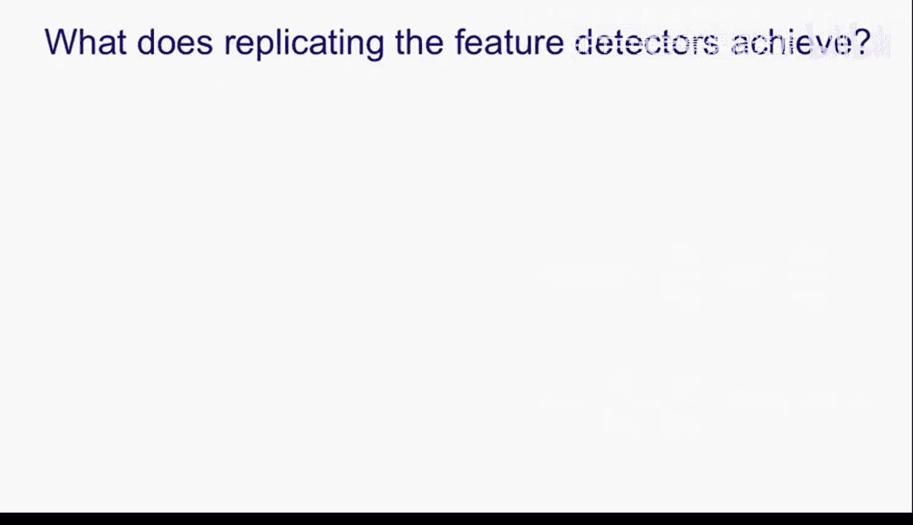
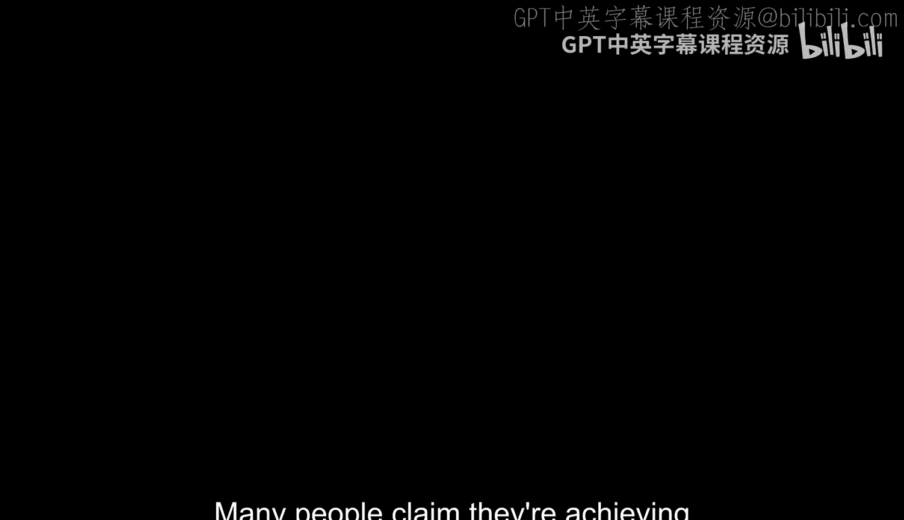
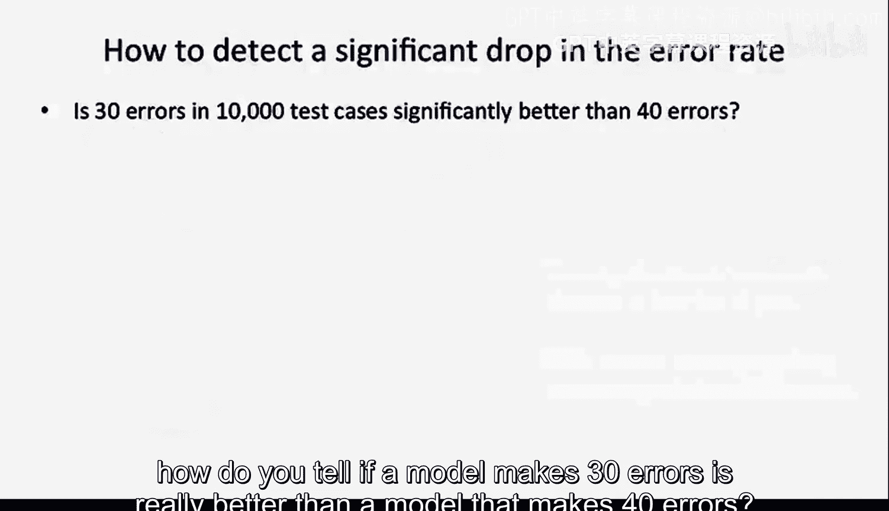
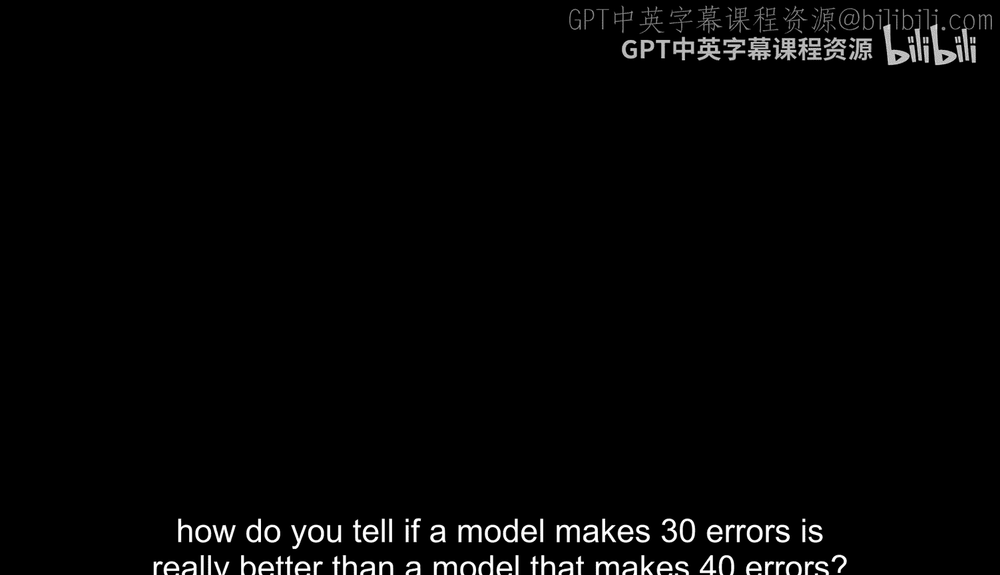
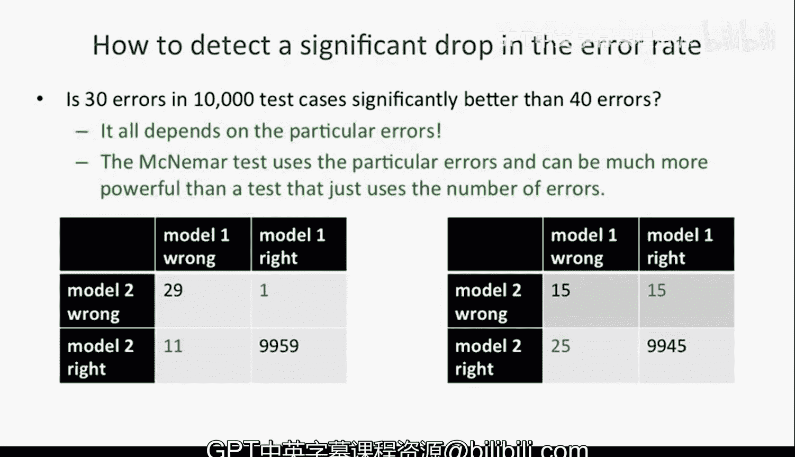

# 神经网络与机器学习：5.3：用于手写数字识别的卷积网络 🧠

在本节课中，我们将学习卷积神经网络在手写数字识别中的应用。这是20世纪80年代神经网络领域取得重大成功的案例之一。

## 卷积网络的基本思想

上一节我们介绍了神经网络的基本结构，本节中我们来看看卷积网络的核心设计理念。

卷积神经网络基于**特征复制**的思想。由于物体可能在图像的不同位置出现，如果一个特征检测器在图像的某个位置有用，那么同样的检测器在其他位置也很可能有用。因此，我们的想法是在所有不同位置构建许多相同特征检测器的副本。

例如，假设我们有一个特征检测器，其权重连接到9个像素。我们可以在图像的不同位置复制这个检测器，并且所有副本中的对应权重（例如，所有“红色箭头”对应的权重）在训练过程中被强制保持相同。这可以用以下约束表示：

**权重共享约束**：对于所有位置 `i, j` 上的同一特征检测器副本，其权重 `W_ij` 必须相等。

这种跨位置的复制极大地减少了需要学习的参数数量。在上面的例子中，3个复制检测器共涉及27个像素连接，但只有9个不同的权重需要学习。

## 网络结构与池化

我们不会只使用一种特征类型。以下是典型的卷积网络结构：

*   **多个特征图**：网络会包含多个“特征图”。每个图内是相同特征的复制品（不同位置的权重被约束为相同），而不同的图则学习检测不同的特征。这使得图像的每个局部区域都能用多种不同类型的特征来表示。
*   **反向传播与权重约束**：复制特征的思想可以很好地融入反向传播算法。我们可以修改梯度计算方式，以确保在权重更新前后，线性约束（如权重相等）始终得到满足。具体做法是，计算各个约束权重的梯度，然后使用这些梯度的总和或平均值来更新所有受约束的权重。

关于复制特征检测器的作用，文献中存在一些混淆。许多人声称它们实现了**平移不变性**，但这并不准确，至少在神经元的**活动**层面不是这样。

复制特征实现的是**等变性**，而非不变性。举例来说，如果图像平移了，那么被激活的神经元位置也会发生同样的平移。图像变了，其表示也以同样的程度变化，这就是等变性。

真正不变的是**知识**（即权重）。我们学会了在某个位置检测一个特征，也就知道了如何在其他位置检测相同的特征。我们在活动层面实现了等变性，在权重层面实现了不变性。

如果希望在活动层面获得一定的不变性，我们需要对复制特征检测器的输出进行**池化**。例如，可以对四个相邻的复制检测器的输出取平均或最大值。这样做有两个好处：
1.  在每个层级上获得少量的平移不变性。
2.  减少下一层的输入数量，从而允许我们在下一层拥有更多不同的特征图，学习更多种类的特征。

通常，取最大值的效果略好于取平均值。但池化会带来一个问题：经过几层这样的池化操作后，我们会丢失关于物体**精确位置**的信息。这对于识别“是否存在一张脸”可能足够了，但对于识别“这是谁的脸”，则需要利用眼睛、鼻子、嘴巴之间的精确空间关系，而这些信息在卷积网络中可能已经丢失。

## LeNet-5：一个成功的早期案例

第一个令人印象深刻的卷积网络例子是由Yann LeCun及其合作者开发的LeNet-5，它在手写数字识别上表现优异。

LeNet-5具有多个隐藏层，每层包含多个由复制单元组成的特征图，并且在层与层之间使用了池化操作（他们称之为“子采样”）。此外，它还是一个“宽”网络，能够同时处理多个字符，即使字符重叠也能工作，因此无需在输入网络前预先分割单个字符。

一个常被忽视的关键点是，他们采用了一种巧妙的方法来训练整个系统，而不仅仅是训练单个字符识别器。输入是像素，输出是整个邮政编码。在训练这个系统时，他们使用了一种后来被称为“最大间隔”的方法，但这在当时远早于该概念的正式提出。

LeNet-5曾一度负责读取北美约10%的支票，具有巨大的实用价值。其架构大致如下：输入是像素，然后是一系列“特征图”和“子采样”层的交替。例如，C1特征层有6个不同的28x28的特征图，每个图检测小的特征（如3x3像素区域），并且同一图内的权重是共享的。接着通过池化（子采样）得到更小的图，再输入到下一层去发现更复杂的复制特征。通过这种层次结构，网络能够获得更复杂、对位置更不敏感的特征。

在包含10000个测试样本的数据集上，LeNet-5取得了超过99%的正确率，犯了82个错误。这些错误大多是人类也很容易认错的数字，表明仍有改进空间。估计人类在该数据集上的错误率可能在20到30个左右。

## 注入先验知识的两种方式

现在，我想探讨一个关于如何在机器学习（特别是神经网络）中注入先验知识的普遍观点。

我们可以像LeNet-5那样，通过网络设计来注入先验知识。例如，使用局部连接、权重约束，或者选择特别适合当前任务的神经元活动类型。这种方式比手工设计特征侵入性小，但它仍然将网络偏向于我们设想的那种解决问题的方式（例如，通过逐渐构建更大特征并在空间上复制来实现物体识别）。

还有一种替代方法，能给网络更大的自由度。我们可以利用先验知识来创建大量额外的训练数据。一个早期的例子是Hoffman和Tresp在钢厂建模方面的工作。他们有一个大型的Fortran模拟器来模拟钢厂过程，虽然模拟器不是真实的，但他们将模拟生成的合成数据与真实数据结合，取得了比仅用真实数据更好的效果。

就学习速度而言，通过连接性和权重约束等方式注入知识效率更高。但随着计算机越来越快，通过生成合成样本来注入知识的方式看起来越来越好。特别是，它允许优化过程发现我们未曾想到的使用多层网络的巧妙方法，我们甚至可能无法完全理解其工作原理。如果我们只想要问题的良好解决方案，这或许是可以接受的。

## 通过合成数据实现突破

在LeNet-5利用关于不变性的知识设计连接、权重共享和池化，取得约80个错误的基础上，通过添加更多技巧（包括使用合成数据），Marc’Aurelio Ranzato等人将错误数降低到了约40个。

一个由Jürgen Schmidhuber领导的瑞士小组，在通过注入合成数据来融入知识方面做到了极致。他们投入大量工作创建了非常有指导意义的合成数据：对每个真实的训练样本进行多种变换，生成更多的训练样本。然后，他们在图形处理器上训练了一个每层具有许多单元、层数也很多的大型网络。GPU提供了30倍的计算加速，而由于他们注入了大量合成数据，网络没有过拟合。如果他们仅仅在GPU上训练一个大型“笨”网络，将会是灾难性的过拟合。

他们实际上结合了三个技巧：
1.  投入精力生成大量合成数据。
2.  训练一个大型的“笨”网络。
3.  使用GPU进行加速。

通过这种方法，他们将错误数降低到了35个。观察他们的错误案例可以发现，正确答案几乎总是出现在他们的前两个预测中。通过构建多个这样的不同模型，然后使用共识来决定数字是什么，他们最终将错误数降低到了约25个，这大概已接近人类的错误率。

## 如何比较模型性能

这项工作引出了一个重要问题：如何判断一个犯30个错误的模型是否真的比一个犯40个错误的模型更好？这个差异显著吗？

令人惊讶的是，答案取决于它们具体犯了哪些错误。仅仅看错误数量提供的信息不够，你必须知道它们各自在哪些样本上出错，哪些样本上正确。

有一种称为**McNemar检验**的统计测试，它利用具体的错误情况，比仅仅使用错误数量要敏感得多。

举例来说，考虑两个模型在测试集上的表现。我们关注的是两个模型**不一致**的情况：即模型1正确而模型2错误，以及模型2正确而模型1错误的样本数量。如果其中一个数量远大于另一个（例如11:1），那么我们可以很有信心地说性能较好的模型确实更优。反之，如果两个数量相差不大（例如25:15），那么即使错误总数有差异，我们也不能确信一个模型比另一个更好。

---

本节课中我们一起学习了卷积神经网络用于手写数字识别的基本原理、经典网络LeNet-5的架构，以及两种向神经网络注入先验知识的方式（网络结构设计与生成合成数据）。我们还了解了通过合成数据和现代计算硬件（GPU）可以大幅提升模型性能，并学习了使用McNemar检验来更精确地比较两个分类模型性能的方法。