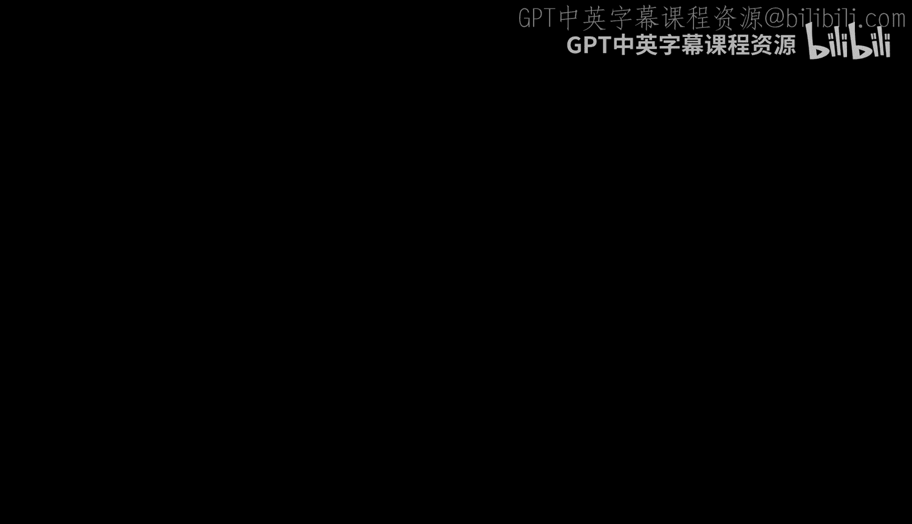
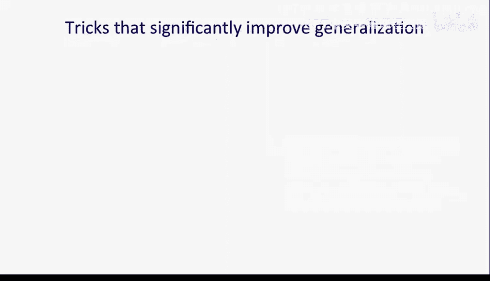
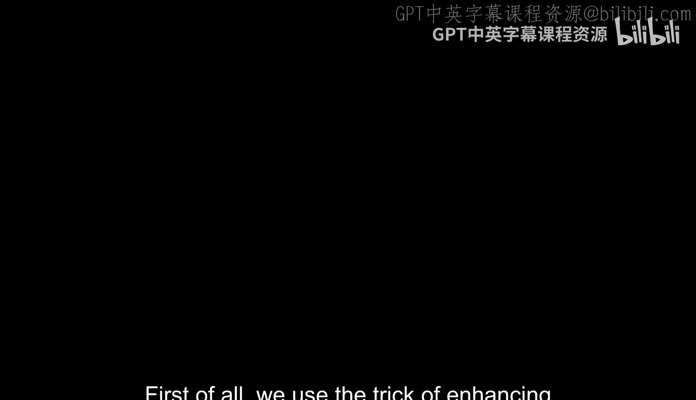
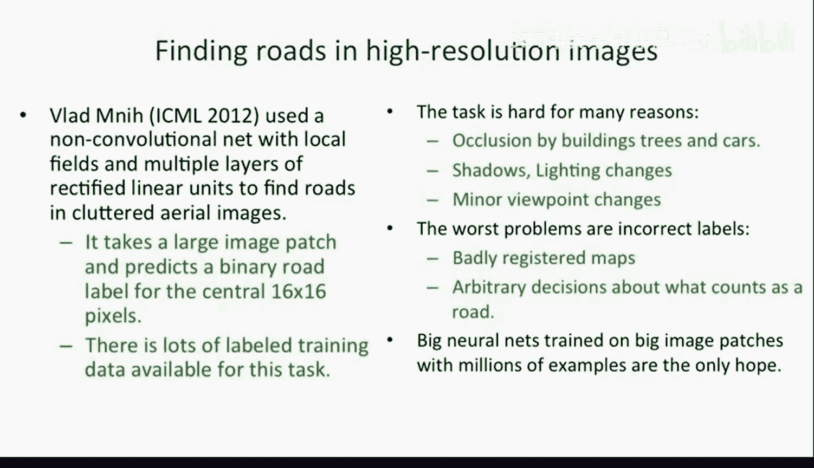

# Hinton@多伦多大学《机器学习的神经网络｜Neural Networks for Machine Learning 2016》claude-4s p24 -24-Lecture 5.4 — Convolutional nets for object recognition  -Neural Networks fo -BV1HtkUB2EZD_p24-

It was always a question for speculation， whether the kinds of nets developed for recsing hundred digits。

Could actually be scaled up。To what vision people call a real task that is recognising objects in high resolution colour images。

When the scene is cluttered so that you have to do things like segmentation。

 you have to deal with 3D viewpoint， you have to deal with the fact that there's many different objects around and you're not quite sure which is the intended one and so on。

Since the start of this course， we've got some interesting new results on that。

So in my first lecture。I described the network developed by Alex Khsevsky and showed that it was good at object recognition。

 But at that point， it hadn't been benchmarked against the best computer vision systems。 Now it has。

People worked on Mnest for many years， gradually improving their ability of these networks to recognise handwritten digits。

Many computer vision researchers thought this was a waste of time if you wanted to be able to recognize real objects in colour images。

Because they thought that the lessons learned from Enist would not generalise to that domain。

That was a fairly reasonable thing to think。Here's a number of reasons why it's a much more difficult task。

First of all， there's many， many more different kinds of objects。

 even if we only recognize 100 classes， that's still a factor of 100。Secondly。

 there's many more pixelels。Even if we use。Dan sampled images that are only 256 by 256 with colour pixels。

 That's still 100 or 300 times as many pixels。Another factor is that in real scenes。

 you have to deal with the fact you've got a two dimensional image of a three dimensional reality。

 So a lot of information has been lost。And real scenes have clutter of a kind that doesn't occur in handwriting In handwriting。

 you can have overlapping letters。 and that requires segmentation。

 But you don't have things like occlusion of large parts of objects by opaque other objects。

You don't have many different kinds of object in the same scene。

And you don't have all the lighting variations that you get in real scenes。So the question is。

 will the same kind of convolutional neural network that proved to be so good at recognizing hundred digits work for real color images？

In the domain of real colour images， we probably do need to wire in some prior knowledge。

Because if we try and do it in the Siraan way with no knowledge wired in。

 putting in all the knowledge by generating extra training examples。

The computational problem is still too large for current computers。So。

 there was a recent competition。

And it was on a database called ImageNe。

Imagenet actually has many more than a million images， but a subset of 1。2 million images was chosen。

 and the classification task was to correctly label those images。 Now。

 the images were hand labeled with 1000 different classes。But this wasn't very reliable。

 There could be an image that has two of those thousand different objects in。

 and only one of them is labeled。So to make the task feasible。

 the computer vision system is allowed to make five bets。

 and it's said to get it right if one of those bets corresponds to the label that a person has given the image。

There's also a localization task。 The reason for the localization task is that many computer vision systems use a bag of features approach for the whole image or for。

 say， a quadrant of the image， they know what the features are， but they don't know where they are。

This allows them to recognize objects， but without knowing exactly where they are。

That's very unlike how people behave。Accept people with a curious kind of brain damage called balance syndrome。

 where they can recognize objects and not be sure where they are。 So for the localization task。

 you have to place a box around an object once you've recognized it。And to get it right。

 your box must have at least a 50% overlap with the correct box。On this task。

 people tried some of the best existing computer vision methods， so。

Leading groups from Oxford and the French National Research Las in Ria and Xerox's European Research Centre and various other universities tried this task。

And discovered it' very hard。The computer vision systems typically use complicated multis stageage systems。

The early stages of these systems are typically hand tuned by optimizing a few parameters。

Using some of the data and the top stage of these systems is always a learning algorithm。

But they don't learn all the way through。In the way that a deep neural net does when it's trained with back propagation。

 they don't have end to end learning。Where the parameters used in the early feature detectors are being influenced by how useful they are for making the final decision about classes。

So here's some examples from the test set to show you what the data is like。

You already saw some examples in the first lecture。 but here's some more。

 So you can see that it's fairly obvious what the object is in that image。 But a lot of it's missing。

 It doesn't have ears。 It doesn't have legs， the predictions。

Are the unnormalized probabilities of Alex Khushevsky's deep neural network。

 And you can see it's confident that that's a cheateetah。And if it's not a cheetah。

 it thinks is's almost certainly a leopard。It also understandss other possibilities like a snow leopard。

 It's the wrong colour for a snow leopard or an Egyptian cat。

Here's an example the other way round here。 there's many objects in the image。

 and the object of interest is only a very small fraction of the pixels。

 The network correctly says bullet train。But it also has other beds like subway train or electric locomotive。

 which are pretty sensible beds。 If you look at the image。

 there's lots of other things that could be labelled like the roof。

 which occupies a much larger fraction of the image than the train。

Or the pillar that's supporting the roof。Or the pedestrian。

Or the large apartment block in the background。In these kinds of images。

 you really have to be able to cope with the fact that there's lots of alternative targets。

 The last image shows a different kind of example。Where there's no background clutter。

 the object is quite well isolated， probably a picture from a catalogue or something。

And the network doesn't get it right for its first be， but it does get it in its top five beds。

But here， the network isn't confident about anything。These are the relative probabilities。

And the network correctly realizes it doesn't really know。

 And if you look at the other possibilities， they're all perfectly plausible。

 If you screw your eyes up so you can't see the image too well。

 you can see how it might think it was a frying pan or a stethoscope。

So how did the systems do on this data？Here's the error rates for the computer vision systems。

And one thing you'll notice is that the best systems are all very similar。

So the University of Tokyo managed to get 26。1%。And here what I'm doing is just reporting the best system from each group。

Oxford University， which has a very good computer vision group。

 generally recognized to be possibly the best group in Europe， again， got in the 26%。

And the French National Research labs and the Xerox Park Centre， which are， again， very good。

 Computer vision groups got 27%。 So you'd have guessed from this that it's going to be hard to beat 26%。

 And if you do beat 26%， you're comparable with the very best computer vision systems。So。

 Alex Khushevsky's neural net。Got 16 per cent error。 It's a huge gap。 Normally in these competitions。

 you don't see big gaps like that。 So Alex Khushevsky's network works like this。

It's a very deep convolutional neural net of the type piate by Yalaco that was first used for digit recognition。

 And then Janan later applied it to recognizing real objects。

 And we're using all the lessons that were learned by Janan's group and by Yoshuo Benjo's group。

 and by various other groups developing these deep neural nets for doing real vision。

 It has 7 hidden layers， which is deeper than usual。

 And that's not counting some of the Max pooling layers。 The early layers are convolutional。

We could probably get away with using just local receptive fields without tying any weights。

 if we had a much bigger computer， but by making them convolutional。

 you cut down the number of parameters a lot， So you cut down the amount of training data you need a lot。

 which cuts down the amount of computation time a lot。The last two layers were globally connected。

 And that's where most of the parameters are。I think there's about 16 million parameters between each pair of those layers。

 What the last two layers are doing is looking for combinations of local features that were extracted by the early layers。

 And obviously， there's combinatorily many combinations to look for。

And that's why you need a lot of parameters there。The activation functions were rectified linear units in every hidden layer。

These train much faster than logistic units， and they're more expressive。

Most of the people seriously applying deep neural networks to real images to do object recognition of nice switch to rectified linear units。

We also used competitive normalization。Within a lair。To suppress the activity of a unit。

 if other units that are looking near by localities are very active。This helps a lot。

 with variations in intensity。So you might have an edge detector。

Which gets somewhat active due to some fairly faint edge。

 And that's pretty much irrelevant If there's much more intense things around。

Those other tricks that we use to significantly improve the generalization of this net。

First of all， we use the trick of enhancing the data by using transformations。

So Elis at Skiva downsled the images in the competition to 256 by 256。

 but instead of using those whole images。Alex Khsevsky took random 224 by 2。

24 patches from those images， which gave him hugely more images to train on and helped him deal with translation invariance。

 even though they're convolutional nets， that still a help。He also used left。

 right reflections of the images， which again， doubled the amount of data。

He didn't use up down reflections because gravity is very important。

 Left right reflections don't really change what things look like much unless they're things like writing。

 At test time， he doesn't just use one patch。He uses a number of different patches， the four corners。

 the middle， that gives him 5。 And then the left right reflections of all those that gives him 10。

 He runs all 10 through the network and then combines their opinions。

In the top layers where most of the parameters are。

 he uses a new regularization technique called dropropout。

 which is very effective and stops the network overfitting。

 That's worth several per cent in his results。I'll describe drop out at some length。

 in a later lecture。But for now， the basic idea of dropout。

Is that each time you present a training example， you om half the hidden units from a layer。

 This means that the other hidden units in that layer。

 the survivors can't rely on their comrades being present。

 They can't learn to fix up the errors left over by the other hidden units in that layer because the other hidden units might not be there。

 and they might be fixing up an error that doesn't exist。So they have to become more individualist。

 They have to individually do useful things。But they still have to do useful things that are different from what the other survivors do。

 So dropout is stopping。Too much cooperation between the hidden units。

And a lot of cooperation is very good for fitting the training data。

But if the test distribution is significantly different。

 then all that cooperation causes overfitting。Alex couldn't have done this work without significant hardware。

But the harborour only cost a few thousand dollars now。Alex is a very good programmer。

 and he used a very efficient implementation of convolutional neural nets。On two Nvidia G T X 5。

80 graphics processes， each of these has over 500 fast little cores。

 which are very good at doing arithmetic and not much good at anything else。

The GPs are very good at doing matrix， matrix multiplies。

So if you stack together the vector activities of a hidden layer over many training cases。

 that gives you a matrix。And now you multiply that by a matrix of weights to figure out the activities in the next hidden layer for all those training cases。

And if both those matrices are big， the GPUs give you a huge advantage。

 They give you a about a factor of 30。They also have very high bandwidth to memory。

 and that's needed for neural nets because in neural nets。

 you keep wanting to know another weight so that you can multiply by an activity。

 And there's millions of these weights。 so you can't keep them all in the cache。

Using all that hardware， he could train his final network in a week。

And he could also combine results from 1010 different patches at test time very quickly。

 So at test time， he can run at just about the frame rate。In future。

 we're going to be able to spread this kind of network over a large number of core as core become cheaper。

 People at Google already experimenting with that。And if we can communicate the states fast enough。

 we're going to be able to do much bigger networks on many more core。

 Google has already simulated networks with 1。7 billion connections。

And I think it's only going to get bigger。As the core get cheaper and the dataset sets get bigger。

These big， deep neural nets are going to improve much faster than the old fashioned computer vision systems。

 because they don't involve much hand engineering， and they can make very good use of huge data sets and huge amounts of computation。

So the fact that we've already opened up a big gap， I think means there's no looking back。

I think from now on all the best object recognition systems， at least in static images。

 willll use big， deep neural nets。There are other application domains where we've learned the same lesson。

So。😔，Vladimir knee。Used a net with local fields， but without convolution。

To extract roads from aerial images， these are cluttered aerial images of urban scenes。Again。

 he uses multiple layers of rectified linear units。And he takes a relatively large image patch。

And predicts for the central 16 by 16 pixels， whether each of those pixels is a piece of road or not a piece of road。

The nice thing about this task is there's a lot of labeled training data available。

That's because maps tell you where the centre lines of roads are。And roads of roughly fixed width。

So from the vectors in the map that tell you where the centre line of the road is。

 you can estimate which pixels are probably row。Nevertheless， the task is very hard。

There's the normal kind of vision problems。 So roads are occluded by buildings because a plane isn't looking straight down when it takes a photograph。

They're pollluded by trees that are also includedluded by cars that are sitting on the road。

Those shadow effects from buildings。There's major lighting changes。

 depending on whether it's a sunny day or a cloudy day， for example。

 And there's minor viewpoint changes。 So the plane is basically looking downwards。

But in any large photo， it can't be looking straight down was at every pixel。

The worst problems in this data are the incorrect labels。

You get incorrect labels because the maps aren't perfectly registered。 For most purposes。

 you don't need a map to be registered better than a few meters。

The pixel cellss are about 1 m square in this data。

And so if the registration of the map is off by 3 mets。

 you're going to get at least three of the labels wrong for pixels across every road。

 Another severe problem is that the people making maps have to make arbitrary decisions about what counts a road and what counts a laneway。

So in many of the maps， you look at something and youve no idea whether that's going to be considered to be a road or a laneway。

 and so you simply don't know what label it's going to get from the map。

Big neural nets trained on big image patches， using millions of examples。

Are I think the only real hope for doing a good job of this task。

 It's very hard to find out what people can do。

So here's what the data looks like。 This is a part of Toronto。 If you know Toronto。

 you can tell that by the angle of the roads。 and above the image of the part of Toronto。

 I put two patches extracted from that image。 And if you look at those patches。

 you can see it is not trivial to tell which the road pixels are on the right is the output of Laabir's system。

 green is correctly identified pixels of road and red means things that his system thought might be road that actually aren't。

Actually， that thing is a parking lot， but you can see why he might have thought it was a road。

