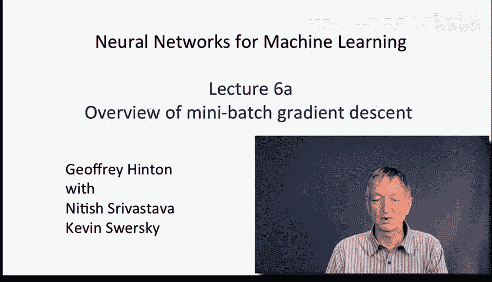
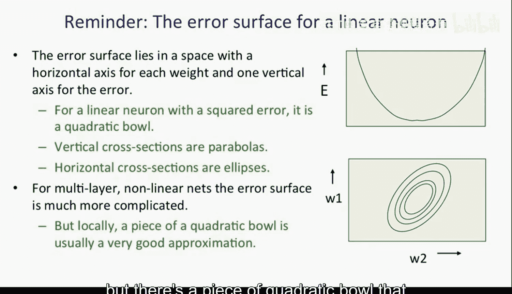
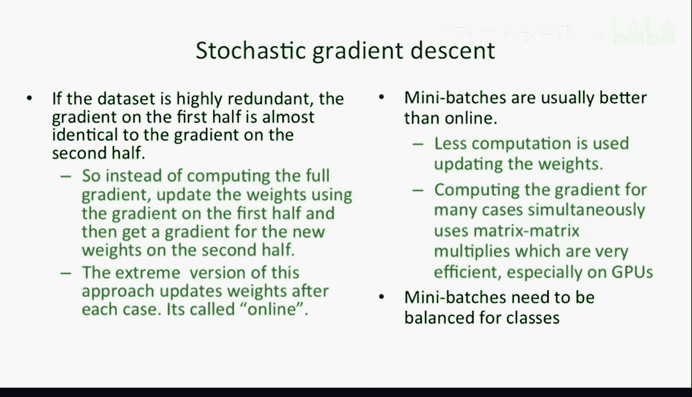
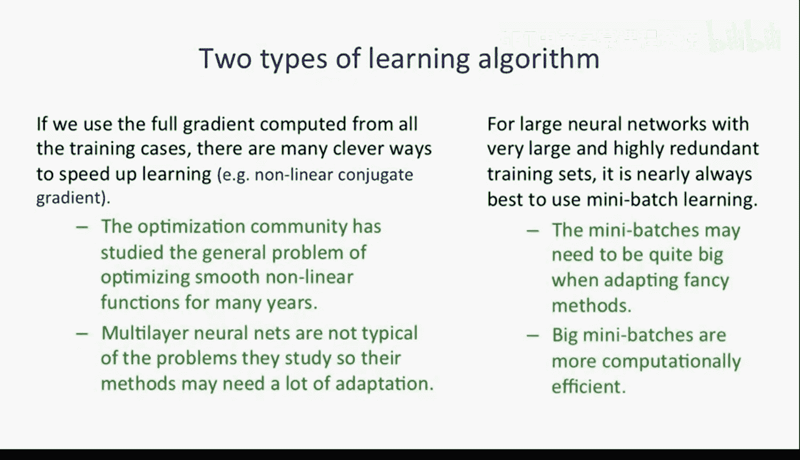
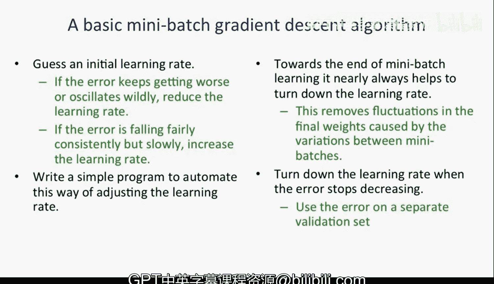

# Hinton@多伦多大学《机器学习的神经网络｜Neural Networks for Machine Learning 2016》claude-4s p25 -25-Lecture 6.1 — Overview of mini batch gradient descent  -Neural Networks for -BV1HtkUB2EZD_p25-

In this video， we're going to look at stochastic gradient descent learning for a neural network。

Particularly the mini batch version， which is probably the most widely used learning algorithm for large neural networks。

We've seen this before， but let's start with a reminder about what the error surface looks like for a linear neuron。

The air surface means。A surface that lies in a space where the horizontal axes correspond to the weights of the neural net and the vertical axis corresponds to the array makes。

For a linear neuron with a squared error， that surface always forms a quadratic bulb。

The vertical cross sections are parameterss。And the horizontal cross sections are ellipses。

For multi layerlineettes， the error surface is much more complicated。

 but as long as the weights aren't too big， it's a smooth error surface。 And locally。

 it's well approximated by a fraction of a quadratic bowl。It might not be the bottom of the bowl。

 but there's a piece of quadratic bowl that will fit the local error surface very well。

If we look at the convergt speed， when we do full batch learning。

When the air surface is a quadratic ball。The obvious thing to do is go downhill。

This will reduce the error。But the problem is that the direction of steepest descent does not point to the place we want to go to。

As you see in the ellipse。The direction of steepest descent is almost at right angles to the direction we want to go in。

We've got a gradient that's very big。Across the ellipse。

 which is a direction in which we only want to travel a small distance。

And the gradients very small along the ellipse。 And that's a direction in which we want to travel in large distance。

It's precisely the wrong way around。Now， you might think that studying linear systems like this is not a good idea if you want to optimize big nonlinear nets。

 but even for these nonlinear multi layer nets， this kind of a problem arises。

 It's a very similar problem that arises。 Even though the a surfaces aren't globally quadratic poles locally。

 they have all these same kinds of properties。 That is。

 they tend to be very curved in some directions and very uncurved in other directions。

So the way the learning goes wrong， if you use a big learning rate。Is that you slosh to and fro。

In the directions in which the aeros surface is very curved。

So will'll say call that sloshing across a ravine。And with the loan rate too big。

 you'll actually diverge。What we want to achieve。Is that we go quickly along the ravine in directions that have small but very consistent gradients。

And we move slowly in directions with these big but very inconsistent gradients。 That is。

 if you go in that direction for a short distance， the gradient will reverse sign。

Before we go into how we achieve that， I need to talk a little bit about stochastic gradient descent。

And the motivation for using it。If you have a data set that's highly redundant。

Then if you compute the gradient for a weight on the first half of the data set。

 you'll get almost exactly the same answer that you get if you compute the gradient on the second half。

So it's a complete waste of time to compute the gradient on the whole dataset set。

You'll be much better off。Computing the gradient on a subset of the data。

 then updating the weights and on the remaining data， computing the gradient for the updated weights。

We can take that to extremes and say we're going to compute the gradient on a single training case。

We're going to update the weights， and then we're going to compute the gradient on the next training case using those new weights。

 That's called online learning。In general， we don't want to go quite that far。

It's usually better to use small mini batches。Typically，10 or 100 or even 1000 examples。

One advantage of a small mini batch is that less computation is used for actually updating the weights。

 because you do that less often， compared with online。

Another advantage is that when you compute the gradient。

 you can compute the gradient for a whole bunch of cases in parallel。

Most computers are very good at doing matrix matrix multiplies。

And that will allow you to consider a whole bunch of training cases and apply the weights to a whole bunch of training cases at the same time to figure out the activities going into the next layer for all of those training cases。

That gives you a matrix， matrix multiply， and it's very efficient。

 especially on a graphics processor unit。One point about using mini batches is you wouldn't want to have a mini batch in which。

The answer is always the same。 and then on the next mini batch， have a different answer。

 that's always the same。That will cause the weights to slosh unnecessarily。The ideal， if you have。

 say 10 classes， would be to have a mini batch with， say。

 10 examples or 100 examples that has exactly the same number from each class in the mini batch。

One way to approximate that is simply to take all your data and just put it in random order and grab random mini batches。

But you must avoid having mini batches that are very uncharacteristic of the whole set of data because the mini batch is all of one class。

So basically， there's two types of learning algorithm for neural nets。

There's full gradient algorithms where you compute the gradient from all of the training cases。

 And once you've done that， there's a lot of clever ways to speed up learning。

There's things like nonlinear versions of a methodical conduit gradient。

The optimization community has been studying the general problem of how you optimize smooth nonlinear functions for many years。

Now， multienual networks are pretty untypical of the kinds of problems they study。

 So applying the methods they developed。May need a lot of modification to make them work for these multi neural networks。

But when you have highly redundant and large training sets。

It's nearly always better to use mini batch learning。The mini batches may need to be quite big。

But that's not so bad because big mini batches are more computationally efficient。

I'm now going to describe a basic mini batch gradient descent learning algorithm。

This is what most people would use when they started training a big neuralral net on a big redundant data set。

You start by guessing an initial learning， right？And you look to see。

If the network learns satisfactorily， or if the error keeps getting worse or oscillates wildly。

If that happens， you reduce the learning rate。You also look to see if the area is falling too slowly。

You expect that the arrow might fluctuate a bit if you measure it on a validation set。

 because the gradient on each mini batch is just a rough estimate of the overall gradient。

So you don't want to reduce the learning rate every time the error rises。

But what you're hoping is the era will fall fairly consistently。

And if it's falling fairly consistently and very slowly， you can probably increase the learning rate。

Once you've got that working， you can then write a simple program to automate that way of adjusting the learning rate。

One thing that nearly always helps is towards the end of learning with mini batches。

 it helps to turn down the learning rate。That's because you're going to get fluctuations in the weights caused by the fluctuations in the gradients that come from the mini batches。

And you'd like a final set of weights， that's a good compromise。

So when you turn down the learning rate， you're smoothing away those fluctuations and getting a final set of weights that's good for many mini batches。

So a good time to turn down the learning rate is when the error stops decreasing consistently。

And a good criterion for saying the error stop decreasing is to use the error on a separate validation set。

 That is， it's a bunch of examples that you are not using for training。

 and also they're not going to be used for your final test。

