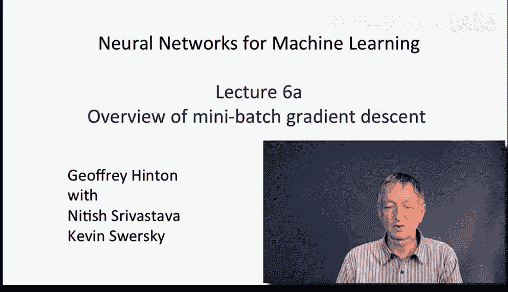
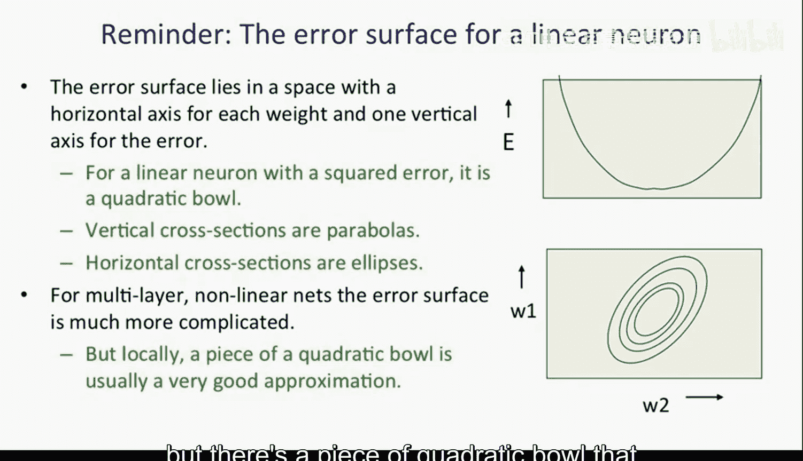
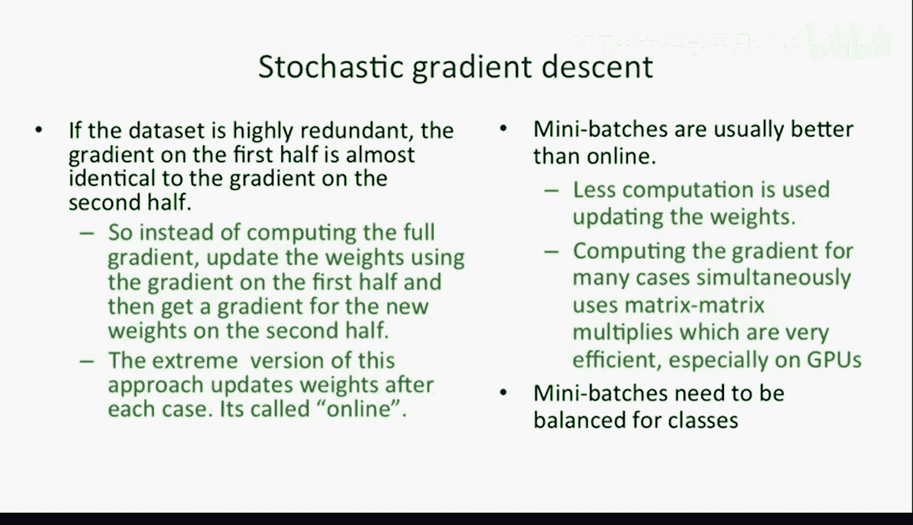
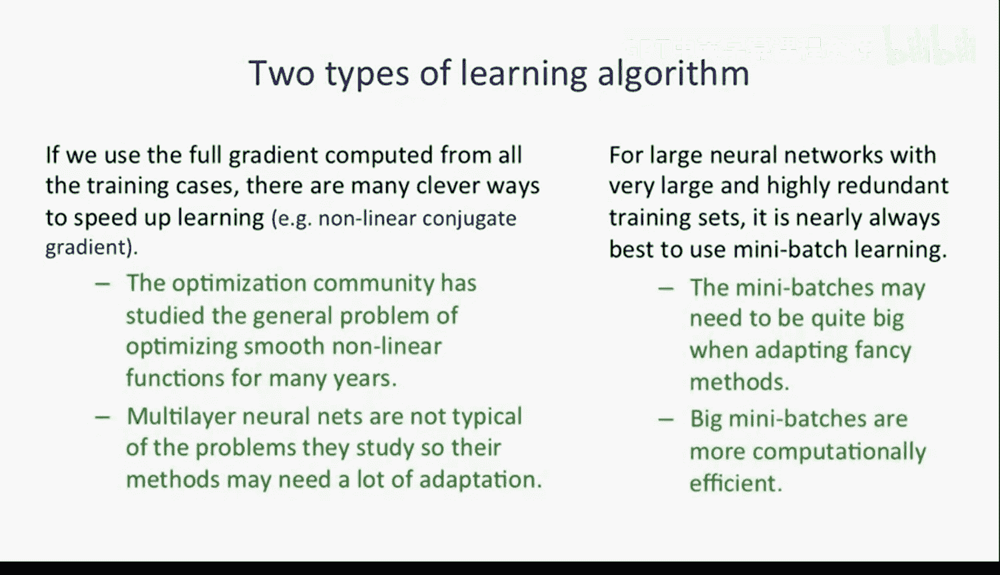
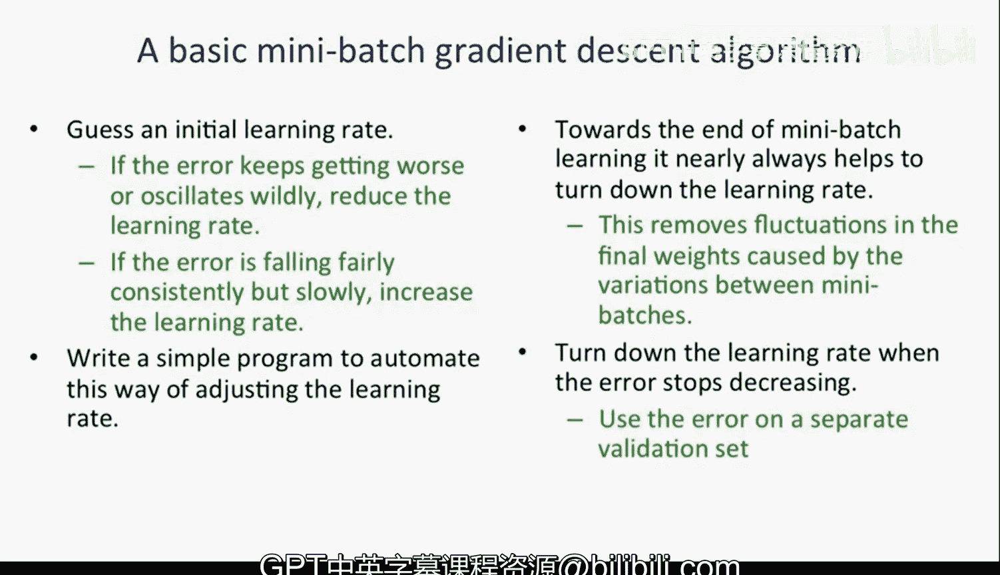

# 神经网络与机器学习：6.1：小批量梯度下降法概述 🧠

在本节课中，我们将学习用于神经网络训练的**小批量随机梯度下降法**。这是目前训练大型神经网络时最广泛使用的学习算法。

## 误差曲面回顾

上一节我们介绍了线性神经元的误差曲面。现在我们来回顾一下其基本形态。

误差曲面存在于一个空间中，其中水平轴对应神经网络的权重，垂直轴对应误差值。对于一个使用平方误差的线性神经元，其误差曲面总是一个**二次碗状**。其垂直截面是抛物线，水平截面是椭圆。

对于多层非线性网络，误差曲面要复杂得多。但只要权重值不是太大，它就是一个平滑的曲面。在局部，它可以很好地用一个二次碗的片段来近似。这个片段可能不是碗的底部，但它能很好地拟合局部误差曲面。

## 收敛速度与问题

上一节我们介绍了误差曲面的形态，本节中我们来看看使用全批量学习时的收敛速度问题。

当误差曲面是一个二次碗时，最直观的做法是沿着最陡峭的下降方向前进。这会减少误差。但问题是，最陡峭的下降方向并不指向我们真正想去的地方。从椭圆截面可以看出，最陡峭的下降方向几乎与我们想去的方向成直角。我们得到的梯度在椭圆短轴方向（我们只想移动一小段距离的方向）上非常大，而在椭圆长轴方向（我们想移动很长距离的方向）上却非常小。这正好是反过来的。

你可能会认为，研究这种线性系统对于优化大型非线性网络没有帮助。但即使对于这些非线性的多层网络，也会出现非常类似的问题。尽管误差曲面在全局上不是二次碗，但在局部，它们具有相同的特性：在某些方向上曲率很大，在其他方向上曲率很小。

如果学习率设置得太大，学习过程就会出现问题。你会在误差曲面曲率很大的方向上来回振荡，我们称之为“在峡谷中晃动”。如果学习率过大，你甚至会发散。

我们想要实现的目标是：在那些梯度小但非常一致的方向上快速前进（沿着峡谷底部），而在那些梯度大但非常不一致的方向上缓慢移动（即，如果你在这个方向上移动一小段距离，梯度就会改变符号）。

## 随机梯度下降的动机

在深入探讨如何实现上述目标之前，我需要先谈谈随机梯度下降及其使用动机。

如果你的数据集高度冗余，那么计算权重在数据集前半部分的梯度，与计算其在数据集后半部分的梯度，得到的答案几乎完全相同。因此，在整个数据集上计算梯度完全是浪费时间。

更好的做法是：在一个数据子集上计算梯度，然后更新权重，接着在剩余数据上使用更新后的权重计算梯度。

我们可以将这种做法推向极致，即每次只在一个训练样本上计算梯度，更新权重，然后使用新权重在下一个训练样本上计算梯度。这被称为**在线学习**。

通常，我们不会走得那么极端。使用**小批量**样本通常更好，典型的小批量大小为10、100甚至1000个样本。

以下是使用小批量的两个主要优势：
*   **计算效率**：与在线学习相比，更新权重的频率更低，因此用于实际更新权重的计算量更少。
*   **并行计算**：计算梯度时，可以并行计算一批样本的梯度。大多数计算机非常擅长进行矩阵乘法运算。这允许你同时考虑一批训练样本，并将权重同时应用于这批样本，以计算下一层所有样本的激活值。这形成了一个矩阵乘法运算，效率非常高，尤其是在图形处理器上。

关于使用小批量，需要注意一点：你不希望一个小批量中的所有样本答案都相同，而下一个小批量中的答案又完全不同。这会导致权重产生不必要的振荡。理想情况下，如果你有10个类别，一个小批量（例如10个或100个样本）中应包含来自每个类别的相同数量的样本。

近似实现这一目标的一种简单方法是：将所有数据随机排序，然后随机抓取小批量。但必须避免小批量样本非常不具有整个数据集代表性的情况，例如一个小批量全部来自同一个类别。

## 算法类型对比

基本上，神经网络的训练算法有两种类型。

一种是**全梯度算法**，即从所有训练样本中计算梯度。一旦计算出梯度，有很多巧妙的方法可以加速学习，例如非线性共轭梯度法。优化领域多年来一直在研究如何优化平滑非线性函数这个一般性问题。然而，多层神经网络与他们研究的问题类型有很大不同。因此，应用他们开发的方法可能需要大量修改才能适用于这些多层网络。

另一种是**小批量学习**。当你拥有高度冗余的大型训练集时，使用小批量学习几乎总是更好。小批量可能需要相当大，但这并不坏，因为大批量在计算上更高效。

## 基础小批量梯度下降算法

现在，我将描述一个基础的小批量梯度下降学习算法。这是大多数人在大型冗余数据集上开始训练大型神经网络时会使用的方法。

以下是算法的基本步骤：
1.  **初始化**：首先猜测一个初始学习率。
2.  **观察与调整**：观察网络是否学习良好，或者误差是否持续变差或剧烈振荡。
    *   如果发生上述情况，**降低**学习率。
    *   同时观察误差是否下降得太慢。如果你在验证集上测量误差，它可能会有些波动，因为每个小批量的梯度只是对整体梯度的粗略估计。因此，你不希望每次误差上升时都降低学习率。但你期望的是误差能相当一致地下降。
    *   如果误差下降得相当一致但非常缓慢，你或许可以**提高**学习率。
3.  **自动化**：一旦算法正常工作，你可以编写一个简单的程序来自动化这种调整学习率的方式。
4.  **学习率衰减**：一个几乎总是有帮助的技巧是：在用小批量学习的后期阶段，**降低学习率**。这是因为小批量带来的梯度波动会导致权重波动。你希望得到一组对许多小批量都表现良好的最终权重。因此，当你降低学习率时，你是在平滑这些波动，从而得到一组适用于多个小批量的最终权重。
5.  **衰减时机**：降低学习率的一个好时机是当误差停止持续下降时。判断误差是否停止下降的一个好标准是使用一个独立的**验证集**上的误差。验证集是一组你不用于训练，也不会用于最终测试的样本。

## 总结

本节课中，我们一起学习了**小批量随机梯度下降法**。我们回顾了神经网络的误差曲面特性，分析了全批量梯度下降在收敛速度上的问题，从而引出了使用随机梯度下降的动机。我们对比了全梯度算法与小批量学习，并详细介绍了基础的小批量梯度下降算法的步骤，包括学习率的初始化、观察调整、自动化以及后期的学习率衰减策略。这是训练大型神经网络最核心、最实用的基础算法之一。