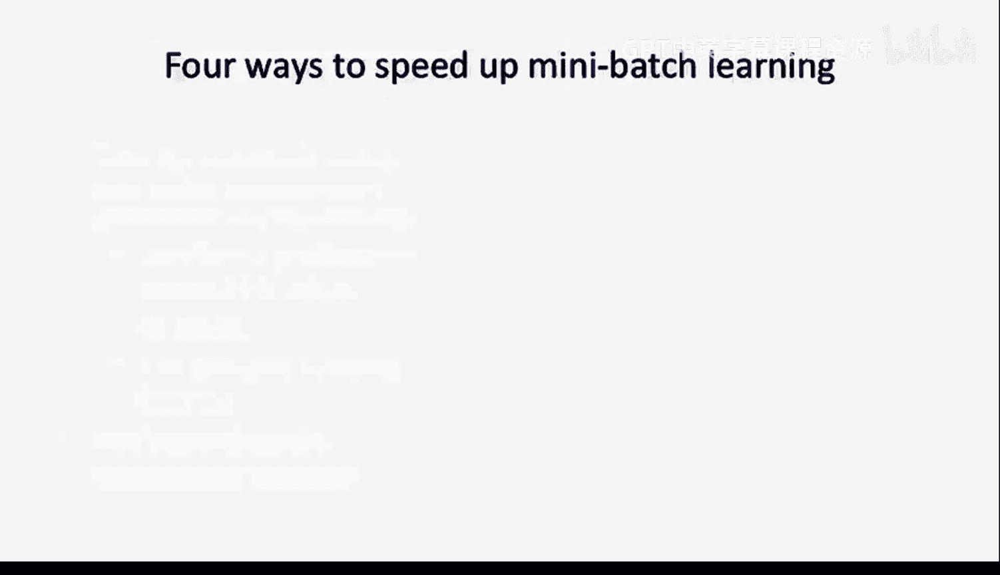
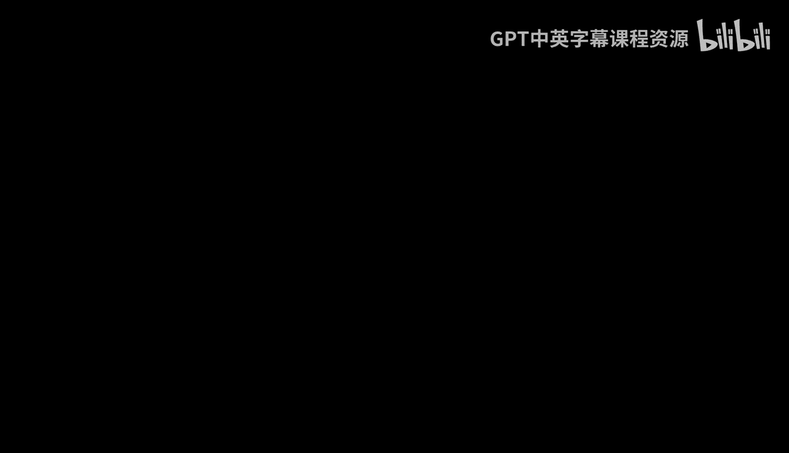
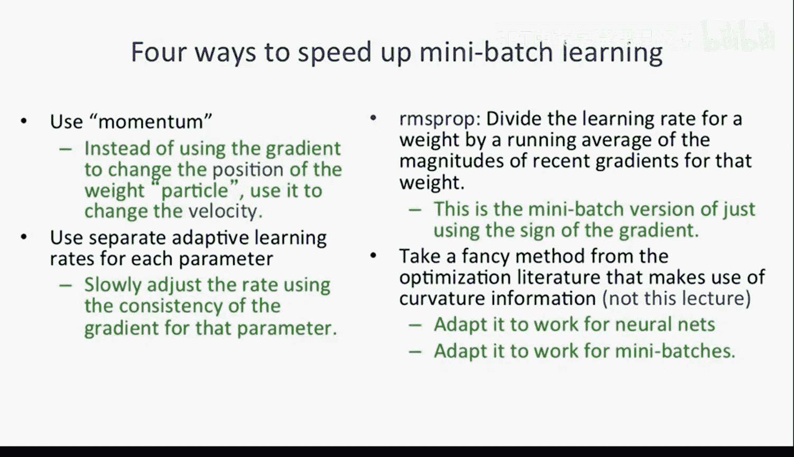

# Hinton@多伦多大学《机器学习的神经网络｜Neural Networks for Machine Learning 2016》claude-4s p26 -26-Lecture 6.2 — A bag of tricks for mini batch gradient descent -Neural Networ -BV1HtkUB2EZD_p26-

In this video， we're going to look at a number of issues that arise when using stochastic gradient descent with mini batches。

There's a large number of tricks that make things work much better。

 these are the kind of black art of neural networks and I'm going to go over some of the main tricks in this video。

The first issue I want to talk about is initializing the weights of a neural network。

If two hidden units have exactly the same weights and same biases， both incoming and outgoing。

Then they can never become different from one another because they will always get exactly the same gradient。

So to allow them to learn different feature detectors。

 you need to start them off different from one another。

We do this by using small random weights to initialize the weights that breaks the symmetry。

Those small random weights shouldn't all necessarily be the same size as each other。

So if you've got a hidden unit that has a very big fan in， if you use quite big weights。

 it'll tend to saturate it。So you can afford to use much smaller weights for a hidden unit that has a very big fan。

If you have a hidden unit with a very small fanning， you want to use bigger weights。

And since the weights are random， it scales with the square root of the number of the weights。

And so a good principle is to make the size of the initial weights be proportional to the square root of the family。

We can also scale the learning rates for the weights the same way。

One thing that has a surprisingly big effect on the speed with which a neural network will learn。

Is shifting the inputs that is adding a constant to each of the components of the input。

It seemed surprising that that could make much difference。But when you're using steepest descent。

 shifting an input value by adding a constant can make a very big difference。

It usually helps to shift each component of the input so that averaged over all of the training data。

 it has a value of 0。That is， make sure its mean is 0。

So suppose we have a little neural net like this， just a linear neuron with two weights。

And suppose we have some training cases。 The first training case says when the inputs are 101 and 101。

 it should give an output of2。And the second one says when there are 101 and 99。

 it should give night blood 0。And I'm using color here to indicate which training case I'm talking about。

If you look at the error surface， you get for those two training cases。It looks like this。

The green line is the line along which the weights will satisfy the first training case。

And the red line is the line along which the weights will satisfy the second training case。

And what we notice is that they're almost parallel。 And so when you combine them。

You get very elongated admit。One way to think about what's going on here is that because we're using a squared error measure。

We get a parabolic trough along the red line。 The red line is the bottom of this parabolic trough that tells us the squared arrow we'll be getting on the red case。

And there's another parabolic trough with the greenland along its bottom。And it turns out。

 although this may surprise your spatial intuition， if you add together two parabolic troughs。

You get a quadratic bowl， an elongated quadratic bowl in this case。

So that's where that errorero surface came from。Now， look what happens if we subtract 100。

From each of those two input components。We get a completely different error surface。

It's in this case， it's a circle， it's ideal。The green line is the line along which the weights add to two。

We're going to take the first way to multiply it by one。

 We're going to take the second way to multiply it by one， and we need to get2。

 So the weights better add to 2。The red line is the line along which the two weights are equal。

Because we're going to take the first way to multiply it by one。

 and we're going to take the second way to multiply by -1。 So if the weights are equal。

 we'll be able to get that 0 that we need。So the error surface in this case is a nice circle where gradient descent is really easy。

 and all we did was subtract 100 from every input。If you're thinking about what happens。

 not with the inputs， but with the hidden units。It makes sense to have hidden units that are hyperbolic tangents that go between minus one and1。

The hyperbolic tangent is simply twice the logistic -1。

And the reason that makes sense is because then the activities of the hidden units are roughly mean zero。

 and that should make the learning faster in the next layer。Of course， that's only true。

If the inputs to the hyperbolic tangents are distributed sensibly around  zero。But in that respect。

 a hyperbolic tangent is better than an logisticistic。However。

 there's other respects in which your logistics better。For example。

 a logistic gives you a rug to sweep things under。It gives an output of0。

 And if you make its input even smaller than it was， the output still0。

So fluctuations in big negative inputs are ignored by the logistic。For the hyperbolic tangent。

 you have to go out to the end of its plateaus before it can ignore anything。

Another thing that makes a big difference is scaling the inputs。When we're using steepest descent。

 scaling the input values is a very simple thing to do。

We transform them so that each component of the input has unit variance over the whole training set。

So it has a typical value of1 or -1。So again， if we take this simple net with two weights。

And we look at the error surface when the first component is very small and the second component is much bigger。

We get an error surface in which we get an ellipse that's got very high curvature where the input components is big。

 because small changes in the weight make a big difference to the output。

And very low curvature in the direction which the input component is small。

Because small changes to the weight hardly make any difference to the error。

The colour here is indicating which axis we're using， not which training example we're using。

 as it did in the previous slide。If we simply change the variance of the inputs， just rescale them。

 make the first component 10 times as big and the second component 10 times is small。

We now get a nice， circular airero surface。Shifting and scaling the inputs is a very simple thing to do。

There's something that's a bit more complicated that actually works even better because it is guaranteed to give you a circle。

A circular error surface。At least it is for a linear urine。

What we do is we try and derelate the components of the input vectors。And other words。

 if you take two components and look at how they're correlated with one another over the whole training set。

Like， if you remember the early example， how the number of portions of chips and the number of portions of ketchup might be highly correlated。

 We want to try and get rid of those correlations that will make learning much easier。

There's actually many ways to decorrelate things。For those of you who know about principal components analysis。

A very sensible thing to do is apply principle components analysis。

Remove the components that have the smallest itemigenvalue。

 which already achieves some dimensionality reduction。

And then scale the remaining components by dividing them by the square roots of American valuesius。

For a linear system， that will give you a circular error surface。

If you don't know about principal components， we'll cover it later in the course。

Once you've got a circular error surface， the gradient points straight towards the minimum。

 so learning is really easy。Now， I want to talk about a few of the common problems that people encounter。

One thing that can happen is if you start with a learning rate that's much too big。

 you drive the hidden units。Either to be firmly on or firmly off。That is。

 their incoming weights are very big and positive or very big and negative。

And their state no longer depends on the input。And of course。

 that means that error derivatives coming from the output won't affect them because they're on their plateaus where the derivative is basically zero。

And so， learning will stop。Because people are expecting to see local minima when learning stops。

 they say， oh， I'm at a local minimum， and the air is terrible。

So there are these really bad local minima。Usually that's not true。

 Usually it's because you got stuck out on the end of a plateau。

A second problem that occurs is if you're classifying things and you're using either a squared error or a cross entropy error。

 the best guessing strategy is normally to make the output unit。

Equal to the proportion of the time that it should be one。

The network will fairly quickly find that strategy。And so thearrow will fall quickly。

But particularly if the network has many layers， it may take a long time before it improves much on that。

 because to improve over the guessing strategy， it has to get sensible information from the input through all the hidden layers to the output。

And that could take a long time to learn if you start with small weights。So again。

 you learn quickly and then the error stops decreasing。And it looks like a local minimum。

 but actually it's another platter。I mentioned earlier that towards the end of learning。

 you should turn down the learning rate。You should also be careful about turning down the learning rate too soon。

When you turn down the learning rate。You reduce the random fluctuations in the area due to the different gradients on different mini batches。

But of course you also reduce the rate of learning。So if you look at the red curve。

You see that when we turn the learning rate down， we got a quick win， the afo。But after that。

 we get slower learning。And if we do that too soon， we're going to lose relative to the green curve。

So don't turn down the load rate too soon or too much。I'm now gonna talk about four main ways。

To speed up mini batch learning a lot。The previous things I talked about were kind of a bag of tricks making things work better。

And these are four methods all explicitly designed to make the learning go much faster。

I'm now going to talk about a method called momentum。In this method。

We don't use the gradient to change the position of the weights。That is。

 if you think of the weights as a ball on the errors surface。Standard gradient descent。

Uses the gradient to change the position of that ball。

You simply multiply the gradient by a learning rate and change the position of the ball by that vector。

In the momentum method， we use the gradient to accelerate this ball。That is。

 the gradient changes its velocity。And then the velocity is what changes the position of the ball。

The reason that's different is because the ball can have momentum。That is。

 it remembers previous gradients in its velocity。A second method for speeding up mini batch learning is to use a separate adaptive learning rate for each parameter。

 and then to slowly adjust that learning rate based on empirical measurements。

And the obvious empirical measurement is， are we keeping making progress by changing the weights in the same direction。

Or does the gradient keep oscillating around so that the sign of the gradient keeps changing。

If the sign of the gradient keeps changing， what we're going to do is reduce the learning rate and if it keeps staying the same。

 we're going to increase the learning rate。A third method。Is what I now call R M S P。

 And what we do in this method is we divide by a running average of the magnitudes of the recent gradients for that weight。

So that if the gradients are big， you divide by a large number and if the gradients are small and you divide by a small number。

That will deal very nicely with a wide range of different gradients。

It's actually a mini batch version of just using the sign of the gradient。

Which is a method called Rrop that was designed for tool batch learning。

The final way of speeding up learning。Which is what optimization people would naturally recommend。

Is to use full batch learning and to use a fancy method that takes curvature information into account。

To adapt that method to work for neural nets， and then maybe to try and adapt it some more。

 So it works with mini batches。I'm not going to talk about that in this lecture。

