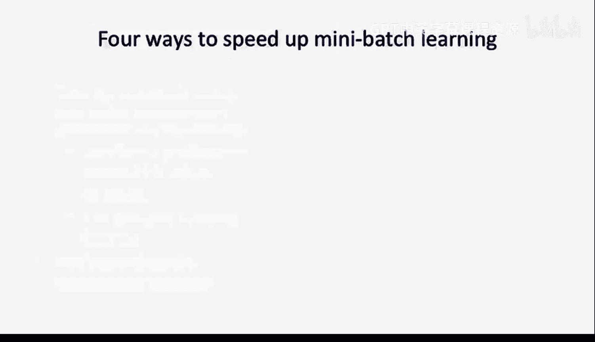
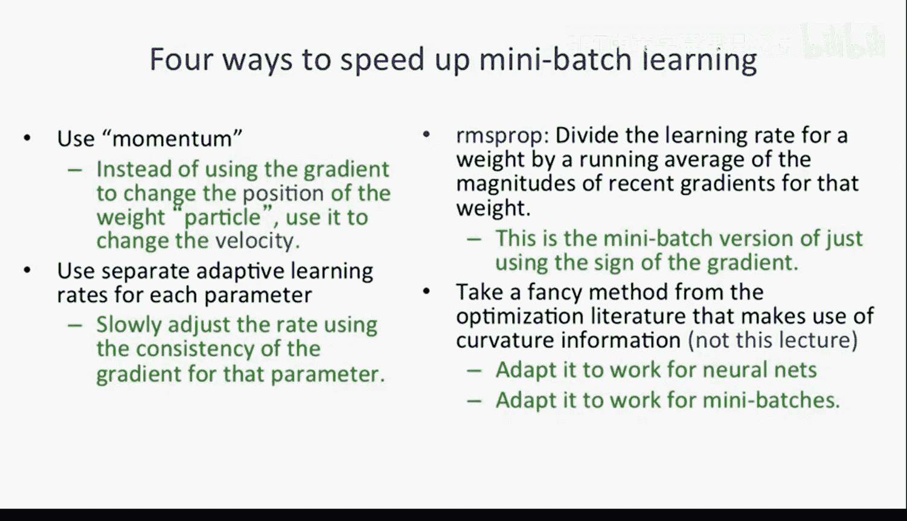

# 神经网络与机器学习：6.2：小批量梯度下降的实用技巧 🧠

在本节课中，我们将学习使用小批量随机梯度下降法时可能遇到的一系列问题，并介绍一系列能显著提升训练效果的实用技巧。这些技巧常被视为神经网络的“黑魔法”，掌握它们对于高效训练模型至关重要。

## 权重初始化

上一节我们介绍了梯度下降的基本概念，本节中我们来看看如何正确初始化神经网络的权重。如果两个隐藏单元拥有完全相同的权重和偏置（包括输入和输出），那么它们将永远无法变得不同，因为它们总是会获得完全相同的梯度。为了让它们学习到不同的特征检测器，我们需要让它们的初始状态彼此不同。

我们通过使用**小的随机权重**来初始化，以此打破对称性。这些小的随机权重的大小并不需要完全相同。以下是初始化权重的关键原则：

*   **根据“扇入”调整权重大小**：如果一个隐藏单元的输入连接（扇入）非常多，使用较大的权重会容易使其饱和。因此，对于扇入很大的单元，应使用更小的权重。反之，对于扇入很小的单元，可以使用稍大的权重。
*   **一个良好的经验法则是**：初始权重的标准差应与扇入数量的平方根成反比。公式表示为：`std = 1 / sqrt(fan_in)`。
*   **学习率的调整**：我们也可以按照同样的方式，为不同权重的学习率进行缩放。

## 输入数据的预处理

一个对神经网络学习速度有显著影响的因素是**输入数据的平移**，即给输入的每个分量加上一个常数。这看似简单，但在使用最速下降法时，平移输入值能带来巨大差异。

通常，将每个输入分量的均值调整为0会很有帮助。也就是说，确保在整个训练集上，每个输入特征的均值为0。

为了理解其原理，我们来看一个简单的线性神经元例子。假设我们有一个包含两个权重的线性网络，以及两个训练样本。如果不对输入做处理，误差曲面会是一个被拉得很长的椭圆形，导致梯度下降非常困难。然而，如果我们简单地将每个输入减去100（即中心化处理），误差曲面就会变成一个理想的圆形，梯度下降变得非常高效。

### 隐藏层的激活函数

考虑到隐藏单元，使用输出范围在-1到1之间的**双曲正切函数**（`tanh`）是有意义的。`tanh`函数实际上是`2 * logistic - 1`。使用它的原因在于，隐藏单元的活动值大致是零均值的，这应该能使下一层的训练更快。当然，这只有在输入到`tanh`的值合理地分布在零附近时才成立。

不过，逻辑斯蒂函数（`logistic`）也有其优势。例如，它能“掩盖”很大的负向输入波动，因为当输入很小时，其输出稳定在0。而对于`tanh`，你需要到达其饱和区的末端才能忽略输入。

### 输入数据的缩放

另一个重要技巧是**缩放输入值**。在使用最速下降法时，缩放输入是一个简单的操作。

我们通过变换数据，使得每个输入分量在整个训练集上具有**单位方差**（即典型值为1或-1）。继续之前的例子，如果第一个输入分量很小而第二个很大，误差曲面会是一个高曲率（对应大输入分量）和低曲率（对应小输入分量）的椭圆，不利于学习。通过简单地重新缩放输入，使两个分量方差相同，我们就能得到一个圆形的误差曲面，学习变得容易。

### 输入数据的去相关

比平移和缩放更复杂但效果更好的方法是**去除输入向量各分量之间的相关性**。换句话说，我们希望消除像“薯条份数”和“番茄酱份数”之间那种高度相关的关系，这会使学习变得容易得多。

有多种方法可以实现去相关。对于了解主成分分析（PCA）的人来说，一个非常合理的方法是应用PCA：移除特征值最小的成分（这本身也实现了降维），然后用特征值的平方根来缩放剩余的成分。对于一个线性系统，这将保证你得到一个圆形的误差曲面。如果你不了解PCA，我们将在课程后续部分进行讲解。

一旦你得到了一个圆形的误差曲面，梯度就直接指向最小值，学习将变得非常容易。

## 常见问题与陷阱

现在，我想谈谈人们常遇到的几个问题。

*   **学习率过大**：如果你使用的初始学习率过大，可能会将隐藏单元驱动到完全饱和（“开”或“关”）的状态。此时，其状态不再依赖于输入，来自输出的误差导数也无法影响它们（因为处于导数基本为零的饱和区），学习会停止。人们常误以为遇到了糟糕的局部最小值，但实际上通常是卡在了平坦的饱和区上。
*   **分类任务中的“猜测策略”平台期**：在分类任务中，如果使用平方误差或交叉熵误差，网络很快会学会一个最优的“猜测策略”——将输出设置为目标为1的比例。误差会快速下降。但随后，特别是对于深层网络，可能需要很长时间才能利用输入信息改进这个策略，因为信息需要穿过所有隐藏层。这看起来也像一个局部最小值，但实际上是一个学习平台期。
*   **过早降低学习率**：我之前提到，在训练后期应该降低学习率。但也要注意不要降得太早或太多。降低学习率可以减少由于不同小批量梯度差异引起的误差随机波动，但同时也降低了学习速度。如果降得太早，总体学习效率可能反而会降低。

## 加速小批量学习的四种主要方法

前面讨论的是一系列让训练更好工作的技巧。现在我将介绍四种专门设计来**显著加速学习**的方法。

### 1. 动量法

在标准梯度下降中，我们直接用梯度乘以学习率来更新权重（想象成在误差曲面上移动一个球）。在**动量法**中，我们使用梯度来**加速**这个球。梯度改变的是球的速度，然后速度再改变球的位置。这样做的不同之处在于，球具有了“动量”，即它的速度记住了之前的梯度信息，有助于平滑更新并加速穿过平缓的沟壑。

### 2. 自适应学习率

第二种方法是**为每个参数使用独立的自适应学习率**，并根据经验测量缓慢调整这个学习率。一个直观的测量是：观察梯度方向是否保持一致。如果梯度的符号不断变化（振荡），我们就降低该参数的学习率；如果梯度的符号保持一致，我们就增加其学习率。

### 3. RMSProp

第三种方法是**RMSProp**。在这种方法中，我们用该权重**近期梯度大小的滑动平均值**来除当前梯度。这样，如果梯度大，就除以一个大数；如果梯度小，就除以一个小数。这能很好地处理梯度大小变化范围很大的情况。它本质上是“仅使用梯度符号”方法的小批量版本，而后者是一种称为Rprop的、为全批量学习设计的方法。

### 4. 利用曲率信息的二阶优化方法

最后一种加速学习的方法是使用**全批量学习**，并采用**考虑曲率信息的二阶优化方法**（如牛顿法、共轭梯度法或拟牛顿法）。优化领域的研究者通常会推荐这种方法。为了使其适用于神经网络，并可能进一步适配小批量学习，需要进行一些调整。不过，这不在本讲座的讨论范围之内。

---

**本节课总结**：在本节课中，我们一起学习了优化小批量梯度下降的一系列关键技巧。我们从**权重初始化**的原理开始，强调了打破对称性的重要性。接着深入探讨了**数据预处理**的三大支柱：中心化（平移）、缩放（归一化方差）和去相关（如PCA），它们能从根本上改善误差曲面的形状，使学习更高效。然后，我们分析了训练中常见的**问题与陷阱**，如学习率不当导致的饱和和平台期。最后，我们介绍了四种**高级优化方法**：动量法、自适应学习率、RMSProp和二阶优化方法，它们能显著加速神经网络的训练过程。掌握这些“黑魔法”是成功训练现代神经网络的重要基础。