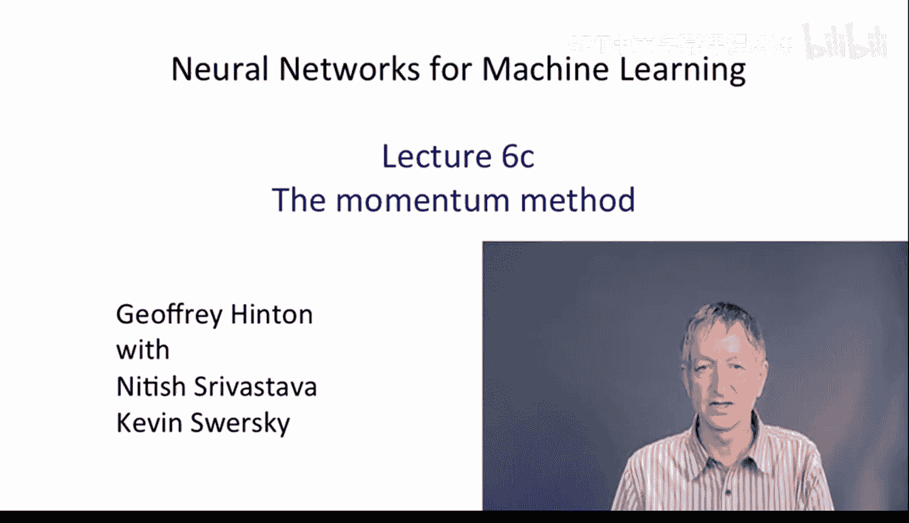
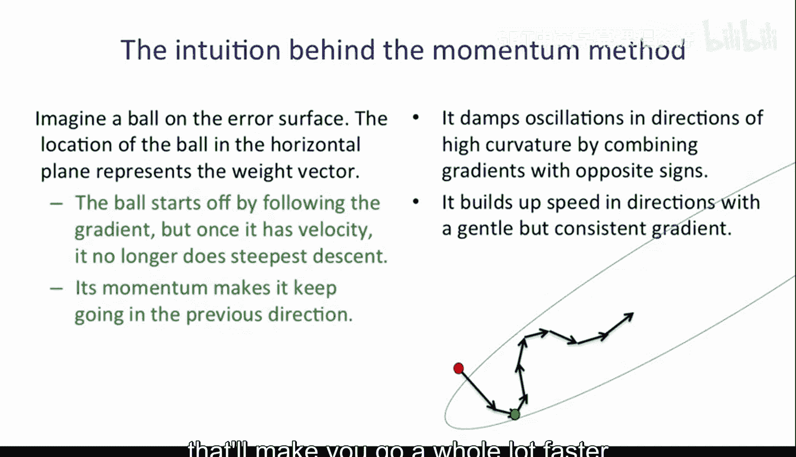
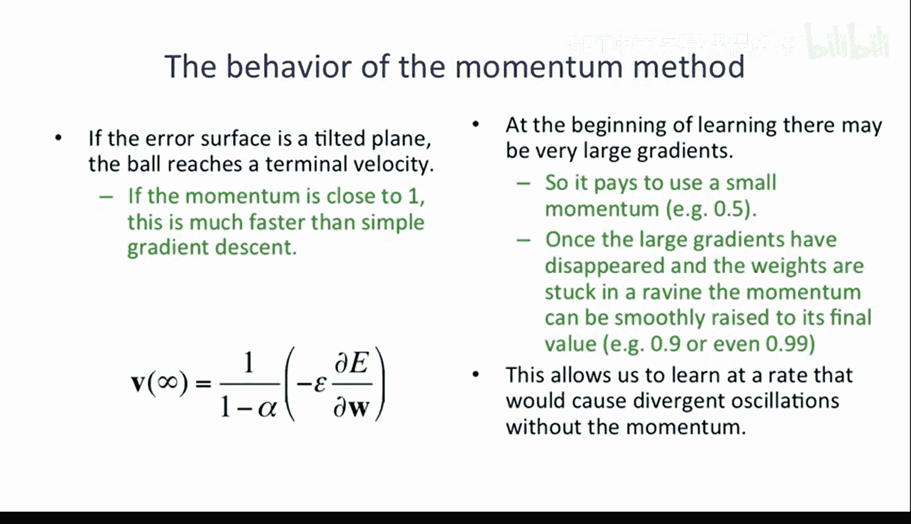
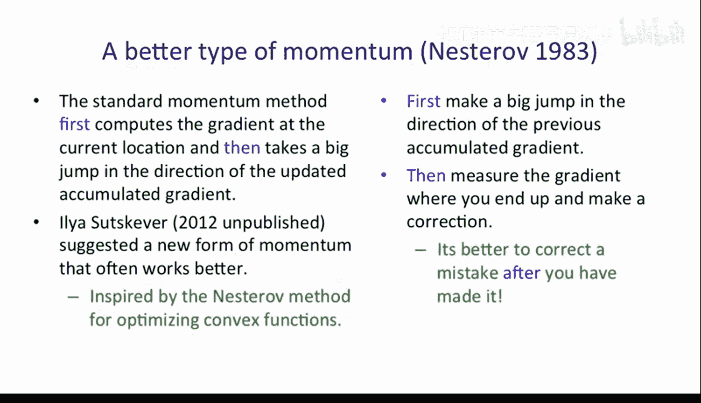
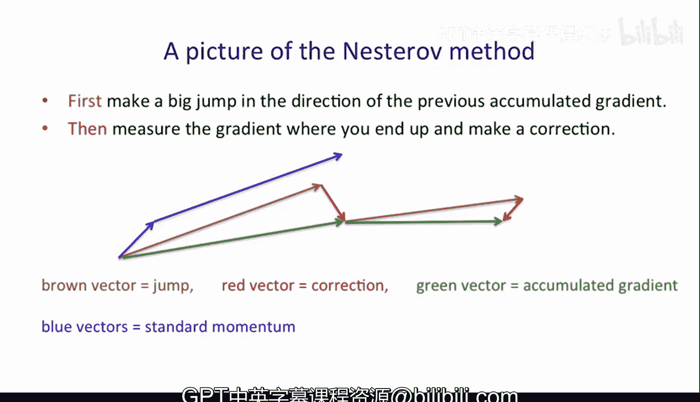

# Hinton@多伦多大学《机器学习的神经网络｜Neural Networks for Machine Learning 2016》claude-4s p27 -27-Lecture 6.3 — The momentum method  -Neural Networks for Machine Learning-.zh -BV1HtkUB2EZD_p27-

In this video， we're going to look at the momentum method for improving the learning speed when doing gradient descent in a neural network。

The momentum method can be applied to full batch learning。

But it also works for mini bachelor learning。It's very widely used。

 and probably the commonest recipe for learning big neural nets is to use。

Sttochastic gradient descent with mini batches， combined with momentum。

I'm going to start with the intuition behind the momentum method。

So we think of a ball on the air surface。Where the location of the ball in the horizontal plane represents the current weight vector。

The ball starts offstationary， and so initially， it will follow the direction as steep as descent。

 It will follow the gradient。But as soon as it's got some velocity。

It'll no longer go in the same direction as the gradient。

Its momentum will make it keep going in the previous direction。Obviously。

 we wanted eventually to get to a low point on the surface， so we wanted to lose energy。

 So we need to introduce a bit of viscosity。 That is。

 we make its velocity die off gently on each or update。

What the momentum method does is it damps oscillations in directions of high curvature。

So if you look at the red starting point and then look at the green point we get to after two steps。

They have gradients that are pretty much equal and opposite。As a result。

 the gradient across the ravine has cancelled out。But the gradient along the ravine has not cancelled out。

A long ravine。We're going to keep building up speed。 And so after the mental methods settled down。

It'll tend to go along the bottom of the ravine， accumulating velocity as it goes。

 And if you're lucky， that'll make you go a whole lot faster than if you just his steepest descent。

The equations of the mental method are fairly simple。We say that the velocity vector at times T。

Is just the velocity vector at time t minus1。Time here is the updates of the weights。

So it's the velocity vector that we got after mini batch t -1 attenuated a bit。

 So we multiply by some number like 0。9。Which is really viscosity。Or it's related to viscosity。

 but unfortunately I called it momentum， so we now call alpha momentum。

And then we add in the effect of the current gradient。

Which is to make us go downhill by some learning rate times the gradient that we have at time T。

And that'll be our new velocity at time T。We then make our weight change at time T equal to velocity。

That velocity can actually be expressed in terms of previous weight changes。

As is shown on the slide here。And I'll leave it to you to follow the math。

The behaviour of the momentum method is very intuitive。On an air surface， it's just a plane。

The ball will reach some terminal velocity。Of which the gain in velocity that comes from the gradient is balanced by the multiplicative attenuation of velocity due to the momentum term。

 which is really viscosity。If that momentum term is close to one。

Then it'll be going down much faster than a simple gradient descent method would。

So the terminal velocity， the philosophy you get at time infinity。

Is the gradient times the learning rate。Multiply by this factor of 1 over1 minus alpha。So if Al is 0。

99， you'll go100 times as fast as you would with the learning rate alone。

You have to be careful in setting momentum at the very beginning of learning。

 If you make the initial random weights quite big， there may be very large gradients。

You have a bunch of weights that's completely no good for the task you're doing。

And it may be very obvious how to change these weights to make things a lot better。

You don't want a big momentum。Because you're going to quickly change them to make things better。

 And then you're going to start on the hard problem of finding out how to get just the right relative values of different weights。

 So you have sensible feature detectors。So it pays at the beginning of learning to have a small momentum。

It's probably better to have 0。5 than 0 because 0。5 will average out some sloes in obvious ravines。

Once the large gradients have disappeared。And you've reached the sort of normal phase of learning where you're stuck in a ravine and you need to go along the bottom of this ravine without sloshing to and fro sideways。

You can smoothly raise the momentum。To its final value。Or you could raise it in one step。

 but that might start an oscillation。You might think that。

 why don't we just use a bigger learning route？What you'll discover is that using a small learning rate and a big momentum。

Allows you to get away with an overall learning rate that's much bigger than you could have had if you use learning rate alone with no momentum。

If you use a big learning rate by itself， you'll get big divergent osinations across the ravine。

Very recently。India said Sva。Has discovered that there's a better type of momentum。

The standard momentum method。Works by first computing the gradient at the current location。

It combines that with its stored memory of previous gradients， which is in the velocity of the ball。

😊，And then it takes a big jump in the direction of the current gradient combined with previous gradients。

 so that's its accumulate cumulative gradient direction。

Iius Zkyva has found that it works better in many cases to use a form of momentum suggested by Nestorrov。

 who was trying to optimize convex functions。Where we first make a big jump in the direction of the previous accumulated gradient。

And then we measure the gradient where we end up and make a correction。It's very， very similar。

 and you need a picture to really understand the difference。

One way of thinking about what's going on is in the standard momentum method。

 you add in the current gradient。And then you gamble on this big jump。In the Nesov method。

 you use your previous accumulated gradient， you make the big jump。

 and then you correct yourself at the place you've got to。

So here's the picture when we first make the jump and then make a correction。Here's a step。

In the direction of the accumulated gradient。So this depends on the gradient we'd accumulated on our previous iteration。

We take that step。We then measure the gradient。And go downhill in the direction of the gradient。

Like that。We then combine。That little correction step with the big jump we made。

To get our new accumulated gradient。We then take our accumulated gradient。

 We attenuate it by some number， like 0。9 or 。99。Multiply by that number。

And we now take our next big jump in the direction of that accumulated gradient like that。Then again。

 at the place where we end up， we measure the gradient。And we go downhill。

That corrects any errors we made， and we get our new accumulated gradient。Now。

 if you compare that with the standard momentum method。

The standard momentum method starts with an accumulated gradient that's like that initial brown vector。

But then it measures the gradient where it is。So it measures the gradient at its current location。

And it adds that to the br vector。So that it makes a jump like this big blue vector。

That's just the br vector plus the current gradient。It turns out， if you're going to gamble。

It's much better。To gamble and then make a correction。Than to make a correction and then gamble。

